# Selvara

**A governance, risk and compliance (GRC) platform for regulated organisations.** One control set, mapped to every framework you answer to, with the evidence, approvals and audit trail that auditors and regulators expect.

[](https://github.com/ShahidCS/Selvara/actions/workflows/security.yml)
[](https://github.com/ShahidCS/Selvara/actions/workflows/deploy-staging.yml)
-lightgrey)


> **Status: v0.3.1 released (24 Nov 2026); production setup and review pending.** Every module runs on the server (Next.js API routes on Supabase Postgres with row level security per company, Supabase Auth with MFA). The same app also builds as a demonstration on synthetic in-browser data, deployed as a preview from the `staging` branch. Before relying on it in production: the owner setup in [docs/guides/SUPABASE.md](docs/guides/SUPABASE.md) and the security, compliance and management review. See [Project status](#project-status).

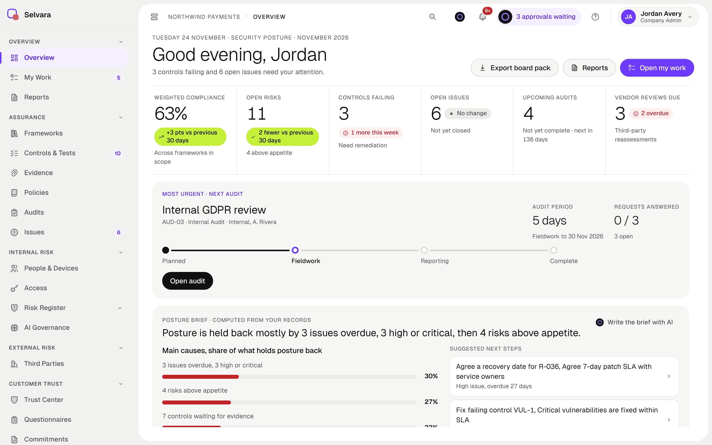

---

## Table of contents

- [Overview](#overview)
- [Who it is for](#who-it-is-for)
- [Screenshots](#screenshots)
- [Key features](#key-features)
- [Standards, regulations and frameworks covered](#standards-regulations-and-frameworks-covered)
- [Security and segregation of duties](#security-and-segregation-of-duties)
- [Roles and access model](#roles-and-access-model)
- [Screens at a glance](#screens-at-a-glance)
- [Tech stack](#tech-stack)
- [Getting started](#getting-started)
- [Configuration](#configuration)
- [Testing and CI](#testing-and-ci)
- [CI/CD pipeline](#cicd-pipeline)
- [Repository layout](#repository-layout)
- [Documentation](#documentation)
- [Project status](#project-status)
- [Roadmap](#roadmap)
- [Maintainers](#maintainers)
- [Contributing](#contributing)
- [Security reporting](#security-reporting)
- [Licence](#licence)

## Overview

Compliance work usually lives in spreadsheets, shared drives and email. Controls are tracked in one place, evidence in another, risks in a third, and the approval history is whatever people remember. Selvara brings that into a single workspace:

- **One control library, many frameworks.** Each control is mapped to the requirements of the standards and regulations in scope, so a single piece of evidence supports several frameworks at once.
- **Readiness you can defend.** Framework readiness is computed requirement by requirement from the status of the mapped controls, not typed in by hand.
- **Decisions with accountability.** Risk acceptance, policy approval, access grants, MFA resets and similar actions follow four-eyes rules: the person who asks can never be the person who approves, and every step is logged.
- **Built for external parties too.** Auditors get a read-only engagement view, vendors answer assessments in an isolated portal, and customers see a managed Trust Center.

The product is one Next.js application: the web front-end and its server API (`front-end/src/server`, on Supabase Postgres and Supabase Auth). The same front-end also builds as a self-contained demonstration on synthetic data.

## Who it is for

| Audience | What they do in Selvara |
|---|---|
| **CISOs and security leaders** | Track posture and framework readiness, take risk decisions, export board packs |
| **Compliance, GRC and risk teams** | Maintain the control library, framework mappings, risk register and policy lifecycle |
| **Control, policy and risk owners** | Attest controls, upload evidence, own policies and risks, work their task list |
| **Internal audit and external auditors** | Run engagements, request and review evidence, raise findings (read-only on the organisation's records) |
| **Procurement and third-party risk** | Assess vendors, track certificates and review cycles, run questionnaires |
| **Employees** | Read published policies and acknowledge them, manage account security |
| **Platform operators (SaaS provider)** | Onboard customers, manage billing and rates, reset MFA under dual control |
| **Vendors and customers (external)** | Complete a security assessment; browse a Trust Center |

It is designed with **regulated sectors in mind** (banks and financial institutions, critical-infrastructure operators and similar), where segregation of duties and defensible audit trails are mandatory rather than nice to have.

## Screenshots

All screenshots use synthetic data (v0.3.1, 24 Nov 2026). The workspace screens are from the demonstration build. The sign-in, account security and company admin screens are from the **production build** (`API_MODE=http`: real server API, no demo accounts), run with synthetic people.

### Workspace

| | |
|---|---|
|  **Frameworks:** 25 catalogue entries with readiness per framework, region and scope | 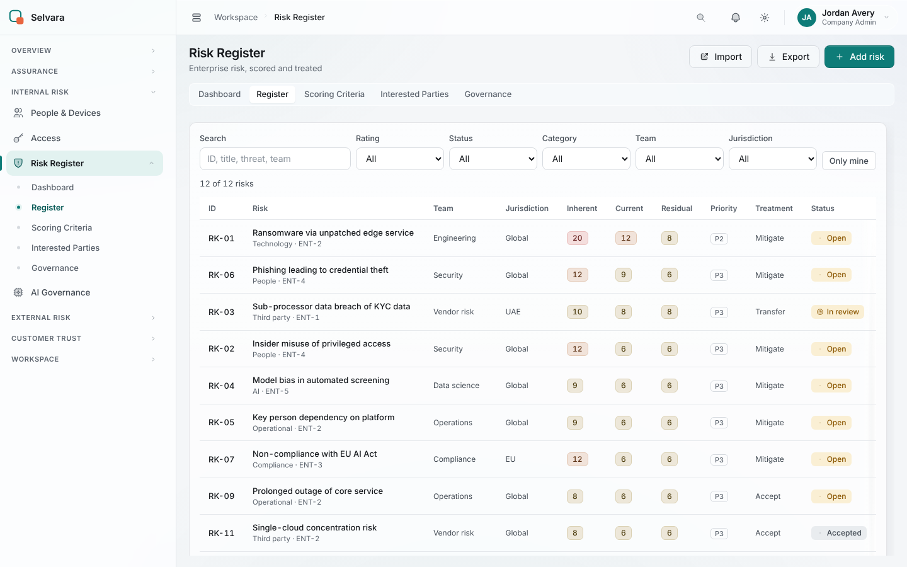 **Risk register:** current and residual exposure, heat map, approvals and governance views |
|  **Audits:** engagements by stage, open findings and outstanding evidence requests | 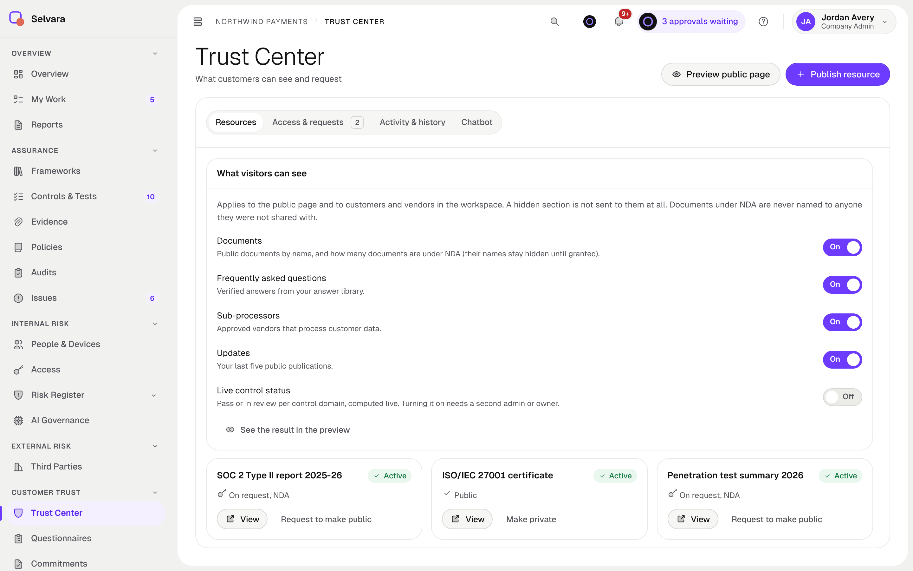 **Trust Center:** what visitors can see, resources on request or public, access requests |
| 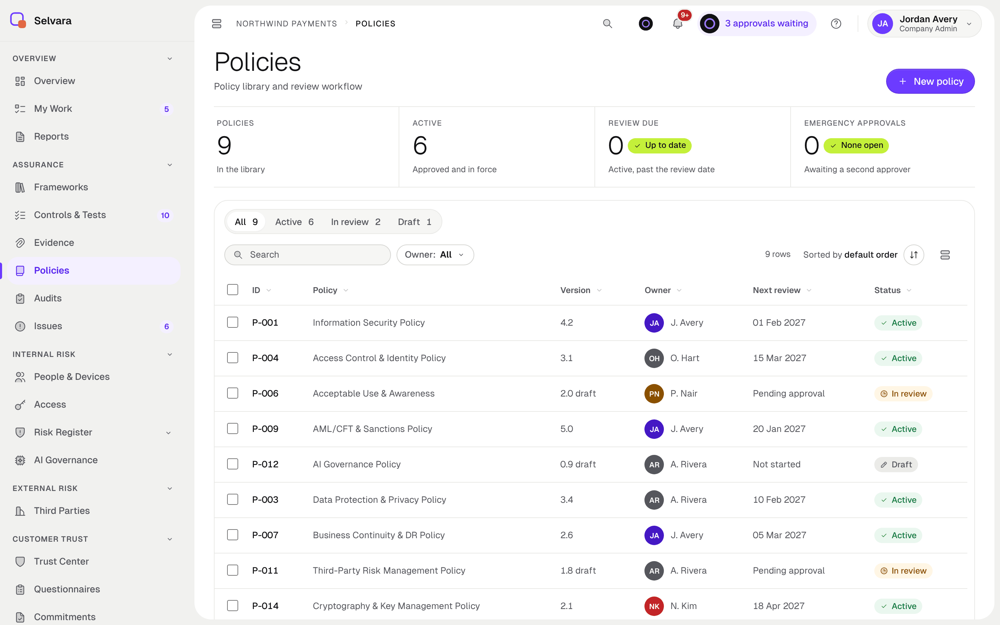 **Policies:** library and review workflow with versions, owners and review dates | 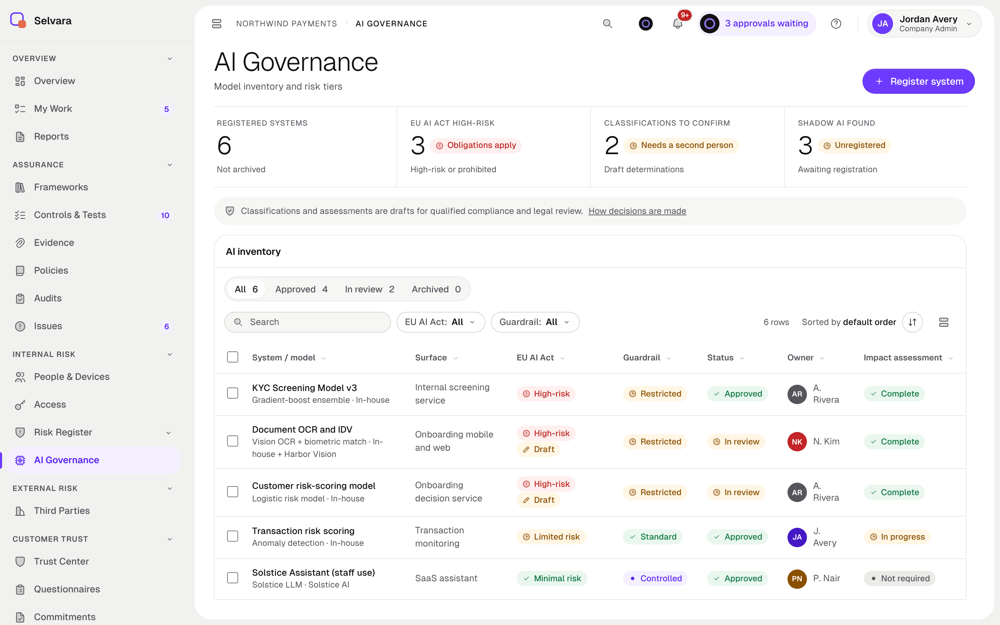 **AI governance:** model inventory with EU AI Act classification, guardrails and impact assessments |
| 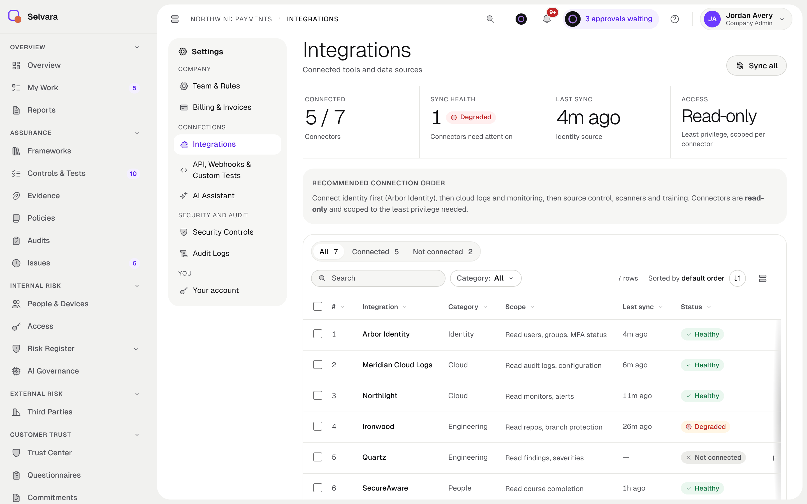 **Settings:** one place for company settings, connections, security and your account | 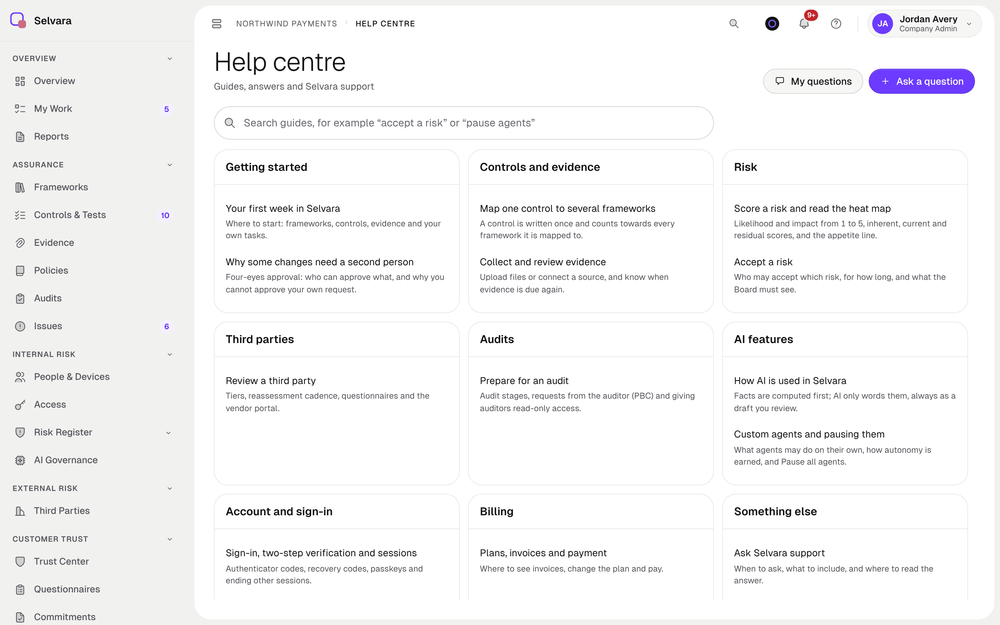 **Help centre:** searchable guides, and questions to Selvara support |
|  **External vendor assessment portal:** standalone, verified entry with email, code and a second factor |  **Dark theme** (light, dark and auto are supported) |

### Sign-in and account security (production build)

| | |
|---|---|
| 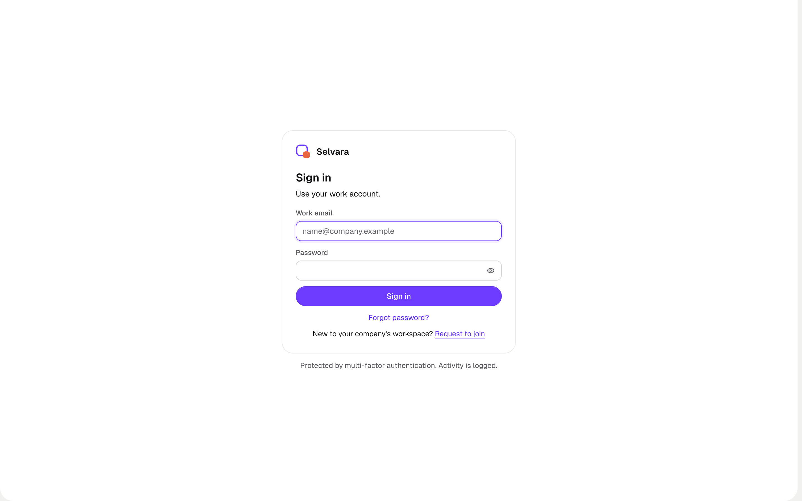 **Sign in:** work email and password, generic errors, request to join; no demo accounts in production | 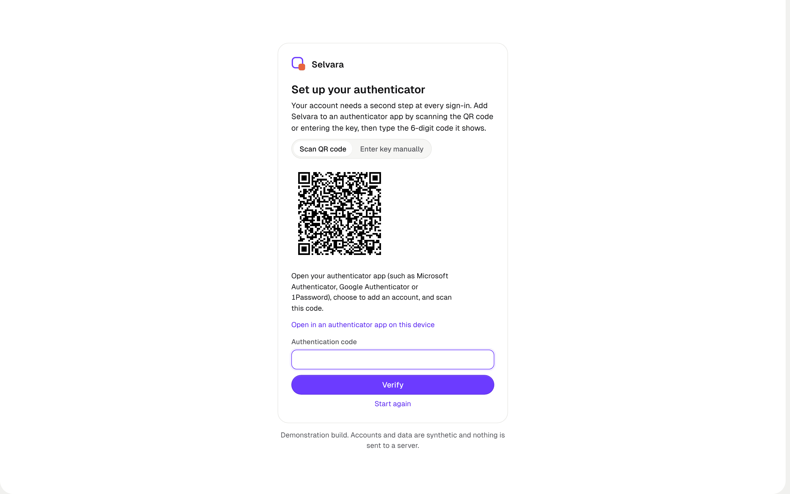 **First sign-in:** add an authenticator app by scanning the QR code or entering the key; the QR is drawn in the browser |
| 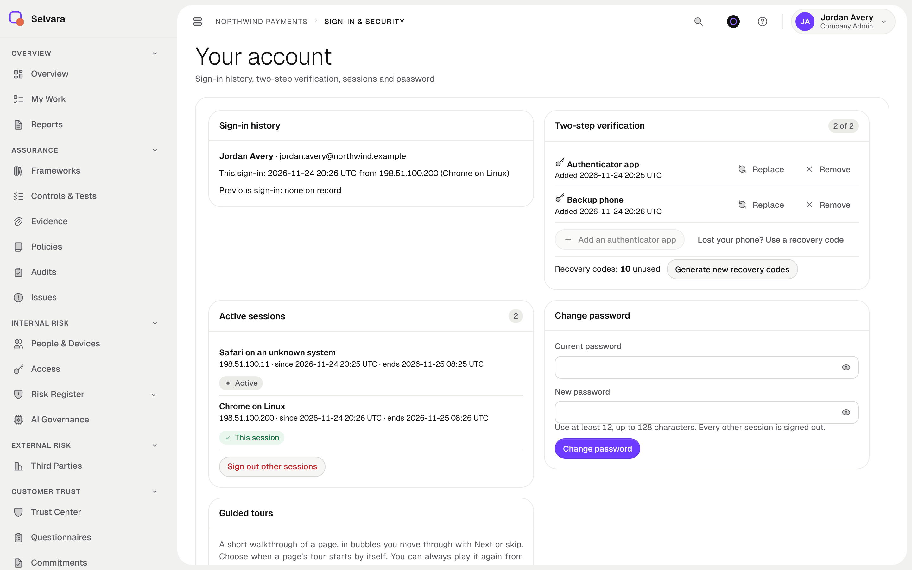 **Your account:** sign-in history, two authenticator apps (replace or remove), recovery codes, active sessions and password | |

### Company admin (production build)

| | |
|---|---|
| 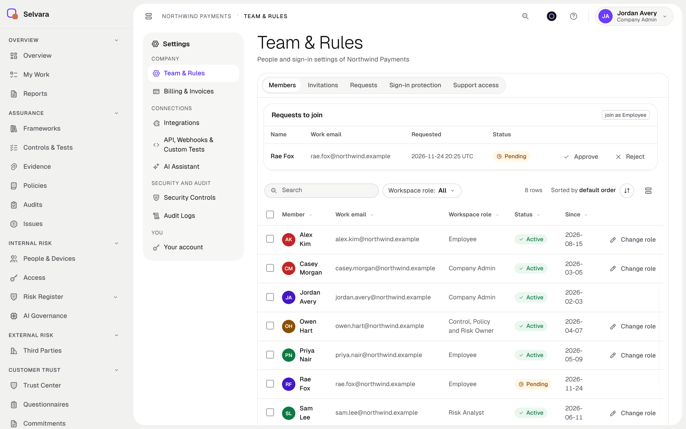 **Team & Rules:** members and roles, requests to join with approve or reject, invitations by email, sign-in protection | 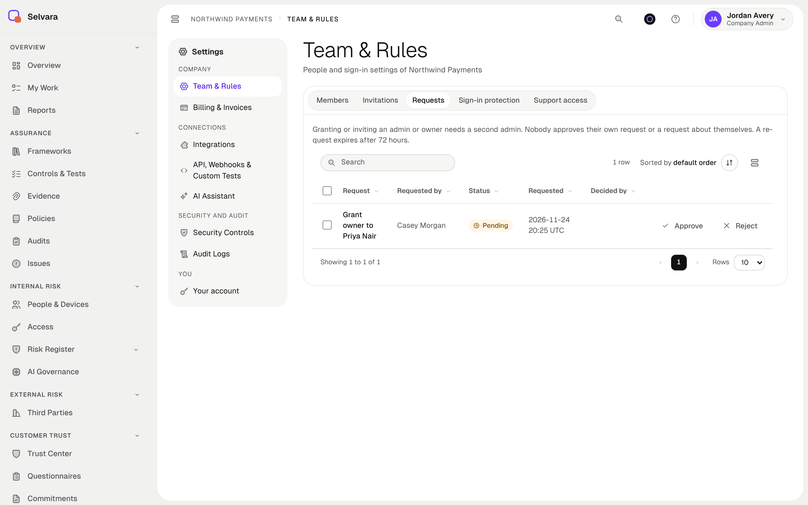 **Approvals waiting:** granting admin or owner needs a second admin; nobody approves their own request or one about themselves |

## Key features

### Assurance
- **Frameworks library**: 25 catalogue entries (see the [coverage table](#standards-regulations-and-frameworks-covered)). Requirement-level scoring, N/A justification, gap-assessment export, and an "add a framework" flow with keyword-based control matching.
- **Controls and tests**: control library with owners, cross-framework mappings, attestation, exceptions with expiry and compensating controls, automated test results, Statement-of-Applicability export, and a framework-by-control matrix.
- **Evidence**: collection, review and acceptance with versioning, attachment validation and a request-deletion workflow.
- **Policies**: full lifecycle (draft, review, approved, published), version history, change log, named approvers, acknowledgement tracking.
- **Audits**: engagement pipeline, information requests (PBC), control testing, findings, auditor access windows and frozen populations.
- **Issues**: table and kanban views, severity, tasks, root cause, and verified closure for high-severity items.

### Risk
- **Risk register** (ISO/IEC 27005 style): inherent, current and residual scoring, heat maps, treatment actions, interested parties, governance views and snapshots.
- **Risk acceptance**: authority ladder by rating; residual score above 15 requires Board approval evidence (decision reference, date, body, minutes) verified by a second person.
- **Import wizard**: CSV or Excel, column mapping, scale conversion and a row-by-row preview. Hand-written parsers with size and zip-bomb limits.
- **People and devices, Access**: workforce and device posture, access inventory, access requests and recertification reviews.
- **AI governance**: model inventory, discovery, lifecycle, EU AI Act classification, impact assessments and guardrails.
- **Third parties**: vendor register, tiering, onboarding gate, certificates and waivers, findings, reassessment.

### Customer trust
- **Trust Center**: publish documents publicly or on request, manage access requests (with domain blocklist), activity history and a retrieval chatbot over verified answers.
- **Questionnaires and commitments**: answer library with verification, submit-for-review before sending, contractual commitments and incident clock.
- **External vendor assessment portal**: a standalone, token-style page with email verification, one-time code, second factor, evidence upload and clarification round.

### Reporting
- **Overview dashboard** with KPIs, trend, readiness ranking and a control-coverage heat map.
- **Board and executive pack**: printable HTML report generated client-side with escaped output.
- **Reports**: stored and scheduled packs, with external distribution subject to approval.

### Settings and platform administration
- **Settings page**: one menu for Team & Rules, Billing & Invoices, Integrations, API, webhooks and custom tests, AI Assistant, Security Controls, Audit Logs and Your account.
- **Team & Rules**: members, roles, invitations by email with expiry, review cycles, SLAs, approvers, account lockout, credential policy.
- **Integrations, API and webhooks, custom tests, AI assistant** (draft-only answers, approval-gated agent actions, MCP access).
- **Audit logs**: tamper-evident workspace log, chain-integrity view, RoPA register, evidence export.
- **Platform admin console**: customers and usage, billing and invoices, exchange rates and tax (with when each rate was last updated), MFA resets, admin audit log, elevated access, platform security (blocked addresses, reputation, password baseline).
- **Help centre**: searchable guides for every module, and questions to Selvara support answered from the Admin Console inbox.

### Account security
- **Two-step verification for every account**: up to two authenticator apps per person, added by scanning a QR code or typing the key, then replaced or removed from Your account (password and a current code each time). Ten single-use recovery codes. Platform super admins use a passkey.
- **Your account**: sign-in history, active sessions with Sign out other sessions, security activity, password and recovery codes.
- **Sign-in protection**: generic errors, account lockout per company preset (Standard, Strict, PCI DSS v4 or Custom), a quick proof-of-work check after failures, and progressive blocking of an address that fails too often.
- **No secrets in responses**: every server response passes a guard that removes credential fields and redacts anything that looks like a secret; only one-time values a person must see (a new key, recovery codes, an authenticator set-up) are let through, once.

### Experience
- Light, dark and auto themes; collapsible sidebar with rail flyouts; command palette (`Ctrl/Cmd + K`); responsive down to phone width with a bottom tab bar; keyboard-operable with focus-trapped dialogs, arrow-key tabs and a skip link. WCAG 2.2 AA is the target, checked with axe in the end-to-end suite.
- **Guided tours** of every page, in bubbles that never cover the fields they describe; each person chooses first visit only, again after updates, or off.
- **Consistent layout**: cards sized to their content, full-width justified text, one empty-state style and one helper-text size across all screens.

## Standards, regulations and frameworks covered

Selvara ships a catalogue of **25 standards, regulations and frameworks** with roughly **1,200 modelled requirements** and a shared control library mapped across them. "Covered" means: a catalogue entry, requirement-level scoring from the status of mapped controls, control mapping, N/A justification and a gap export. It does **not** mean certification, a regulator's acceptance, legal advice, or a substitute for the text of the standard or law.

Status below was researched on **2026-11-08**. Several items changed recently, so check the official text before relying on a date.

### International standards

| Catalogue entry | Issuer | Edition tracked or current | Requirements modelled |
|---|---|---|---|
| ISO/IEC 27001:2022 (ISMS) | ISO/IEC | 2022, Amendment 1:2024 (climate action) | 123 |
| ISO/IEC 27002:2022 (security controls) | ISO/IEC | 2022 | 93 |
| ISO/IEC 27701 (privacy information management) | ISO/IEC | 2025 edition is current: standalone, replaces 2019 | 8 |
| ISO 22301 (business continuity) | ISO | 2019, Amendment 1:2024 | 6 |
| ISO/IEC 27005 (information security risk) | ISO/IEC | 2022 | 6 |
| ISO/IEC 42001 (AI management system) | ISO/IEC | 2023 | 70 |
| ISO/IEC 29100 (privacy framework) | ISO/IEC | 2024 edition is current | 24 |
| ISO/IEC 30107-1 (biometric presentation attack detection) | ISO/IEC | 2023 | 12 |
| PCI DSS v4.0.1 | PCI Security Standards Council | v4.0.1 is the only active version; future-dated requirements mandatory since 31 Mar 2025 | 10 |

### European Union

| Catalogue entry | Instrument | Notes | Requirements modelled |
|---|---|---|---|
| GDPR | Regulation (EU) 2016/679 | Proposed "Digital Omnibus" changes are not adopted | 12 |
| EU AI Act | Regulation (EU) 2024/1689, amended by (EU) 2026/1744 | High-risk obligations moved to 2 Dec 2027 (Annex III) and 2 Aug 2028 (Annex I) | 10 |
| DORA | Regulation (EU) 2022/2554 | Applies since 17 Jan 2025 | 289 |
| NIS2 | Directive (EU) 2022/2555 | National transposition varies | 52 |

### Middle East and South Asia

| Catalogue entry | Issuer | Notes | Requirements modelled |
|---|---|---|---|
| UAE PDPL | UAE federal (Federal Decree-Law 45 of 2021) | Executive regulations status unclear in sources | 8 |
| DIFC Data Protection Law | DIFC (Law No. 5 of 2020) | Applies in the DIFC, not UAE mainland | 7 |
| UAE Information Assurance Standards | UAE federal authorities | Issuer and current version need confirmation | 188 |
| SAMA Cyber Security Framework | SAMA (Saudi Central Bank) | Version 1.0 (2017); catalogue is a subset | 8 |
| SBP Enterprise Technology Governance and Risk Management Framework | State Bank of Pakistan | BPRD Circular 05/2017 | 60 |
| SBP AML/CFT/CPF Regulations | State Bank of Pakistan | BPRD Circular 05/2020 as amended | 7 |
| PECA 2016 | Government of Pakistan | Cybercrime statute, amended 2025 | 46 |

### United States frameworks

| Catalogue entry | Issuer | Edition tracked or current | Requirements modelled |
|---|---|---|---|
| SOC 2 | AICPA | 2017 Trust Services Criteria (revised points of focus 2022) | 11 |
| NIST CSF 2.0 | NIST | February 2024 | 106 |
| NIST SP 800-207 Zero Trust Architecture | NIST | August 2020 | 35 |
| NIST SP 800-37 Risk Management Framework | NIST | Revision 2 | 47 |

### Financial crime

| Catalogue entry | Notes | Requirements modelled |
|---|---|---|
| AML/CFT and sanctions | Composite of screening and monitoring requirements; the closest official reference is the FATF Recommendations | 7 |

**Add your own.** The "Add a regulation, standard or guideline" flow loads templates (NIS2, CIS Controls v8.1, HIPAA Security Rule, SAMA CSF) or pasted requirements and matches each line to control domains by keyword. These are starting points, not full catalogues.

**Be aware of uneven depth.** The requirement count shows how much of a framework is modelled, not how much of it exists. DORA (289), UAE IA (188) and ISO/IEC 27001 (123) are modelled in depth, while ISO 22301 (6), ISO/IEC 27701 (8) and SOC 2 (11) are summaries. Requirement titles are paraphrased (licensed standard text is not reproduced) and control mappings are draft content that needs review by qualified compliance staff.

Per-framework detail, official issuers, status notes, sources, naming accuracy and frameworks not yet covered are in [`docs/architecture/FRAMEWORKS.md`](docs/architecture/FRAMEWORKS.md). Most sources there are secondary (law-firm and certification-body pages), so it marks what is not verified.

## Security and segregation of duties

Selvara is built on the assumption that the people who operate a control must not be the people who approve it. The full contract is in [`docs/security/SOD_MATRIX.md`](docs/security/SOD_MATRIX.md). Highlights:

- **Four-eyes approvals** for risk acceptance above threshold, policy publication, access grants (two approvers for privileged access), MFA resets, role changes, vendor onboarding, AI classification, public Trust Center publishing, API keys with write scope, finance adjustments and rate overrides.
- **No standing privileged access.** Platform super admins have no workspace access, and every admin-console change needs an audited, time-boxed elevated session with a reason and ticket reference.
- **MFA reset to standard practice**: three identity checks, ticket, named second approver, 24-hour expiry; the requester can only withdraw.
- **Policy workflow**: owner-only edits, new version for every change, approver is never the author, approved versions are immutable, emergency changes need retrospective approval.
- **Credential policy aligned to OWASP ASVS 2.1 and NIST SP 800-63B**: 12 to 128 characters, no composition rules, Unicode and passphrases accepted, breached and common-password rejection, no forced rotation or history rules, no SMS or voice MFA.
- **Secure by construction**: no HTML built from strings, safe-link and upload helpers, CSV formula-injection guard, strict webhook URL validation (SSRF hygiene), strict response headers including a Content-Security-Policy, hash-chained audit logs.

> **Important:** a browser is never a trust boundary. In production (`NEXT_PUBLIC_API_MODE=http`) every rule is enforced by the server and the database (row level security per company); the UI only mirrors it. The demonstration build enforces the same rules in the browser so they can be shown and tested. Known limitations and the test log are in [`docs/security/SECURITY.md`](docs/security/SECURITY.md).

## Roles and access model

Twelve demo personas cover nine roles. Second personas exist so that dual control can be demonstrated end to end.

| Role | Space | Typical access |
|---|---|---|
| Platform Super Admin (x2) | Admin console | Customers, billing, rates, MFA resets, admin log, elevated access (no workspace content) |
| Platform Support | Admin console | Customers, billing, rates, MFA reset requests, admin log (read-focused) |
| Company Admin (x2) | Company | All company modules |
| Control, Policy and Risk Owner (x2) | Company | Assurance, risk, vendors, trust, questionnaires, commitments |
| Risk Analyst | Company | Risk, issues, controls, work |
| Employee | Company | Overview, My Work, policies (read and acknowledge), access, questionnaires |
| External Auditor | Company | Audits, controls, evidence, policies, frameworks (read-only) |
| Vendor Contact, Trust Center Visitor | Company (restricted) | Questionnaires and Trust Center only |

### Signing in (demo accounts)

The app opens on a sign-in page. There is no role switcher: sign out from the account menu (top right) and sign in as another persona.

**Two kinds of account, kept apart.**
- **Real accounts** are created through **Request to join** and approved by a company admin. They have their own password and an authenticator app (TOTP), added at the first sign-in by scanning a QR code or entering the key, and required every time, plus 10 single-use recovery codes. A second app can be added later from Your account.
- **Platform super admins** sign in with a **passkey** (fingerprint, face, PIN or a security key), added at the first sign-in. In the demonstration build, a device without passkeys can use a labelled on-screen code instead.
- **Demo accounts** (below) exist only in the demonstration build, where there is no backend and the browser runs the checks (`front-end/src/lib/session.ts`). They are limited: labelled as demo, sessions end after one hour, the second step shows its code on screen, and the shared password cannot be changed or reset.

A production build (`NEXT_PUBLIC_API_MODE=http`) has no demo accounts: sign-in, MFA, reset and sessions go to the server routes in `front-end/src/server` (Supabase Auth and Postgres; setup in [docs/guides/SUPABASE.md](docs/guides/SUPABASE.md), contract in [docs/security/CONTROLS.md](docs/security/CONTROLS.md)). In that build every module runs on the server (since v0.2.0), and each role sees the modules its role allows. Production builds it when the GitHub environment variable `API_MODE` is `http` ([docs/guides/SUPABASE.md](docs/guides/SUPABASE.md) section 4c). The `staging` branch deploys both builds as previews: a demo and a live one on the staging database ([docs/security/PIPELINE.md](docs/security/PIPELINE.md), "Staging branch and previews"). Nothing in the demonstration build is an authentication control.

Every demo account uses the password `selvara-demo`.

| Persona | Role | Email |
|---|---|---|
| Dana Whitfield | Platform Super Admin | `dana.whitfield@demo.selvara.test` |
| Riley Quinn | Platform Super Admin | `riley.quinn@demo.selvara.test` |
| Sam Hayes | Platform Support | `sam.hayes@demo.selvara.test` |
| Jordan Avery | Company Admin | `jordan.avery@demo.selvara.test` |
| Casey Morgan | Company Admin | `casey.morgan@demo.selvara.test` |
| Owen Hart | Control, Policy and Risk Owner | `owen.hart@demo.selvara.test` |
| Taylor Reed | Control, Policy and Risk Owner | `taylor.reed@demo.selvara.test` |
| Priya Nair | Employee | `priya.nair@demo.selvara.test` |
| Morgan Blake | External Auditor | `morgan.blake@demo.selvara.test` |
| Sam Lee | Risk Analyst | `sam.lee@demo.selvara.test` |
| Grace Lin | Vendor Contact | `grace.lin@demo.selvara.test` |
| Lee Park | Trust Center Visitor | `lee.park@demo.selvara.test` |

**Request to join.** Anyone can ask to join from the sign-in page with a name, work email and a password that meets the policy. The request waits until a company admin approves it (Team, Members, "Requests to join", with a reason, audited); the person then signs in as an Employee under their own name. Requests are kept in this browser only. The answer to a request never says whether an email is already known, sign-in errors are generic, and five failures lock that email for five minutes. Ten failures from one network address within 15 minutes block that address for every account, for longer each time (5 minutes, 30 minutes, 2 hours, then 24 hours, repeating; never permanently); only an elevated platform super admin can lift a block (Admin Console, Platform security). In this demo the address is a synthetic one per browser; if you block your own browser, sign in from another browser or clear this site's data.

After 3 failures a short "Quick check" (a proof-of-work calculation in the browser) comes before the next try. **Forgot password?** (real accounts) shows, in a box marked demo, the link the email would carry; the reset also needs the authenticator or a recovery code. **Sign-in & security** (account menu, or Settings, Your account) opens **Your account**: last sign-in, authenticator apps (add, replace or remove), active sessions with Sign out other sessions, change password, new recovery codes (password confirmed first), guided-tour preferences and security activity. Company admins set the account lockout (Standard, Strict, PCI DSS v4, or Custom within 3–10 attempts and 15–60 minutes) and trusted office networks in Team, Review cycles & SLAs.

## Screens at a glance

| Area | Routes |
|---|---|
| Overview | `/ws/overview`, `/ws/work` (tabs Tasks, Policies, Account security, Delegation; the old `/ws/me` opens Policies), `/ws/reports` |
| Assurance | `/ws/frameworks`, `/ws/controls`, `/ws/evidence`, `/ws/policies`, `/ws/audits`, `/ws/issues` |
| Internal risk | `/ws/people`, `/ws/access`, `/ws/risk`, `/ws/ai` |
| External risk | `/ws/vendors` |
| Customer trust | `/ws/trust`, `/ws/questionnaires`, `/ws/commitments` |
| Settings | `/ws/integrations`, `/ws/api`, `/ws/assistant`, `/ws/team`, `/ws/billingws`, `/ws/auditlog`, `/ws/appsec` |
| Platform admin | `/admin/customers`, `/admin/billing`, `/admin/rates`, `/admin/mfa`, `/admin/adminlog`, `/admin/elevation`, `/admin/security` |
| Everyone | `/auth` (Your account; in the demonstration also the sign-in gallery), `/help` (Help centre) |
| Standalone | `/login`, `/vendor-portal` (external vendor assessment), `/trust/<company>` (public Trust Center) |

## Tech stack

- **Exact versions of everything:** [docs/architecture/STACK.md](docs/architecture/STACK.md), generated from `package.json`, the lockfile and the CI config
- **Framework:** Next.js 16 (Pages Router) and React 19, TypeScript
- **Styling:** the original design tokens and component CSS (kept verbatim), with Tailwind CSS 4 for utilities only (no reset; the legacy CSS sits in a lower cascade layer so a utility beats a legacy class)
- **State:** small external stores (React `useSyncExternalStore`); no state-management dependency
- **Server:** Next.js API routes (`front-end/src/server`, one entry point `src/pages/api/[...path].ts`) on Supabase: Postgres with row level security per company (migrations in `supabase/migrations`), Supabase Auth (passwords, TOTP), Supabase Storage for evidence files
- **Data:** production reads and writes the database; the demonstration build uses synthetic seed data in the browser
- **Testing:** Vitest (unit) and Playwright (end to end)
- **Dependencies:** intentionally minimal: six production packages (Next.js, React, React DOM, `pg`, `@supabase/supabase-js` on the server only, and `uqr` for QR codes, security-reviewed and pinned); no UI kit, no spreadsheet or charting libraries. Production dependencies are checked with `npm audit` in CI
- **Browsers:** last two versions of Chrome, Edge, Firefox, Safari and iOS Safari

## Getting started

Requirements: **Node.js 20.9 or newer** (developed on Node 22) and npm.

```bash
git clone https://github.com/ShahidCS/Selvara.git
cd Selvara/front-end
npm install
npm run dev
```

Open <http://localhost:3000> and sign in with a demo account (see [Signing in](#signing-in-demo-accounts)). `jordan.avery@demo.selvara.test` (Company Admin) is a good start for the workspace; `dana.whitfield@demo.selvara.test` opens the admin console.

Other commands:

```bash
npm run typecheck   # tsc --noEmit
npm run build       # production build
npm start           # serve the production build
npm test            # unit tests (Vitest)
npm run test:e2e    # end-to-end tests (Playwright)
npm run ci          # typecheck, unit tests, build (lint runs separately: npm run lint)
```

### Try the dual-control flows

1. Switch to **Platform Super Admin**, open **Admin > Elevated Access**, request elevation (reason of at least 15 characters and a ticket such as `OPS-1234`).
2. Open **Admin > MFA Resets** and approve the seeded request. Then switch to **Platform Support** and note that Approve is disabled for them.
3. As **Company Admin**, open **Risk**, record an acceptance with residual score above 15, and note the Board-evidence requirement and the second-person verification.

## Configuration

Copy `front-end/.env.example` to `front-end/.env.local`. There are no secrets in this repository and none are needed to run it.

| Variable | Default | Purpose |
|---|---|---|
| `NEXT_PUBLIC_API_MODE` | `mock` | `mock` serves seeded synthetic data; `http` calls a real API. Production takes it from the GitHub environment variable `API_MODE`; the staging previews set it themselves (demo: `mock`, live: `http`). Vercel's own variable of that name has no effect |
| `NEXT_PUBLIC_API_BASE_URL` | empty | Base URL of the GRC API (used only in `http` mode; also added to the CSP `connect-src`). Deployed `http` builds use `/api` (same origin) |

Server settings (database, Supabase, email, AI, integrations, payments) live in Vercel's environment variables, never in the repository: see [docs/guides/SUPABASE.md](docs/guides/SUPABASE.md).

## Testing and CI

- **Unit tests (Vitest, about 590)** cover the security helpers, the server routes per module group, the response guard, the credential policy, segregation-of-duties and approvals engine, the risk Board-evidence rules (including the 15 / 16 boundary), framework scoring and output encoding.
- **End-to-end tests (Playwright, about 150)** cover every route, the full persona-by-route access matrix, privileged-access gating, read-only roles, the password policy, authenticator set-up by QR code and key, injection resistance, accessibility (axe), layout and the vendor portal. They run against the demonstration build.
- **CI** (GitHub Actions) runs type-check, lint, unit tests, build, `npm audit` on production dependencies, and the end-to-end suite on every push and pull request. Dependabot proposes weekly grouped updates.

Server routes have unit tests per module group, and a database suite checks company isolation against a real Postgres in CI. Details, including what is not covered (visual regression, load), are in [`docs/guides/TESTING.md`](docs/guides/TESTING.md).

## CI/CD pipeline

Every change reaches production only through GitHub Actions, and every release leaves verifiable evidence.

- **Pull requests** run type-check, lint, unit and end-to-end tests, a dependency audit, CodeQL static analysis, secret scanning, a runtime dependency audit, licence policy, a Trivy scan and a ZAP baseline scan. High and Critical findings block the merge.
- **Merges to `main`** re-run every gate.
- **Staging** is the `staging` branch, moved forward to a commit already on `main`. Each move re-runs the gates, checks the commit is on `main`, and deploys two Vercel **previews** of it: **Staging demo** (the demonstration build, for demos) and **Staging live** (the production build on a separate staging database, switched on by the owner). Vercel deploys only from Actions; its own Git deploys are disabled.

  ```bash
  git fetch origin main && git push origin origin/main:staging
  ```
- **Production releases** come from a **signed version tag** on `main`. The tag is verified, the gates run again, and the deployment waits for approval in a protected environment before it ships.
- **Evidence:** every build produces a CycloneDX SBOM and a SHA-256 checksum, and the deployed bytes are extracted from that exact checksum-verified archive. Build-provenance attestations are supported and switch on automatically where the GitHub plan allows them (currently off for this private repository); an optional keyless Sigstore signature is off by default.
- **The pipeline protects itself:** every action is pinned to a full commit SHA, workflow permissions are least-privilege, install scripts never run in CI, and a policy check fails the build if a workflow breaks these rules.

Setup, release steps, how to verify an artefact, accepted risks and what is not yet proven are in [`docs/security/PIPELINE.md`](docs/security/PIPELINE.md).

## Repository layout

```
Selvara/
├── README.md                 this file
├── LICENSE                   proprietary, all rights reserved
├── SECURITY.md               vulnerability reporting policy
├── .github/                  workflows, pipeline scripts, rulesets, CODEOWNERS, Dependabot configuration
├── docs/                     architecture/ (including backend-v2/), guides/, security/ documentation and README screenshots (see docs/ORGANIZATION.md)
├── supabase/migrations/      database schema, row level security and functions (0001 to 0012)
└── front-end/                Next.js application (web front-end and its server API)
    ├── src/
    │   ├── pages/            routes: /ws, /admin, /auth, /help, /login, /trust, /vendor-portal, /api
    │   ├── features/         one folder per module: screens, services, rules
    │   ├── components/       shell (layout, dialogs, settings menu), ui kit, shared kit (QR code, tours)
    │   ├── server/           server API: routes, response guard, auth, database access, email, integrations
    │   ├── lib/              stores, RBAC, segregation-of-duties and approvals engine, scoring, audit chains
    │   ├── services/         API stubs and business rules (deny by default)
    │   ├── data/             synthetic seed data
    │   ├── hooks/ styles/ assets/
    ├── tests/ e2e/           unit and end-to-end tests
    └── scripts/              developer tools for preparing seed data
```

## Documentation

| Document | Contents |
|---|---|
| [`front-end/README.md`](front-end/README.md) | Front-end setup and structure in detail |
| [`docs/architecture/FRAMEWORKS.md`](docs/architecture/FRAMEWORKS.md) | Researched reference for every framework, regulation and standard covered |
| [`docs/security/SOD_MATRIX.md`](docs/security/SOD_MATRIX.md) | Segregation-of-duties, privileged-access and credential-policy contract |
| [`docs/security/SECURITY.md`](docs/security/SECURITY.md) | Controls in place, known limitations, backend requirements, test log |
| [`docs/security/PIPELINE.md`](docs/security/PIPELINE.md) | CI/CD pipeline: gates, staging branch and previews, release, supply-chain controls, accepted risks |
| [`docs/security/CONTROLS.md`](docs/security/CONTROLS.md) | Security control register with evidence per control, and the authentication API contract |
| [`docs/security/EXCEPTIONS.md`](docs/security/EXCEPTIONS.md) | Accepted exceptions with reasons, controls and exits |
| [`docs/guides/SUPABASE.md`](docs/guides/SUPABASE.md) | Owner setup: Supabase projects, Vercel variables, email, storage, live staging |
| [`docs/architecture/DESIGN_SYSTEM.md`](docs/architecture/DESIGN_SYSTEM.md) | Design tokens, components, layout rules and deliberate deviations |
| [`docs/architecture/STACK.md`](docs/architecture/STACK.md) | Exact versions of every dependency and tool (generated) |
| [`docs/architecture/PRODUCTION_PROGRAMME.md`](docs/architecture/PRODUCTION_PROGRAMME.md) | How every module moved to the server, group by group |
| [`docs/architecture/backend-v2/`](docs/architecture/backend-v2/README.md) | Back-end v2 design authority: design, reviews, audit, decisions, readiness gate, roadmap |
| [`docs/guides/TESTING.md`](docs/guides/TESTING.md) | Test strategy, how to run it, CI, gaps |
| [`docs/architecture/DECISIONS.md`](docs/architecture/DECISIONS.md) | Decisions taken and decisions still open |
| [`CHANGELOG.md`](CHANGELOG.md) | Every release and what changed |
| [`docs/guides/CHECKLIST.md`](docs/guides/CHECKLIST.md) | Feature-to-component map with a per-module checklist in `docs/guides/checklist/` |
| [`docs/architecture/SPEC_BOARDS.md`](docs/architecture/SPEC_BOARDS.md) | Comparison of the design boards with the implemented product |
| [`docs/architecture/PORTING_GUIDE.md`](docs/architecture/PORTING_GUIDE.md) | Conventions used to build and secure each module |

## Project status

| Area | State |
|---|---|
| Front-end (all screens, roles, workflows) | Complete |
| Segregation of duties, privileged-access gating, credential policy | Enforced on the server and in the database; mirrored in the UI |
| Server (API, database, authentication, sessions, tenant isolation) | **Built**: every module ([production programme](docs/architecture/PRODUCTION_PROGRAMME.md), groups 1 to 8) |
| Security hardening (v0.3) | Response guard on every API response, invitation links by email only, authenticator apps with QR set-up |
| Automated tests and CI/CD | Unit, database-isolation and end-to-end suites; security gates; staging previews (demo and live); tag-driven release to Vercel |
| Production | **v0.3.1 deployed** (24 Nov 2026); owner setup and review pending |
| Back-end v2 (redesign) | Design approved through an independent audit; readiness gate **No-Go** until the budget, vendor facts, open decisions and legal assumptions are settled ([backend-v2](docs/architecture/backend-v2/README.md)). No v2 code is written before the gate passes |

What production still needs:

- **Owner setup** ([`docs/guides/SUPABASE.md`](docs/guides/SUPABASE.md)): a required reviewer on the `production` environment, the platform super admins and the first company, and the **email provider** (invitations are sent only by email since v0.3.0). The live staging preview needs its own staging Supabase project. Stripe, AI and integration credentials are optional.
- **Review:** all generated code, configuration and security controls need technical, security and management review before reliance.
- **Not built yet (owner decisions):** scheduled jobs (agent schedules, integration syncs, automatic invoicing and rate refresh, email digests; they need a Vercel cron), malware scanning of uploads, usage-based billing, and the other items listed per group in the production programme.
- **Known limitations** ([`docs/security/SECURITY.md`](docs/security/SECURITY.md)): the Content-Security-Policy still allows inline scripts (the Pages Router needs them; a nonce-based policy is the fix). The deploy tooling (Vercel CLI) carries accepted advisories in build-only packages ([EX-04](docs/security/EXCEPTIONS.md)). The end-to-end suite runs against the demonstration build; the production build is covered by server and database tests.

> **Compliance notice:** framework mappings, requirement titles, scoring and generated reports are **draft content**. Requirement titles are paraphrased; licensed standard text is not reproduced. Outputs must be reviewed by qualified compliance, legal and risk personnel before reliance, filing or distribution. All generated code, configuration and security controls need technical, security and management review before deployment.

All data in this repository is **synthetic**. Names, customers, vendors, addresses and figures are fictional.

## Roadmap

Planned work, in rough priority order. This is a direction, not a commitment, and carries no dates.

1. ~~**Backend foundation and server-side enforcement**~~: built (API, database, authentication with MFA and passkeys, tenant isolation, persisted approvals and elevation, hash-chained audit storage).
2. ~~**Account security and layout hardening**~~: done in v0.3 (response guard, authenticator apps with QR set-up, layout review of every screen, staging previews).
3. **Go-live:** owner setup (email, staging database), security and compliance review, scheduled jobs (Vercel cron).
4. **Production hardening:** nonce-based CSP, malware scanning of uploads, end-to-end tests against the live staging preview.
5. **Back-end v2:** starts only after the readiness gate passes and the owner approves ([roadmap and calendar](docs/architecture/backend-v2/phase5/P5-roadmap-calendar.md)).
6. **Product depth:** deepen the shallow framework catalogues (for example ISO 22301, ISO/IEC 27701, SOC 2, SAMA CSF), resolve the open items in [`docs/architecture/DECISIONS.md`](docs/architecture/DECISIONS.md), and port the remaining policy-library and third-party-risk improvements described in [`docs/architecture/SPEC_BOARDS.md`](docs/architecture/SPEC_BOARDS.md).
7. **Engineering quality:** TypeScript strict mode and visual regression tests (lint and automated accessibility checks are in place).

## Maintainers

- Owner and maintainer: [@ShahidCS](https://github.com/ShahidCS)

## Contributing

Selvara is proprietary software (see [Licence](#licence)). Contributions are accepted from contributors authorised by the owner, under the terms agreed with them. If you have been invited to contribute:

1. Read [`docs/architecture/PORTING_GUIDE.md`](docs/architecture/PORTING_GUIDE.md) and [`docs/security/SOD_MATRIX.md`](docs/security/SOD_MATRIX.md) first. New mutations must call the service layer (deny by default), write an audit entry and follow the secure-coding rules.
2. Run `npm run ci` and `npm run test:e2e` in `front-end/` before opening a pull request.
3. Never commit secrets, real personal data or customer information. Use synthetic data only.

## Security reporting

Please do **not** open public issues for suspected vulnerabilities. Email **[security@selvara.com](mailto:security@selvara.com)**. The full policy is in [`SECURITY.md`](SECURITY.md).

## Licence

Copyright (c) 2026 Selvara. **All rights reserved.** This is proprietary software: it is not open source or free software, and no right to use, copy, modify, distribute or host it is granted except under a separate written agreement. See [`LICENSE`](LICENSE).
