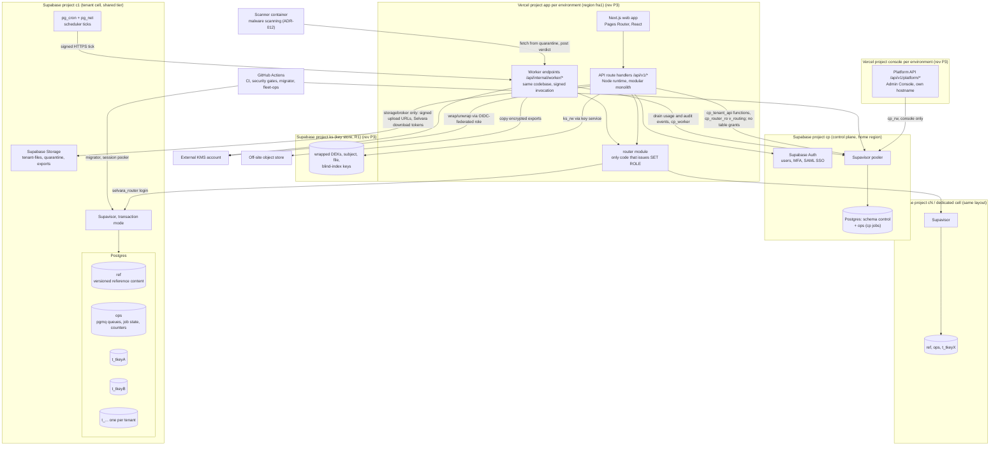
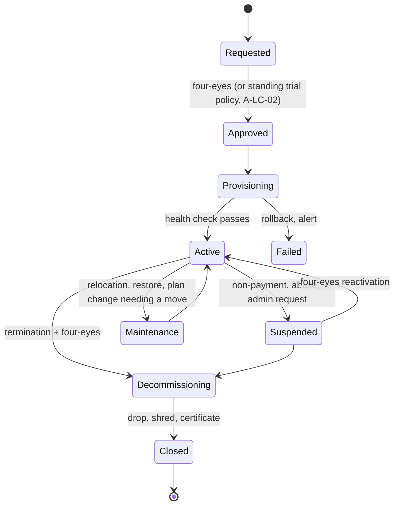
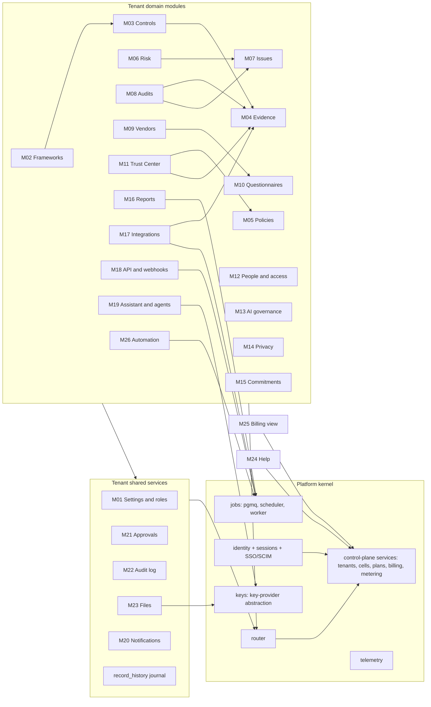

# Phase 2A: Architecture

| | |
|---|---|
| Status | Draft for the design authority (Phase 2). Documents only. |
| Date | 2026-11-23; revised 2026-11-24 for Phase 4 findings (rev P4) |
| Binding input | `00-spine.md` (spine v2, S0 to S9), ADR-001 (accepted), design-authority rulings DA-01 to DA-15 (rev P3) |
| ADRs owned | ADR-002, ADR-010 (this document); ADR-004, ADR-005, ADR-009 are shared with 2H |
| Compliance note | Any regulatory statement here is a **DRAFT** pending qualified legal and compliance review. Vendor facts marked *(verify)* were not confirmed against the vendor's current documentation. |

**ID convention.** The workstream prefix `A-` is followed by a section code (`A-CP-`, `A-RT-`, ...) so that item IDs never collide with assumption IDs (`A-15` to `A-24`), which keep the plain two-digit form.

---

## A-1. System context (C4 Level 1)

```mermaid
flowchart TB
  subgraph People
    TU["Tenant users<br/>admin, owner, analyst, employee"]
    EX["External parties<br/>auditor, vendor, Trust Center viewer"]
    PS["Platform staff<br/>management_approver, ciso, support"]
    AV["Anonymous visitors<br/>public Trust Center"]
  end
  SEL(("Selvara GRC platform<br/>control plane + tenant data plane"))
  TU -->|HTTPS, Supabase Auth session, SSO| SEL
  EX -->|HTTPS, scoped and time-boxed| SEL
  PS -->|HTTPS, elevation + four-eyes| SEL
  AV -->|HTTPS, public trust routes| SEL
  IDP["Customer IdPs<br/>SAML / OIDC, SCIM client"] <-->|SSO assertions, SCIM 2.0| SEL
  KMS["External KMS<br/>Selvara account + customer BYOK keys"] <-->|wrap / unwrap DEK| SEL
  PAY["Payment provider<br/>Stripe adapter now, others pluggable"] <-->|checkout, signed webhooks| SEL
  MAIL["Email provider<br/>transactional"] <-->|send, bounce and complaint webhooks| SEL
  AI["AI providers<br/>off by default, per tenant"] <-->|prompts after personal-data check| SEL
  INT["Customer systems<br/>GitHub, cloud, IdP directories"] <-->|integration syncs, outbound webhooks| SEL
  OBS["Observability SaaS<br/>logs, errors, uptime, paging"] <--|telemetry without tenant content| SEL
  OFF["Off-site object store<br/>other region, object lock"] <--|encrypted exports, audit anchors| SEL
```

## A-2. Containers (C4 Level 2)



Plane separation shown above:

| ID | Plane | Containers | Holds |
|---|---|---|---|
| A-PL-01 | Control plane | Supabase project `cp`: Auth, `control` schema, `ops` for control-plane jobs | The spine v2 control-plane catalogue (S2 plus accepted additions; 2B §6); nothing else (rev P3) |
| A-PL-02 | Tenant data plane | Supabase projects `c1..cN`: `ref`, `ops`, `t_<tkey>`, Storage buckets | All tenant business data, files, per-tenant journal and audit log |
| A-PL-03 | Compute (stateless) | Vercel projects `app` (web, tenant and account API, SCIM, public, hooks, worker endpoints) and `console` (platform API, Admin Console; the only holder of `cp_rw`) (R2-03) | No state beyond per-instance caches (A-RT-07) (rev P3) |
| A-PL-04 | Key plane | External KMS accounts (production, non-production); key-store project `ks` | KMS: tenant KEKs and the platform KEK (F-K-30). `ks`: wrapped DEKs, subject, file and blind-index keys (DA-04); DEKs leave only wrapped (rev P3) |
| A-PL-05 | Delivery plane | GitHub Actions with environments | Build, scans, attestations, migrator and fleet-ops credentials |

---

## A-3. Control plane (ADR-001 consequences applied; ADR-010)

### A-3.1 Contents (spine v2 catalogue) and justification (rev P3)

"Tenant business data" (TBD) means anything under S4 or file contents. Every row below answers **No** for TBD; the right column states the residual personal data.

| ID | Table | Purpose | Why it must be in the control plane | Personal data held | TBD |
|---|---|---|---|---|---|
| A-CP-01 | `control.tenants` | Tenant registry: id, `tkey`, display name, `customer_ref`, status (`provisioning`, `active`, `suspended`, `maintenance`, `offboarding`, `closed`; `offboarding` is the Decommissioning state of A-8), plan, `cell_id`, tier, `trust_public_ref`, created/approved refs (rev P3) | Routing and lifecycle must be decided before any tenant schema is opened | None (company name only) | No |
| A-CP-02 | `control.tenant_cells` | **Cell registry** (decision A-D-03): cell id, region, tier (shared or dedicated), status (Open, Full, Draining, Closed), capacity counters, connection secret *reference* | The router needs the cell before connecting | None | No |
| A-CP-03 | `control.tenant_schema_versions` | Per tenant: current version, target version, rollout state, last drift fingerprint, last migrated at | Router fails closed on version mismatch; orchestrator state (ADR-009) | None | No |
| A-CP-04 | `control.identities` | Supabase user id, email (E1 under the platform DEK F-K-31 wrapped by the platform KEK F-K-30, plus HMAC blind index `email_bidx` with key F-K-32 for sign-in lookup, DA-05), display name, status, `home_tenant_id` (SD-E3) | One person may belong to several tenants (D1); sign-in precedes tenant choice | Member identity (allowed by S2) | No (rev P3) |
| A-CP-05 | `control.memberships` | user, tenant, role id, status | Authorisation of tenant entry happens before the tenant connection | Membership fact | No |
| A-CP-06 | `control.tenant_roles` | Tenant-defined role id and name only | Membership needs a role id that exists; permissions stay in `t_<tkey>.tenant_role_permission` | None | No |
| A-CP-07 | `control.platform_staff` | Staff accounts, status | Platform authorisation is global | Staff identity | No |
| A-CP-08 | `control.platform_roles` | `management_approver`, `ciso`, `support`, custom roles named only from the fixed list of nine (2E E-73, OD-07) | OQ-01, OD-07 | None | No (rev P3) |
| A-CP-09 | `control.platform_role_permissions` | Permission set per platform role | OQ-01 | None | No |
| A-CP-10 | `control.platform_approvals`, `platform_approval_votes` | Four-eyes engine for platform actions (provisioning, decommission, key destruction, relocation, restore, provider changes) | Approvals precede the action and outlive the tenant | Approver ids | No |
| A-CP-11 | `control.elevations` | Time-boxed staff elevation (reason, ticket, 60 min) | Kept from E-07 | Staff id, reason text | No |
| A-CP-12 | `control.support_grants`, `support_sessions` | Customer-granted, read-only support access windows | The grant must be checked before staff reach a tenant (via `t_<tkey>_ro`) | Staff and granting admin ids | No |
| A-CP-13 | `control.platform_audit_log` | Hash-chained platform log (staff actions, approvals, lifecycle, key events, certificate issuance) | Platform actions are not tenant records; the tenant's own log also records every support view (S2, OQ-10) | Actor ids, IPs | No |
| A-CP-14 | `control.plans`, `plan_entitlements` | Plan catalogue and limits (users, frameworks, storage, API calls, upload size under the platform ceiling) | Enforcement needs entitlements before the tenant transaction | None | No |
| A-CP-15 | `control.billing_entities` | Selvara selling entities (Pakistan now; UAE, US, UK later) | BL-04 | None | No |
| A-CP-16 | `control.subscriptions`, `invoices`, `payments` | Commercial relationship | Selvara is controller for billing data | Billing contact | No |
| A-CP-17 | `control.usage_meters` | Aggregated counts per tenant and meter per period, built from events (A-XT-02) | Plan limits and invoicing | None | No |
| A-CP-18 | `control.provider_configs` | Payment, AI, email, scanner provider settings with **secret references** | Platform-level configuration | None | No |
| A-CP-19 | `control.key_registry` | Tenant KEK ids, DEK versions, BYOK flag, state, destruction date; never key material | Crypto-shredding must be provable after the tenant schema is gone | None | No |
| A-CP-20 | `control.deletion_certificates` | Signed certificate per decommission and per key destruction | Must survive the tenant (Q-24) | Approver ids | No |
| A-CP-21 | `control.support_questions`, `support_messages` | Help desk (M24) | Selvara is controller for support communication | Requester identity and message text | No by design; see A-CP-R1 |
| A-CP-22 | `control.ropa_selvara` | Selvara's own RoPA (OQ-08) | Provider-level record | None | No |
| A-CP-23 | `control.sso_connections` | Per-tenant SAML/OIDC metadata, domain bindings, secret references | Sign-in happens before tenant entry | None | No |
| A-CP-24 | `control.scim_tokens` | Hashed SCIM bearer tokens, tenant id, scopes, expiry | SCIM requests are authenticated before tenant routing | None | No |
| A-CP-25 | `control.sessions` | **Addition (SD-A1, now in spine v2 S2).** Server-side session: session id hash, user id, `active_tenant_id`, assurance level (MFA, step-up time), created, last seen, revoked | S3 step 1 requires a server-side session record holding the active tenant | Session metadata; IP as `ip_enc` (E1, platform KEK) plus `ip_hmac`, and the IP prefix | No (rev P3) |
| A-CP-40 | `control.invitations`, `control.join_requests` | Pending invitations (invite email E1 under the platform KEK, token hash) and requests to join a tenant | Precede membership; links go by email to the invitee only (DA-09) | Invitee or requester email and name | No (rev P3) |
| A-CP-41 | `control.passkeys`, `control.recovery_codes`, `control.auth_throttle`, `control.account_notices` | Factor hashes, sign-in throttle state, account notices (SD-E1) | Authentication precedes tenant entry | Factor metadata, notices | No (rev P3) |
| A-CP-42 | `control.sso_domains` | Verified SSO domains per connection (SD-E1) | Home-realm discovery before tenant entry | None | No (rev P3) |
| A-CP-43 | `control.api_key_routes`, `control.portal_link_routes` | Key id or link id to tenant, status, expiry; no secret (SD-C1) | API keys and portal links are routed before tenant entry | None | No (rev P3) |
| A-CP-44 | `control.idempotency_records` | Idempotency keys of control-plane requests only (SD-C2); never tenant-route responses | Replays of account, platform, billing and help calls | Possibly billing contact in a stored response (E1, platform KEK) | No (rev P3) |
| A-CP-45 | `control.ref_content_releases` | `ref` release loaded per cell (ADR-011) | Content upgrades are fleet-wide | None | No (rev P3) |
| A-CP-46 | `control.platform_audit_anchor` | Anchor roots, proofs, TSA token references (SD-F-03, ADR-013) | Anchors the platform audit chain | None | No (rev P3) |
| A-CP-47 | `control.v_routing` (view) | Routing fields plus `route_mac` (HMAC over tenant id, `tkey`, cell), granted to `cp_router_ro` | The router verifies `route_mac`; mismatch returns 503 and alerts | None | No (rev P3) |
| A-CP-48 | `control.trial_policies` | The standing trial policy approved four-eyes under OD-04 (limits from 2I I-4.4.3) | Trial placement is decided before provisioning | None | No (rev P3) |
| A-CP-49 | Billing tables: `control.price_lists`, `invoice_lines`, `ledger_entries`, `credit_notes`, `invoice_series`, `provider_events`, `fx_rates`, `tax_rules`, `entitlement_overrides`, `plan_change_requests`, `usage_event_receipts`, `ai_provider_reviews` (I-SD1) | Commercial records, metering receipts, provider reviews | Selvara is controller for billing | Billing contact data in snapshots and provider events (E1, platform KEK) | No (rev P3) |

| ID | Residual exposure | Control |
|---|---|---|
| A-CP-R1 (registered as R-60) | A customer can paste business content into a support message | Text-only messages, no file attachments in the control plane; the UI warns; retention class `support`: 2 years after closure (2G G-RET-07) *(DRAFT)*; a support agent needing tenant data uses a support session, never asks for paste (rev P3). Server-side checks on every support message before it is stored (rev P4): (1) secret-pattern detection with the Gitleaks rule set: a match is redacted, the sender is told, and an audit entry records the rule id (never the value) (P4-A1-06, support-message part); (2) a content heuristic for pasted business content (record refs of the tenant's ref patterns, or long structured text such as tables or many delimited lines): the user is asked to use a support session instead, and an override is recorded with the message (P4-A1-15). Tested in 2J J-SEC-34 with synthetic token patterns and synthetic refs |
| A-CP-R2 (registered as R-61) | `control.identities` and `memberships` reveal who works where | Readable by `app` only through `cp_tenant_api` functions (which derive the caller from the session record) and by `console` through `cp_rw` under row-level security keyed on `app.platform`; staff views are logged (OQ-10) (rev P3) |

### A-3.2 Control plane access (summary; full decision in ADR-010)

| ID | Principal | Path | Rights |
|---|---|---|---|
| A-CP-30 | `app` deployment (tenant API, account API, SCIM, public endpoints, billing and help views) | `cp` pooler, login of `cp_tenant_api` | `EXECUTE` on the fixed function set of 2F F-CP-02 only; no table grants; each function derives the tenant and identity from the session record (R2-03) (rev P3) |
| A-CP-31 | Worker (events, metering, provisioning, certificates) | Login of `cp_worker`, `app.system = '<job>'` | Insert-only on `usage_meters`, `usage_event_receipts`, `platform_audit_log`; update on `tenant_schema_versions` and provisioning state (rev P3) |
| A-CP-32 | Migrator | GitHub environment `production-migrate` | DDL on `control`, `ops` |
| A-CP-33 | Supabase Auth | Supabase-managed | `auth` schema only; an Auth hook (if used) reads `control.memberships` through a narrow function *(verify hook availability)* |
| A-CP-34 | Humans (break-glass) | Supabase dashboard, two org members, MFA | Superuser; every use is a break-glass event reviewed by the other super admin (R-C) |
| A-CP-35 | Data API (PostgREST) on `cp` and every cell | **Disabled** or no exposed schemas; `anon` and `authenticated` have no grants outside what Auth needs *(verify the switch per project)* | None |
| A-CP-36 | Router (`app`) | `cp` pooler, login of `cp_router_ro` | `SELECT` on the view `control.v_routing` only (2F F-ISO-02) (rev P3) |
| A-CP-37 | `console` deployment (platform API, Admin Console) | `cp` pooler, login of `cp_rw`; credential held only by the `console` project | DML on `control` under RLS keyed on `app.platform`, `app.elevation_id`; no DDL (R2-03) (rev P3) |

---

## A-4. Tenant data plane

| ID | Element | Design |
|---|---|---|
| A-DP-01 | Schemas per cell | `ref`, `ops`, `t_<tkey>` per tenant, Supabase `auth` and `storage` (cells do not use `auth`; identities live in `cp`) |
| A-DP-02 | Tenant schema | The S4 catalogue (about 140 tables per 2B and ADR-008 C8-2) plus `record_history` (rev P3); standard columns on every table; owned by the `migrator`-controlled owner role `t_owner` (NOLOGIN), never by `t_<tkey>_rw`, so a tenant role cannot `ALTER`, `DISABLE ROW LEVEL SECURITY` or `DROP` |
| A-DP-03 | Defence in depth | `tenant_id uuid not null` with `CHECK (tenant_id = '<uuid>')` written at provisioning, plus RLS `tenant_id = current_setting('app.tenant_id')::uuid` with `FORCE ROW LEVEL SECURITY` |
| A-DP-04 | `ref` | Read-only to every `t_<tkey>_rw`/`_ro`; versioned (ADR-011, 2B); tenants reference `ref` rows by id and version |
| A-DP-05 | `ops` | pgmq queues, job state (spine v2 S8), rate-limit counters `ops.rate_buckets` (`UNLOGGED`), event emit functions (rev P3). No tenant business data: payloads carry `tkey`, job type and record ids only |
| A-DP-06 | Files | Bucket `tenant-files`, prefix `<tkey>/`; `quarantine`; `exports`. Each object is encrypted with its own per-file key, wrapped by the tenant DEK and held in `ks.file_key`; `file_object` holds only the key id and version (DA-04). The bucket never holds plaintext (rev P3) |
| A-DP-07 | Role inventory per cell | `selvara_router` (group, NOLOGIN) with login members `selvara_router_a`, `selvara_router_b` (SD-A2), `t_<tkey>_rw`, `t_<tkey>_ro`, `t_owner`, `ops_worker`, `tenant_admin` (CREATEROLE, owns the provisioning function only), `fleet_observer` (`pg_monitor`-style statistics, no data), `migrator` |

---

## A-5. Tenant routing from verified identity (ADR-002)

### A-5.1 Sequence, with fail-closed branches

```mermaid
sequenceDiagram
  autonumber
  participant B as Browser
  participant H as API handler
  participant A as cp Auth
  participant C as cp control (cp_tenant_api, cp_router_ro)
  participant R as router module
  participant P as Cell pooler (transaction mode)
  participant T as t_tkey schema
  B->>H: request + HttpOnly __Host- Selvara session cookie (no tenant in path or body)
  Note over H,A: Supabase Auth tokens are used only during sign-in (SD-E2) (rev P3)
  H->>C: cp_tenant_api.session_resolve(session id hash) (no cache: every request) (rev P3)
  alt missing, revoked, or assurance too low for route
    H-->>B: 401 (or 403 step-up required)
  end
  H->>C: membership(user, active tenant) + tenant status (no cache) + v_routing cell, schema, version (static fields cached 30 s); verify route_mac (rev P3)
  alt route_mac mismatch
    H-->>B: 503 (routing integrity alert)
  end
  alt no active membership
    H-->>B: 403
  else tenant not Active (Suspended, Decommissioning, Closed)
    H-->>B: 403 tenant_unavailable (404 if Closed)
  else tenant in Maintenance
    H-->>B: 503 maintenance
  else schema version outside the release's supported window
    H-->>B: 503 schema_mismatch
  end
  H->>R: withTenant(ctx{tkey, tenantId, userId, cell, roleKind})
  R->>P: BEGIN (pool for this cell)
  R->>P: one extended-protocol statement, all values bound: set_config role = t_tkey_rw, search_path = t_tkey, ref, pg_temp, app.tenant_id, app.user_id, app.request_id, app.scope (+ app.engagement_id for auditors), statement_timeout, lock_timeout, all is_local true (rev P3)
  R->>P: assertion statement: current_user = t_tkey_rw and current_setting app.tenant_id matches
  alt any step fails
    R->>P: ROLLBACK
    H-->>B: 503 (logged as routing_failure, alert)
  end
  R->>T: handler queries (parameterised, unqualified names)
  T-->>R: rows filtered by grants and RLS
  R->>P: COMMIT (role, search_path and settings reset by transaction end)
  H-->>B: 200
```

### A-5.2 Routing rules

| ID | Rule |
|---|---|
| A-RT-01 | The tenant comes only from `control.sessions.active_tenant_id`. Switching tenant is `POST /api/v1/account/session/tenant`, which re-checks membership and writes the session row. The router verifies `route_mac` on the `v_routing` row; a mismatch returns 503 and raises the routing-integrity alert (F-M-03) (rev P3). |
| A-RT-02 | `router` (`src/server/router/**`) is the only module that may import the cell pool or issue `SET ROLE`, `RESET ROLE`, `set_config('role', ...)`, `set_config('search_path', ...)` or `set_config('app.*', ...)`; enforced by an ESLint rule, a CodeQL query and a test that greps the build output (spine v2 S3.5, A-RT-10) (rev P3). |
| A-RT-03 | `selvara_router` login roles hold no privileges of their own (NOINHERIT; membership grants `WITH INHERIT FALSE, SET TRUE` on Postgres 16+ *(verify the cell Postgres major version)*). A query that runs before `SET LOCAL ROLE` fails with a permission error: fail closed by construction. |
| A-RT-04 | `roleKind` is `rw` for normal work and `ro` for auditor engagements, exports and support sessions. The choice is made by the handler's declared capability, never by input. The router also sets `app.scope` (member, auditor, vendor, support, trust_public) and, for auditors, `app.engagement_id`, which the restrictive RLS policies of 2B and 2F F-ISO-14 use (rev P3). |
| A-RT-05 | The preamble is one parameterised statement over the extended protocol that calls `set_config(..., true)` for the role, `search_path`, the `app.*` settings and the timeouts, with every value bound (sketch: `select set_config('role', $1, true), set_config('search_path', $2, true), ...`). The post-switch assertion (`select current_user, current_setting('app.tenant_id')`) is a second extended-protocol statement; the router may pipeline the two. No simple-query multi-statement string is ever sent, the router's own included (DA-02). Role and schema names come only from a `tkey` validated against `^[a-z2-7]{16}$` (rev P3). |
| A-RT-06 | Public routes (`/api/v1/public/trust/<ref>`, vendor portal) resolve the tenant from a signed, opaque reference mapped in `control` (never a `tkey` or schema name in the URL) and always use `t_<tkey>_ro` plus a public-route allowlist of views. |
| A-RT-07 | Caches (reconciled R2-01): **sessions, memberships and tenant status are never cached**; every request reads them (indexed primary-key lookups in `cp`). Revoking a membership or suspending a tenant also sets `revoked_at` on the affected `control.sessions` rows in the same transaction. Only static routing fields (cell, schema name, schema version) are cached per instance, TTL 30 s, invalidated on relocation and migration events. Revocation therefore takes effect on the next request. |
| A-RT-08 | Jobs: a pgmq message carries `tkey`; the worker resolves the tenant through `control` (status read live, never cached or replicated, R2-01; status must allow the job type) and enters through the same `router.withTenant`. If `cp` is unreachable, the tick is skipped and alerted (rev P3). |
| A-RT-09 | Every response that is a refusal of another tenant's record is 404 (S6). |
| A-RT-10 | **R-56 controls (identical in 2A, 2F F-ISO-06 and 2J; DA-02; aligned with F-ISO-06 rev P4 in rev P5).** (1) If SQL injection exists anywhere inside a routed transaction, an injected `SET ROLE` or `RESET ROLE` to another tenant's role **succeeds**, because Postgres checks the login's role memberships (R-56); RLS and grants do not stop it, and `set_config('app.tenant_id', ...)` is equally reachable. (2) Only `router` issues role and context statements (`SET`, `RESET`, `set_config`, `search_path`) or opens a cell pool (A-RT-02; ESLint rule, CodeQL query, build-output grep). (3) All SQL, the router's setup statements included, uses parameterised statements over the extended protocol, one statement per Parse, all values bound; no simple-query multi-statements. (4) No dynamic SQL is built from input outside `router` and migrations; prologue identifiers come only from a `tkey` validated against `^[a-z2-7]{16}$`. (5) Detection: pgaudit `ROLE`, `MISC` (SET) and **`FUNCTION`** classes on the router logins, streamed to the SIEM (an injection over the extended protocol must call `set_config('role' / 'search_path' / 'app.%', …)` inside an expression, which `ROLE` and `MISC` do not log); any role statement, and any `set_config` of `role`, `search_path` or `app.%` outside the fixed prologue shape, is Sev-1 *(verify that pgaudit `FUNCTION` logs nested built-in calls on Supabase, VC-09 and VC-28)*. Log-independent control: `assert_context` re-checks `current_user`, `app.tenant_id` and `search_path` after each mutation statement and before every COMMIT, and the **response is buffered** until the assertion and the commit succeed, so a changed role, tenant or `search_path` is detected before any byte leaves (2F F-ISO-03); `log_statement` stays a secondary signal (DU-09). (6) Tests (F-IT-11, F-IT-12, F-IT-24, F-IT-38, F-IT-39, F-IT-106; J-ISO-25, J-SEC-30, injection fuzz, privilege snapshot) prove each control is in place; they do not claim the attack fails. (7) **ISO-HARD** (2F F-D-14, F-4.5; ADR-002 decision 9) bounds what an escape reaches: KMS decrypt bound to the routed `tkey`, `ks` only through functions that read the routed tenant, Storage only through `storagebroker` with a derived prefix, and a tenant-mismatch detector; an escape then reaches another tenant's rows but not its keys or files. (8) Router, migration and isolation SQL changes are reviewed by R-B (CODEOWNERS) and by the contracted technical reviewer at each release gate (OD-12). Residual risk: inside the owner-accepted C1-01 (R-02), re-confirmed by the owner on 2026-11-24 with ISO-HARD (OD-15, ADR-001) (rev P3, rev P5). |

---

## A-6. Connection management at scale

| ID | Topic | Design |
|---|---|---|
| A-CN-01 | Pooler mode | Supavisor **transaction mode** (port 6543) for API and worker traffic. Port 5432 (session mode) only for the migrator and fleet-ops jobs, which need session features and IPv4 reachability from GitHub runners *(verify)*. |
| A-CN-02 | Why one login | Supavisor keeps one pool per (database user, database). Per-tenant logins (ADR-002 option C) would create one pool per tenant and exhaust server connections at a few dozen tenants. One login gives **one pool per cell regardless of tenant count**, which is why C1-01 exists. |
| A-CN-03 | Transaction-scoped state only | Only `SET LOCAL`, `set_config(..., true)` and `pg_advisory_xact_lock` are allowed. `SET` (session), `SET SESSION AUTHORIZATION`, session advisory locks, `LISTEN/NOTIFY`, temporary tables (tenant roles have no `TEMPORARY` privilege, F-ISO-11) (rev P3), and `WITH HOLD` cursors are banned; a lint rule on SQL strings and a pooled-connection test that checks `current_user` and `search_path` at the start of every transaction enforce it. |
| A-CN-04 | Prepared statements | The shared pooler in transaction mode does not support named prepared statements *(source 3)*. `pg` (node-postgres) sends parameterised queries as **unnamed** statements, which are safe; the `name` query option is banned by lint. ORMs that require named statements or session state (Prisma without its pooler flag) are excluded. A dedicated pooler (PgBouncer 1.21+) supports them *(source 3)* if ever needed. |
| A-CN-05 | Role-level settings do not apply after `SET ROLE` | `ALTER ROLE ... SET statement_timeout` takes effect at login, not on `SET ROLE`. Per-tenant budgets are therefore issued as `SET LOCAL statement_timeout` (default 8 s; reports and exports 60 s via `ro` worker paths) and `SET LOCAL lock_timeout = '3s'` in the router preamble. `idle_in_transaction_session_timeout` is set on the router login roles. |
| A-CN-06 | Pool per function instance | `max` 3 per cell pool, idle timeout 10 s, connect timeout 5 s (kept from `db.ts`). Pools for cells are created lazily; an instance that only serves `c1` holds no `c2` connections. |
| A-CN-07 | Pooler client ceiling | Pooler client limits scale with compute size (Micro 200, Small 400, Medium about 600 *(source 1, verify; VC-15)*). Ceiling, per project an instance connects to (cell, `cp`, `ks`): peak Vercel instances × (number of login roles used on that project) × 3 must stay below 70% of that project's pooler client limit. `cp` serves every instance of every cell. A breach is a scaling alert (H) (rev P3). |
| A-CN-08 | Server connections | Default pool size per compute is small (15 on Micro *(source 1, verify)*). Transactions are kept short (no external calls inside a tenant transaction: KMS, email, AI and HTTP happen before or after). Target mean transaction time under 15 ms. |
| A-CN-09 | Catalog and relcache growth | Each tenant adds about 800 to 850 `pg_class` rows (about 140 tables per 2B and ADR-008 C8-2, their TOAST tables and about 500 indexes) *(estimate; measured by 2J H3)* and about 3,000 `pg_attribute` rows *(estimate)* (rev P3). A pooled server connection that serves many tenants accumulates relcache/catcache entries for every schema it touches, so backend memory grows with tenants served. Controls: server-connection recycling *(verify the Supavisor setting available on hosted projects; VC-17)*, backend memory monitoring, and the cell capacity rule CR-1 (A-PH-02, A-PH-03) (rev P3). |
| A-CN-10 | Statistics attribution | `pg_stat_statements` computes `queryid` with relation OIDs, so the same query text in 500 schemas produces 500 entries and evicts at the default `pg_stat_statements.max` *(verify on Supabase)*. Attribution uses the `userid` column (the tenant role after `SET ROLE`, *verify*) and is sampled hourly by `fleet_observer` into the fleet report. |
| A-CN-11 | Behaviour at hundreds to thousands of tenants | Connections: unchanged (one pool). Role memberships: `selvara_router` is a member of every `t_*_rw`/`_ro` role (2 per tenant); membership checks are cached per backend. Catalog: grows linearly (A-CN-09); `pg_dump` of the whole database and catalog-wide migrations slow down, which is why per-tenant operations never rely on database-wide dumps and the cell is capped. |
| A-CN-12 | Credential rotation | Two login roles (`selvara_router_a/_b`) let the password of the idle one rotate, deploy, then swap, with no downtime (quarterly, automated by H). |

---

## A-7. Physical layout and cells

| ID | Item | Decision |
|---|---|---|
| A-PH-01 | Launch | `cp` (control plane), `c1` (shared cell) and `ks` (key store) as **three Supabase projects** in `R1` = Frankfurt (OQ-14), one production Supabase organisation (ADR-010, ADR-003); `ks` has a standby in the DR region (DA-11) (rev P3). |
| A-PH-02 | Schemas per cell | Capacity rule CR-1 (2J J-7.2): provisional threshold 300 tenant schemas per shared cell until measured; then floor_100(0.6 × K). Warm-pool, canary, trial and restore schemas count (A-15, DA-10) (rev P3). |
| A-PH-03 | Threshold to open a new cell (any one) | Secondary triggers of CR-1 (any one marks the cell `Full`): (1) the CR-1 count threshold; (2) `pg_class` rows above 250,000; (3) database size above 60% of the disk the cell's compute tier is sized for; (4) p95 API latency on the cell above target (A-NFR-03) for 3 consecutive days with compute already at the tier ceiling chosen for shared cells (Large); (5) a full migration rollout on the cell exceeds 45 minutes; (6) pooler clients above 70% of limit at peak after a compute upgrade; (7) backend resident memory above 60% of RAM (2J H3). A new cell is provisioned at 80% of the count threshold or of any trigger; placement is refused at the threshold. The status of the full cell becomes `Full` (no new placement); existing tenants stay (rev P3). |
| A-PH-04 | Placement | New tenants go to the `Open` shared cell in the chosen region with the most headroom; region choice is recorded at provisioning (R-01). Provisioning, relocation and restore refuse a target cell whose region is outside the tenant's contracted residency set, and DR resources stay in the pinned EU DR region (2H H-AC-05) (P4-A1-11, placement part; the residency attribute itself is defined with the control-plane data model) (rev P4). |
| A-PH-05 | Dedicated cell (enterprise tier) | One Supabase project per tenant, same layout (`ref`, `ops`, one `t_<tkey>`), same code path and router; own compute size, own PITR window (14 or 28 days), optional Team/Enterprise Supabase features such as PrivateLink *(verify plan requirement)*. A tenant also moves to a dedicated cell when it alone exceeds 10% of a shared cell's database size or query time. |
| A-PH-06 | Cell identity | Cell ids are opaque (`c1`, `c2`, `d-<tkey>`); project refs live only in `control.tenant_cells` as secret references and in CI secrets. |

---

## A-8. Tenant lifecycle



| ID | Step | What happens | Target time | Gate |
|---|---|---|---|---|
| A-LC-01 | Provision | Allocate `tkey`; `control.tenants` row; choose cell; `ops.provision_tenant(tkey)` creates schema, roles, grants, tables at the current version (or claims a warm-pool schema, H-PV-04); create KEK in KMS, generate and wrap the first DEK and store it in `ks.tenant_dek`; register ids in `key_registry` (rev P3); seed (A-LC-03); create storage prefix; register backups and monitoring; health check (router round trip as `t_<tkey>_rw`, isolation probe); invite first admin | p95 under 2 min after approval; trial under 30 s (warm pool) | Four-eyes (`platform_approvals`) for paid, enterprise and dedicated tenants |
| A-LC-02 | Trial provisioning | Same pipeline under a **standing approval**: R-A and R-B approve the trial policy (limits, duration, region) once; each trial references it; daily digest to both | under 30 s | Standing four-eyes on the policy: OD-04 (approved); limits defined once in 2I I-4.4.3 (`control.trial_policies`) (rev P3) |
| A-LC-03 | Seed reference content | Nothing is copied from `ref` except tenant-editable templates: 7 base `tenant_role` rows and permissions, `tenant_settings` defaults, `risk_method_settings` and `risk_criteria` defaults (ISO 27005 both methods), RoPA template rows into `processing_activity`, notification defaults, `trust_settings` (unpublished). Framework activation is a tenant choice (`framework_scope`) that points at `ref` by version. Seed version recorded. | inside A-LC-01 | None (automated, idempotent) |
| A-LC-04 | Suspend | Status `Suspended` in `control`; sessions revoked in the same transaction, so the next request is refused (403); queues skip the tenant except exports, DSAR clocks and retention jobs; public Trust Center shows nothing | effective under 60 s | Four-eyes unless automatic for non-payment under the dunning policy |
| A-LC-05 | Plan change (same cell) | Update subscription and entitlements; limits apply on the next request | immediate | Self-serve via payment, or four-eyes for manual overrides |
| A-LC-06 | Relocation between cells | Status `Maintenance` (read-only banner, writes 503); final logical export; create schema and roles in target cell at the same schema version; load; verify row counts, hash-chain of `audit_log_entry`, `record_history` continuity and file manifest; copy files (encrypted objects copied as-is); switch `cell_id`; drop in source after 7 days under four-eyes | write freeze p95 under 15 min for tenants under 1 GB; under 2 h for 1 to 20 GB | Four-eyes |
| A-LC-07 | Export (tenant request or exit) | Per-tenant logical export through `t_<tkey>_ro`: JSONL per table, schema version and catalog fingerprint, file manifest, decrypted with the tenant's keys and re-encrypted to a tenant-supplied public key or delivered through a signed URL valid 24 h | under 1 h for under 5 GB; under 24 h otherwise | Tenant admin request plus re-authentication; no platform approval needed |
| A-LC-08 | Decommission | (rev P5: aligned with the offboarding rules of 2D D-12, D-12b, D-58 and D-12e and the canonical step list and certificate schema of 2G G-6.3; those texts govern.) Termination notice; status `Decommissioning`; **final export** (FINAL-EXPORT, 2D D-12b): the export window is **30 days from the first `ready` export**, extended as D-12b-1 states; **deletion precondition**: the latest export generation is `confirmed` (receipt) or `window_expired`, and deletion is blocked on a signed-manifest mismatch (OFF-EXPORT-MANIFEST); **approval**: four-eyes under D-58, the single approval rule (the requester counts as one approver only if they hold a required role, and is never the sole approver); a legal hold blocks deletion and has no override; drop schema and roles; delete `<tkey>/` objects and exports in all stores; schedule destruction of the KEK and its DR-region copy in KMS (multi-Region replicas, or the second KEK of the VC-14 fallback, 2H H-VF-02) (provider minimum waiting period applies *(verify; AWS KMS 7 to 30 days)*); delete every `ks` row of the tenant (DEK versions, subject, file and blind-index keys), which then rolls off the `ks` PITR window, daily backups, key journal and KS-SNAP within 8 days (rev P3, rev P4); the Supabase Auth user of an identity is deleted **in the same run as the identity's pseudonymisation**: 30 days after the person's last membership ends, or immediately on an upheld erasure (2D D-12a(7), D-80a); **deletion certificate** (D-12e): issued at key destruction, listing every store of 2G G-6.3 with its roll-off date, and **closed** when the last store has rolled off (any RA-01 legal hold on KS-SNAP is recorded with its release time, ADR-019); anchored in `platform_audit_log` | data removal under 1 h after approval; certificate issued at key destruction and closed at the last roll-off (rev P5) | Four-eyes (D-58); GitHub environment approval for the drop job (H-PV-07) |

Residual window (stated on the certificate): Supabase PITR and daily backups of the cell keep E0 plaintext columns of the dropped schema until they age out (7 days at the launch PITR setting *(verify)*); E1 and E2 fields and files are unreadable once the KEK is destroyed; `ks` copies of the tenant's keys are gone from every copy within 8 days (DA-11) (rev P3). This is why confidential and personal fields are encrypted at application level (ADR-003).

---

## A-9. Cross-tenant needs without cross-tenant queries

| ID | Need | Mechanism | Never |
|---|---|---|---|
| A-XT-01 | Event emission | Inside a tenant transaction, `ops.emit(event_type, payload)` (SECURITY DEFINER, pinned `search_path`) derives `tkey` from `current_user` (`t_<tkey>_rw`), never from an argument, validates the payload against an allowlist schema per event type (ids, counts, enums), and sends to a pgmq queue. Atomic with the business change. **Definer allow-list (identical in 2A, 2F F-T-033, 2J J-ISO-27):** SECURITY DEFINER functions executable by `t_*_rw` are `ops.emit(event_type, payload)`, `ops.emit_usage(meter, qty)` and the audit append function `t_<tkey>.audit_append(...)`; `t_<tkey>.assert_context` is SECURITY INVOKER. Any other is a CI failure (F-IT-23) (rev P3). | Free-text, names or file content in events |
| A-XT-02 | Billing metering | Worker drains usage events into `control.usage_meters` (aggregates per tenant, meter, period); plan enforcement reads entitlements plus meters | Counting by scanning tenant schemas |
| A-XT-03 | Product analytics | Aggregated events (feature used, module, counts) into `control` aggregates; dashboards over those only | A cross-schema `UNION` or a reporting replica of tenant data |
| A-XT-04 | Support tooling | Staff see the control-plane view (tenant status, plan, usage, schema version, health) in `console`. Tenant content only inside a customer-granted support session, served by `app` through the router as `t_<tkey>_ro` with `app.scope = 'support'`; `console` holds no cell credential; read-only, logged in both audit logs (rev P3) | Staff queries across tenants |
| A-XT-05 | Fleet health | `fleet_observer` reads catalog and statistics views (sizes, versions, slow queries by role) only | Reading any tenant table |
| A-XT-06 | Shared content | `ref` is pushed to tenants by version; tenant content never flows back into `ref` | Tenant data feeding shared catalogues or AI training |

---

## A-10. Service boundaries

**Recommendation (A-SB-01): one modular monolith** (one Next.js codebase and deployment), with enforced module boundaries. Reasons: one team-less operator, one deploy unit to attest, one router to audit, shared transaction for business change + journal + audit + event. Extraction candidates later: scanner (already separate), exports runner, AI gateway.

| ID | Boundary rule |
|---|---|
| A-SB-02 | Platform modules live in `src/server/platform/<module>`; tenant modules in `src/server/modules/mNN-<name>`; each exposes `index.ts` only. ESLint `no-restricted-imports` enforces it, matching the front-end feature rule. |
| A-SB-03 | Tenant modules never import `control` data access; they receive a `TenantCtx` from `router`. |
| A-SB-04 | Cross-module writes go through the owning module's service (for example, M04 evidence links are created by M04, called from M08). |
| A-SB-05 | One approvals engine (M21), one audit writer (M22), one file service (M23), one journal writer (`record_history`) used by every module in the same transaction. |



---

## A-11. Technology decisions and tenant isolation per component

| ID | Component | Choice | Tenant isolation mechanism |
|---|---|---|---|
| A-TS-01 | Framework and runtime | Next.js 16 API routes on Vercel, Node runtime (not Edge: `pg` and KMS SDK need Node), TypeScript (Q-12) | Tenant context only from `router`; no global mutable state keyed by request |
| A-TS-02 | Database | Supabase Postgres per cell; `pg` driver; SQL through a typed query builder that emits unnamed statements (choice left to 2B) | Role per tenant, schema grants, `tenant_id` + RLS (ADR-002) |
| A-TS-03 | Cache | **No external cache at launch** (decision A-D-05). Per-instance LRU for JWKS and static routing fields only (TTL 30 s; never sessions, memberships or tenant status, R2-01); `ops.rate_buckets` (UNLOGGED) for rate limits (rev P3) | Keys include `tkey`; only control-plane metadata is cached, never tenant records |
| A-TS-04 | Queue and scheduler | Supabase Queues (pgmq) in `ops`, `pg_cron` ticks via `pg_net` to worker endpoints (ADR-005) *(verify maturity: Queues listed as alpha on one Supabase page, source 6)* | One message, one tenant; `tkey` from the emitting role; fair round-robin per tenant |
| A-TS-05 | Object storage | Supabase Storage per cell; signed upload URLs into `quarantine` and Selvara-signed download tokens on `files.<domain>` (spine v2 S1) | Prefix `<tkey>/` derived from router context; per-file application encryption (keys in `ks`); only the `storagebroker` module holds the Storage service credential (SD-F-02, R-13) (rev P3) |
| A-TS-06 | Search | Postgres full-text search (`tsvector` + GIN) over E0 columns (titles, refs, enums, dates, scores) inside each tenant schema; trigram index for `ref` lookups. Search over E1 free text is decrypt-and-filter inside the tenant's own request with bounded page sizes; no plaintext index of E1 or E2 exists (DA-01). E2 exact match uses a keyed blind index | Index lives in the tenant schema; no shared search index (rev P3) |
| A-TS-07 | Keys | External KMS behind the key-provider abstraction (ADR-003, 2F/2G) | One KEK per tenant; BYOK per tenant |
| A-TS-08 | Email | Transactional provider behind the email abstraction | Templates rendered per tenant; no tenant content in subjects beyond record refs |
| A-TS-09 | Malware scanning | One managed container (ADR-012) | Receives one object at a time by signed URL; holds nothing after the verdict |

---

## A-12. Non-functional requirements

| ID | NFR | Target | Measured by |
|---|---|---|---|
| A-NFR-01 | Availability: uniform contractual SLA (**SLA-U**, OQ-23) | **One SLA for every plan, shared and dedicated:** 99.0% monthly availability of the tenant API and web app, read from the versioned SLA schedule, not hard-coded (OD-23, ADR-020 decision 8; rev P5b). VC-13: the vendors back an SLA only on Enterprise plans, so the figure is self-backed. Remedy: service credits only, 10% of the monthly fee below the target and 25% more than 2.0 points below it (2I I-4.6). Exclusions (the canonical list is 2I I-4.6.4; rev P5): planned maintenance announced at least 72 h ahead, inside the window and within the 8 h monthly cap, and capped emergency maintenance (rev P5b); vendor-wide region outages of Supabase, Vercel or the KMS provider (region loss is **excluded**); customer-caused issues (its users, integrations, IdP, BYOK key disabled, exceeded limits); suspension or restriction under 2I I-5; and the Trust Center public pages. Trials carry no SLA. Decision record: ADR-020 (rev P5). Critical-path dependencies (Vercel, `cp`, cell, `ks`, KMS beyond the 5-minute DEK cache) are each probed and reported (rev P3). Supersedes the shared-tier "objective only" wording and DU-35 (rev P4) | External probes from three locations every minute on the login page and an authenticated canary-tenant read per cell; the method in 2J J-SLA; monthly SLA report (2H H-OB-05) |
| A-NFR-02 | Availability, internal objective | 99.9% monthly **objective** (not contractual) for every tier, used for alerting and engineering targets; it is not offered to customers. The contractual figure is A-NFR-01 only (rev P4) | Same probes, per cell |
| A-NFR-03 | Latency p95, single-record read | under 300 ms server time | Server timing metric per route |
| A-NFR-04 | Latency p95, list (limit 50) and writes | under 500 ms | Same |
| A-NFR-05 | Latency p95, routing overhead | under 15 ms, including the uncached `cp` session, membership and status read (R2-01); static routing cache miss under 60 ms (rev P3) | Router span |
| A-NFR-06 | Latency, public Trust Center page | p95 under 400 ms | Probe |
| A-NFR-07 | Throughput per shared cell (launch sizing) | 200 requests/s sustained, 500 burst | 2J load test |
| A-NFR-08 | Per-tenant fairness | 50 requests/s per tenant, 10 per user (plan-adjustable); jobs 1 to 2 concurrent per tenant | 429 rate, queue lag |
| A-NFR-09 | Scalability | CR-1: 300 tenants per shared cell (provisional), linear by cells; 1,000 tenants = 4 shared cells at the provisional value (rev P3) | 2J |
| A-NFR-10 | Tenant provisioning | p95 under 2 min after approval; trial under 30 s | Pipeline metric |
| A-NFR-11 | Migration rollout | under 45 min per cell for a full rollout | Orchestrator metric |
| A-NFR-12 | Revocation propagation | Suspension, membership and session revocation enforced on the next request (no cache, R2-01) | Test |
| A-NFR-13 | RPO, cell loss (DR) | 5 min or less once PITR is on (`cp`, every shared cell and `ks`, at launch per the DU-02 recommendation), *(verify WAL archive interval, VC-16; if longer, the RPO is that interval, 2H H-VF-04)*; 24 h (daily backup) where PITR is off (rev P3, rev P4) | DR drill |
| A-NFR-14 | RTO, cell loss | Shared: 4 h; dedicated: 4 h | DR drill |
| A-NFR-15 | RPO / RTO, single-tenant restore (logical error) | RPO: any point in the journal when the tenant schema is intact (path A); when the journal is damaged, the PITR window (7 days, path B, VC-02) and otherwise the last export (≤ 26 h). Restores never bring back erased subjects or deleted file versions whose keys were destroyed (F-K-11, F-K-12). RTO from the second approval: 8 h shared, 4 h enterprise for restores classified S1 (platform-incident driven, paged 24/7); **8 and 4 business hours** for tenant-requested restores (OQ-22, P4-A1-09) (rev P3, rev P4) | Quarterly restore drill |
| A-NFR-16 | RPO / RTO, region loss | RPO 26 h per tenant (fixed nightly export slot ± 2 h; files copied by the same job), 1 h for `cp` (hourly export), ≤ 5 min for `ks` (key journal on KS-SNAP); RTO 72 h shared, 24 h enterprise (rev P3). Objectives only: region loss is excluded from SLA-U (A-NFR-01). DEKs are recovered through the tenant's DR-region KEK, a multi-Region replica or, if VC-14 fails, an independent second KEK (2H H-VF-02), so no fact failure turns this into data loss (rev P4) | Annual region-loss tabletop plus partial rebuild |
| A-NFR-17 | Data durability of journal | Every committed change has a `record_history` row in the same transaction | Invariant test |
| A-NFR-18 | Upload limits | Per plan and per tenant, capped by the platform ceiling set by a super admin; ceiling below the Supabase Storage per-file limit of the plan *(verify)* | Config check |
| A-NFR-07a | Throughput, `cp` | (200 requests/s × number of shared cells) sustained, 2.5 × burst; `cp` read p95 under 5 ms; `cp` pooler clients under 70% of its limit (A-CN-07) (DA-12) (rev P3) | 2J H12 (`cp` load test) |
| A-NFR-19 | RPO / RTO, `ks` loss | 5 min / 4 h (DR-region standby; `ks` PITR; daily backup or KS-SNAP plus key-journal replay), including loss of the Supabase organisation (KS-SNAP in `offsite-prod`, 2H H-BK-08) (DA-11) (rev P3, rev P4) | DR drill; quarterly KS-SNAP drill (2J J-KSS) |
| A-NFR-20 | RPO / RTO, `cp` loss | 5 min / 2 h (H-DR-02) (rev P3) | DR drill |
| A-NFR-21 | Scope of the RPO/RTO figures (rev P4) | Every RPO and RTO above is an **objective, not contractual** (SLA-U carries availability only). The RTOs apply 24/7 to incidents classified S1 (cell, `cp`, `ks` or region loss, and platform-incident restores); other work runs in business hours (OQ-22). Figures are published to customers only after the matching drills have run in production (2H H-9.4) | Drill evidence |

---

## A-13. Decisions made in this workstream

| ID | Decision | Rationale |
|---|---|---|
| A-D-01 | Separate `cp` project from launch (ADR-010) | Smaller blast radius, distinct credentials, cp can stay up when a cell is restored; marginal cost about one Small compute plus 7-day PITR (about USD 115 per month, H-C-02 and H-C-03) (rev P3) |
| A-D-02 | Supabase Auth runs in `cp` only; cells do not use their `auth` schema | One identity store across cells; SSO configured once |
| A-D-03 | `control.tenant_cells` is the cell registry; the tenant's cell is `control.tenants.cell_id` | The spine names the table but not its shape |
| A-D-04 | Per-tenant export is a logical, table-level JSONL export through `t_<tkey>_ro`, plus the schema version and catalog fingerprint, not `pg_dump` | Runs in the worker without a database-wide tool, restores into any cell at a known version; meets S7 "schema dump" by reproducible DDL at that version |
| A-D-05 | No external cache at launch | Fewer subprocessors; revisit when A-NFR-07 or A-NFR-07a is approached |
| A-D-06 | Release supports a window of tenant schema versions `[N-1, N]` (expand/contract) | Batched rollouts (ADR-009) need old and new schemas to coexist |
| A-D-07 | Modular monolith | A-SB-01 |

---

## Deliverables

| ID | Deliverable | Location |
|---|---|---|
| A-DL-01 | This document | `p2/2A-architecture.md` |
| A-DL-02 | ADR-002 Isolation inside one project | `p2/adr/ADR-002-isolation-inside-one-project.md` |
| A-DL-03 | ADR-010 Control plane placement and access | `p2/adr/ADR-010-control-plane-placement.md` |
| A-DL-04 | Shared with 2H: ADR-004, ADR-005, ADR-009 | `p2/adr/` |

## Decisions required

| ID | Decision | ADR | Who |
|---|---|---|---|
| A-DR-01 | Role per tenant, one router, RLS as defence in depth, two router login roles | ADR-002 | Owner |
| A-DR-02 | Dedicated `cp` project from launch | ADR-010 | Owner |
| A-DR-03 | Standing four-eyes approval of a trial policy instead of per-trial approval | ADR-010 (lifecycle) | Owner: decided, OD-04 (rev P3) |
| A-DR-04 | Cell capacity rule CR-1 (A-PH-02, A-PH-03) | ADR-001 C1-05 follow-up | Adopted by the design authority (DA-10); register DU-01 (rev P3) |
| A-DR-05 | Uniform SLA (SLA-U, A-NFR-01): 99.0% monthly, configurable (OD-23, rev P5b), credits only, region loss and vendor-wide outages excluded; RPO/RTO objectives only | Records OQ-23; recorded with alternatives in ADR-020 (rev P5) | Owner: decided in principle (OQ-23); figure *(verify)* against VC-13 before any contract (rev P4) |

## Open risks

| ID | Risk | L | I | Treatment |
|---|---|---|---|---|
| R-11 | Supabase organisation owners and the dashboard SQL editor have superuser reach into every tenant schema in a cell; this bypasses the router entirely | Low | Critical | Two org members only, MFA enforced, break-glass procedure with after-review, application-level encryption of confidential fields, Supabase org audit log *(verify plan)* |
| R-12 | Catalog growth (A-CN-09) degrades backend memory and migration time earlier than the provisional 300-schema threshold (master for R-20 and R-58 in the Phase 3 register) | Medium | High | 2J load test with 1,000 synthetic schemas; recycle server connections; CR-1 lowers the threshold if needed (rev P3) |
| R-13 | Storage access needs a credential that can reach every tenant prefix in the bucket (service key) unless a prefix-scoped token mechanism is available | Medium | High | Treated by design: the service credential is confined to `storagebroker` (SD-F-02), never used for database access, with paths derived from router context and tests; per-file keys mean a path error does not reveal plaintext; residual accepted under SD-F-02 (rev P3) |
| R-14 | (Closed by R2-01) Session, membership and status checks are uncached; residual: a request already in flight completes | Low | Low | Accepted; closed (owner R-B) (rev P3) |

Phase 3: the unified register (`risks.md`) also carries R-60 (A-CP-R1), R-61 (A-CP-R2) and R-62 (`cp` on every request, A-NFR-07a) (rev P3).

## New assumptions

| ID | Assumption | Validate by |
|---|---|---|
| A-15 | A shared cell holds 300 tenant schemas within A-NFR targets on Large compute or below (the CR-1 provisional value) (rev P3) | 2J load test |
| A-16 | Cell Postgres is version 16 or later, so membership grants can carry `INHERIT FALSE, SET TRUE` | Check project version |
| A-17 | The Data API (PostgREST) can be disabled or restricted to no schemas per project | Supabase documentation |
| A-18 | A typical tenant is under 1 GB of database data and under 20 GB of files in year one | Telemetry after launch |

## Spine deviations

All four deviations below are folded into spine v2 (Phase 3) and are no longer deviations (rev P3).

| ID | Spine item | Deviation | Reason |
|---|---|---|---|
| SD-A1 | S2 ("and only this") | Adds `control.sessions` | S3 step 1 needs a server-side session record holding the active tenant; nothing in S2 can hold it |
| SD-A2 | S3.3 "logged in as `selvara_router`" | `selvara_router` becomes a NOLOGIN group; logins are `selvara_router_a` and `selvara_router_b` | Zero-downtime password rotation (A-CN-12). Membership chain must keep `SET` rights *(verify on the cell Postgres version)* |
| SD-A3 | S3.2 "503 when the schema version does not match" | 503 when the version is outside the release's supported window `[N-1, N]` | Batched migrations (ADR-009) |
| SD-A4 | S7 "schema dump" | Logical JSONL export plus version and catalog fingerprint; DDL is regenerated from migrations at that version | A-D-04 |

## Sources

1. Supabase documentation, "Compute and Disk" (connection and pooler limits per compute size). Fetched only through search summaries; figures marked *(verify)*.
2. Supabase pricing page ("Predictable pricing").
3. Supabase documentation, "Disabling Prepared statements" (troubleshooting) and "Supavisor FAQ".
4. Supabase changelog, "Supabase Connection Pooler Deprecating Session Mode on Port 6543".
5. Supabase documentation, "PrivateLink" and "Network restrictions".
6. Supabase "Queues" feature and documentation pages.
