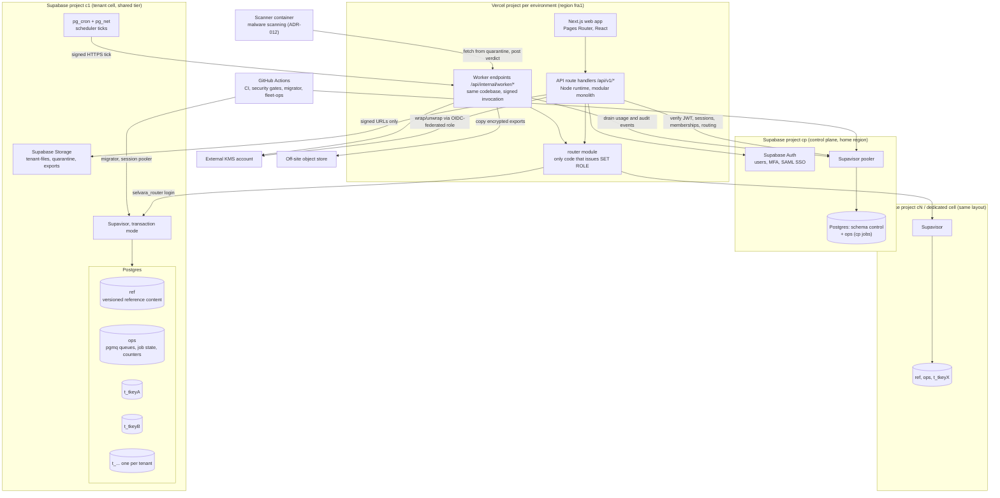
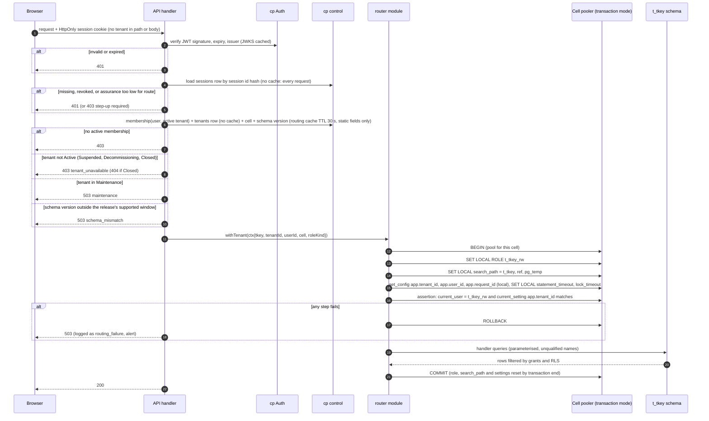
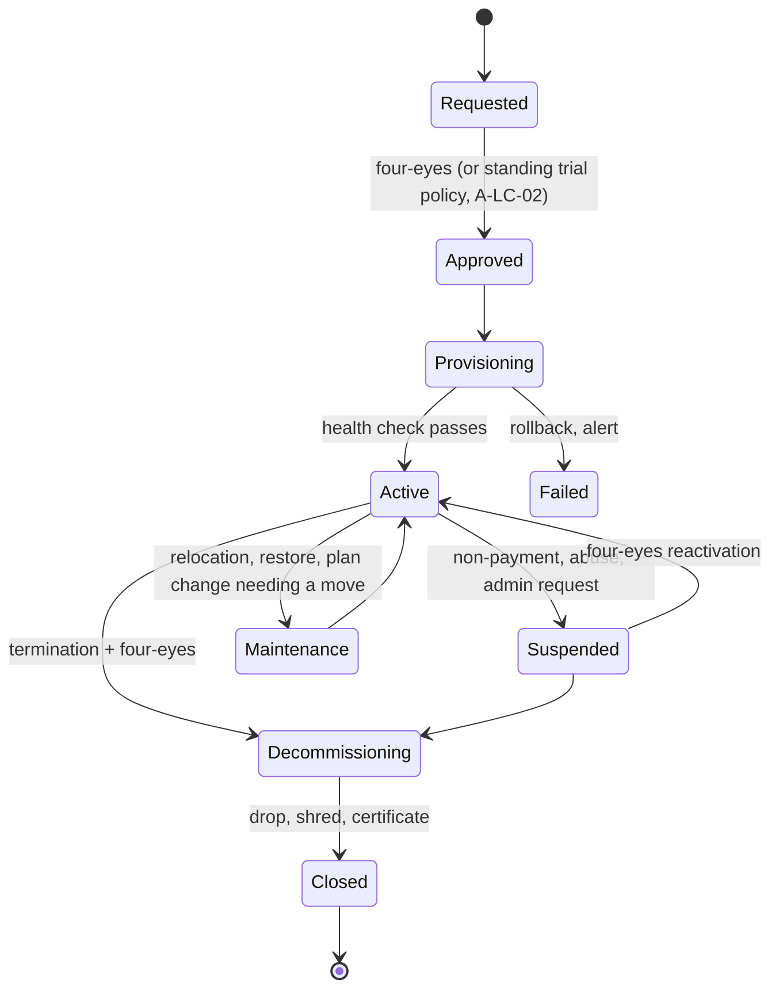
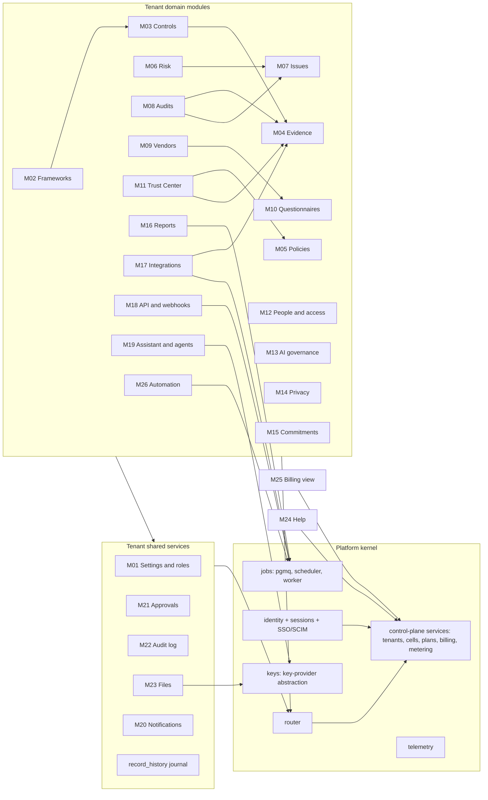

# Phase 2A: Architecture

| | |
|---|---|
| Status | Draft for the design authority (Phase 2). Documents only. |
| Date | 2026-11-23 |
| Binding input | `00-spine.md` (S0 to S9), ADR-001 (accepted) |
| ADRs owned | ADR-002, ADR-010 (this document); ADR-004, ADR-005, ADR-009 are shared with 2H |
| Compliance note | Any regulatory statement here is a **DRAFT** pending qualified legal and compliance review. Vendor facts marked *(verify)* were not confirmed against the vendor's current documentation. |

**ID convention.** The workstream prefix `A-` is followed by a section code (`A-CP-`, `A-RT-`, ...) so that item IDs never collide with assumption IDs (`A-15` to `A-24`), which keep the plain two-digit form.

---

## A-1. System context (C4 Level 1)

```mermaid
flowchart TB
  subgraph People
    TU["Tenant users<br/>admin, owner, analyst, employee"]
    EX["External parties<br/>auditor, vendor, Trust Center viewer"]
    PS["Platform staff<br/>management_approver, ciso, support"]
    AV["Anonymous visitors<br/>public Trust Center"]
  end
  SEL(("Selvara GRC platform<br/>control plane + tenant data plane"))
  TU -->|HTTPS, Supabase Auth session, SSO| SEL
  EX -->|HTTPS, scoped and time-boxed| SEL
  PS -->|HTTPS, elevation + four-eyes| SEL
  AV -->|HTTPS, public trust routes| SEL
  IDP["Customer IdPs<br/>SAML / OIDC, SCIM client"] <-->|SSO assertions, SCIM 2.0| SEL
  KMS["External KMS<br/>Selvara account + customer BYOK keys"] <-->|wrap / unwrap DEK| SEL
  PAY["Payment provider<br/>Stripe adapter now, others pluggable"] <-->|checkout, signed webhooks| SEL
  MAIL["Email provider<br/>transactional"] <-->|send, bounce and complaint webhooks| SEL
  AI["AI providers<br/>off by default, per tenant"] <-->|prompts after personal-data check| SEL
  INT["Customer systems<br/>GitHub, cloud, IdP directories"] <-->|integration syncs, outbound webhooks| SEL
  OBS["Observability SaaS<br/>logs, errors, uptime, paging"] <--|telemetry without tenant content| SEL
  OFF["Off-site object store<br/>other region, object lock"] <--|encrypted exports, audit anchors| SEL
```

## A-2. Containers (C4 Level 2)



Plane separation shown above:

| ID | Plane | Containers | Holds |
|---|---|---|---|
| A-PL-01 | Control plane | Supabase project `cp`: Auth, `control` schema, `ops` for control-plane jobs | Exactly the S2 list (A-3) |
| A-PL-02 | Tenant data plane | Supabase projects `c1..cN`: `ref`, `ops`, `t_<tkey>`, Storage buckets | All tenant business data, files, per-tenant journal and audit log |
| A-PL-03 | Compute (stateless) | Vercel functions: web, API, worker endpoints | No state beyond per-instance caches (A-RT-07) |
| A-PL-04 | Key plane | External KMS accounts (production, non-production) | KEKs only; DEKs leave only wrapped |
| A-PL-05 | Delivery plane | GitHub Actions with environments | Build, scans, attestations, migrator and fleet-ops credentials |

---

## A-3. Control plane (ADR-001 consequences applied; ADR-010)

### A-3.1 Contents (exact S2 list) and justification

"Tenant business data" (TBD) means anything under S4 or file contents. Every row below answers **No** for TBD; the right column states the residual personal data.

| ID | Table | Purpose | Why it must be in the control plane | Personal data held | TBD |
|---|---|---|---|---|---|
| A-CP-01 | `control.tenants` | Tenant registry: id, `tkey`, display name, status (Provisioning, Active, Suspended, Maintenance, Decommissioning, Closed), plan, `cell_id`, tier, created/approved refs | Routing and lifecycle must be decided before any tenant schema is opened | None (company name only) | No |
| A-CP-02 | `control.tenant_cells` | **Cell registry** (decision A-D-03): cell id, region, tier (shared or dedicated), status (Open, Full, Draining, Closed), capacity counters, connection secret *reference* | The router needs the cell before connecting | None | No |
| A-CP-03 | `control.tenant_schema_versions` | Per tenant: current version, target version, rollout state, last drift fingerprint, last migrated at | Router fails closed on version mismatch; orchestrator state (ADR-009) | None | No |
| A-CP-04 | `control.identities` | Supabase user id, email, display name, status | One person may belong to several tenants (D1); sign-in precedes tenant choice | Member identity (allowed by S2) | No |
| A-CP-05 | `control.memberships` | user, tenant, role id, status | Authorisation of tenant entry happens before the tenant connection | Membership fact | No |
| A-CP-06 | `control.tenant_roles` | Tenant-defined role id and name only | Membership needs a role id that exists; permissions stay in `t_<tkey>.tenant_role_permission` | None | No |
| A-CP-07 | `control.platform_staff` | Staff accounts, status | Platform authorisation is global | Staff identity | No |
| A-CP-08 | `control.platform_roles` | `management_approver`, `ciso`, `support`, custom roles from predefined names | OQ-01 | None | No |
| A-CP-09 | `control.platform_role_permissions` | Permission set per platform role | OQ-01 | None | No |
| A-CP-10 | `control.platform_approvals`, `platform_approval_votes` | Four-eyes engine for platform actions (provisioning, decommission, key destruction, relocation, restore, provider changes) | Approvals precede the action and outlive the tenant | Approver ids | No |
| A-CP-11 | `control.elevations` | Time-boxed staff elevation (reason, ticket, 60 min) | Kept from E-07 | Staff id, reason text | No |
| A-CP-12 | `control.support_grants`, `support_sessions` | Customer-granted, read-only support access windows | The grant must be checked before staff reach a tenant (via `t_<tkey>_ro`) | Staff and granting admin ids | No |
| A-CP-13 | `control.platform_audit_log` | Hash-chained platform log (staff actions, approvals, lifecycle, key events, certificate issuance) | Platform actions are not tenant records; the tenant's own log also records every support view (S2, OQ-10) | Actor ids, IPs | No |
| A-CP-14 | `control.plans`, `plan_entitlements` | Plan catalogue and limits (users, frameworks, storage, API calls, upload size under the platform ceiling) | Enforcement needs entitlements before the tenant transaction | None | No |
| A-CP-15 | `control.billing_entities` | Selvara selling entities (Pakistan now; UAE, US, UK later) | BL-04 | None | No |
| A-CP-16 | `control.subscriptions`, `invoices`, `payments` | Commercial relationship | Selvara is controller for billing data | Billing contact | No |
| A-CP-17 | `control.usage_meters` | Aggregated counts per tenant and meter per period, built from events (A-XT-02) | Plan limits and invoicing | None | No |
| A-CP-18 | `control.provider_configs` | Payment, AI, email, scanner provider settings with **secret references** | Platform-level configuration | None | No |
| A-CP-19 | `control.key_registry` | Tenant KEK ids, DEK versions, BYOK flag, state, destruction date; never key material | Crypto-shredding must be provable after the tenant schema is gone | None | No |
| A-CP-20 | `control.deletion_certificates` | Signed certificate per decommission and per key destruction | Must survive the tenant (Q-24) | Approver ids | No |
| A-CP-21 | `control.support_questions`, `support_messages` | Help desk (M24) | Selvara is controller for support communication | Requester identity and message text | No by design; see A-CP-R1 |
| A-CP-22 | `control.ropa_selvara` | Selvara's own RoPA (OQ-08) | Provider-level record | None | No |
| A-CP-23 | `control.sso_connections` | Per-tenant SAML/OIDC metadata, domain bindings, secret references | Sign-in happens before tenant entry | None | No |
| A-CP-24 | `control.scim_tokens` | Hashed SCIM bearer tokens, tenant id, scopes, expiry | SCIM requests are authenticated before tenant routing | None | No |
| A-CP-25 | `control.sessions` | **Addition (spine deviation SD-A1).** Server-side session: session id hash, user id, active tenant id, assurance level (MFA, step-up time), created, last seen, revoked | S3 step 1 requires a server-side session record holding the active tenant; S2 omits it | Session metadata, IP prefix | No |

| ID | Residual exposure | Control |
|---|---|---|
| A-CP-R1 | A customer can paste business content into a support message | Text-only messages, no file attachments in the control plane; the UI warns; retention 24 months after closure *(DRAFT, 2G to confirm)*; a support agent needing tenant data uses a support session, never asks for paste |
| A-CP-R2 | `control.identities` and `memberships` reveal who works where | Readable only by `cp_rw` handlers under row-level security keyed on `app.user_id` and `app.platform`; staff views are logged (OQ-10) |

### A-3.2 Control plane access (summary; full decision in ADR-010)

| ID | Principal | Path | Rights |
|---|---|---|---|
| A-CP-30 | API handlers (account, platform, routing, SCIM) | `cp` pooler, login role of the `cp_rw` group | DML on `control` under RLS keyed on `app.user_id`, `app.platform`, `app.elevation_id`; no DDL |
| A-CP-31 | Worker (events, metering, certificates) | Same login, `app.system = '<job>'` | Insert-only on `usage_meters`, `platform_audit_log`; update on `tenant_schema_versions` |
| A-CP-32 | Migrator | GitHub environment `production-migrate` | DDL on `control`, `ops` |
| A-CP-33 | Supabase Auth | Supabase-managed | `auth` schema only; an Auth hook (if used) reads `control.memberships` through a narrow function *(verify hook availability)* |
| A-CP-34 | Humans (break-glass) | Supabase dashboard, two org members, MFA | Superuser; every use is a break-glass event reviewed by the other super admin (R-C) |
| A-CP-35 | Data API (PostgREST) on `cp` and every cell | **Disabled** or no exposed schemas; `anon` and `authenticated` have no grants outside what Auth needs *(verify the switch per project)* | None |

---

## A-4. Tenant data plane

| ID | Element | Design |
|---|---|---|
| A-DP-01 | Schemas per cell | `ref`, `ops`, `t_<tkey>` per tenant, Supabase `auth` and `storage` (cells do not use `auth`; identities live in `cp`) |
| A-DP-02 | Tenant schema | The S4 catalogue (110 tables) plus `record_history`; standard columns on every table; owned by the `migrator`-controlled owner role `t_owner` (NOLOGIN), never by `t_<tkey>_rw`, so a tenant role cannot `ALTER`, `DISABLE ROW LEVEL SECURITY` or `DROP` |
| A-DP-03 | Defence in depth | `tenant_id uuid not null` with `CHECK (tenant_id = '<uuid>')` written at provisioning, plus RLS `tenant_id = current_setting('app.tenant_id')::uuid` with `FORCE ROW LEVEL SECURITY` |
| A-DP-04 | `ref` | Read-only to every `t_<tkey>_rw`/`_ro`; versioned (ADR-011, 2B); tenants reference `ref` rows by id and version |
| A-DP-05 | `ops` | pgmq queues, job state, rate-limit counters (`UNLOGGED`), event emit functions. No tenant business data: payloads carry `tkey`, job type and record ids only |
| A-DP-06 | Files | Bucket `tenant-files`, prefix `<tkey>/`; `quarantine`; `exports`. Objects are encrypted with the tenant DEK before upload (ADR-003), so the bucket never holds plaintext |
| A-DP-07 | Role inventory per cell | `selvara_router` (group, NOLOGIN) with login members `selvara_router_a`, `selvara_router_b` (SD-A2), `t_<tkey>_rw`, `t_<tkey>_ro`, `t_owner`, `ops_worker`, `tenant_admin` (CREATEROLE, owns the provisioning function only), `fleet_observer` (`pg_monitor`-style statistics, no data), `migrator` |

---

## A-5. Tenant routing from verified identity (ADR-002)

### A-5.1 Sequence, with fail-closed branches



### A-5.2 Routing rules

| ID | Rule |
|---|---|
| A-RT-01 | The tenant comes only from `control.sessions.active_tenant_id`. Switching tenant is `POST /api/v1/account/session/tenant`, which re-checks membership and writes the session row. |
| A-RT-02 | `router` is the only module that may import the cell pool or issue `SET ROLE`; enforced by an ESLint restricted-import rule and a unit test that greps the build output (S3.5). |
| A-RT-03 | `selvara_router` login roles hold no privileges of their own (NOINHERIT; membership grants `WITH INHERIT FALSE, SET TRUE` on Postgres 16+ *(verify the cell Postgres major version)*). A query that runs before `SET LOCAL ROLE` fails with a permission error: fail closed by construction. |
| A-RT-04 | `roleKind` is `rw` for normal work and `ro` for auditor engagements, exports and support sessions. The choice is made by the handler's declared capability, never by input. |
| A-RT-05 | The post-switch assertion (`select current_user, current_setting('app.tenant_id')`) runs in the same round trip as the settings (one multi-statement simple query) to keep the overhead to one network round trip. |
| A-RT-06 | Public routes (`/api/v1/public/trust/<ref>`, vendor portal) resolve the tenant from a signed, opaque reference mapped in `control` (never a `tkey` or schema name in the URL) and always use `t_<tkey>_ro` plus a public-route allowlist of views. |
| A-RT-07 | Caches (reconciled R2-01): **sessions, memberships and tenant status are never cached**; every request reads them (indexed primary-key lookups in `cp`). Revoking a membership or suspending a tenant also sets `revoked_at` on the affected `control.sessions` rows in the same transaction. Only static routing fields (cell, schema name, schema version) are cached per instance, TTL 30 s, invalidated on relocation and migration events. Revocation therefore takes effect on the next request. |
| A-RT-08 | Jobs: a pgmq message carries `tkey`; the worker resolves the tenant through `control` (status must allow the job type) and enters through the same `router.withTenant`. |
| A-RT-09 | Every response that is a refusal of another tenant's record is 404 (S6). |

---

## A-6. Connection management at scale

| ID | Topic | Design |
|---|---|---|
| A-CN-01 | Pooler mode | Supavisor **transaction mode** (port 6543) for API and worker traffic. Port 5432 (session mode) only for the migrator and fleet-ops jobs, which need session features and IPv4 reachability from GitHub runners *(verify)*. |
| A-CN-02 | Why one login | Supavisor keeps one pool per (database user, database). Per-tenant logins (ADR-002 option C) would create one pool per tenant and exhaust server connections at a few dozen tenants. One login gives **one pool per cell regardless of tenant count**, which is why C1-01 exists. |
| A-CN-03 | Transaction-scoped state only | Only `SET LOCAL`, `set_config(..., true)` and `pg_advisory_xact_lock` are allowed. `SET` (session), `SET SESSION AUTHORIZATION`, session advisory locks, `LISTEN/NOTIFY`, temporary tables that outlive a transaction, and `WITH HOLD` cursors are banned; a lint rule on SQL strings and a pooled-connection test that checks `current_user` and `search_path` at the start of every transaction enforce it. |
| A-CN-04 | Prepared statements | The shared pooler in transaction mode does not support named prepared statements *(source 3)*. `pg` (node-postgres) sends parameterised queries as **unnamed** statements, which are safe; the `name` query option is banned by lint. ORMs that require named statements or session state (Prisma without its pooler flag) are excluded. A dedicated pooler (PgBouncer 1.21+) supports them *(source 3)* if ever needed. |
| A-CN-05 | Role-level settings do not apply after `SET ROLE` | `ALTER ROLE ... SET statement_timeout` takes effect at login, not on `SET ROLE`. Per-tenant budgets are therefore issued as `SET LOCAL statement_timeout` (default 8 s; reports and exports 60 s via `ro` worker paths) and `SET LOCAL lock_timeout = '3s'` in the router preamble. `idle_in_transaction_session_timeout` is set on the router login roles. |
| A-CN-06 | Pool per function instance | `max` 3 per cell pool, idle timeout 10 s, connect timeout 5 s (kept from `db.ts`). Pools for cells are created lazily; an instance that only serves `c1` holds no `c2` connections. |
| A-CN-07 | Pooler client ceiling | Pooler client limits scale with compute size (Micro 200, Small 400, Medium about 600 *(source 1, verify)*). Ceiling check: peak Vercel instances x 3 must stay below 70% of the cell's pooler client limit; breach is a cell-scaling alert (H). |
| A-CN-08 | Server connections | Default pool size per compute is small (15 on Micro *(source 1, verify)*). Transactions are kept short (no external calls inside a tenant transaction: KMS, email, AI and HTTP happen before or after). Target mean transaction time under 15 ms. |
| A-CN-09 | Catalog and relcache growth | Each tenant adds about 650 `pg_class` rows (110 tables, TOAST, about 400 indexes) and about 3,000 `pg_attribute` rows *(estimate)*. A pooled server connection that serves many tenants accumulates relcache/catcache entries for every schema it touches, so backend memory grows with tenants served. Controls: server-connection recycling *(verify the Supavisor setting available on hosted projects)*, backend memory monitoring, and the cell threshold (A-PH-03). |
| A-CN-10 | Statistics attribution | `pg_stat_statements` computes `queryid` with relation OIDs, so the same query text in 500 schemas produces 500 entries and evicts at the default `pg_stat_statements.max` *(verify on Supabase)*. Attribution uses the `userid` column (the tenant role after `SET ROLE`, *verify*) and is sampled hourly by `fleet_observer` into the fleet report. |
| A-CN-11 | Behaviour at hundreds to thousands of tenants | Connections: unchanged (one pool). Role memberships: `selvara_router` is a member of every `t_*_rw`/`_ro` role (2 per tenant); membership checks are cached per backend. Catalog: grows linearly (A-CN-09); `pg_dump` of the whole database and catalog-wide migrations slow down, which is why per-tenant operations never rely on database-wide dumps and the cell is capped. |
| A-CN-12 | Credential rotation | Two login roles (`selvara_router_a/_b`) let the password of the idle one rotate, deploy, then swap, with no downtime (quarterly, automated by H). |

---

## A-7. Physical layout and cells

| ID | Item | Decision |
|---|---|---|
| A-PH-01 | Launch | `cp` (control plane) and `c1` (shared cell) as **two Supabase projects** in one region (Frankfurt today per `docs/guides/SUPABASE.md`), one production Supabase organisation (ADR-010). |
| A-PH-02 | Schemas per cell | Provisional ceiling **300 tenant schemas** per shared cell until 2J measures it (A-15). |
| A-PH-03 | Threshold to open a new cell (any one) | (1) 300 tenant schemas; (2) `pg_class` rows above 250,000; (3) database size above 60% of the disk the cell's compute tier is sized for; (4) p95 API latency on the cell above target (A-NFR-03) for 3 consecutive days with compute already at the tier ceiling chosen for shared cells (Large); (5) a full migration rollout on the cell exceeds 45 minutes; (6) pooler clients above 70% of limit at peak after a compute upgrade. The status of the full cell becomes `Full` (no new placement); existing tenants stay. |
| A-PH-04 | Placement | New tenants go to the `Open` shared cell in the chosen region with the most headroom; region choice is recorded at provisioning (R-01). |
| A-PH-05 | Dedicated cell (enterprise tier) | One Supabase project per tenant, same layout (`ref`, `ops`, one `t_<tkey>`), same code path and router; own compute size, own PITR window (14 or 28 days), optional Team/Enterprise Supabase features such as PrivateLink *(verify plan requirement)*. A tenant also moves to a dedicated cell when it alone exceeds 10% of a shared cell's database size or query time. |
| A-PH-06 | Cell identity | Cell ids are opaque (`c1`, `c2`, `d-<tkey>`); project refs live only in `control.tenant_cells` as secret references and in CI secrets. |

---

## A-8. Tenant lifecycle



| ID | Step | What happens | Target time | Gate |
|---|---|---|---|---|
| A-LC-01 | Provision | Allocate `tkey`; `control.tenants` row; choose cell; `ops.provision_tenant(tkey)` creates schema, roles, grants, tables at the current version (or claims a warm-pool schema, H-PV-04); create KEK in KMS and wrap first DEK; register in `key_registry`; seed (A-LC-03); create storage prefix; register backups and monitoring; health check (router round trip as `t_<tkey>_rw`, isolation probe); invite first admin | p95 under 2 min after approval; trial under 30 s (warm pool) | Four-eyes (`platform_approvals`) for paid, enterprise and dedicated tenants |
| A-LC-02 | Trial provisioning | Same pipeline under a **standing approval**: R-A and R-B approve the trial policy (limits, duration, region) once; each trial references it; daily digest to both | under 30 s | Standing four-eyes on the policy; owner to confirm (Open items) |
| A-LC-03 | Seed reference content | Nothing is copied from `ref` except tenant-editable templates: 7 base `tenant_role` rows and permissions, `tenant_settings` defaults, `risk_method_settings` and `risk_criteria` defaults (ISO 27005 both methods), RoPA template rows into `processing_activity`, notification defaults, `trust_settings` (unpublished). Framework activation is a tenant choice (`framework_scope`) that points at `ref` by version. Seed version recorded. | inside A-LC-01 | None (automated, idempotent) |
| A-LC-04 | Suspend | Status `Suspended` in `control`; sessions revoked in the same transaction, so the next request is refused (403); queues skip the tenant except exports, DSAR clocks and retention jobs; public Trust Center shows nothing | effective under 60 s | Four-eyes unless automatic for non-payment under the dunning policy |
| A-LC-05 | Plan change (same cell) | Update subscription and entitlements; limits apply on the next request | immediate | Self-serve via payment, or four-eyes for manual overrides |
| A-LC-06 | Relocation between cells | Status `Maintenance` (read-only banner, writes 503); final logical export; create schema and roles in target cell at the same schema version; load; verify row counts, hash-chain of `audit_log_entry`, `record_history` continuity and file manifest; copy files (encrypted objects copied as-is); switch `cell_id`; drop in source after 7 days under four-eyes | write freeze p95 under 15 min for tenants under 1 GB; under 2 h for 1 to 20 GB | Four-eyes |
| A-LC-07 | Export (tenant request or exit) | Per-tenant logical export through `t_<tkey>_ro`: JSONL per table, schema version and catalog fingerprint, file manifest, decrypted with the tenant's keys and re-encrypted to a tenant-supplied public key or delivered through a signed URL valid 24 h | under 1 h for under 5 GB; under 24 h otherwise | Tenant admin request plus re-authentication; no platform approval needed |
| A-LC-08 | Decommission | Termination notice; status `Decommissioning`; grace 30 days (export available); four-eyes approval; drop schema and roles; delete `<tkey>/` objects and exports in all stores; schedule KEK destruction in KMS (provider minimum waiting period applies *(verify; AWS KMS 7 to 30 days)*); destroy per-subject keys; issue a signed deletion certificate (what, keys, approvers, timestamps, hashes, residual windows of provider backups) anchored in `platform_audit_log` | data removal under 1 h after approval; certificate after KEK destruction completes | Four-eyes; GitHub environment approval for the drop job (H-PV-07) |

Residual window (stated on the certificate): Supabase PITR and daily backups of the cell keep plaintext columns of the dropped schema until they age out (7 days at the launch PITR setting *(verify)*); encrypted fields are unreadable once the KEK is destroyed. This is why confidential and personal fields are encrypted at application level (ADR-003).

---

## A-9. Cross-tenant needs without cross-tenant queries

| ID | Need | Mechanism | Never |
|---|---|---|---|
| A-XT-01 | Event emission | Inside a tenant transaction, `ops.emit(event_type, payload)` (SECURITY DEFINER, pinned `search_path`) derives `tkey` from `current_user` (`t_<tkey>_rw`), never from an argument, validates the payload against an allowlist schema per event type (ids, counts, enums), and sends to a pgmq queue. Atomic with the business change. | Free-text, names or file content in events |
| A-XT-02 | Billing metering | Worker drains usage events into `control.usage_meters` (aggregates per tenant, meter, period); plan enforcement reads entitlements plus meters | Counting by scanning tenant schemas |
| A-XT-03 | Product analytics | Aggregated events (feature used, module, counts) into `control` aggregates; dashboards over those only | A cross-schema `UNION` or a reporting replica of tenant data |
| A-XT-04 | Support tooling | Staff see the control-plane view (tenant status, plan, usage, schema version, health). Tenant content only inside a support session via `t_<tkey>_ro`, read-only, logged in both audit logs | Staff queries across tenants |
| A-XT-05 | Fleet health | `fleet_observer` reads catalog and statistics views (sizes, versions, slow queries by role) only | Reading any tenant table |
| A-XT-06 | Shared content | `ref` is pushed to tenants by version; tenant content never flows back into `ref` | Tenant data feeding shared catalogues or AI training |

---

## A-10. Service boundaries

**Recommendation (A-SB-01): one modular monolith** (one Next.js codebase and deployment), with enforced module boundaries. Reasons: one team-less operator, one deploy unit to attest, one router to audit, shared transaction for business change + journal + audit + event. Extraction candidates later: scanner (already separate), exports runner, AI gateway.

| ID | Boundary rule |
|---|---|
| A-SB-02 | Platform modules live in `src/server/platform/<module>`; tenant modules in `src/server/modules/mNN-<name>`; each exposes `index.ts` only. ESLint `no-restricted-imports` enforces it, matching the front-end feature rule. |
| A-SB-03 | Tenant modules never import `control` data access; they receive a `TenantCtx` from `router`. |
| A-SB-04 | Cross-module writes go through the owning module's service (for example, M04 evidence links are created by M04, called from M08). |
| A-SB-05 | One approvals engine (M21), one audit writer (M22), one file service (M23), one journal writer (`record_history`) used by every module in the same transaction. |



---

## A-11. Technology decisions and tenant isolation per component

| ID | Component | Choice | Tenant isolation mechanism |
|---|---|---|---|
| A-TS-01 | Framework and runtime | Next.js 16 API routes on Vercel, Node runtime (not Edge: `pg` and KMS SDK need Node), TypeScript (Q-12) | Tenant context only from `router`; no global mutable state keyed by request |
| A-TS-02 | Database | Supabase Postgres per cell; `pg` driver; SQL through a typed query builder that emits unnamed statements (choice left to 2B) | Role per tenant, schema grants, `tenant_id` + RLS (ADR-002) |
| A-TS-03 | Cache | **No external cache at launch** (decision A-D-05). Per-instance LRU for JWKS and static routing fields only (TTL 30 s; never sessions, memberships or tenant status, R2-01); `ops.rate_bucket` (UNLOGGED) for rate limits | Keys include `tkey`; only control-plane metadata is cached, never tenant records |
| A-TS-04 | Queue and scheduler | Supabase Queues (pgmq) in `ops`, `pg_cron` ticks via `pg_net` to worker endpoints (ADR-005) *(verify maturity: Queues listed as alpha on one Supabase page, source 6)* | One message, one tenant; `tkey` from the emitting role; fair round-robin per tenant |
| A-TS-05 | Object storage | Supabase Storage per cell; signed URLs issued by the API | Prefix `<tkey>/`; client-side (application) encryption with the tenant DEK; storage access by a cell-scoped token whose policy limits to the prefix (2F decides the token mechanism; see R-13) |
| A-TS-06 | Search | Postgres full-text search (`tsvector` + GIN) inside each tenant schema; trigram index for `ref` lookups. Encrypted fields are not searchable (by design) | Index lives in the tenant schema; no shared search index |
| A-TS-07 | Keys | External KMS behind the key-provider abstraction (ADR-003, 2F/2G) | One KEK per tenant; BYOK per tenant |
| A-TS-08 | Email | Transactional provider behind the email abstraction | Templates rendered per tenant; no tenant content in subjects beyond record refs |
| A-TS-09 | Malware scanning | One managed container (ADR-012) | Receives one object at a time by signed URL; holds nothing after the verdict |

---

## A-12. Non-functional requirements

| ID | NFR | Target | Measured by |
|---|---|---|---|
| A-NFR-01 | Availability, API, shared tier | 99.9% monthly, excluding announced maintenance | External uptime probes on `/api/health` and an authenticated canary tenant read |
| A-NFR-02 | Availability, dedicated tier | 99.9% contractual, 99.95% objective (bounded by Supabase and Vercel commitments *(verify which plans carry an SLA)*) | Same, per cell |
| A-NFR-03 | Latency p95, single-record read | under 300 ms server time | Server timing metric per route |
| A-NFR-04 | Latency p95, list (limit 50) and writes | under 500 ms | Same |
| A-NFR-05 | Latency p95, routing overhead (cache hit) | under 15 ms; cache miss under 60 ms | Router span |
| A-NFR-06 | Latency, public Trust Center page | p95 under 400 ms | Probe |
| A-NFR-07 | Throughput per shared cell (launch sizing) | 200 requests/s sustained, 500 burst | 2J load test |
| A-NFR-08 | Per-tenant fairness | 50 requests/s per tenant, 10 per user (plan-adjustable); jobs 1 to 2 concurrent per tenant | 429 rate, queue lag |
| A-NFR-09 | Scalability | 300 tenants per shared cell (provisional), linear by cells; 1,000 tenants = 4 shared cells | 2J |
| A-NFR-10 | Tenant provisioning | p95 under 2 min after approval; trial under 30 s | Pipeline metric |
| A-NFR-11 | Migration rollout | under 45 min per cell for a full rollout | Orchestrator metric |
| A-NFR-12 | Revocation propagation | Suspension, membership and session revocation enforced on the next request (no cache, R2-01) | Test |
| A-NFR-13 | RPO, cell loss (DR) | 5 min or less with PITR *(verify WAL archive interval)* | DR drill |
| A-NFR-14 | RTO, cell loss | Shared: 4 h; dedicated: 4 h | DR drill |
| A-NFR-15 | RPO / RTO, single-tenant restore (logical error) | RPO: any point in the journal (cell intact) or the PITR window; RTO 8 h shared, 4 h enterprise | Quarterly restore drill |
| A-NFR-16 | RPO / RTO, region loss | RPO 24 h (off-site nightly exports); RTO 72 h shared, 24 h enterprise | Annual region-loss tabletop plus partial rebuild |
| A-NFR-17 | Data durability of journal | Every committed change has a `record_history` row in the same transaction | Invariant test |
| A-NFR-18 | Upload limits | Per plan and per tenant, capped by the platform ceiling set by a super admin; ceiling below the Supabase Storage per-file limit of the plan *(verify)* | Config check |

---

## A-13. Decisions made in this workstream

| ID | Decision | Rationale |
|---|---|---|
| A-D-01 | Separate `cp` project from launch (ADR-010) | Smaller blast radius, distinct credentials, cp can stay up when a cell is restored; marginal cost about one Micro compute plus its PITR |
| A-D-02 | Supabase Auth runs in `cp` only; cells do not use their `auth` schema | One identity store across cells; SSO configured once |
| A-D-03 | `control.tenant_cells` is the cell registry; the tenant's cell is `control.tenants.cell_id` | The spine names the table but not its shape |
| A-D-04 | Per-tenant export is a logical, table-level JSONL export through `t_<tkey>_ro`, plus the schema version and catalog fingerprint, not `pg_dump` | Runs in the worker without a database-wide tool, restores into any cell at a known version; meets S7 "schema dump" by reproducible DDL at that version |
| A-D-05 | No external cache at launch | Fewer subprocessors; revisit when A-NFR-07 is approached |
| A-D-06 | Release supports a window of tenant schema versions `[N-1, N]` (expand/contract) | Batched rollouts (ADR-009) need old and new schemas to coexist |
| A-D-07 | Modular monolith | A-SB-01 |

---

## Deliverables

| ID | Deliverable | Location |
|---|---|---|
| A-DL-01 | This document | `p2/2A-architecture.md` |
| A-DL-02 | ADR-002 Isolation inside one project | `p2/adr/ADR-002-isolation-inside-one-project.md` |
| A-DL-03 | ADR-010 Control plane placement and access | `p2/adr/ADR-010-control-plane-placement.md` |
| A-DL-04 | Shared with 2H: ADR-004, ADR-005, ADR-009 | `p2/adr/` |

## Decisions required

| ID | Decision | ADR | Who |
|---|---|---|---|
| A-DR-01 | Role per tenant, one router, RLS as defence in depth, two router login roles | ADR-002 | Owner |
| A-DR-02 | Dedicated `cp` project from launch | ADR-010 | Owner |
| A-DR-03 | Standing four-eyes approval of a trial policy instead of per-trial approval | ADR-010 (lifecycle) | Owner |
| A-DR-04 | Provisional cell threshold (A-PH-03) pending 2J | ADR-001 C1-05 follow-up | Design authority |

## Open risks

| ID | Risk | L | I | Treatment |
|---|---|---|---|---|
| R-11 | Supabase organisation owners and the dashboard SQL editor have superuser reach into every tenant schema in a cell; this bypasses the router entirely | Low | Critical | Two org members only, MFA enforced, break-glass procedure with after-review, application-level encryption of confidential fields, Supabase org audit log *(verify plan)* |
| R-12 | Catalog growth (A-CN-09) degrades backend memory and migration time earlier than the provisional 300-schema threshold | Medium | High | 2J load test with 1,000 synthetic schemas; recycle server connections; lower threshold if needed |
| R-13 | Storage access needs a credential that can reach every tenant prefix in the bucket (service key) unless a prefix-scoped token mechanism is available | Medium | High | 2F to confirm a prefix-scoped signed token *(verify)*; otherwise the service key is confined to the files module, never used for database access, with path-prefix checks and tests; files are DEK-encrypted so a path error does not reveal plaintext |
| R-14 | (Closed by R2-01) Session, membership and status checks are uncached; residual: a request already in flight completes | Low | Low | R-B | Accept | Closed |

## New assumptions

| ID | Assumption | Validate by |
|---|---|---|
| A-15 | A shared cell holds 300 tenant schemas within A-NFR targets on Large compute or below | 2J load test |
| A-16 | Cell Postgres is version 16 or later, so membership grants can carry `INHERIT FALSE, SET TRUE` | Check project version |
| A-17 | The Data API (PostgREST) can be disabled or restricted to no schemas per project | Supabase documentation |
| A-18 | A typical tenant is under 1 GB of database data and under 20 GB of files in year one | Telemetry after launch |

## Spine deviations

| ID | Spine item | Deviation | Reason |
|---|---|---|---|
| SD-A1 | S2 ("and only this") | Adds `control.sessions` | S3 step 1 needs a server-side session record holding the active tenant; nothing in S2 can hold it |
| SD-A2 | S3.3 "logged in as `selvara_router`" | `selvara_router` becomes a NOLOGIN group; logins are `selvara_router_a` and `selvara_router_b` | Zero-downtime password rotation (A-CN-12). Membership chain must keep `SET` rights *(verify on the cell Postgres version)* |
| SD-A3 | S3.2 "503 when the schema version does not match" | 503 when the version is outside the release's supported window `[N-1, N]` | Batched migrations (ADR-009) |
| SD-A4 | S7 "schema dump" | Logical JSONL export plus version and catalog fingerprint; DDL is regenerated from migrations at that version | A-D-04 |

## Sources

1. Supabase documentation, "Compute and Disk" (connection and pooler limits per compute size). Fetched only through search summaries; figures marked *(verify)*.
2. Supabase pricing page ("Predictable pricing").
3. Supabase documentation, "Disabling Prepared statements" (troubleshooting) and "Supavisor FAQ".
4. Supabase changelog, "Supabase Connection Pooler Deprecating Session Mode on Port 6543".
5. Supabase documentation, "PrivateLink" and "Network restrictions".
6. Supabase "Queues" feature and documentation pages.
