# Phase 2B: Data model

| | |
|---|---|
| Workstream | B (Data model) |
| Status | Proposed, Phase 2 design. Documents only. |
| Date | 2026-11-23 |
| Binding inputs | `p2/00-spine.md` (S1 to S9), Phase 1 `backend-v2/` documents, ADR-001 |
| ADRs owned | [ADR-008](../adr/ADR-008-typed-entity-tables.md) typed entity tables; [ADR-011](../adr/ADR-011-reference-content-versioning.md) reference content distribution and versioning |
| ADRs referenced | ADR-002 (isolation, workstream A/F), ADR-003 (keys, F/G), ADR-004 (backup, H), ADR-009 (migration orchestration, A), ADR-010 (control plane, A) |
| Companion | [2B-classification.md](2B-classification.md): field classification, field-level encryption and retention class per entity |
| Compliance note | Retention periods, lawful bases and special-category handling are a **DRAFT** pending review by qualified legal and compliance staff. Items marked *(verify)* are unconfirmed. |

## Contents

1. Model principles (B-D01 to B-D21)
2. Placement: control plane, `ref`, tenant schema, `ops`
3. Standard columns, audit fields and the change journal
4. `tenant_id` as defence in depth
5. Reference content in `ref` and tenant custom content
6. Module catalogue: ERD and table specification per module (M01 to M26, control plane, `ks`, `ops`, `ref`, API exposure) (rev P3)
7. Deletion, legal hold and retention
8. Multi-schema migration rules
9. Mapping of today's `ws_records`, `platform_records` and `kv` to v2
10. Verification (B-V)
11. Deliverables, decisions, risks, assumptions, spine deviations

Notation used in every table below:

| Token | Meaning |
|---|---|
| `pk`, `fk→x`, `uk`, `nn` | primary key, foreign key to table `x`, unique, not null |
| `ck(...)` | check constraint (text enumerations are `text` plus `ck`, never Postgres enum types, see B-D07) |
| `xor(a,b,...)` | exclusive arc: exactly one of the listed nullable foreign keys is not null (check constraint) |
| `_enc` | ciphertext column (`bytea`), envelope-encrypted by the application (ADR-003). Encryption class (2F F-D-12, the only codes used, DA-01): **E1** tenant DEK (in `control`: the platform KEK, B-E90.2), **E2** per-subject key; a column without `_enc` is **E0** (rev P3) |
| `_bidx` | blind index (`bytea`, HMAC-SHA-256 under the tenant blind-index key in `ks`, or in `control` under the platform blind-index key F-K-32) for equality lookup on an encrypted value (rev P3) |
| `user` | a member's user id (`uuid`), the Supabase Auth id held in `control.identities`, mirrored in `member_profile.user_id` |
| Del | delete mode: **S** soft (`deleted_at`), **H** hard, **A** append-only (never updated or deleted by the application; purged by retention only), **I** immutable after insert |
| RC | default `retention_class` value (section 7, B-RC01 to B-RC28; column purges B-RC30 to B-RC35) (rev P3) |

## 1. Model principles

| ID | Decision | Rationale |
|---|---|---|
| B-D01 | **One typed table per entity** (ADR-008). Every field a rule, filter, join, link, classification or retention decision depends on is a typed column. `jsonb` is allowed only for (a) frozen snapshots (`risk_snapshot.content`, `record_history.before/after`, `report_run.filters`), (b) non-secret provider configuration and provider payloads. Free-form JSON documents that hold user input are stored as **encrypted JSON** (`bytea`, E1): `approval.payload_enc`, `risk_import.rows_enc`, `ai_assessment.answers_enc`, `agent_change.proposed_enc`. Each `jsonb` or encrypted-JSON column carries a `*_schema` text column naming its JSON Schema id and a size check (validated by the service before encryption). (rev P3) | Today's `ws_records` hides fields from the database: no constraints, no foreign keys, no per-field classification, encryption or retention (inventory AS gap 4 to 6, RK gap 2, 10). |
| B-D02 | **People are referenced by id only.** Business tables store `user` ids (members) or `person.id` (workforce, contractors) or an external-party row id (vendor contact, trust viewer, data subject). Display names and emails live only in `member_profile`, `person`, `contractor`, `vendor_contact`, `trust_viewer`, `data_subject_request` and are resolved at read time. | Fixes F1-09 and RK gap 10: names copied into many JSON records and into audit targets. Erasure then touches a known, small set of columns. |
| B-D03 | **Exclusive-arc links instead of polymorphic `(table, id)` pairs** wherever the target set is closed (`evidence_link`, `issue_link`, `audit_shared_item`, `control_mapping`, `requirement_status`, `processing_link`). Each target has its own nullable `fk` column and a `xor` check. The only polymorphic references are `approval.subject_*`, `notification.link_*`, `record_history`, `audit_log_entry.target_*` and `file_object.owner_*`, each validated by a constraint trigger against an allow-list of tables. | Real referential integrity for every link that grants access (auditor scope, Trust Center) or drives a rule. |
| B-D04 | **Primary keys** are `uuid` (UUIDv7, time-ordered, generated by the API; native `uuidv7()` when the Postgres version offers it *(verify for the Supabase Postgres version)*). The human id `ref` (`CTL-12`) is assigned from `ref_counter` under a row lock, is unique per table and is never reused, even after deletion. | Stable ids across export, restore and replay (S7); readable references for users and auditors. |
| B-D05 | **Times are `timestamptz`; calendar facts are `date`** (due dates, effective dates, review dates). Money is `bigint` minor units plus `currency char(3)`. Today's epoch-millisecond `bigint`s and display strings (`Policy.review`, `Test.last`, `Audit.period`) are not carried over. | Inventory AS gap 8: dates stored as display text cannot drive jobs (S8). |
| B-D06 | **Audit fields are set by the database**, not by the request: triggers fill `created_at/by`, `updated_at/by` from `app.user_id` and `app.actor_kind` (set by `router`, S3) and enforce `version = old.version + 1`. A missing actor context fails the write. | The client cannot spoof authorship; same pattern as today's `ws_records_guard`, generalised. |
| B-D07 | **No Postgres enum types.** Enumerations are `text` with a `ck` (short, stable lists) or a lookup table in `ref` (long or content-driven lists, such as data categories). | Adding an enum value across thousands of schemas is awkward and cannot run inside every migration transaction; a check constraint can be replaced `NOT VALID` then validated (section 8). |
| B-D08 | **Tables are owned by the NOLOGIN role `t_owner`** (one per cell, controlled by `migrator`, as ADR-002 and 2A A-DP-02 name it); `t_<tkey>_rw` and `t_<tkey>_ro` are never owners. RLS is `ENABLE` and `FORCE` on every tenant table. | Owners bypass RLS unless forced; keeping the application role a non-owner keeps the defence-in-depth policy effective (section 4). See SD-B03. |
| B-D09 | **One approval engine** (M21 `approval`, `approval_vote`, `delegation`) for every tenant module, and `control.platform_approvals` for the platform. Modules store `approval_id` on the record that is waiting. | Fixes F1-04 (two engines today). |
| B-D10 | **Files are rows**: every stored object has a `file_object` row (M23) with hash, size, type, scan state and key version; modules reference `file_object.id`, never a path. Vendor portal uploads, Trust Center documents, knowledge-base documents, board minutes and evidence attachments all use it. | RK gap 9: portal files unscanned and outside Evidence; board minutes stored as a name only. |
| B-D11 | **Status is stored; derived states are computed.** Store the decision state (`approved`, `closed`); derive time-based labels (`Expiring`, `Overdue`, `Review due`, `Past due`) in queries from stored dates. Jobs (S8) write the transitions that have legal effect (acceptance expired, access ended) as ordinary audited updates. | Removes read-time writes (F1-05) while keeping the evidence trail. |
| B-D12 | **The brief's "Assessment" is not one table.** It is realised as `vendor_assessment`, `ai_assessment`, `dpia`, `audit` and `control_attestation`, each with its own rules. A cross-module view `assessment_v` (read-only) lists them for reports. | The five have different subjects, approvers and lifecycles; one generic table would need a polymorphic subject and loose rules. |
| B-D13 | **Two meanings of AccessRequest stay separate**: `access_request` (M12, workforce access to systems) and `trust_access_request` (M11, external document access). Platform access (`control.support_grants`, `control.elevations`) is a third, control-plane concept. | RK gap 16, AD gap 15. |
| B-D14 | **Vendor staff use the visitor model**, not tenant membership: a vendor contact answers through `vendor_portal_invite` plus `visitor_session`. The `vendor` base role remains only for tenants that want a vendor user with an account; that member sees only questionnaires linked to their `vendor_contact.user_id`. | RK gap 12. Keeps third-party people out of `control.memberships` by default (data minimisation). |
| B-D15 | **Snapshots are immutable and hashed**: `risk_snapshot`, `audit_shared_item` populations frozen at `audit.populations_frozen_at`, `access_review_item`, `report_run`, `policy_version` once approved. A trigger refuses updates to frozen rows. | AS gap 4 ("freeze populations locks nothing"). |
| B-D16 | **`record_history` journals every change** of every business table (S7), including encrypted columns as ciphertext. High-volume operational tables (`notification`, `webhook_delivery`, `integration_sync_run`, `test_run`, `automation_run`, `visitor_session`, `idempotency_record` (rev P3)) are excluded; they are append-only and carry their own audit entries where they matter. | Q-24 ("back up every change") without doubling telemetry volume. |
| B-D17 | **Personal data in the audit log is kept out of the hash input.** `audit_log_entry` and `control.platform_audit_log` hash every column except the personal-data ciphertexts `ip_enc`, `pd_enc` and `details_enc`; those enter the hash input only as their keyed HMACs (`ip_hmac`, `pd_hmac`, `details_hmac`), never as plaintext or ciphertext, so the retention column purge (B-RC32) or subject-key shredding can null the personal value while the chain still verifies (DA-03; 2F F-D-09, F-L-03 and ADR-013 follow this rule). Targets are `(target_table, target_id, target_ref)`, never names or emails. (rev P3) | An append-only, hash-chained log and storage limitation (GDPR Art. 5(1)(e) *(verify)*) are otherwise in conflict. |
| B-D18 | **Field-level encryption scope** (detail in the classification file; classes E0/E1/E2 of 2F F-D-12 only, DA-01): (a) direct identifiers of natural persons (members, workforce, contractors, visitors, vendor contacts, Trust Center viewers and NDA signers, data subjects, IdP-synced accounts, external report recipients, integration contacts) with a **per-subject key (E2)**; (b) narrative and descriptive free text that may hold personal or confidential data (descriptions, notes, reasons, comments, rationales, answers, bodies, scope text, encrypted JSON documents) with the **tenant DEK (E1)**; (c) titles, names of records, refs, enumerations, dates and scores stay **E0** and searchable; (d) all files with a per-file key whose wrapped form lives in the key store `ks.file_key`, never in a tenant table (DA-04, B-P24); (e) control-plane personal fields with **E1 under the platform KEK** (DA-05, B-E90.2). Secrets are never stored: only secret references (`*_secret_ref`) or one-way hashes. Tenant tables hold key ids and versions only (`subject_key_id`, `file_key_id`, `key_version`). (rev P3) | Erasure that reaches backups (discovery §6 condition 1) needs a key per person for exactly the columns that hold their identity; narrative text is crypto-shredded with the tenant and is not exposed as plaintext to operator access (2F R-44). |
| B-D19 | **Each ref content row is immutable and version-specific**; a tenant row points at the exact ref row it used (`fk` to `ref.requirement.id`), and upgrades remap through `ref.requirement_crosswalk` (ADR-011). | Audit evidence stays tied to the requirement text that was in force. |
| B-D20 | **One tenant schema shape for every plan.** Plan limits are enforced by the API against `control.plan_entitlements` (S6), never by omitting tables. | One migration chain, one drift fingerprint per version. |
| B-D21 | **Search over E1 text is decrypt-and-filter inside the tenant's own request.** Full-text and sort indexes exist only on E0 columns (titles, names, refs). A text filter on an E1 column decrypts the candidate rows of the tenant's current query (already narrowed by E0 filters and RLS) in the API and filters them in memory, with bounded page sizes (at most 200 rows returned and at most 2,000 rows decrypted per request *(limit set in 2C, measured in 2J)*); no plaintext index, cache or search engine holds E1 content (2F F-ISO-33). DSR locate (M14) uses E2 blind indexes, then decrypt-and-filter over E1 text. (rev P3) | DA-01. Keeps narrative content encrypted at rest and in backups while keeping list filtering usable for a tenant's own data volumes. |

## 2. Placement

### 2.1 Rule

| ID | Rule |
|---|---|
| B-P01 | Default placement is the **tenant schema** `t_<tkey>`. |
| B-P02 | An entity goes to the **control plane** only if it must be read **before** a tenant context exists (sign-in, routing, invitation redemption, SCIM, SSO), or it is about the commercial relationship between Selvara and the tenant, or Selvara is its controller (S2, OQ-08). |
| B-P03 | **`ref`** holds content identical for every tenant, published by Selvara, immutable per release, with no tenant data and no personal data. |
| B-P04 | **`ops`** holds queue messages and job state only: `tkey`, job type, record ids, attempt counters. No business fields, no personal data, no free text. A job reads its data from the tenant schema through `router` (S8). |
| B-P05 | Nothing about a tenant's GRC content (controls, evidence, risks, vendors, policies, audits, privacy records, files) is ever central (S2). Counts for metering are sent as events and aggregated in `control.usage_meters`. |

### 2.2 Placement of the brief's entities

| ID | Entity | Placement | Table(s) | Justification for central placement |
|---|---|---|---|---|
| B-P10 | Tenant | Control | `control.tenants`, `control.tenant_cells`, `control.tenant_schema_versions`; tenant side `tenant_settings` | Routing (S3 step 2) needs it before any tenant schema is chosen. Tenant-side behaviour settings stay in the tenant schema. |
| B-P11 | User | Control | `control.identities`; tenant side `member_profile` (copy of display data, E2) (rev P3) | One person can belong to several tenants (D1); sign-in precedes tenant choice. |
| B-P12 | Membership | Control | `control.memberships` (status `invited`, `pending`, `active`, `suspended`, `removed`), `control.invitations` (addition, SD-B01) | Needed to authorise the request before the tenant transaction (S3 step 2). An invitation must be redeemable by someone with no tenant context yet. |
| B-P13 | Role | Split | `control.tenant_roles` (id, tenant, name, base role ceiling); `tenant_role` (same id, description); `control.platform_roles` | The membership's role id must resolve centrally; what the role may do is tenant data (S2). |
| B-P14 | Permission | Split | `ref.permission` (catalogue of codes), `tenant_role_permission`; `control.platform_role_permissions` | Codes are product-defined (ref); grants are tenant-defined (tenant schema). |
| B-P15 | Framework, Requirement | `ref` plus tenant | `ref.framework`, `ref.requirement`; `framework_scope`, `custom_framework`, `custom_requirement`, `requirement_status` | Library content is identical for all tenants (ADR-011). |
| B-P16 | Control, ControlMapping | Tenant (library in `ref`) | `control`, `control_mapping`; `ref.library_control` | |
| B-P17 | Evidence, Policy, Asset, Threat, Vulnerability, Risk, RiskTreatment, Vendor, Questionnaire, Assessment, Audit, Finding, CorrectiveAction, TrustCenterPage, AccessRequest, ProcessingActivity, DPIA, DataSubjectRequest | Tenant | modules M03 to M15 | |
| B-P18 | Plan, Subscription, Invoice | Control | `control.plans`, `control.plan_entitlements`, `control.subscriptions`, `control.invoices`, `control.invoice_lines`, `control.payments` | Commercial relationship between Selvara and the tenant (B-P02). The tenant reads its own rows through `/api/v1/account/...` and the billing view (M25). |
| B-P19 | AuditLogEntry | Both | `audit_log_entry` (tenant actions, including support-session views); `control.platform_audit_log` (platform actions) | Each scope has its own hash chain. A platform action that affects a tenant writes to both, as today. |
| B-P20 | Notification | Both | `notification`, `notification_pref` (tenant); `control.account_notices` (account security and platform staff notices, addition SD-B01) | Account security notices (new sign-in, MFA reset) are not about any one tenant. |
| B-P21 | Selvara's own RoPA | Control | `control.ropa_selvara` | Selvara is controller (OQ-08). |
| B-P22 | Support questions | Control | `control.support_questions`, `control.support_messages` | Selvara is controller of support communication (S2). |
| B-P23 | Sessions, MFA recovery codes, passkeys, sign-in throttling | Control | `control.sessions`, `control.recovery_codes`, `control.passkeys`, `control.auth_throttle` (additions SD-B01; owned by workstream E) | Identity state, needed before tenant context. Listed here so that no entity is unplaced. |
| B-P24 | Wrapped keys | Key store `ks` (separate project, ADR-003, 2F F-D-05) | `ks.tenant_dek`, `ks.subject_key`, `ks.file_key`, blind-index keys (section 6 "Key store `ks`") | Wrapped key material lives only in `ks`, never in a tenant schema, `ref`, `ops` or `control` (DA-04). Tenant and control tables hold key ids and versions only (`subject_key_id`, `file_key_id`, `key_version`). `ks` is excluded from tenant exports, the `control` export and WORM segments (ADR-004). (rev P3) |
| B-P25 | Job state | `ops` (per cell) | section 6 "Operational schema `ops`" | Defined so that 2D SD-D1 tables have a home and a classification (X1-17). (rev P3) |

## 3. Standard columns, audit fields and the change journal

### 3.1 Standard columns (S4), with types and rules

| ID | Column | Type and constraint | Set by | Rule |
|---|---|---|---|---|
| B-S01 | `id` | `uuid pk` | API (UUIDv7) | Never changes (trigger). |
| B-S02 | `tenant_id` | `uuid nn`, default `current_setting('app.tenant_id')::uuid`, `ck` against the schema's literal tenant uuid | default plus trigger | Section 4. |
| B-S03 | `ref` | `text uk`, `ck (ref ~ '^[A-Z]{1,5}-[0-9]{1,7}$')` | `ref_counter` | Null allowed on child rows that have no human id (SD-B02). Never reused. |
| B-S04 | `created_at`, `created_by` | `timestamptz nn`, `uuid` | trigger from `now()` and `app.user_id` | `created_by` is null only when `created_by_kind` is `system`, `visitor` or `api_key` (then `created_by_principal` holds the job type, visitor session id or API key id). |
| B-S05 | `created_by_kind`, `updated_by_kind` | `text nn ck in ('user','api_key','agent','system','visitor','support')` | trigger from `app.actor_kind` | `support` = platform staff inside a support session; support sessions are read-only (S2), so it appears only on audit and history rows. |
| B-S06 | `updated_at`, `updated_by` | `timestamptz nn`, `uuid` | trigger | |
| B-S07 | `version` | `int nn default 1 ck (version >= 1)` | trigger enforces `new = old + 1` | API sends `version` on `PATCH` (S6); mismatch gives 409. |
| B-S08 | `deleted_at` | `timestamptz` | API through the delete service | A soft-deleted row is read-only (trigger), excluded by default views, and purged by retention (section 7). |
| B-S09 | `legal_hold` | `bool nn default false` | legal-hold service only (trigger refuses other writers) | Denormalised flag for record-level holds; the purge job also checks class and tenant-wide holds in `legal_hold`. |
| B-S10 | `retention_class` | `text nn ck in (B-RC codes)`, default per table | DDL default; changed only by the retention service | Section 7. |

Append-only and immutable tables (Del = A or I) carry `id`, `tenant_id`, `created_at`, `created_by`, `created_by_kind`, `legal_hold` and `retention_class` only (SD-B02).

### 3.2 Change journal `record_history` (S7)

| ID | Column | Type and constraint | Note |
|---|---|---|---|
| B-H01 | `id` | `uuid pk` | |
| B-H02 | `tenant_id` | standard | |
| B-H03 | `table_name` | `text nn` | allow-list check |
| B-H04 | `row_id` | `uuid nn` | |
| B-H05 | `row_version` | `int nn`, `uk (table_name, row_id, row_version)` | |
| B-H06 | `op` | `text nn ck in ('insert','update','soft_delete','restore','purge','shred','migration')` | `purge`, `shred` and `migration` rows carry no content (B-M11) |
| B-H07 | `before`, `after` | `jsonb` | Full row images. `_enc` columns are copied as ciphertext (base64); the journal never holds plaintext of an encrypted field. |
| B-H08 | `actor_id`, `actor_kind`, `at`, `request_id` | `uuid`, `text nn`, `timestamptz nn`, `uuid nn` | `request_id` joins to `audit_log_entry.request_id` |
| B-H09 | `retention_class`, `legal_hold` | copied from the parent row | the journal is purged with its parent, never sooner |

Written by an `AFTER INSERT OR UPDATE OR DELETE` trigger owned by `t_owner`; `t_<tkey>_rw` has `INSERT` only through the trigger (no direct grant), no `UPDATE` or `DELETE`.

## 4. `tenant_id` in tenant schemas: defence in depth

ADR-002 (workstream A/F) owns isolation. This section fixes the data-model part.

### 4.1 Mechanism

| ID | Layer | Design |
|---|---|---|
| B-T01 | Literal function | At provisioning, the migrator creates `t_<tkey>.tenant_uuid()` as `IMMUTABLE`, returning the tenant's uuid as a literal. |
| B-T02 | Column default | `tenant_id uuid not null default current_setting('app.tenant_id')::uuid`. Without the setting, the default raises an error, so an insert outside a routed transaction fails. |
| B-T03 | Check constraint | `ck (tenant_id = t_<tkey>.tenant_uuid())`. Immutable, so it survives dump, restore and replay (S7) and needs no session state. |
| B-T04 | Context trigger | `BEFORE INSERT OR UPDATE` on every table: refuse (`42501`) when `current_setting('app.tenant_id', true)` is null, or not equal to `tenant_uuid()`, or when `new.tenant_id` differs from it. Bypassed only for `migrator` during a declared backfill (sets `app.migration_run_id`, which the trigger records). |
| B-T05 | Row-level security | `ENABLE` and `FORCE`. Policy for `t_<tkey>_rw` and `t_<tkey>_ro`: `using (tenant_id = tenant_uuid() and tenant_uuid() = current_setting('app.tenant_id', true)::uuid)`, `with check` the same. A router bug that sets tenant B's id while in tenant A's role returns zero rows and refuses writes. |
| B-T06 | Privileges | `t_<tkey>_rw`: `USAGE` on `t_<tkey>`, DML on its tables (no `TRUNCATE`, no `REFERENCES`, no DDL); `SELECT` on `ref`. `t_<tkey>_ro`: `SELECT` only. No grant on any other `t_*` schema, on `ops` or on `control`. `PUBLIC` has nothing on `t_*`. |
| B-T07 | Indexes | `tenant_id` is constant per schema, so it is in no index. The RLS predicate compares constants and does not change plans. |
| B-T08 | Scope policies (rev P3) | Besides the tenant policy, **restrictive** RLS policies per principal scope, keyed on `app.scope` (`member`, `auditor`, `vendor`, `support`, `trust_public`) and, for auditors, `app.engagement_id`, both set by `router` with `set_config(..., true)` (2F F-ISO-14, X2-02). `auditor`: reads only rows reachable from a live `audit_shared_item` of that engagement (kinds `control`, `evidence` with its files, `policy`, `risk_snapshot`; DA-07) plus the engagement's own `audit`, `information_request`, `finding` and `audit_test` rows; no `risk` list (risk data only through shared `risk_snapshot` rows); no member list and no member ids beyond display names resolved by the API on shared records. `vendor`: one `vendor_portal_invite` and its `vendor_assessment`. `support`: read-only (`t_<tkey>_ro`). |

> Sketch (one table, for clarity only):
> `create table t_x.control (id uuid primary key, tenant_id uuid not null default current_setting('app.tenant_id')::uuid check (tenant_id = t_x.tenant_uuid()), ...);`
> `alter table t_x.control enable row level security; alter table t_x.control force row level security;`
> `create policy p_tenant on t_x.control to t_x_rw, t_x_ro using (tenant_id = t_x.tenant_uuid() and t_x.tenant_uuid() = current_setting('app.tenant_id', true)::uuid) with check (...same...);`

The spine's wording, "a check ... equal to `current_setting('app.tenant_id')`", is implemented as B-T03 plus B-T04, because a `CHECK` that reads session state is not immutable and breaks restore. See SD-B04.

### 4.2 Tests (run in CI against a disposable database with two or more tenant schemas, and nightly by the drift job)

| ID | Test | Expected |
|---|---|---|
| B-V01 | Catalog lint: every table in every `t_*` schema has `tenant_id uuid not null`, the B-T03 check, the B-T04 trigger, RLS enabled **and** forced, a policy for `_rw` and `_ro`, the audit-field trigger, the history trigger (unless on the B-D16 exclusion list), owner `t_owner` | zero violations; violation fails the build and, in production, marks the tenant `drift` (section 8.6) |
| B-V02 | Insert in tenant A's routed transaction with an explicit `tenant_id` of B | check violation |
| B-V03 | Statement in role `t_A_rw` with `app.tenant_id` unset | default raises; selects return zero rows |
| B-V04 | Role `t_A_rw` with `app.tenant_id` = B | zero rows; writes refused |
| B-V05 | Role `t_A_rw` selects `t_B.control` by qualified name; changes `search_path` to `t_B` | permission denied |
| B-V06 | Role `t_A_rw` attempts `SET ROLE t_B_rw`, `RESET ROLE`, `set_config('role', ...)` | refused (no membership; `router` is the only member, NOINHERIT, S3) |
| B-V07 | Restore tenant A's export into a fresh schema with the same `tkey` and replay `record_history` | all checks pass; row counts and hashes match the source |
| B-V08 | Property test through the API: for every `GET /:id` and every link endpoint, ids from tenant B used in tenant A's session | 404 (S6), never 403 or data |
| B-V09 | `ops` message forged with tenant A's `tkey` but record ids of B | job reads nothing; error logged; no write |

## 5. Reference content (`ref`) and tenant custom content

ADR-011 records the options and the decision. This section fixes the data rules.

### 5.1 What is reference content

| ID | Package kind (`ref.content_package.kind`) | Today | `ref` tables |
|---|---|---|---|
| B-RF01 | `framework` (one package per framework; 25 frameworks, OQ-15) (rev P3) | `data/seed.json`, `data/frameworkReqs.json`, `data/annexA.json` | `ref.framework`, `ref.requirement_group`, `ref.requirement`, `ref.requirement_crosswalk`, `ref.framework_mapping` |
| B-RF02 | `control_library` | `seed.json` controls (30) | `ref.library_control`, `ref.library_control_mapping` |
| B-RF03 | `questionnaire_template` | `vendorQuestions.json` (12 portal questions), `trustSeed.json` `VENDOR_Q` | `ref.questionnaire_template`, `ref.template_question` |
| B-RF04 | `risk_catalogue` (asset types, threats, vulnerabilities, scenarios, categories) | none (RK gap 1); categories as code constants | `ref.risk_catalogue_item`, `ref.risk_criteria_preset` |
| B-RF05 | `ropa_template` | `data/platform.json` `ROPA` (PA-01 to PA-17) | `ref.ropa_template_activity` |
| B-RF06 | `privacy_taxonomy`, product catalogue (B-RF17) (lawful bases, Art. 9 conditions, data-subject categories, data categories, transfer mechanisms) | free text | `ref.lawful_basis`, `ref.data_category`, `ref.subject_category` |
| B-RF07 | `policy_template` | none | `ref.policy_template` |
| B-RF08 | `report_catalogue`, `standard_terms`, product catalogues (B-RF17) | `REPORT_CATALOGUE` constant; `trustSeed.json` `STANDARD_TERMS` | `ref.report_catalogue`, `ref.standard_term` |
| B-RF09 | `permission_catalogue`, `approval_kinds`, `retention_floors` (product-defined, released with the application) | `roles.json`, `lib/rulesWs.ts`, `governance.ts` | `ref.permission`, `ref.approval_kind`, `ref.retention_floor` |

Help articles stay in code: nothing in a tenant schema references them.

### 5.2 Rules

| ID | Rule |
|---|---|
| B-RF10 | `ref` rows are immutable. A change is a new `ref.content_release` of the package with new rows. Old releases are never deleted (only `status = 'retired'`, which forbids new pins). |
| B-RF11 | Every content row has a version-specific `id` and a stable `key` (`iso27001`, `A.5.1`, `LC-ACCESS-01`). Tenant rows reference the `id`; upgrades map old to new through `ref.requirement_crosswalk` (`same`, `changed`, `split`, `merged`, `removed`, `new`). |
| B-RF12 | `ref` holds no tenant data and no personal data. Authors are platform staff ids in `ref.content_release.approved_by_1/2` only. |
| B-RF13 | `ref` holds **identifiers, titles and Selvara-authored guidance**, not the copyrighted text of standards unless Selvara holds a redistribution licence (risk R-24). A tenant may paste licensed text into its own custom fields. |
| B-RF14 | Each tenant pins one release per package in `content_pin` (M02). A `framework_scope` row must reference a `ref.framework` of the pinned release (trigger). |
| B-RF15 | Upgrade is per tenant and per package: preview (diff computed from the crosswalk against the tenant's `requirement_status`, `control_mapping`, `evidence_link`, `audit_shared_item`), approval, then one tenant transaction that remaps rows and moves the pin. Rows whose requirement was `removed` are kept with `orphaned = true` and are hidden from scoring, never deleted. Detail in ADR-011. Interfaces: preview and request through 2C C-M02-08 and C-M02-09, permission `frameworks.upgrade` (2E E-30.10), approval kind `content.upgrade` (2D D-K36), apply and forced-upgrade job D-82 (DA-15). (rev P3) |
| B-RF16 | An upgrade of a framework that is in the scope of an audit in stage `fieldwork` or `reporting` is refused (422) until the audit completes, unless approved as kind `content.upgrade.in_audit` (four-eyes, 2D D-K37). The audit's shared items keep pointing at the old release rows. (rev P3) |
| B-RF17 | Product-defined catalogues (B-RF06, B-RF08, B-RF09) are not pinned and are keyed by a stable text key, so tenant rows reference them by key (`lawful_basis_key`, `report_key`, `standard_term_key`, `permission_code`): the tenant always reads the release that matches the deployed application version, because code depends on them. They change only additively within the expand/contract window (section 8). |

### 5.3 Custom content in the tenant schema

| ID | Custom content | Table | Lineage |
|---|---|---|---|
| B-RF20 | Custom framework and requirements | `custom_framework`, `custom_requirement` | `custom_framework.source_ref_framework_id` when forked from a library framework |
| B-RF21 | Custom control | `control` with `library_control_id is null` | adopted controls keep `library_control_id` |
| B-RF22 | Custom questionnaire template | `questionnaire_template`, `template_question` | `source_ref_template_id` |
| B-RF23 | Custom assets, threats, vulnerabilities | `asset`, `threat`, `vulnerability` with `catalogue_item_id is null` | catalogue rows keep `catalogue_item_id` |
| B-RF24 | RoPA entries | `processing_activity` | `source_template_id` |
| B-RF25 | Policies | `policy` | `policy.source_template_id` |

Custom content is never written to `ref`, never shared between tenants and is exported with the tenant.

## 6. Module catalogue

Standard columns (B-S01 to B-S10) are on every table and are **omitted** from the diagrams and the column lists below. Diagram naming: a `REF_` prefix is a table in schema `ref`; a `CP_` prefix is a table in `control`. Every other name is a table in `t_<tkey>`. Tables marked **(add)** are additions to the S4 catalogue (SD-B01).

### M01 Settings

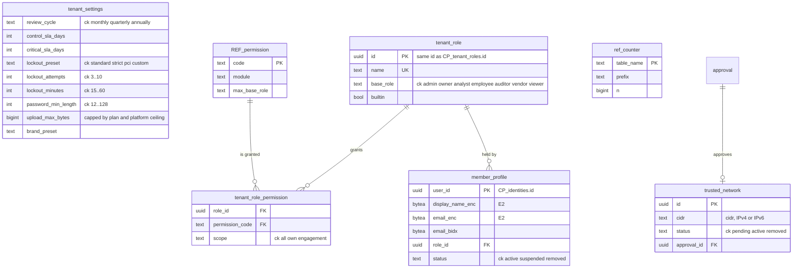

| ID | Table | Key columns (type, constraint) | Del | RC |
|---|---|---|---|---|
| B-E01.1 | `tenant_settings` | singleton (`uk` on a constant expression); `review_cycle text ck`; `risk_appetite_label text`; `control_sla_days int ck >0`; `critical_sla_days int ck >0`; `lockout_preset text ck`; `lockout_attempts int ck 3..10`; `lockout_minutes int ck 15..60`; `password_min_length int ck 12..128`; `upload_max_bytes bigint ck >0`; `brand_preset text`; `data_region text` (read-only mirror of `control.tenants.region`) | none | `tenant_lifetime` |
| B-E01.2 | `trusted_network` (add) | `cidr cidr nn`; `label_enc bytea` (E1); `status text ck`; `approval_id fk→approval` | S | `tenant_lifetime` (rev P3) |
| B-E01.3 | `tenant_role` | `id` = `control.tenant_roles.id`; `name text uk nn`; `base_role text nn ck` (ceiling); `builtin bool nn`; `description text` | S (builtin: none) | `tenant_lifetime` |
| B-E01.4 | `tenant_role_permission` | `role_id fk nn`; `permission_code text fk→ref.permission(code) nn`; `scope text ck`; `uk(role_id, permission_code)`; trigger: `ref.permission.max_base_role` must not exceed the role's `base_role` (a custom role can never exceed admin, S5) | H (journalled) | `tenant_lifetime` |
| B-E01.5 | `member_profile` | `user_id uuid pk` (no cross-project fk, kept in step by the membership sync job, A-27); `display_name_enc`, `email_enc bytea` (E2); `email_bidx bytea uk`; `job_title text`; `department text`; `role_id fk→tenant_role`; `status text ck`; `subject_key_id uuid nn` (id of the key in `ks.subject_key`, B-P24); `last_synced_at timestamptz` (`tour_prefs` moved to `control.identities`, X1-26) | none; the E2 subject key is shredded at the end of `platform_identity` (B-RC19), or earlier on an upheld erasure (OD-10), and the row stays as "Former member" | `platform_identity` (rev P3) |
| B-E01.6 | `ref_counter` (add) | `table_name text pk`; `prefix text nn ck`; `n bigint nn` | none | `tenant_lifetime` |

### M02 Frameworks

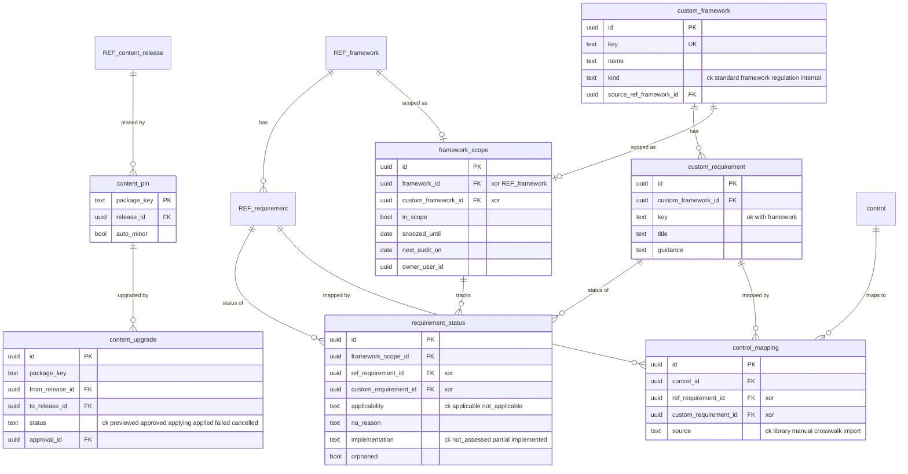

| ID | Table | Key columns (type, constraint) | Del | RC |
|---|---|---|---|---|
| B-E02.1 | `framework_scope` | `xor(framework_id fk→ref.framework, custom_framework_id fk)`; partial `uk` on each; `in_scope bool nn default false`; `snoozed_until date`; `next_audit_on date`; `target_certification_on date`; `owner_user_id uuid fk→member_profile`; trigger B-RF14 | S | `assurance` |
| B-E02.2 | `custom_framework` | `key text uk nn ck ^[a-z0-9-]{2,40}$`; `name`, `short_name text nn`; `kind text ck`; `region text`; `edition text`; `source_ref_framework_id fk→ref.framework`; `status text ck (draft, active, retired)` | S | `assurance` |
| B-E02.3 | `custom_requirement` | `custom_framework_id fk nn`; `key text nn`; `uk(custom_framework_id, key)`; `group_key`, `group_title`, `title text nn`; `guidance_enc bytea` (E1); `sort int` | S | `assurance` (rev P3) |
| B-E02.4 | `requirement_status` | `framework_scope_id fk nn`; `xor(ref_requirement_id fk→ref.requirement, custom_requirement_id fk)`; partial `uk` per pair; `applicability text ck`; `na_reason_enc bytea` (E1; `ck` not null when not applicable); `na_decided_by uuid`, `na_decided_at`; `implementation text ck`; `orphaned bool nn default false` | S | `assurance` (rev P3) |
| B-E02.5 | `control_mapping` | `control_id fk nn`; `xor(ref_requirement_id, custom_requirement_id)`; partial `uk(control_id, ...)`; `source text ck`; replaces both of today's maps (AS gap 5); unmapping is a soft delete | S | `assurance` |
| B-E02.6 | `content_pin` (add) | `package_key text pk`; `release_id fk→ref.content_release nn`; `auto_minor bool nn default false`; `pinned_by`, `pinned_at` | none | `tenant_lifetime` |
| B-E02.7 | `content_upgrade` (add) | `package_key text nn`; `from_release_id`, `to_release_id fk→ref.content_release nn`; `status text ck`; `diff jsonb` (`diff_schema`; counts and affected row ids, no content); `approval_id fk`; `error text`; `applied_at` | I after `applied` | `assurance` |

### M03 Controls

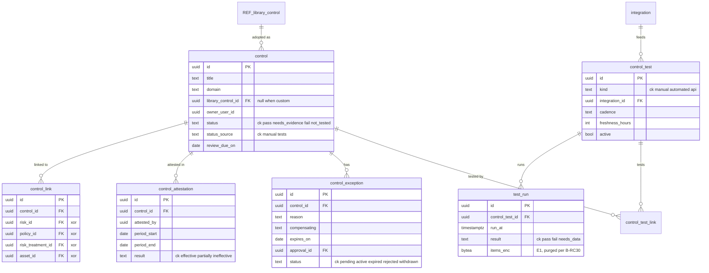

| ID | Table | Key columns (type, constraint) | Del | RC |
|---|---|---|---|---|
| B-E03.1 | `control` | `ref` `CTL-n`; `title text nn`; `description_enc bytea` (E1); `domain text nn`; `library_control_id fk→ref.library_control`; `owner_user_id uuid fk→member_profile nn`; `status text ck`; `status_source text ck`; `status_changed_at`; `review_due_on date`; `external_ticket_key text` | S | `assurance` (rev P3) |
| B-E03.2 | `control_test` | `ref` `TST-n` or `AT-n`; `name text nn`; `kind text ck`; `integration_id fk` (`ck` not null when `automated`); `logic text`; `cadence text ck`; `freshness_hours int nn default 72` (replaces the "Pass older than 3 days" rule); `active bool nn` | S | `assurance` |
| B-E03.3 | `control_test_link` (add) | `control_id fk nn`; `control_test_id fk nn`; `uk(control_id, control_test_id)` | H (journalled) | `assurance` |
| B-E03.4 | `test_run` | `control_test_id fk nn`; `run_at timestamptz nn`; `result text ck`; `item_count`, `fail_count int`; `items_enc bytea` (E1; names employee accounts); `source_sync_run_id fk→integration_sync_run`; `note_enc bytea` (E1) | A; `items_enc` nulled per B-RC30 | `assurance` (rev P3) |
| B-E03.5 | `control_exception` | `ref` `EX-n`; `control_id fk nn`; `requested_by uuid nn`; `reason_enc`, `compensating_enc bytea nn` (E1); `expires_on date nn`; `approval_id fk nn`; `status text ck`; `expiry_recorded_at` | S | `assurance` (rev P3) |
| B-E03.6 | `control_attestation` | `control_id fk nn`; `attested_by uuid nn` (must be the control owner or delegate); `period_start`, `period_end date`; `statement_enc bytea` (E1); `result text ck` | I | `assurance` (rev P3) |
| B-E03.7 | `control_link` (add) | `control_id fk nn`; `xor(risk_id, policy_id, risk_treatment_id, asset_id)`; partial `uk` per pair; replaces `risk.linked` and `policy.mappedControls` | S | `assurance` |

### M04 Evidence

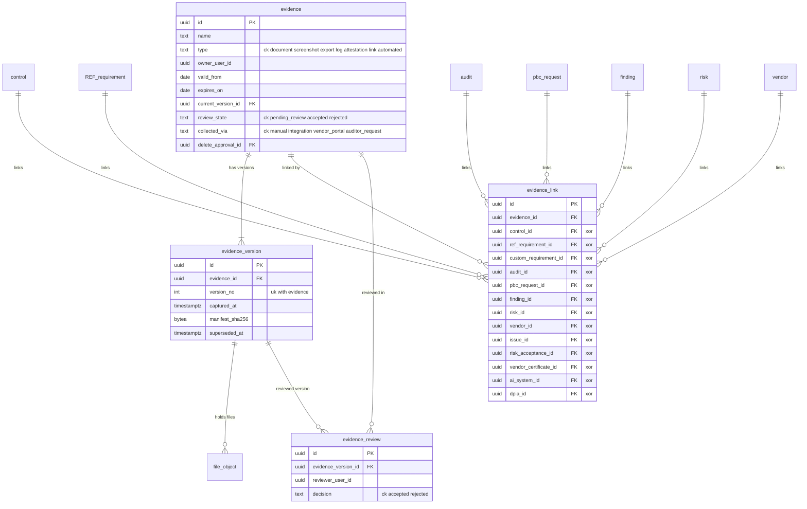

| ID | Table | Key columns (type, constraint) | Del | RC |
|---|---|---|---|---|
| B-E04.1 | `evidence` | `ref` `EV-n`; `name text nn`; `type text ck`; `description_enc bytea` (E1); `owner_user_id uuid nn`; `valid_from date`; `expires_on date` (job S8 raises reminders and sets controls to `needs_evidence`); `review_cycle_days int`; `current_version_id fk→evidence_version` (deferrable); `review_state text ck`; `collected_via text ck`; `integration_id fk`; deletion: `delete_approval_id fk`, `delete_reason_enc bytea` (E1) (four-eyes; files purged, rows kept as tombstone with hashes, replacing `evidence-tombstone`) | S (four-eyes) | `evidence` (rev P3) |
| B-E04.2 | `evidence_version` | `evidence_id fk nn`; `version_no int nn`; `uk(evidence_id, version_no)`; `note_enc bytea` (E1); `captured_at timestamptz nn`; `manifest_sha256 bytea nn` (hash of the sorted file hashes); `superseded_at`; files are `file_object` rows with `owner_table = 'evidence_version'` (at most 20, API) | I | `evidence` (rev P3) |
| B-E04.3 | `evidence_link` | `evidence_id fk nn`; `xor(...)` over the 13 target columns above; partial `uk` per target; `linked_by`, `linked_at` | S | `evidence` |
| B-E04.4 | `evidence_review` | `evidence_id fk nn`; `evidence_version_id fk nn`; `reviewer_user_id uuid nn`; `ck/trigger` reviewer ≠ `evidence_version.created_by` (SOD); `decision text ck`; `note_enc bytea` (E1); any new version resets `evidence.review_state` | A | `evidence` (rev P3) |

### M05 Policies

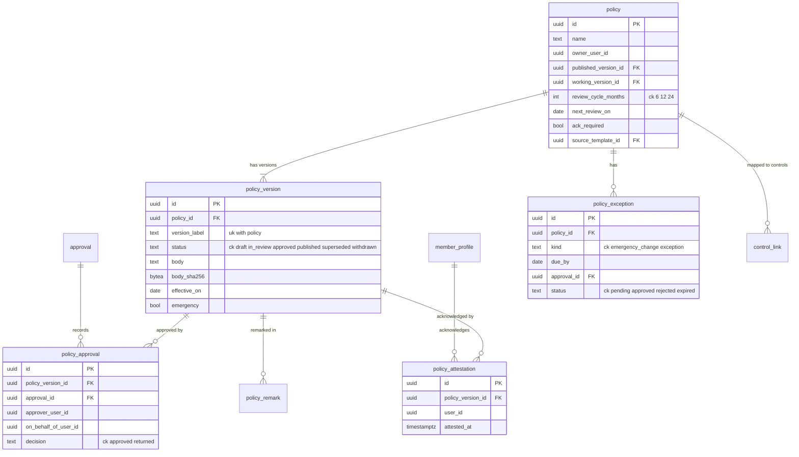

| ID | Table | Key columns (type, constraint) | Del | RC |
|---|---|---|---|---|
| B-E05.1 | `policy` | `ref` `P-n`; `name text nn`; `category text`; `owner_user_id uuid nn`; `published_version_id`, `working_version_id fk→policy_version` (at most one of each, as today); `review_cycle_months int ck`; `next_review_on date` (replaces display text); `ack_required bool`; `ack_audience text ck (all_members, roles)`; `ack_role_ids uuid[]`; `source_template_id fk→ref.policy_template`; `last_reminded_at` | S | `policy` |
| B-E05.2 | `policy_version` | `policy_id fk nn`; `version_label text nn ck ^[0-9]+\.[0-9]+$`; `uk(policy_id, version_label)`; `status text ck`; `body_enc bytea nn` (E1; limit raised from 8,000 to 200,000 characters, A-30; the copy published on the Trust Center is a `trust_document`, P); `body_sha256 bytea nn`; `change_note_enc bytea` (E1); `author_user_id`; `editor_user_ids uuid[]`; `submitted_at/by`; `approved_at`; `effective_on date`; `published_at/by`; `superseded_at`; `emergency bool`; `policy_exception_id fk`; trigger: immutable body once `approved` | I after approval | `policy` (rev P3) |
| B-E05.3 | `policy_approval` | `policy_version_id fk nn`; `approval_id fk→approval nn`; `approver_user_id nn` ≠ `author_user_id` (trigger); `on_behalf_of_user_id`, `delegation_id fk`; `decision text ck`; `reason_enc bytea` (E1) | A | `policy` (rev P3) |
| B-E05.4 | `policy_attestation` | `policy_version_id fk nn`; `user_id uuid nn`; `uk(policy_version_id, user_id)`; `attested_at nn`; `channel text ck (ui, my_work, api)`; trigger refuses `auditor`, `vendor`, `viewer` base roles (OQ-06). One row per person **per version**, so history is kept (AS gap 6) | A | `policy` |
| B-E05.5 | `policy_exception` | `ref` `PX-n`; `policy_id fk nn`; `policy_version_id fk`; `kind text ck`; `reason_enc bytea nn` (E1); `due_by date` (5 business days for emergency); `approval_id fk nn`; `status text ck`; `expires_on date` | S | `policy` (rev P3) |
| B-E05.6 | `policy_remark` (add, rev P3) | `policy_version_id fk nn`; `author_user_id uuid nn`; `section text` (heading or anchor in the version); `text_enc bytea nn` (E1, ≤ 2,000 characters); `due_on date`; `status text ck (open, resolved)`; `resolved_by`, `resolved_at`; `resolve_reason_enc bytea` (E1, ≥ 10 characters, checked by the service). "My remarks" (S-AS-02, kept by OD-05; 2C C-M05-14, C-M05-15; X2-18) | S | `policy` |

### M06 Risk (ISO/IEC 27005, both methods, OQ-05)

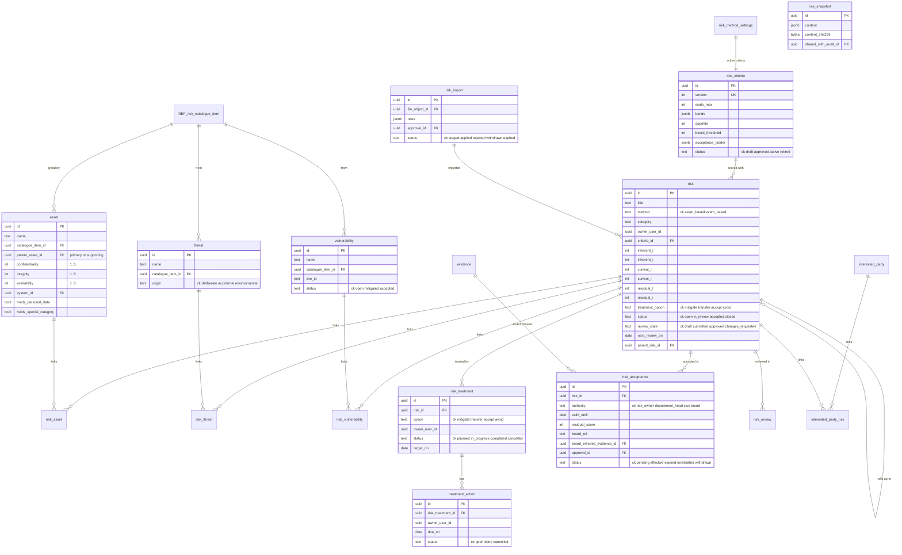

| ID | Table | Key columns (type, constraint) | Del | RC |
|---|---|---|---|---|
| B-E06.1 | `risk_method_settings` | singleton; `method text ck (asset_based, event_based, both)`; `active_criteria_id fk→risk_criteria nn`; `require_asset_link bool`; `registers text[]`; `jurisdictions text[]` | none | `tenant_lifetime` |
| B-E06.2 | `risk_criteria` | `version int uk nn`; `status text ck`; `scale_max int ck 3..10`; `likelihood_labels`, `impact_labels text[]` (`ck` cardinality = `scale_max`); `bands jsonb` (`bands_schema`); `appetite int`; `board_threshold int`; `acceptance_ladder jsonb`; `category_team_map jsonb`; `approval_id fk` (changing criteria is four-eyes, A-31); `effective_from`; seeded from `ref.risk_criteria_preset` (today's appetite 11, Board threshold 15) | I once `active` | `risk` |
| B-E06.3 | `asset` | `ref` `AS-n`; `name text nn`; `catalogue_item_id fk→ref.risk_catalogue_item`; `asset_kind text ck (primary_process, primary_information, supporting)`; `parent_asset_id fk→asset`; `owner_user_id`; `confidentiality`, `integrity`, `availability int ck 1..5`; `business_value int ck 1..5`; `location text`; `system_id fk→system`; `holds_personal_data`, `holds_special_category bool nn`; `status text ck (active, retired)` | S | `risk` |
| B-E06.4 | `threat` | `ref` `TH-n`; `name text nn`; `catalogue_item_id fk`; `origin text ck`; `description_enc bytea` (E1) | S | `risk` (rev P3) |
| B-E06.5 | `vulnerability` | `ref` `VU-n`; `name text nn`; `catalogue_item_id fk`; `cve_id text ck ^CVE-[0-9]{4}-[0-9]{4,}$`; `severity text ck`; `status text ck`; `description_enc bytea` (E1) | S | `risk` (rev P3) |
| B-E06.6 | `risk` | `ref` `RK-n`; `title text nn`; `description_enc bytea` (E1); `method text ck`; `category text nn`; `register text nn`; `jurisdiction text nn`; `owner_user_id nn`; `criteria_id fk nn`; six score inputs `int` (trigger: 1..`criteria.scale_max`); generated stored `inherent_score`, `current_score`, `residual_score`; `treatment_option text ck`; `status text ck`; `review_state text ck`; `identified_on`, `last_reviewed_on`, `next_review_on date`; `closed_at`; `parent_risk_id fk→risk` (enterprise roll-up, E-RK-09); `risk_import_id fk`; `source_ai_signal_id fk`; `ck`: `method = 'asset_based'` requires at least one `risk_asset` (deferred constraint trigger) when `require_asset_link` | S | `risk` (rev P3) |
| B-E06.7 | `risk_asset`, `risk_threat`, `risk_vulnerability` | `risk_id fk nn`; target `fk nn`; `uk(risk_id, target)` | H (journalled) | `risk` |
| B-E06.8 | `risk_treatment` | `risk_id fk nn`; `option text ck`; `plan_enc bytea` (E1); `owner_user_id`; `status text ck`; `target_on date`; `expected_residual_l`, `expected_residual_i int`; `cost_minor bigint`, `currency char(3)` | S | `risk` (rev P3) |
| B-E06.9 | `treatment_action` | `ref` `TA-n`; `risk_treatment_id fk nn`; `text_enc bytea nn` (E1); `owner_user_id`; `due_on date`; `status text ck`; `cancel_reason_enc bytea` (E1; `ck` not null when cancelled); `done_at`; ids replace index addressing (RK gap 2) | S | `risk` (rev P3) |
| B-E06.10 | `risk_acceptance` | `risk_id fk nn`; `authority text ck`; `accepted_by_user_id nn`; `accepted_at`; `valid_until date ck (≤ accepted_at + 12 months)`; `rationale_enc`, `compensating_enc bytea nn` (E1); `residual_score int nn`; `criteria_id fk nn`; Board: `board_ref text ck ^BRD-[0-9]{4}-[0-9]{2}$`, `board_date date` (≤ 90 days old at recording), `board_body text ck`, `board_minutes_evidence_id fk→evidence` (a real file, RK gap 2), `verified_by`, `verified_at`; `approval_id fk`; `status text ck`; `invalidated_at`, `invalidated_reason_enc` (E1). History by rows, replacing the three slots | I except status transitions | `risk` (rev P3) |
| B-E06.11 | `risk_review` | `risk_id fk nn`; `reviewed_by nn`; `reviewed_at`; `outcome text ck (no_change, rescored, escalated, closed)`; score columns before and after; `note_enc bytea` (E1) | A | `risk` (rev P3) |
| B-E06.12 | `interested_party` | `ref` `IP-n`; `party text nn` (an organisation or role, not a named person, A-32); `requirement_enc bytea` (E1); `location text` | S | `risk` (rev P3) |
| B-E06.13 | `interested_party_risk` (add) | `interested_party_id fk nn`; `risk_id fk nn`; `uk` | H (journalled) | `risk` |
| B-E06.14 | `risk_snapshot` | `ref` `RS-n`; `taken_at`; `scope text ck (all, approved)`; `row_count int`; `content jsonb nn` (frozen; holds user ids, not names); `content_sha256 bytea nn`; `shared_with_audit_id fk→audit` | I | `risk` |
| B-E06.15 | `risk_import` | `ref` `IM-n`; `file_object_id fk`; `rows_enc bytea` (E1; encrypted JSON, `rows_schema`); `new_count`, `update_count int`; `approval_id fk nn`; `status text ck`; `applied_at`; `rows_enc` nulled 30 days after a terminal status | S | `risk` (rev P3) |

### M07 Issues (CorrectiveAction)

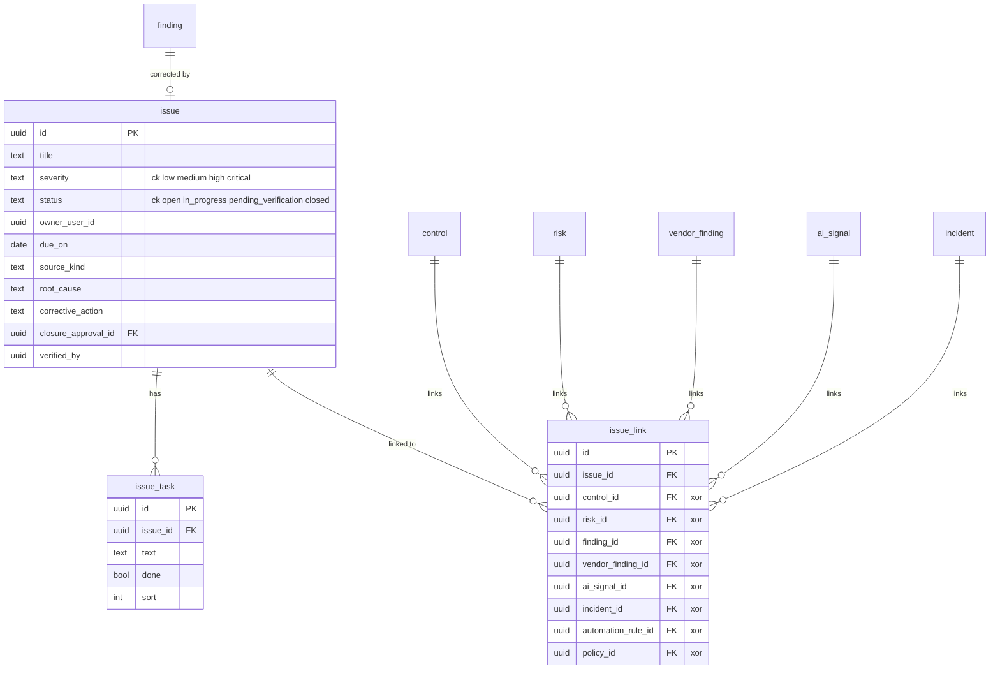

| ID | Table | Key columns (type, constraint) | Del | RC |
|---|---|---|---|---|
| B-E07.1 | `issue` | `ref` `ISS-n` (today `R-n`, which collides with risk ids; the old form is accepted as an alias in import only); `title text nn`; `description_enc bytea` (E1); `severity text ck`; `status text ck`; `owner_user_id nn`; `due_on date`; `source_kind text ck (manual, audit_finding, vendor_finding, ai_signal, automation_rule, incident, test_failure)`; `root_cause_enc`, `corrective_action_enc bytea` (E1); `closure_approval_id fk`, `closed_at`, `closed_by`; `verification_approval_id fk`, `verified_by` (≠ owner and ≠ closer, trigger), `verified_at`, `verification_note_enc` (E1); `ck`: `severity in (high, critical)` and `status = closed` require `verified_by` | S | `issue` (rev P3) |
| B-E07.2 | `issue_task` | `issue_id fk nn`; `text_enc bytea nn` (E1); `done bool nn`; `done_at`, `done_by`; `sort int`; at most 100 per issue (trigger) | S | `issue` (rev P3) |
| B-E07.3 | `issue_link` | `issue_id fk nn`; `xor(...)` over the eight columns; partial `uk` per target; unlinking is a soft delete (AS gap 5) | S | `issue` |

### M08 Audits

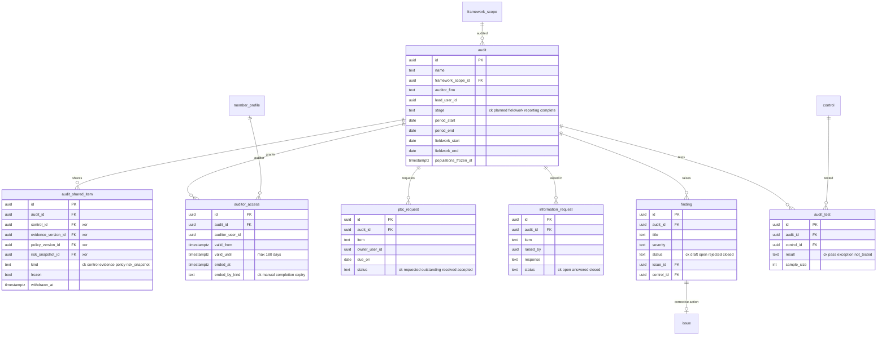

| ID | Table | Key columns (type, constraint) | Del | RC |
|---|---|---|---|---|
| B-E08.1 | `audit` | `ref` `AUD-n`; `name text nn`; `framework_scope_id fk` (replaces the display string `fw`, AS gap 8); `auditor_firm text` (organisation, Internal); `lead_user_id`; `stage text ck`; `scope_enc bytea` (E1); `period_start`, `period_end`, `fieldwork_start`, `fieldwork_end date`; `opened_on`; `populations_frozen_at`, `frozen_by`; `closed_at`, `close_reason_enc` (E1); trigger: `complete` makes the audit and its children read-only | S | `assurance` (rev P3) |
| B-E08.2 | `audit_shared_item` | `audit_id fk nn`; `kind text nn ck (control, evidence, policy, risk_snapshot)` (DA-07); `xor(control_id, evidence_version_id, policy_version_id, risk_snapshot_id)`, `ck` the non-null target matches `kind`; partial `uk` per target; `shared_by`, `shared_at`; `frozen bool` (true for rows shared before `populations_frozen_at`; a frozen row cannot be withdrawn, and the API refuses revoke with 422 `AUD-FROZEN`); `withdrawn_at`. **The auditor's whole read scope** (F1-01, B-T08): evidence is shared by version and its files are included by default (no separate include-files flag), policy by version, so later edits are not exposed; risks only as `risk_snapshot` rows (the auditor has no risk list). Requirement, test-run and report-run targets are removed (DA-07) | S (frozen: I) | `assurance` (rev P3) |
| B-E08.3 | `auditor_access` | `audit_id fk nn`; `auditor_user_id uuid nn` (member with base role `auditor`); `valid_from`, `valid_until timestamptz nn ck (valid_until ≤ valid_from + 180 days)`; `granted_by`; `ended_at`; `ended_by_kind text ck`; partial `uk(audit_id, auditor_user_id) where ended_at is null`. Expiry is ended by a job, not on read (F1-05) | A (status columns only) | `assurance` |
| B-E08.4 | `pbc_request` | `ref` `PBC-n`; `audit_id fk nn`; `item_enc bytea nn` (E1); `owner_user_id`; `due_on date`; `status text ck`; evidence attaches through `evidence_link.pbc_request_id` | S | `assurance` (rev P3) |
| B-E08.5 | `information_request` | `ref` `IR-n`; `audit_id fk nn`; `item_enc bytea nn` (E1); `raised_by nn`; `response_enc bytea` (E1); `answered_by`; `status text ck`; `closed_by` | S | `assurance` (rev P3) |
| B-E08.6 | `finding` | `ref` `F-n`; `audit_id fk nn`; `title text nn`; `severity text ck`; `status text ck`; `recommendation_enc bytea` (E1); `drafted_by`; `accepted_by`, `accepted_at`; `rejected_reason_enc` (E1), `rejected_by`; `issue_id fk→issue`; `control_id fk`; `closed_at` set by a job when the linked issue is closed and verified (AS gap 11) | S | `assurance` (rev P3) |
| B-E08.7 | `audit_test` | `audit_id fk nn`; `control_id fk nn` (was unchecked text); `result text ck`; `sample_size int`; `note_enc bytea` (E1); `tested_by`, `tested_at` | S | `assurance` (rev P3) |

### M09 Vendors

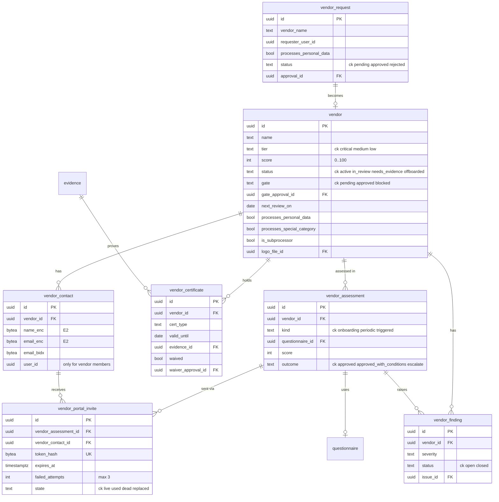

| ID | Table | Key columns (type, constraint) | Del | RC |
|---|---|---|---|---|
| B-E09.1 | `vendor` | `ref` `V-n`; `name text nn`, `uk(lower(name)) where deleted_at is null`; `category text`; `tier text ck`; `score int ck 0..100`; `status text ck`; `gate text ck`; `gate_reason_enc bytea` (E1); `gate_approval_id fk`; `next_review_on date` (tier cadence); `processes_personal_data`, `processes_special_category`, `is_subprocessor bool nn` (sub-processor list on the Trust Center only when `is_subprocessor` and gate `approved`); `service_description_enc bytea` (E1); `processing_countries text[]` (ISO 3166 alpha-2, replaces region "—"); `logo_file_id fk→file_object` (not a data URL); `vendor_request_id fk`; `owner_user_id`; `offboarded_at` | S | `vendor` (rev P3) |
| B-E09.2 | `vendor_contact` | `vendor_id fk nn`; `name_enc`, `email_enc`, `phone_enc bytea` (E2); `email_bidx bytea`; `role_title text`; `is_primary bool`; `user_id uuid` (only when the contact is a `vendor` member, B-D14); `subject_key_id uuid nn` | S, PD shredded at RC end | `external_contact` |
| B-E09.3 | `vendor_certificate` | `ref` `CE-n`; `vendor_id fk nn`; `cert_type text nn`; `issuer text`; `valid_until date`; `evidence_id fk→evidence` (certificates become evidence, RK gap 9); `waived bool`; `waiver_reason_enc bytea` (E1); `waiver_approval_id fk`; `waiver_until date` | S | `vendor` (rev P3) |
| B-E09.4 | `vendor_assessment` | `ref` `VA-n`; `vendor_id fk nn`; `kind text ck`; `questionnaire_id fk`; `assessor_user_id` (member) or `assessor_org text`; `score int ck 0..100`; `outcome text ck`; `assessed_on date nn`; `next_due_on date` | I | `vendor` |
| B-E09.5 | `vendor_finding` | `ref` `VF-n`; `vendor_id fk nn`; `vendor_assessment_id fk`; `title text nn`; `severity text ck`; `status text ck`; `close_reason_enc bytea` (E1); `closed_by`; `issue_id fk→issue` (RK gap 9) | S | `vendor` (rev P3) |
| B-E09.6 | `vendor_request` | `ref` `VR-n`; `vendor_name text nn`; `category text`; `reason_enc bytea` (E1); `requester_user_id nn`; `processes_personal_data bool nn`; `criticality text ck`; `status text ck`; `approval_id fk` (critical: four-eyes); `decided_by`, `decided_at`; `vendor_id fk` | S | `vendor` (rejected: `rejected_request`) (rev P3) |
| B-E09.7 | `vendor_portal_invite` | `vendor_assessment_id fk nn` (the questionnaire is reached through the assessment, X2-33); `vendor_contact_id fk nn`; `token_hash bytea uk nn` (SHA-256; the token itself is never stored); `expires_at ck (≤ created_at + 30 days)`; `due_on date`; `failed_attempts int ck 0..3`; `state text ck`; `link_used_at`; one `live` invite per assessment (partial `uk`); the link resolves to the tenant through `control.portal_link_routes` (2C SD-C1), which holds no token | H 30 days after terminal state | `transient` (rev P3) |

### M10 Questionnaires

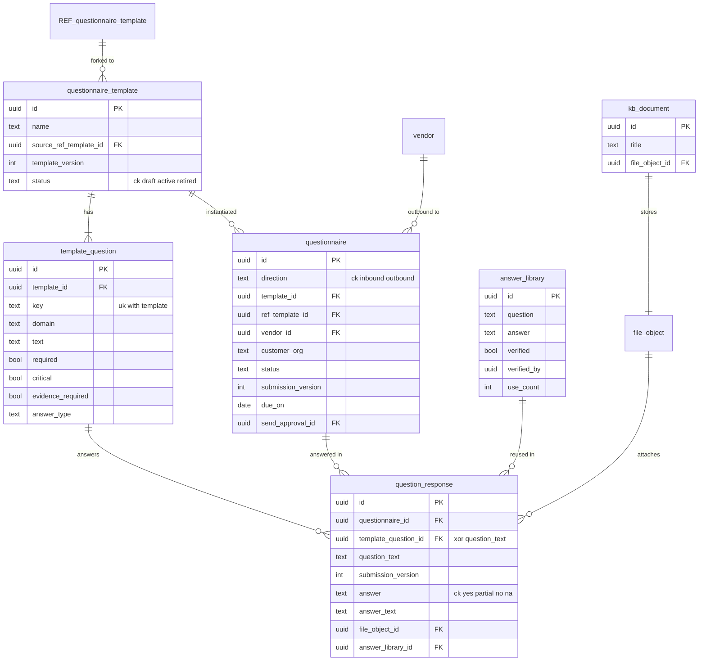

| ID | Table | Key columns (type, constraint) | Del | RC |
|---|---|---|---|---|
| B-E10.1 | `questionnaire_template` | `name text nn`; `purpose text ck (vendor_due_diligence, customer_security, internal)`; `source_ref_template_id fk→ref.questionnaire_template`; `template_version int nn`; `status text ck` | S | `vendor` |
| B-E10.2 | `template_question` | `template_id fk nn`; `key text nn`; `uk(template_id, key)`; `domain text`; `text text nn`; `required`, `critical`, `evidence_required bool`; `answer_type text ck (ynpna, text, file, choice)`; `choices text[]`; `sort int` | S | `vendor` |
| B-E10.3 | `questionnaire` | `ref` `Q-n` (inbound) or `VQ-n` (outbound); `direction text ck`; `xor` over (`template_id`, `ref_template_id`) for outbound, both null allowed for inbound imports; `vendor_id fk` (`ck` not null when outbound); `customer_org text` (inbound; organisation name, Confidential); `status text ck (not_started, in_progress, sent, submitted, reopened, complete)`; `submission_version int nn default 0`; `due_on date`; `author_user_id`; `editor_user_ids uuid[]`; `send_approval_id fk` (`q.send`); `sent_at`, `submitted_at`; `clarify_note_enc bytea` (E1); one open outbound questionnaire per vendor (partial `uk`) | S | `vendor` (rev P3) |
| B-E10.4 | `question_response` | `questionnaire_id fk nn`; `xor(template_question_id fk, question_text text)` (inbound rows carry imported text, RK gap 7); `submission_version int nn`; `uk(questionnaire_id, template_question_id, submission_version)`; `answer text ck`; `answer_text_enc bytea` (E1); `comment_enc bytea` (E1, ≤ 2,000 characters); `file_object_id fk`; `answer_library_id fk`; `answered_by_kind text ck (user, visitor)`; `answered_by_user_id`, `visitor_session_id fk`; `clarification_requested bool`. A submission freezes the rows of that version (B-D15) | I per submitted version | `vendor` (rev P3) |
| B-E10.5 | `answer_library` | `ref` `AL-n`; `question text nn`; `answer_enc bytea nn` (E1; decrypted by the API when served on the Trust Center); `verified bool nn`; `verified_by`, `verified_at` (any edit clears both, trigger); `use_count int nn` (incremented on reuse); `published_to_trust bool ck (not published_to_trust or verified)` | S | `vendor` (rev P3) |
| B-E10.6 | `kb_document` (add) | `ref` `KB-n`; `title text nn`; `doc_type text`; `file_object_id fk nn`; at most 500 per tenant (API) | S | `vendor` |

### M11 Trust Center (TrustCenterPage)

TrustCenterPage = `trust_settings` (page switch, public reference, chatbot, blocklist) plus the ordered `trust_section` rows the tenant chooses to publish (OQ-07).

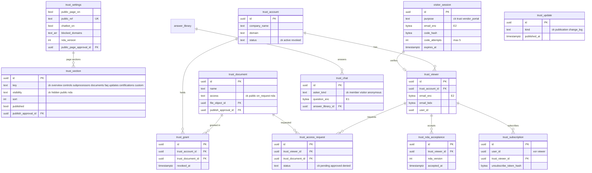

| ID | Table | Key columns (type, constraint) | Del | RC |
|---|---|---|---|---|
| B-E11.1 | `trust_settings` | singleton; `public_page_on bool nn`; `public_ref text uk` (mirrored to `control.tenants.trust_public_ref` so that `/api/v1/public/trust/<ref>` routes before a tenant context exists, SD-B01); `chatbot_on bool`; `blocked_domains text[]`; `nda_version int nn`; `nda_document_id fk→trust_document`; `public_page_approval_id fk` (`trust.public-page`, four-eyes to switch on) | none | `tenant_lifetime` |
| B-E11.2 | `trust_section` | `key text ck`; `uk(key) where key <> 'custom'`; `title text`; `body text` (Public once published); `visibility text ck`; `sort int`; `published bool`; `publish_approval_id fk`; `published_at`. The `controls` section shows control status by domain only when `visibility = public` (default `hidden`, F1-02) | S | `tenant_lifetime` |
| B-E11.3 | `trust_document` | `ref` `TRS-n`; `name text nn uk`; `description text`; `access text ck`; `file_object_id fk`; `status text ck (active, archived)`; `publish_approval_id fk` (to `public`: four-eyes). Names of `nda` documents are not served to anonymous visitors (F1-02, enforced in the API) | S | `tenant_lifetime` |
| B-E11.4 | `trust_account` | `ref` `TA-n`; `company_name text nn`; `domain text nn ck` (lower-case hostname); `status text ck`; `revoke_reason_enc bytea` (E1) | S | `external_contact` (rev P3) |
| B-E11.5 | `trust_viewer` | `trust_account_id fk nn`; `email_enc bytea` (E2); `email_bidx bytea nn`; `uk(trust_account_id, email_bidx)`; `user_id uuid` (when a member); `status text ck (active, removed)`; `last_seen_at`; `subject_key_id uuid nn` | S, PD shredded at RC end | `external_contact` |
| B-E11.6 | `trust_nda_acceptance` | `trust_viewer_id fk nn`; `nda_version int nn`; `uk(trust_viewer_id, nda_version)`; `accepted_at nn`; `ip_hmac bytea`; `signer_name_enc bytea` (E2, the viewer's subject key; the name accepted by 2C C-PU-05). **Per person** (OQ-07): one viewer's acceptance never covers another viewer | A | `external_contact` (rev P3) |
| B-E11.7 | `trust_grant` (add) | `trust_account_id fk nn`; `trust_document_id fk nn`; partial `uk(...) where revoked_at is null`; `trust_access_request_id fk`; `granted_by`; `revoked_at`, `revoked_by`. Access by id, never by name (F1-02) | S | `external_contact` |
| B-E11.8 | `trust_access_request` | `ref` `TR-n`; `trust_viewer_id fk nn`; `trust_document_id fk nn`; `reason_enc bytea` (E1); `status text ck`; `decided_by`, `decided_at`; `note_enc bytea` (E1) | S | `external_contact` (denied: `rejected_request`) (rev P3) |
| B-E11.9 | `trust_subscription` | `xor(user_id, trust_viewer_id fk)`; `subscribed_at`; `ended_at`; `unsubscribe_token_hash bytea uk` | S | `external_contact` |
| B-E11.10 | `trust_chat` | `ref` `TC-n`; `asked_at nn`; `asker_kind text ck`; `user_id`, `trust_viewer_id fk`; `visitor_domain text`; `question_enc bytea` (E1; free text from anonymous visitors may hold PD); `answer_library_id fk`; `answered bool` | A | `operational` |
| B-E11.11 | `trust_update` | `ref` `TU-n`; `kind text ck`; `title text nn`; `body text`; `published_at`, `published_by`; `notify_subscribers bool`. Sending goes through an `ops` email job carrying ids only (replaces kv `trust-outbox`) | I | `tenant_lifetime` |
| B-E11.12 | `visitor_session` (add) | `purpose text ck`; `subject_questionnaire_id fk`; `email_enc bytea` (E2); `email_bidx bytea nn`; `code_hash bytea`; `code_expires_at` (10 min); `code_attempts int ck 0..5`; `verified_at`; `last_seen_at` (15 min idle); `expires_at ck (≤ created_at + 60 minutes)` (2E E-15i, 2C C-PU-02); `ended_at`; `ip_hmac bytea`. Replaces kv `vsess`, `vcode`, `vcode-ip`, `vcode-to`, `vcheck-ip`, `vportal`. Per-address throttling stays in `control.auth_throttle` | H at RC end | `transient` (rev P3) |

### M12 People and access

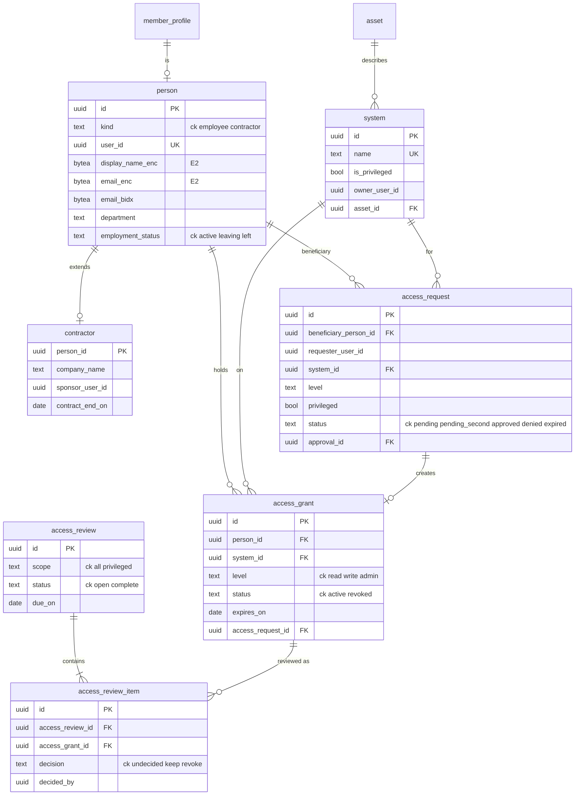

| ID | Table | Key columns (type, constraint) | Del | RC |
|---|---|---|---|---|
| B-E12.1 | `person` | `ref` `PP-n`; `kind text ck`; `user_id uuid uk` (null for people without an account); `display_name_enc`, `email_enc bytea` (E2); `email_bidx bytea`; `job_title`, `department text`; `manager_person_id fk→person`; `employment_status text ck`; `start_on`, `end_on date`; `source text ck (directory, manual, integration)`; `device_posture text ck (compliant, non_compliant, unknown)` (PD, E0; fed by D-69, 2C Person `devicePosture`); `subject_key_id uuid nn` (id of the key in `ks.subject_key`) (shared with `member_profile` when `user_id` is set). Replaces the computed workforce view (RK gap 17) | S, PD shredded at RC end | `access` (rev P3) |
| B-E12.2 | `contractor` | `person_id fk pk` (1:1, `ck person.kind = contractor`); `company_name text`; `sponsor_user_id nn`; `contract_end_on date` | S | `access` |
| B-E12.3 | `system` | `ref` `SYS-n`; `name text uk nn`; `description_enc bytea` (E1); `owner_user_id`; `is_privileged bool nn` (replaces the regex on the name, RK gap 16); `data_classification text ck`; `asset_id fk→asset`; `integration_id fk` | S | `access` (rev P3) |
| B-E12.4 | `access_grant` | `ref` `G-n`; `person_id fk nn`; `system_id fk nn` (was free text); `level text ck`; `status text ck`; `granted_on date`; `expires_on date`; `source text ck (request, recorded, integration, review)`; `access_request_id fk`; `revoked_at`, `revoked_by`, `revoke_reason_enc bytea` (E1) | S | `access` (rev P3) |
| B-E12.5 | `access_request` | `ref` `AR-n`; `beneficiary_person_id fk nn`; `requester_user_id nn`; `system_id fk nn`; `level text ck`; `reason_enc bytea` (E1); `privileged bool nn` (set from `system.is_privileged` and level, trigger); `status text ck`; `first_approver_user_id`; `approval_id fk` (second approval when privileged); `decided_by`, `decision_reason_enc` (E1), `decided_at`; trigger: requester and beneficiary never approve | S | `access` (denied: `rejected_request`) (rev P3) |
| B-E12.6 | `access_review` | `ref` `REV-n`; `name text`; `scope text ck`; `status text ck`; `due_on date`; `completed_at`, `completed_by` | S | `access` |
| B-E12.7 | `access_review_item` (add) | `access_review_id fk nn`; `access_grant_id fk nn`; frozen `person_id`, `system_id`, `level`; `decision text ck`; `decided_by` (≠ the reviewed person, trigger); `decided_at`; `revoked bool`; decision is final once set (trigger) | I after decision | `access` |

### M13 AI governance

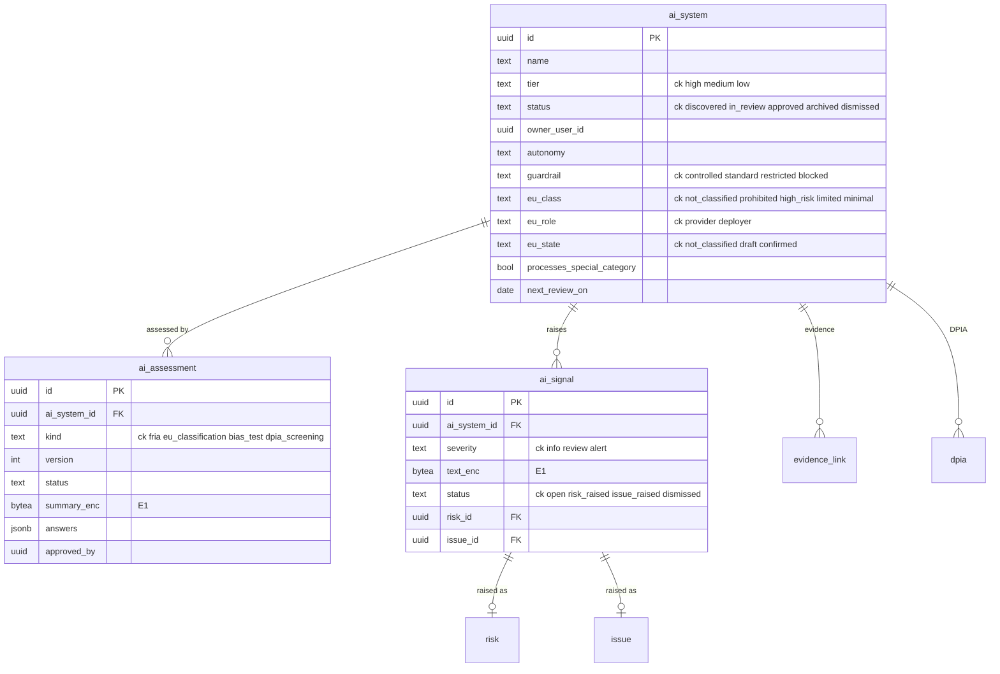

| ID | Table | Key columns (type, constraint) | Del | RC |
|---|---|---|---|---|
| B-E13.1 | `ai_system` | `ref` `AI-n`; `name text nn`; `purpose_enc bytea` (E1); `tier text ck`; `status text ck` (shadow AI is `discovered` or `dismissed`, replacing `ai-shadow` and `ai-shadow-dismissed`); `owner_user_id`; `lawful_basis_key text fk→ref.lawful_basis`; `surface`, `model`, `provider_name text`; `data_reached_enc bytea` (E1; may describe special-category processing); `processes_personal_data`, `processes_special_category bool`; `autonomy text ck`; `guardrail text ck`; `eu_class`, `eu_role`, `eu_state text ck`; `eu_drafted_by`, `eu_confirmed_by` (≠ drafter, trigger); `oversight text[]`; `last_review_on`, `next_review_on date`; `builtin text ck (assistant)`; `discovered_source text`; `dismissed_reason_enc bytea` (E1); `archive_approval_id fk` (four-eyes) | S | `ai_governance` (rev P3) |
| B-E13.2 | `ai_assessment` | `ai_system_id fk nn`; `kind text ck`; `version int nn`; `uk(ai_system_id, kind, version)`; `status text ck (not_started, draft, submitted, changes_requested, approved, not_required)`; `result text ck` (bias: `passed`, `issues_found`, `due`, `not_applicable`); `summary_enc bytea` (E1); `answers_enc bytea` (E1; encrypted JSON, `answers_schema`; EU classification questions); `submitted_by`; `approved_by` (≠ `submitted_by`, trigger); `approved_at`; `return_reason_enc` (E1). Keeps every version (bias history included, RK gap 18) | I once approved | `ai_governance` (rev P3) |
| B-E13.3 | `ai_signal` | `ref` `S-n`; `ai_system_id fk nn`; `at nn`; `severity text ck`; `source text`; `text_enc bytea` (E1; may quote blocked personal data); `recommendation_enc bytea` (E1); `status text ck`; `risk_id`, `issue_id fk`; `dismissed_reason_enc` (E1); `decided_by`; `occurrence_count int`. No cap of 200; retention handles volume | S | `operational` (kept with the risk or issue when one is raised) (rev P3) |

### M14 Privacy

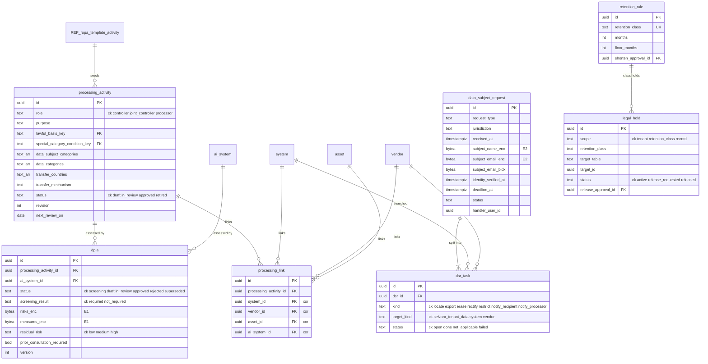

| ID | Table | Key columns (type, constraint) | Del | RC |
|---|---|---|---|---|
| B-E14.1 | `processing_activity` | `ref` `PA-n`; `name text nn`; `role text ck`; `purpose_enc bytea nn` (E1); `lawful_basis_key text fk→ref.lawful_basis nn`; `special_category_condition_key text fk→ref.lawful_basis` (Art. 9 conditions; `ck` not null when `special_categories` is not empty); `data_subject_categories`, `data_categories`, `special_categories text[]` (keys of `ref.subject_category`, `ref.data_category`); `recipients_enc bytea` (E1); `transfer_countries text[]`; `transfer_mechanism text ck (adequacy, scc, bcr, derogation, none)`; `retention_text_enc bytea` (E1); `toms_enc bytea` (E1); `owner_user_id nn`; `status text ck`; `revision int nn` (incremented on each approval; earlier revisions in `record_history`); `approval_id fk`, `approved_by`, `approved_at`; `next_review_on date`; `source_template_id fk→ref.ropa_template_activity`; `dpia_required text ck (yes, no, screening_pending)`. Per tenant (OQ-08) | S | `privacy_register` (rev P3) |
| B-E14.2 | `processing_link` (add) | `processing_activity_id fk nn`; `xor(system_id, vendor_id, asset_id, ai_system_id)`; partial `uk` per target. `audit_log_entry.processing_activity_id` replaces the client-side regex tag (ST gap 2) | S | `privacy_register` |
| B-E14.3 | `dpia` | `ref` `DPIA-n`; `processing_activity_id fk`; `ai_system_id fk`; `ck` at least one; `title text nn`; `status text ck`; `screening_result text ck`; `screening_rationale_enc`, `description_enc`, `necessity_enc`, `risks_enc`, `measures_enc`, `dpo_advice_enc bytea` (E1); `residual_risk text ck`; `dpo_user_id`; `prior_consultation_required bool`; `consultation_ref text`; `version int nn`; `author_user_id`; `approval_id fk`; `approved_by` (≠ author, trigger); `approved_at`; `next_review_on date` | I once approved (new version for changes) | `privacy_register` |
| B-E14.4 | `data_subject_request` | `ref` `DSR-n`; `request_type text ck (access, rectification, erasure, restriction, portability, objection, automated_decision)`; `jurisdiction text ck (eu_gdpr, uk_gdpr, uae_pdpl, difc_dp, other)` *(verify list)*; `received_at nn`; `received_channel text ck`; `subject_name_enc`, `subject_email_enc`, `subject_identifiers_enc`, `agent_details_enc bytea` (E2, a key for this request's subject); `subject_email_bidx bytea`; `subject_key_id uuid nn`; `requester_is_agent bool`; `identity_verified_at`; `identity_method text ck`; `deadline_at nn` (from the jurisdiction rule in `ref`, A-33); `extended bool`; `extension_reason_enc bytea` (E1); `extended_deadline_at`; `paused_at` (awaiting identity); `status text ck (received, verifying, in_progress, awaiting_subject, completed, refused, withdrawn)`; `outcome text ck`; `refusal_reason_enc bytea` (E1); `response_sent_at`; `response_file_id fk→file_object`; `handler_user_id`; `special_category_involved bool`; `closed_at`. The deadline clock is an `ops` job (S8) | S | `privacy_case` (rev P3) |
| B-E14.5 | `dsr_task` | `dsr_id fk nn`; `kind text ck`; `target_kind text ck`; `system_id`, `vendor_id fk`; `status text ck`; `located_count int`; `result_note_enc bytea` (E1); `due_on date`; `done_by`, `done_at`. `selvara_tenant_data` tasks run as a job that searches the tenant schema by blind index (`*_bidx`) | S | `privacy_case` |
| B-E14.6 | `retention_rule` | `retention_class text uk nn` (B-RC code); `months int ck 1..240`; `floor_months int nn` (from `ref.retention_floor`, `ck months ≥ floor_months`); `basis_enc bytea` (E1); `pending_shorter_months int`; `shorten_approval_id fk` (`team-retention`, four-eyes); `changed_reason_enc bytea nn` (E1). Replaces the browser-only demo (F1-03) | none | `tenant_lifetime` (rev P3) |
| B-E14.7 | `legal_hold` | `ref` `LH-n`; `scope text ck`; `retention_class text`; `target_table text`, `target_id uuid` (record scope; allow-list trigger); `ck` scope matches columns; `matter_enc bytea` (E1); `reason_enc bytea nn` (E1); `placed_by`, `placed_at`; `release_requested_by`; `release_approval_id fk` (`team-hold`; approver ≠ placer); `released_at`; `status text ck`. Record-scope holds set `legal_hold = true` on the target row (and its `record_history` and files) by trigger | I except status | `tenant_lifetime` (rev P3) |

### M15 Commitments

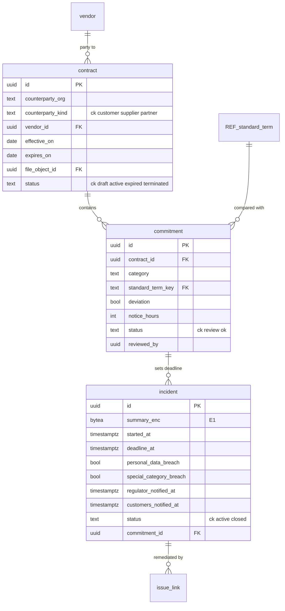

| ID | Table | Key columns (type, constraint) | Del | RC |
|---|---|---|---|---|
| B-E15.1 | `contract` | `ref` `CT-n`; `counterparty_org text nn`; `counterparty_kind text ck`; `vendor_id fk`; `title text`; `effective_on`, `expires_on date`; `file_object_id fk`; `owner_user_id`; `status text ck` | S | `commitment` |
| B-E15.2 | `commitment` | `ref` `CM-n`; `contract_id fk`; `name text nn`; `detail_enc bytea` (E1); `category text ck (security, privacy, availability, notification, audit_right, other)`; `standard_term_key text fk→ref.standard_term`; `deviation bool`; `notice_hours int`; `status text ck`; `reviewed_by` (≠ `created_by`, trigger); `review_note_enc bytea` (E1); `due_on date` | S | `commitment` (rev P3) |
| B-E15.3 | `incident` | `ref` `INC-n`; `summary_enc bytea` (E1); `started_at nn`; `detected_at`; `commitment_id fk` (source of the notice period); `deadline_at nn` (default start + 48 hours, as today); `severity text ck`; `personal_data_breach`, `special_category_breach bool nn`; `regulator_notified_at`, `customers_notified_at`; `closed_at`, `closed_by`; `outcome_enc bytea` (E1); `status text ck`. Several incidents may be active at once (today: one) | S | `commitment` |

### M16 Reports

| ID | Table | Key columns (type, constraint) | Del | RC |
|---|---|---|---|---|
| B-E16.1 | `report_schedule` | `ref` `SP-n`; `report_key text fk→ref.report_catalogue nn`; `name text`; `frequency text ck (weekly, monthly, quarterly, biannual, yearly, custom, on_demand)`; `next_run_at`; `recipient_user_ids uuid[]` (members, by id, F1-09); `external_recipients_enc bytea` (E2; each address under its own subject key, X1-32); `external_recipient_subject_key_ids uuid[]`; `external bool`; `distribution_approval_id fk` (`report.distribution`); `status text ck (active, paused, removed)` | S | `operational` (rev P3) |
| B-E16.2 | `report_run` | `report_schedule_id fk`; `report_key text nn`; `kind text ck (scheduled, on_demand, audit_evidence_package, tenant_export, module_export, board_pack, auditlog_export)` (module exports of 2C C-EX-01 are `module_export` rows); `export_kind text` (`ck` in `ref.report_catalogue` keys, which lists every C-EX-01 kind); `filters jsonb` (frozen, `filters_schema`); `row_count int`; `watermark_ref text` (auditor exports); `contains_personal_data bool nn`; `requested_by`; `started_at`, `finished_at`; `status text ck`; `file_object_id fk`; `sha256 bytea`; `entry_count int`; `period_start`, `period_end` | I | `operational`; output file purged 30 days after the run when `contains_personal_data` (B-RC35) (`audit_evidence_package`: `audit_log`) (rev P3) |

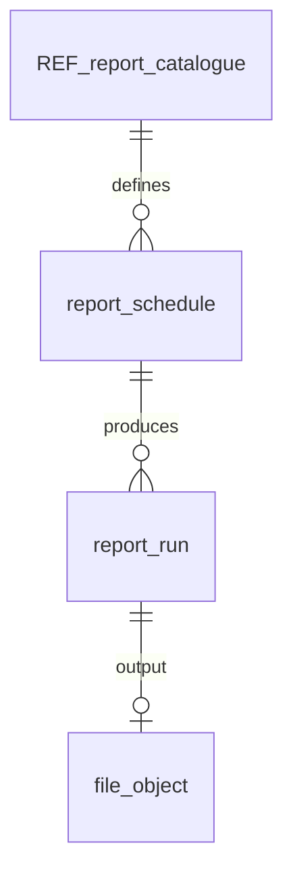

### M17 Integrations

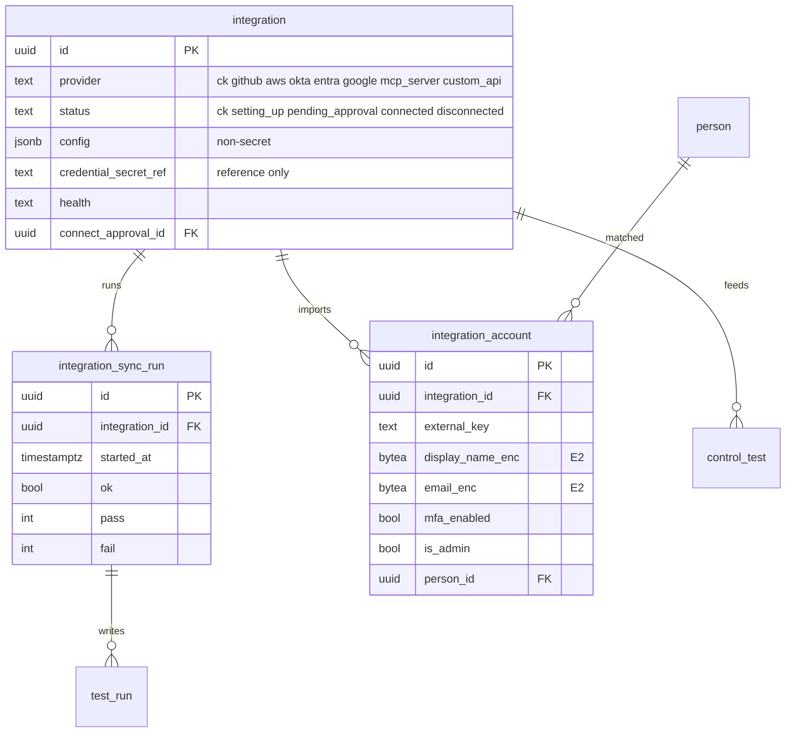

| ID | Table | Key columns (type, constraint) | Del | RC |
|---|---|---|---|---|
| B-E17.1 | `integration` | `ref` `INT-n`; `provider text ck` (MCP grants become `mcp_server` rows, replacing `mcp-grant`); `label text`; `status text ck`; `config jsonb` (`config_schema`; role ARN, installation id, domain, client id; no secrets; admin email moved to `config_contact_enc`, E2 under the contact's subject key, with `config_contact_subject_key_id uuid`); `credential_secret_ref text` (pointer to the secret store, ADR-003; replaces `sealedKey`); `external_id text`; `connect_approval_id fk`; `connected_at`, `last_sync_at`, `last_ok_at`; `health text ck`; `last_error_enc bytea` (E1); `disconnected_reason_enc bytea` (E1); `verified_config_sha256 bytea` | S | `tenant_lifetime` (rev P3) |
| B-E17.2 | `integration_sync_run` | `ref` `SYNC-n`; `integration_id fk nn`; `started_at`, `finished_at`; `ok bool`; `error text`; `pass`, `fail`, `needs_data int`; `counts jsonb` | A | `ops_medium` (rev P3) |
| B-E17.3 | `integration_account` (add) | `integration_id fk nn`; `external_key text nn`; `uk(integration_id, external_key)`; `display_name_enc`, `email_enc bytea` (E2); `email_bidx bytea`; `status text ck (active, suspended, deprovisioned)`; `mfa_enabled bool`; `is_admin bool`; `last_login_at`; `person_id fk→person`; `subject_key_id uuid nn`. One row per account (was one JSON document of up to 5,000, F1-08); hard-deleted on disconnect | H on disconnect | `operational` |
| B-E17.4 | `integration_check` (add, rev P3) | `integration_id fk nn`; `check_key text nn` (provider check catalogue key); `uk(integration_id, check_key)`; `control_test_id fk→control_test` (the automated test the check feeds); `enabled bool nn`; `last_result text ck (pass, fail, needs_data)`; `last_run_at`. 2C IntegrationCheck, C-M17-06 (X1-24) | S | `tenant_lifetime` |

### M18 API and webhooks

| ID | Table | Key columns (type, constraint) | Del | RC |
|---|---|---|---|---|
| B-E18.1 | `api_key` | `ref` `AK-n`; `label text nn`; `scopes text[] nn` (`ck` each in the scope catalogue: `read:<module>`, `write:<module>`, `read:evidence-files`, `events:push`); `owner_person_id fk→person nn`; `ip_allowlist cidr[]`; `pepper_version int nn`; `key_id text uk nn` (kid used by `control.api_key_routes`); `prefix text uk nn`; `key_hmac bytea uk nn` (HMAC of the full key; the key is shown once and never stored); `lifetime_days int ck (30, 90, 365)`; `status text ck (requested, approved, active, revoked, expired)`; `approval_id fk`; `issued_at`, `expires_at`; `last_used_at`; `uses bigint` (2C `uses`); `revoked_at`, `revoked_by` | S | `security_telemetry` after revocation (rev P3) |
| B-E18.2 | `webhook` | `ref` `WH-n`; `url text nn ck ^https://`; `events text[] nn` (`ck` subset of the catalogue); `status text ck (pending_approval, not_approved, active, paused, disabled)`; `disabled_at`, `disabled_reason text` (auto-disable, 2C C-90); `signing_secret_ref text` (reference, replaces the sealed secret); `secret_shown_at`; `approval_id fk`; `failure_count int`; `last_delivery_at` | S | `tenant_lifetime` (rev P3) |
| B-E18.3 | `webhook_delivery` | `ref` `DLV-n`; `webhook_id fk nn`; `event_type text nn`; `event_id uuid nn`; `attempt int`; `attempted_at`; `http_status int`; `duration_ms int`; `error text`; `status text ck (queued, sending, delivered, failed, dead)`; `next_attempt_at timestamptz`; partial index on `status = 'queued'` (outbox, 2C C-85). The payload is not stored | A (status and attempt columns updatable by the delivery job only) | `ops_short` (rev P3) |
| B-E18.4 | `idempotency_record` (add, rev P3; 2C SD-C2, C-51) | `idempotency_key text nn`; `principal text nn` (member, API key or visitor session id); `route text nn`; `uk(principal, idempotency_key)`; `request_sha256 bytea nn`; `status text ck (in_progress, completed)`; `http_status int`; `response_body_enc bytea` (E1); `expires_at nn` (created + 24 h). Excluded from `record_history` (B-D16 list) | H at expiry | `transient` |

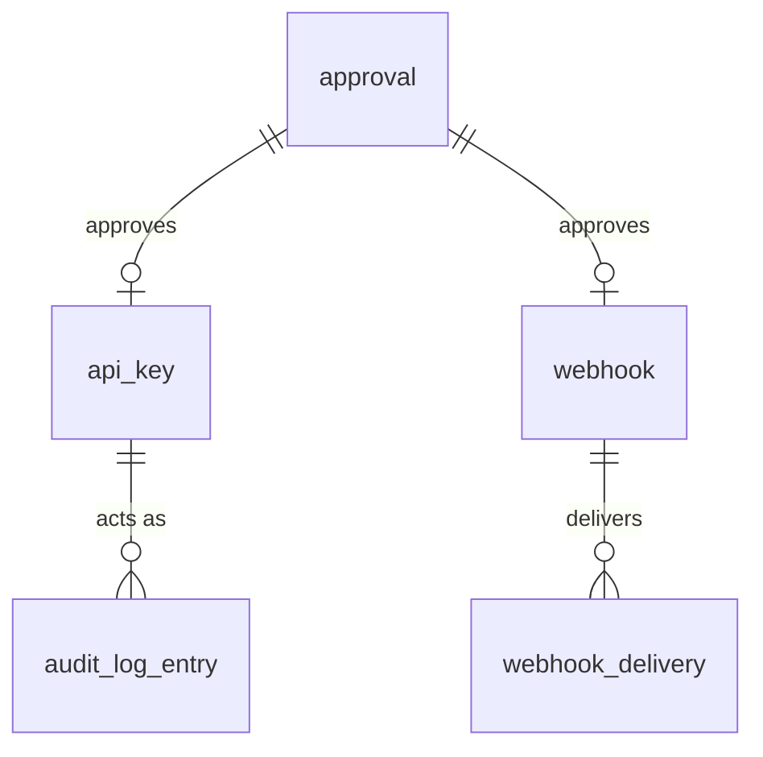

### M19 Assistant and agents

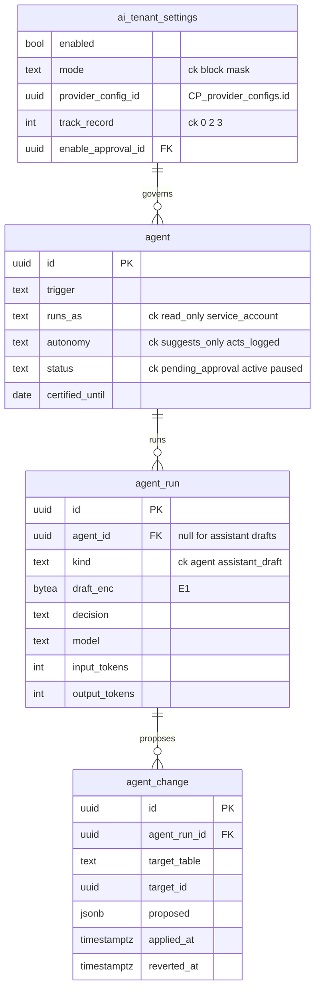

| ID | Table | Key columns (type, constraint) | Del | RC |
|---|---|---|---|---|
| B-E19.1 | `ai_tenant_settings` | singleton; `enabled bool nn default false` (off by default, R-07); `mode text ck`; `provider_config_id uuid` (control-plane id, not a cross-project fk; validated by the API); `model text`; `track_record int ck`; `enable_approval_id`, `mask_approval_id fk` (`ai.enable`, `ai.mask`) | none | `tenant_lifetime` |
| B-E19.2 | `agent` | `ref` `AG-n`; `name text nn`; `trigger text ck`; `runs_as text ck`; `autonomy text ck`; `status text ck`; `certified_until date`; `certified_by`; `enable_approval_id`, `autonomy_approval_id`, `recert_approval_id fk` | S | `ai_governance` |
| B-E19.3 | `agent_run` | `agent_id fk` (`ck` not null when `kind = agent`); `kind text ck` (assistant drafts replace `ai-draft`; question and answer text are still not stored); `started_at`; `change_summary_enc bytea` (E1); `draft_enc bytea` (E1; nulled per B-RC31); `record_refs uuid[]`; `recipient_user_ids uuid[]`; `decision text ck (waiting, approved_applied, applied_after_review, auto_applied, rejected, rejected_after_applying)`; `requested_by`; `decided_by` (≠ requested_by for `approved_applied`); `decided_reason_enc bytea` (E1); `model text`; `input_tokens`, `output_tokens int`; `masked bool`; `reviewed_by`, `reviewed_at` | A (decision columns updatable once) | `ai_governance` (rev P3) |
| B-E19.4 | `agent_change` | `agent_run_id fk nn`; `target_table text nn` (allow-list); `target_id uuid nn`; `proposed_enc bytea` (E1; encrypted JSON; fields of an E2 target are encrypted under that subject's key, never plaintext); `applied_at`; `reverted_at`; `history_id fk→record_history` (the applied change) | A | `ai_governance` (rev P3) |

### M20 Notifications

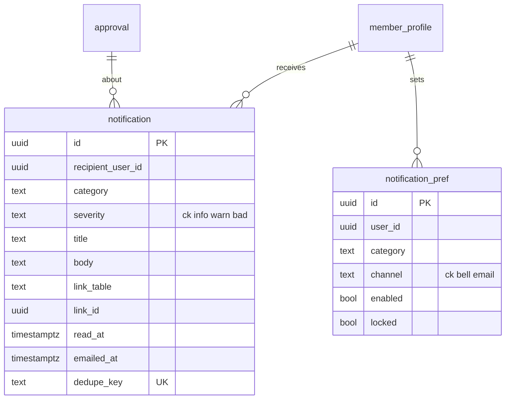

| ID | Table | Key columns (type, constraint) | Del | RC |
|---|---|---|---|---|
| B-E20.1 | `notification` | `recipient_user_id uuid nn`; `category text ck (security, approvals, controls, evidence, issues, risks, vendors, privacy, system)`; `severity text ck`; `title text ck (≤ 120)`; `body text ck (≤ 300)` (Internal; refs and ids only, no other person's PD, B-C rule in the classification file); `link_table text`, `link_id uuid` (allow-list); `approval_id fk`; `read_at` (per person, AD gap 9); `emailed_at`; `dedupe_key text uk` | H at RC end | `operational`, capped at 12 months for notifications (G-RET-22) (rev P3) |
| B-E20.2 | `notification_pref` | `user_id uuid nn`; `category text ck`; `channel text ck`; `uk(user_id, category, channel)`; `enabled bool nn`; `locked bool nn` (bell for `approvals` and `security` is locked on) | H on member removal | `tenant_lifetime` |

### M21 Approvals

```mermaid
erDiagram
  approval ||--o{ approval_vote : "voted in"
  delegation ||--o{ approval_vote : "acting for"
  REF_approval_kind ||--o{ approval : "kind"
  approval {
    uuid id PK
    text kind FK
    text subject_table
    uuid subject_id
    jsonb payload
    bytea payload_enc "E1, every kind"
    int needs "ck 1 2"
    text_arr approver_roles
    uuid named_approver_user_id
    uuid requested_by
    text status "ck pending approved rejected withdrawn expired"
    timestamptz expires_at
  }
  approval_vote {
    uuid id PK
    uuid approval_id FK
    uuid voter_user_id
    uuid acting_for_user_id
    uuid delegation_id FK
    text decision "ck approve reject"
    text reason
  }
  delegation {
    uuid id PK
    uuid from_user_id
    uuid to_user_id
    timestamptz starts_at
    timestamptz until_at "max 14 days"
    timestamptz revoked_at
  }
```

| ID | Table | Key columns (type, constraint) | Del | RC |
|---|---|---|---|---|
| B-E21.1 | `approval` | `ref` `APR-n`; `kind text fk→ref.approval_kind nn` (every kind registered, F1-04); `title text nn`; `subject_table text nn`, `subject_id uuid nn` (allow-list constraint trigger); `payload_enc bytea` (E1; encrypted JSON, `payload_schema`; every kind, so this is the only payload column, X1-02); `needs int ck`; `approver_roles text[]`; `named_approver_user_id`; `forbid_user_ids uuid[]`; `requested_by uuid nn`; `status text ck`; `expires_at nn`; `decided_at`; `decided_reason_enc bytea` (E1); expiry swept by a job, not on read (F1-05) | A (status columns once) | inherits the subject's class (rev P3) |
| B-E21.2 | `approval_vote` | `approval_id fk nn`; `voter_user_id uuid nn`; `uk(approval_id, voter_user_id)`; trigger refuses `voter = requested_by`, voters in `forbid_user_ids`, and a delegate whose delegator is the requester (SOD_MATRIX); `acting_for_user_id`, `delegation_id fk` (replaces `approval-meta`); `decision text ck`; `reason_enc bytea` (E1; plaintext length ≥ 10, checked by the service); `at nn` | A | as `approval` (rev P3) |
| B-E21.3 | `delegation` | `ref` `DG-n`; `from_user_id`, `to_user_id uuid nn ck (from ≠ to)`; `reason_enc bytea` (E1); `starts_at`; `until_at ck (≤ starts_at + 14 days)`; `revoked_at`, `revoked_by`; `kinds text[]` | S | `access` (rev P3) |

### M22 Audit log

```mermaid
erDiagram
  audit_log_entry ||--o| record_history : "change detail"
  processing_activity ||--o{ audit_log_entry : "lawful context"
  audit_log_entry }o--|| audit_anchor : "anchored by"
  audit_log_entry {
    uuid id PK
    bigint chain_n UK
    timestamptz at
    text actor_kind "ck member auditor vendor platform_staff system scim api_key agent"
    uuid actor_id
    uuid on_behalf_of
    text outcome "ck allowed refused error"
    text refusal_code
    text action
    text category
    text target_table
    uuid target_id
    text target_ref
    uuid request_id
    text lawful_basis_key
    uuid processing_activity_id FK
    bytea ip_enc "E1"
    bytea ip_hmac
    bytea pd_enc "E2"
    bytea pd_hmac
    text ip_prefix
    bytea details_enc "E1"
    bytea details_hmac
    bytea prev_hash
    bytea hash
  }
  audit_anchor {
    uuid id PK
    text kind "ck anchor verify worm_export"
    bigint chain_from
    bigint chain_to
    bytea head_hash
    text receipt_ref
    text result "ck intact broken"
    bigint first_bad_chain_n
  }
  record_history {
    uuid id PK
    text table_name
    uuid row_id
    int row_version
    text op
    jsonb before
    jsonb after
  }
```

| ID | Table | Key columns (type, constraint) | Del | RC |
|---|---|---|---|---|
| B-E22.1 | `audit_log_entry` | `chain_n bigint uk nn` (gap-free, assigned under the chain-head lock); `at nn`; `actor_kind text nn ck (member, auditor, vendor, platform_staff, system, scim, api_key, agent)` (2F F-L-02, 2C C-M22-01); `actor_id uuid`; `actor_principal text` (API key ref, job type, visitor session id, support session id); `on_behalf_of uuid` (delegation or support grant); `action text nn`; `category text ck`; `outcome text nn ck (allowed, refused, error)`; `refusal_code text` (`ck` not null when refused); `target_table text`, `target_id uuid`, `target_ref text` (no names or emails, B-D17); `request_id uuid nn`; `lawful_basis_key text`; `processing_activity_id fk`; `history_id fk→record_history`; `detail text ck (≤ 1,000)` (E0: ids and codes only, no PD, B-C26 of the classification file); `details_enc bytea` (E1: reasons, before and after summary), `details_hmac bytea`; `ip_enc` (E1), `ip_hmac`, `ip_prefix text` (/24 or /48); `pd_enc` (E2, the key of the person named), `pd_hmac`; `prev_hash`, `hash bytea nn`. **Hash input**: every column except `ip_enc`, `pd_enc` and `details_enc`, which enter only as their keyed HMACs (B-D17, DA-03). Append-only trigger, as today | A | `audit_log` (`ip_enc`, `pd_enc`, `details_enc` nulled after 1 year, B-RC32) (rev P3) |
| B-E22.2 | `audit_anchor` | `kind text ck`; `chain_from`, `chain_to bigint`; `head_hash bytea nn`; `anchored_at`; `receipt_ref text` (ADR-013 target); `result text ck`; `first_bad_chain_n bigint`; `report_run_id fk` (WORM export). Replaces `audit-verify` and `audit-package` metadata | A | `audit_log` |
| B-E22.3 | `record_history` | section 3.2 | A | parent's class |
| B-E22.4 | `audit_chain_head` (add) | one row: `last_chain_n bigint nn`, `last_hash bytea nn`; locked `FOR UPDATE` by the append function so `chain_n` is gap-free (replaces `audit_chain`) | none | `tenant_lifetime` |

### M23 Files

| ID | Table | Key columns (type, constraint) | Del | RC |
|---|---|---|---|---|
| B-E23.1 | `file_object` | `bucket text ck (tenant-files, quarantine, exports)`; `path text uk nn ck (path like '<tkey>/%')` (literal prefix baked at provisioning, like B-T03); `original_name_enc bytea` (E1; file names can hold PD); `mime_type text nn` (allow-list); `size_bytes bigint nn ck (> 0 and ≤ platform ceiling)`; `sha256 bytea nn`; `scan_state text ck (pending, clean, infected, failed)`; `scanned_at`; `scanner_version text`; `file_key_id uuid nn` (reference to `ks.file_key`, 2F F-K-04; the wrapped key is never stored in the cell, DA-04); `key_version int nn`; `owner_table text`, `owner_id uuid` (allow-list constraint trigger); `contains_personal_data text ck (unknown, yes, no)`; `purged_at`. Only `clean` files can be linked or downloaded (trigger on linking tables, API on signed URLs) | S; bytes hard-deleted at purge; `infected` hard-deleted after 7 days | owner's class (rev P3) |

```mermaid
erDiagram
  file_object {
    uuid id PK
    text bucket
    text path UK
    bytea sha256
    bigint size_bytes
    text scan_state
    uuid file_key_id "ref to ks.file_key"
    int key_version
    text owner_table
    uuid owner_id
  }
  evidence_version ||--o{ file_object : links
  trust_document ||--o| file_object : links
  kb_document ||--|| file_object : links
  question_response ||--o| file_object : links
  risk_import ||--o| file_object : links
  report_run ||--o| file_object : links
  contract ||--o| file_object : links
  vendor ||--o| file_object : "logo"
```

### M24 Help and M25 Billing (tenant view)

No tenant tables (S4). Help questions are `control.support_questions`; the tenant reads its subscription, invoices and payments through `/api/v1/account/...` from the control plane.

### M26 Automation

| ID | Table | Key columns (type, constraint) | Del | RC |
|---|---|---|---|---|
| B-E26.1 | `automation_rule` | `ref` `RL-n`; `name text ck (≤ 80)`; `trigger text ck (control.failing, evidence.needed, evidence.expiring, issue.overdue, vendor.overdue)`; `action text ck (notify.owner, create.issue)`; `status text ck (draft, pending_approval, active, paused)`; `approval_id fk` (`team-rule`); `max_actions_per_run int ck 1..20`; at most 25 rules (plan entitlement) | S | `tenant_lifetime` |
| B-E26.2 | `automation_run` | `automation_rule_id fk nn`; `at nn`; `matched`, `acted int`; `capped bool`; `acted_record_ids uuid[]`; `actor_kind = system` | A | `operational` |

```mermaid
erDiagram
  automation_rule ||--o{ automation_run : runs
  automation_rule ||--o{ issue_link : "created issues"
```

### Cross-module overview (tenant schema)

```mermaid
erDiagram
  framework_scope ||--o{ requirement_status : links
  control ||--o{ control_mapping : links
  control ||--o{ evidence_link : links
  evidence ||--o{ evidence_link : links
  policy ||--o{ control_link : links
  risk ||--o{ control_link : links
  risk ||--o{ risk_treatment : links
  audit ||--o{ finding : links
  finding ||--o| issue : links
  vendor ||--o{ vendor_assessment : links
  vendor_assessment ||--o| questionnaire : links
  processing_activity ||--o{ dpia : links
  processing_activity ||--o{ processing_link : links
  vendor ||--o{ processing_link : links
  person ||--o{ access_grant : links
  approval ||--o{ approval_vote : links
  audit_log_entry ||--o| record_history : links
  file_object ||--o{ evidence_version : links
```

### Control plane (`cp` project, schema `control`)

Owned by workstream A (ADR-010) for structure and I for billing; shown here so that every brief entity has a diagram. Tables marked (add) are proposed additions (SD-B01). **The B-E90 rows below are the complete control-plane catalogue of spine v2** (S2 plus the accepted additions SD-A1, SD-B01, SD-C1, SD-C2, SD-E1, SD-E3, SD-F-03, 2I I-SD1 and the Phase 3 additions); ADR-010's schema-inventory check fails on any table or view not listed here (DA-06). Encrypted control-plane columns are **E1 under the platform KEK** held in the external KMS (DA-05; 2F F-K-30, F-K-31 and ADR-003 decision 2); blind indexes use F-K-32 and audit HMACs F-K-33; no tenant DEK exists in `cp`. (rev P3)

```mermaid
erDiagram
  CP_tenants ||--|| CP_tenant_cells : "lives in"
  CP_tenants ||--o{ CP_tenant_schema_versions : "per chain"
  CP_identities ||--o{ CP_memberships : has
  CP_tenants ||--o{ CP_memberships : has
  CP_tenant_roles ||--o{ CP_memberships : "role"
  CP_tenants ||--o{ CP_tenant_roles : defines
  CP_tenants ||--o{ CP_invitations : "add"
  CP_identities ||--o{ CP_sessions : "add"
  CP_platform_staff ||--o{ CP_elevations : opens
  CP_platform_roles ||--o{ CP_platform_role_permissions : grants
  CP_platform_staff }o--|| CP_platform_roles : holds
  CP_platform_approvals ||--o{ CP_platform_approval_votes : links
  CP_tenants ||--o{ CP_support_grants : gives
  CP_support_grants ||--o{ CP_support_sessions : "used by"
  CP_plans ||--o{ CP_plan_entitlements : defines
  CP_billing_entities ||--o{ CP_subscriptions : bills
  CP_tenants ||--o{ CP_subscriptions : has
  CP_plans ||--o{ CP_subscriptions : "on plan"
  CP_subscriptions ||--o{ CP_invoices : produces
  CP_invoices ||--|{ CP_invoice_lines : "add"
  CP_invoices ||--o{ CP_payments : "settled by"
  CP_tenants ||--o{ CP_usage_meters : meters
  CP_tenants ||--o{ CP_key_registry : keys
  CP_tenants ||--o{ CP_deletion_certificates : "closed by"
  CP_tenants ||--o{ CP_sso_connections : links
  CP_tenants ||--o{ CP_scim_tokens : links
  CP_tenants ||--o{ CP_support_questions : asks
  CP_support_questions ||--o{ CP_support_messages : links
  CP_tenants {
    uuid id PK
    text tkey UK "16 char base32"
    text name
    text customer_ref UK
    text status "ck provisioning active suspended maintenance offboarding closed"
    text region
    text trust_public_ref UK
    bytea route_mac
  }
  CP_tenant_schema_versions {
    uuid tenant_id FK
    text chain "ck tenant"
    int version
    text state "ck current migrating failed quarantined drift"
    bytea fingerprint
  }
  CP_identities {
    uuid id PK "auth user id"
    bytea email_enc
    bytea email_bidx UK
    bytea display_name_enc
    text status
    uuid home_tenant_id FK
    jsonb tour_prefs
  }
  CP_memberships {
    uuid id PK
    uuid identity_id FK
    uuid tenant_id FK
    uuid role_id FK
    text status "ck invited pending active suspended removed"
  }
  CP_tenant_roles {
    uuid id PK
    uuid tenant_id FK
    text name
    text base_role
  }
  CP_plans {
    uuid id PK
    text key
    int version
    text status
  }
  CP_plan_entitlements {
    uuid plan_id FK
    text metric "ck per 2I I-4.2: users external_users frameworks storage_bytes db_bytes api_calls modules byok sso scim dedicated_cell pitr_days"
    bigint limit_value
  }
  CP_subscriptions {
    uuid id PK
    uuid tenant_id FK
    uuid plan_id FK
    uuid billing_entity_id FK
    text cycle
    text currency
    text status "ck trial active past_due cancelled"
    text provider "payment provider key"
    text provider_customer_ref
  }
  CP_invoices {
    uuid id PK
    text number UK "INV-YYYY-nnnnn"
    uuid subscription_id FK
    char currency
    bigint total_minor
    bigint tax_minor
    text status "ck open paid void written_off"
  }
  CP_payments {
    uuid id PK
    uuid invoice_id FK
    text entry_type "ck payment credit refund writeoff void markpaid unmatched"
    bigint amount_minor
    text provider_ref
    uuid approval_id FK
  }
  CP_usage_meters {
    uuid tenant_id FK
    text metric
    date period
    bigint value
  }
```

| ID | Table | Key columns (beyond the diagram) | Class of PD | RC |
|---|---|---|---|---|
| B-E90.1 | `control.tenants` | `cell_id fk`; `created_at`, `closed_at`; `status text ck (provisioning, active, suspended, maintenance, offboarding, closed)` drives routing (S3); `route_mac bytea nn` (HMAC over `tenant_id`, `tkey`, cell under the routing MAC key F-K-08; `router` verifies it and fails closed on mismatch, X2-28) | none (organisation data, Confidential) | `financial` after closure (rev P3) |
| B-E90.2 | `control.identities` | `email_enc`, `display_name_enc bytea` (**E1 under the platform KEK**, DA-05: platform DEK F-K-31 wrapped by the platform KEK F-K-30); `email_bidx bytea uk` (HMAC-SHA-256 blind index under the platform blind-index key F-K-32, for exact-match sign-in lookup); `tour_prefs jsonb` (I; replaces kv `tours`, X1-26); `home_tenant_id uuid fk→control.tenants` (2E SD-E3); `mfa_state` read from Supabase Auth, not copied | PD | `platform_identity` (rev P3) |
| B-E90.3 | `control.memberships` | `uk(identity_id, tenant_id)`; `since`, `ended_at`; `invited_by`; join requests are held in `control.join_requests` (2E SD-E1) until approved; `source text ck (invite, join, jit, scim)`; `expires_at timestamptz` (time-boxed external members, null otherwise); `external bool nn` (X1-16) | PD (pseudonymous ids) | `platform_identity` (rev P3) |
| B-E90.4 | `control.invitations` (add) | `tenant_id`; `email_enc` (E1, platform KEK), `email_bidx`; `role_id`; `token_hash uk`; `expires_at` (72 h); `approval_id`; `status`. The link goes by email to the invitee only; no endpoint returns it (DA-09) | PD | `transient` after terminal state (rev P3) |
| B-E90.5 | `control.sessions`, `control.recovery_codes`, `control.passkeys`, `control.auth_throttle`, `control.account_notices` (add; workstream E) | as today's `sessions`, `recovery_codes`, `passkeys`, kv `ip`/`lock`, `notices`; IP addresses as `ip_enc` (E1, platform KEK) plus `ip_hmac` plus `ip_prefix`; `account_notices.body_enc` (E1, platform KEK). Per-account and per-address sign-in throttling lives in `auth_throttle`; request-rate buckets stay in `ops.rate_buckets` (X1-33) | PD | `sign_in_record` (B-RC21) for `sessions`, `auth_throttle`, `account_notices`; `account_credential` (B-RC22) for `recovery_codes`, `passkeys` (rev P3) |
| B-E90.6 | `control.price_lists`, `control.invoice_lines`, `control.ledger_entries`, `control.credit_notes`, `control.invoice_series`, `control.plan_change_requests`, `control.fx_rates`, `control.tax_rules`, `control.provider_events`, `control.entitlement_overrides` (additions owned by workstream I, 2I I-SD1) | typed replacements for `platform_records` billing kinds (AD gap 4); names follow 2I | billing contact PD in `control.subscriptions.contact_enc`; PD also in `provider_events.payload_enc` and in the buyer block of `invoices.rendered_snapshot_enc` (both E1, platform KEK) | `financial` (rev P3) |
| B-E90.7 | `control.ref_content_releases` (add) | `release_id`, `cell_id`, `loaded_at`, `content_sha256`, `status`: which `ref` release is loaded in which cell | none | `platform_lifetime` (B-RC23) (rev P3) |
| B-E90.8 | `control.platform_audit_log` | same shape as `audit_log_entry` (B-E22.1), `tenant_id` nullable; own chain; encrypted columns `ip_enc`, `details_enc` under the **platform KEK** (E1) instead of tenant keys; hash input uses `ip_hmac` and `details_hmac` (B-D17) | PD (staff ids, IP) | `audit_log` (platform-set, 7 years, G-RET-04); `ip_enc`, `details_enc` nulled after 1 year (rev P3) |
| B-E90.9 | `control.join_requests` (add, 2E SD-E1) | `tenant_id`; `email_enc` (E1, platform KEK), `email_bidx`; `display_name_enc` (E1, platform KEK); `company_code_hash bytea`; `status text ck (pending, approved, rejected, expired)`; `decided_by`, `decided_at`; `expires_at` | PD | `rejected_request` when rejected, else `transient` after decision (rev P3) |
| B-E90.10 | `control.sso_domains` (add, 2E SD-E1) | `sso_connection_id fk`; `domain text uk`; `verification_token_hash bytea`; `verified_at` | none | `tenant_lifetime` (rev P3) |
| B-E90.11 | `control.api_key_routes` (add, 2C SD-C1) | `key_id text pk` (= `api_key.key_id`); `tenant_id`; `status text ck (active, revoked)`; no secret, no hash | none | hard-deleted on revocation (rev P3) |
| B-E90.12 | `control.portal_link_routes` (add, 2C SD-C1) | `link_id text pk`; `tenant_id`; `expires_at`; no token | none | `transient` (rev P3) |
| B-E90.13 | `control.idempotency_records` (add, 2C C-51) | `idempotency_key`, `principal`, `route`; `uk(principal, idempotency_key)`; `request_sha256`; `status`; `http_status`; `response_body_enc` (E1, platform KEK). Only control-plane routes (account, platform, billing, help); tenant routes use the tenant's `idempotency_record` (B-E18.4) | as the response | `transient`; hard-deleted 24 h after creation (rev P3) |
| B-E90.14 | `control.platform_audit_anchor` (add, 2F SD-F-03) | `root_hash`, `leaf_hash`, `proof`, `object_key` (WORM), `tsa_token_ref`, `anchored_at`, `chain_from`, `chain_to` | none | `audit_log` (rev P3) |
| B-E90.15 | view `control.v_routing` (add, 2F F-ISO-02) | `tenant_id`, `tkey`, cell, `schema_version`, `status`, `route_mac`; the only object granted to `cp_router_ro`; status read live on every request, never cached (R2-01) | none | n/a (view) (rev P3) |
| B-E90.16 | `control.usage_event_receipts` (add, 2I I-SD1) | `event_id uuid pk`; `received_at`; dedupe of metering events | none | hard-deleted after 35 days (rev P3) |
| B-E90.17 | `control.ai_provider_reviews` (add, 2I I-SD1, ADR-007) | fields of 2I I-10.2 (provider, model, review date, reviewer ids, terms reviewed, outcome, next review) | PD (staff ids) | `platform_lifetime` (rev P3) |
| B-E90.18 | `control.tenant_cells` | `id`; `region`; `tier text ck (shared, dedicated)`; `status text ck (open, full, draining, closed)`; capacity counters and threshold `T`; connection secret **reference** (2A A-CP-02) | none | `platform_lifetime` (rev P3) |
| B-E90.19 | `control.tenant_schema_versions` | `tenant_id`, `chain`, `version`, `target_version`, `state`, `fingerprint`, `last_migrated_at` (2A A-CP-03, B-M02) | none | `tenant_lifetime` (rev P3) |
| B-E90.20 | `control.tenant_roles` | `id` (= tenant `tenant_role.id`), `tenant_id`, `name`, `base_role` ceiling; names only, permissions stay in the tenant (2A A-CP-06) | none | `tenant_lifetime` (rev P3) |
| B-E90.21 | `control.platform_staff` | `identity_id fk→identities`; `display_name_enc`, `email_enc` (E1, platform KEK) when not taken from `identities`; `status`; `role_id fk→platform_roles`; `engaged_from`, `engaged_until` | PD | `staff_record` (B-RC25) (rev P3) |
| B-E90.22 | `control.platform_roles`, `control.platform_role_permissions` | role names from the fixed list only (OD-07, 2E E-73); permission codes per role | none | `platform_lifetime` (rev P3) |
| B-E90.23 | `control.platform_approvals`, `control.platform_approval_votes` | `kind`, `subject`, `payload jsonb` (ids and codes only), `payload_enc` (E1, platform KEK; personal or sensitive payloads such as a first-admin email or MFA-reset identity checks), `requested_by`, `status`, `expires_at`; votes: `voter_id`, `decision`, `reason_enc` (E1, platform KEK) | PD | `staff_record` (rev P3) |
| B-E90.24 | `control.elevations` | `staff_id`, `reason_enc` (E1, platform KEK), `ticket_ref`, `starts_at`, `ends_at` (60 min, 2A A-CP-11) | PD | `staff_record` (rev P3) |
| B-E90.25 | `control.support_grants`, `control.support_sessions` | grant: `tenant_id`, `granted_by`, `scope`, `starts_at`, `ends_at`, `reason_enc` (E1, platform KEK); session: `support_grant_id`, `staff_id`, `started_at`, `ended_at` | PD (ids) | `staff_record` (rev P3) |
| B-E90.26 | `control.support_questions`, `control.support_messages` | question: `tenant_id`, `asker_id`, `subject_enc` (E1, platform KEK), `status text ck (open, answered, closed, reopened)`, `closed_at`; message: `question_id`, `author_kind`, `author_id`, `body_enc` (E1, platform KEK); text only, no attachments (2A A-CP-R1) | PD; may hold pasted tenant content | `support` (B-RC26) (rev P3) |
| B-E90.27 | `control.plans`, `control.plan_entitlements` | plan `key`, `version`, `status`; entitlements per metric of 2I I-4.2 (including `db_bytes`, `byok`, `sso`, `scim`, `dedicated_cell`, `pitr_days`, `external_users`; DA-13) | none | `platform_lifetime` (rev P3) |
| B-E90.28 | `control.billing_entities` | Selvara's selling entities (2I I-2.1.1): legal name, country, tax registration, invoice series; no customer data | none | `financial` (rev P3) |
| B-E90.29 | `control.subscriptions` | `tenant_id`, `plan_id`, `billing_entity_id`, `cycle`, `currency`, `status`, provider refs; `contact_enc`, `address_enc` (E1, platform KEK; billing contact, no card data, F1-07) | PD | `financial` (rev P3) |
| B-E90.30 | `control.invoices`, `control.payments` | invoice number, amounts, tax, status; `rendered_snapshot_enc` (E1, platform KEK; buyer legal name, address, tax ids, 2I I-6.3.2); payments: entry type, amount, provider ref, `approval_id` | PD (sole traders) | `financial` (rev P3) |
| B-E90.31 | `control.usage_meters` | `tenant_id`, `metric`, `period`, `value` (aggregates only, S2) | none | `financial` (rev P3) |
| B-E90.32 | `control.provider_configs` | adapter, non-secret settings, secret **references** (payment, AI, email, scanner) | none | `platform_lifetime` (rev P3) |
| B-E90.33 | `control.key_registry` | tenant KEK ids and versions, DEK versions, BYOK flag, state, destruction dates; never key material | none | `tenant_lifetime`; destroyed-key rows `accountability` (B-RC24) (rev P3) |
| B-E90.34 | `control.deletion_certificates` | certificate fields of 2G G-6.3; holds no deleted content | PD (approver ids) | `accountability` (B-RC24) (rev P3) |
| B-E90.35 | `control.ropa_selvara` | Selvara's RoPA entries (2G G-2) | none | `platform_lifetime` (rev P3) |
| B-E90.36 | `control.sso_connections`, `control.scim_tokens` | IdP metadata, certificates, group-to-role mappings, secret references; SCIM `token_hash`, scopes, expiry | none | `tenant_lifetime` (rev P3) |
| B-E90.37 | `control.break_glass_events` (add) | `opened_by`, `reason_enc` (E1, platform KEK), `incident_ref`, `opened_at`, `closed_at`, `reviewed_by`, `review_note_enc` (E1, platform KEK); record of 2E E-78b, 2C C-PL-25 (X1-25) | PD | `staff_record` (rev P3) |
| B-E90.38 | `control.trial_policies` (add) | standing trial policy approved four-eyes under OD-04: `seats`, `storage_bytes`, `trial_days`, `region`, feature caps (AI off, no BYOK, SSO or dedicated cell), `max_concurrent_per_cell`, `approval_id`, `effective_from` (2I I-4.4.3, X3-10) | none | `platform_lifetime` (rev P3) |

### Key store `ks` (separate project, ADR-003; rev P3)

Owned by workstream F (2F F-D-05, F-7; ADR-003). Listed here so that every stored object has a home (X1-14, X2-31, DA-04). `ks` holds **wrapped key material only**, keyed by tenant `tkey` and key id; it holds no tenant data and no personal data other than the existence of a subject key id. Tenant and control tables reference keys by id and version only.

| ID | Table | Key columns | Deleted when | Backups |
|---|---|---|---|---|
| B-K01 | `ks.tenant_dek` | `tkey`, `version`, `wrapped_dek bytea` (wrapped by the tenant KEK, F-K-01), `state`, `created_at`, `retired_at` | tenant offboarding (2F F-K-10) | see B-K05 |
| B-K02 | `ks.subject_key` | `subject_key_id uuid pk`, `tkey`, `wrapped_key bytea` (wrapped by the tenant DEK), `created_at` | upheld erasure or end of the subject's retention (F-K-11, B-DL06); offboarding | see B-K05 |
| B-K03 | `ks.file_key` | `file_key_id uuid pk`, `tkey`, `wrapped_key bytea` (wrapped by the tenant DEK), `created_at` | file purge (F-K-12, B-DL07); offboarding | see B-K05 |
| B-K04 | `ks.blind_index_key`, audit HMAC keys | `tkey`, `version`, `wrapped_key bytea` (F-K-05; audit HMAC key F-K-33) | offboarding | see B-K05 |
| B-K06 | `ks.platform_dek`, platform blind-index and audit HMAC keys | `version`, `wrapped_dek bytea` (wrapped by the platform KEK F-K-30), `state` (F-K-31 to F-K-33) | never while the platform runs | see B-K05 |
| B-K05 | Continuity and shredding window | Point-in-time restore off; daily backups kept 7 days; a standby in the DR region and an append-only off-site key journal whose objects expire 8 days after they are written (DA-11; 2F, ADR-003). A destroyed key leaves the live store and the standby at once, the daily backups within 7 days plus the 1-day backup cycle, and the journal when the object holding its insert expires; it is therefore unrecoverable from every copy **no later than 8 days after destruction** (ADR-003 decision 3). `ks` is never included in tenant exports, the `control` export, WORM audit segments or other off-site copies (ADR-004). | | |

### Operational schema `ops` (per cell; rev P3)

Queue and job state only (B-P04): `tkey`, job type, record ids, counters. No business fields, no personal data, no free text. Class I, E0. Named `ops.rate_buckets` everywhere (2C C-60; 2A A-TS-03 to align). Tables from 2D SD-D1 (X1-17):

| ID | Table | Key columns | RC |
|---|---|---|---|
| B-O01 | `ops.job_dedupe` | `dedupe_key text pk`, `tkey`, `job_type`, `expires_at` (2D D-61) | `transient` |
| B-O02 | `ops.tenant_slots` | `tkey`, `queue`, `slots_in_use int`, `updated_at` (2D D-78) | `transient` |
| B-O03 | `ops.tenant_job_pause` | `tkey`, `job_type`, `paused_at`, `reason_code text ck` (2D D-87) | `transient` |
| B-O04 | `ops.provisioning_steps` | `tkey`, `step`, `state text ck`, `attempts int`, `completed_at` (2D D-91) | `operational` |
| B-O05 | `ops.usage_events` | `event_id uuid pk`, `tkey`, `metric`, `count bigint`, `at`; counts only (2D D-74) | `transient` after aggregation into `control.usage_meters` |
| B-O06 | `ops.rate_buckets` | `bucket_key_hash bytea pk` (keyed hash of principal or address and route), `tokens`, `refilled_at` (2C C-55 to C-60) | `transient` |

### Reference schema `ref` (per cell, read-only to tenants)

```mermaid
erDiagram
  REF_content_package ||--o{ REF_content_release : releases
  REF_content_release ||--o{ REF_framework : contains
  REF_framework ||--o{ REF_requirement_group : groups
  REF_requirement_group ||--o{ REF_requirement : contains
  REF_requirement ||--o{ REF_requirement_crosswalk : "from"
  REF_requirement ||--o{ REF_framework_mapping : "maps"
  REF_content_release ||--o{ REF_library_control : contains
  REF_library_control ||--o{ REF_library_control_mapping : maps
  REF_requirement ||--o{ REF_library_control_mapping : "mapped by"
  REF_content_release ||--o{ REF_questionnaire_template : contains
  REF_questionnaire_template ||--o{ REF_template_question : has
  REF_content_release ||--o{ REF_risk_catalogue_item : contains
  REF_content_release ||--o{ REF_ropa_template_activity : contains
  REF_content_release ||--o{ REF_policy_template : contains
  REF_content_package {
    uuid id PK
    text key UK
    text kind
    text licence_note
  }
  REF_content_release {
    uuid id PK
    uuid package_id FK
    text version "semver, uk with package"
    text status "ck published deprecated retired"
    bytea content_sha256
    text signature_ref
    uuid approved_by_1
    uuid approved_by_2
    uuid supersedes_release_id FK
  }
  REF_framework {
    uuid id PK
    uuid release_id FK
    text key
    text name
    text kind
    text edition
  }
  REF_requirement {
    uuid id PK
    uuid framework_id FK
    text key "uk with framework"
    text title
    text guidance
  }
  REF_requirement_crosswalk {
    uuid from_requirement_id FK
    uuid to_requirement_id FK
    text relation "ck same changed split merged removed new"
  }
  REF_library_control {
    uuid id PK
    uuid release_id FK
    text key
    text title
    text domain
  }
  REF_risk_catalogue_item {
    uuid id PK
    uuid release_id FK
    text kind "ck asset_type threat vulnerability scenario category"
    text key
    text title
  }
```

| ID | Rule for `ref` tables |
|---|---|
| B-E99.1 | No `tenant_id`, no RLS (no tenant rows); no personal data; owned by `ref_owner` (NOLOGIN); `SELECT` granted to every `t_*_rw` and `t_*_ro`; written only by `migrator` through the content loader (ADR-011). |
| B-E99.2 | Insert-only: a trigger refuses `UPDATE` except `content_release.status` transitions, and refuses every `DELETE`. |
| B-E99.3 | `ref.policy_template`, `ref.ropa_template_activity`, `ref.risk_criteria_preset` follow the content release model (B-RF10, pinned, referenced by version-specific id). |
| B-E99.4 | `ref.permission`, `ref.approval_kind`, `ref.retention_floor`, `ref.lawful_basis`, `ref.data_category`, `ref.subject_category`, `ref.standard_term`, `ref.report_catalogue` (which lists every export kind of 2C C-EX-01) and `ref.dsar_rules` (text key `rule_id`; jurisdiction, base period, maximum extension, clock-stop rules; 2D SD-D2, D-51; rev P3) are product catalogues (B-RF17): text primary keys (`code`, `key`) that the application references by name, changed only by the `ref` migration chain under expand/contract (section 8), never pinned, never deleted (a retired code keeps its row with `retired_in_version`). |

### API exposure (rev P3)

Every table is either exposed through a 2C endpoint family or internal (X1-19). B-V21 checks this list against the schema registry and the OpenAPI files.

| ID | Tables | 2C endpoints | Internal |
|---|---|---|---|
| B-API01 | `tenant_settings`, `trusted_network`, `tenant_role`, `tenant_role_permission`, `member_profile` | C-M01-01 to C-M01-11 | |
| B-API02 | `framework_scope`, `custom_framework`, `custom_requirement`, `requirement_status`, `control_mapping`, `content_pin`, `content_upgrade` | C-M02-01 to C-M02-09 (C-M02-08, C-M02-09: content upgrade, DA-15) | |
| B-API03 | M03 tables | C-M03; links through C-M06-05, C-M05-08; `control_test` kind `api` = CustomTest C-M18-04; `test_run` source `api` = ApiEvent C-M18-05/06 | |
| B-API04 | M04, M05 (incl. `policy_remark`: C-M05-14, C-M05-15), M06, M07, M08, M09, M10, M12, M13, M14, M15 tables | C-M04 to C-M10, C-M12 to C-M15; `vendor_portal_invite` via C-M09-09/11 and C-PU-08 | |
| B-API05 | M11 tables | C-M11, C-PU-01 to C-PU-07 | `visitor_session` (cookie only) |
| B-API06 | `report_schedule`, `report_run` | C-M16; exports C-EX-01, C-SH-03, C-M22-03/04, C-M08-12 | |
| B-API07 | `integration` (incl. provider `mcp_server` = McpGrant C-M19-05), `integration_sync_run`, `integration_account`, `integration_check` | C-M17-01 to C-M17-06 | |
| B-API08 | `api_key`, `webhook`, `webhook_delivery` | C-M18-01 to C-M18-03 | `idempotency_record` (C-51 mechanism) |
| B-API09 | M19 to M23, M26 tables | C-M19 to C-M23, C-M26 | `audit_chain_head`, `ref_counter`, `schema_migration` |
| B-API10 | `control.*` | C-AC, C-PL, C-M01 (memberships, invitations, SSO, SCIM, support grants), C-M24-01, C-M25, C-PU (public refs) | `invoice_series`, `provider_events`, `usage_event_receipts`, `api_key_routes`, `portal_link_routes`, `idempotency_records`, `ref_content_releases`, `billing_entities`, `v_routing`, `tenant_schema_versions` (C-PL-21 reads it) |
| B-API11 | `ref.*`, `ks.*`, `ops.*` | `ref` read through module endpoints only | all |

## 7. Deletion, legal hold and retention

### 7.1 Retention classes (DRAFT for legal and compliance review)

Defaults extend SOD_MATRIX §14 (draft). A tenant may lengthen any tenant-configurable class at once, and shorten it only by four-eyes approval (`team-retention`) down to the floor (`retention_rule`, B-E14.6). The period runs from the **anchor** event of each table (listed in the classification file).

| ID | `retention_class` | Default period | Floor | Tenant-configurable | Typical anchor |
|---|---|---|---|---|---|
| B-RC01 | `audit_log` | 7 years | 5 years | yes | entry time |
| B-RC02 | `evidence` | 7 years | 5 years | yes | version superseded, or evidence deleted |
| B-RC03 | `risk` | 7 years | 5 years | yes | risk closed, asset retired |
| B-RC04 | `policy` | 10 years | 5 years | yes | version superseded |
| B-RC05 | `assurance` | 7 years | 5 years | yes | audit complete, control or framework retired |
| B-RC06 | `issue` | 3 years | 1 year | yes | issue closed |
| B-RC07 | `access` | 3 years | 1 year | yes | grant revoked, review complete, person left |
| B-RC08 | `security_telemetry` | 1 year | 90 days | yes | event time |
| B-RC09 | `transient` | 30 days | none | no | terminal state (used, expired, ended) |
| B-RC10 | `operational` | 13 months | 3 months | yes | event time |
| B-RC11 | `privacy_case` | 3 years *(verify)* | 1 year | yes | request closed |
| B-RC12 | `privacy_register` | 5 years after retirement *(verify)* | 1 year | yes | activity retired, DPIA superseded |
| B-RC13 | `external_contact` | 2 years | none | yes | last activity or relationship end |
| B-RC14 | `rejected_request` | 3 months | none | yes | decision |
| B-RC15 | `financial` (control plane) | longest record-keeping period of the billing entity's tax jurisdiction, set per `control.billing_entities` row; provisional **6 years after the end of the tax year** *(verify, OD-08)* | platform-set | no | end of financial year of the invoice (rev P3) |
| B-RC16 | `tenant_lifetime` | while the tenant is active | n/a | no | offboarding |
| B-RC17 | `vendor` | 7 years | 5 years | yes | vendor offboarded |
| B-RC18 | `commitment` | 7 years | 5 years | yes | contract expired, incident closed |
| B-RC19 | `platform_identity` | identity (`control.identities`): 30 days after the end of the last membership or after account deletion, whichever is first, then pseudonymised (email and name nulled, id kept; 2G G-RET-01). `member_profile` names: 7 years after membership end for audit attribution (R-23), unless an upheld erasure shreds the subject key earlier (OD-10, B-DL06; 2G G-RET-26) *(legal to confirm, OD-08)* | 1 year | no | last membership end, or account deletion (rev P3) |
| B-RC20 | `ai_governance` | 10 years *(verify against EU AI Act record-keeping articles)* | 1 year | yes | system archived |
| B-RC21 | `sign_in_record` | 90 days after session end or event | platform-set | no | session end or event (`control.sessions`, `auth_throttle`, `account_notices`; 2G G-RET-03) (rev P3) |
| B-RC22 | `account_credential` | until revoked or the identity is deleted, then hard-deleted | n/a | no | revocation or identity deletion (`control.recovery_codes`, `passkeys`) (rev P3) |
| B-RC23 | `platform_lifetime` | while the platform record is current, then 10 years *(verify)* | platform-set | no | record superseded or retired (`provider_configs`, `ai_provider_reviews`, `ropa_selvara`, `ref_content_releases`, `plans`, `tenant_cells`, `platform_roles`, `trial_policies`) (rev P3) |
| B-RC24 | `accountability` | 10 years after the event *(verify)* | platform-set | no | deletion or key destruction (`deletion_certificates`, destroyed-key rows of `key_registry`, WORM anchors; 2G G-RET-13, G-RET-18) (rev P3) |
| B-RC25 | `staff_record` | engagement end + 7 years *(verify)* | platform-set | no | end of the staff engagement, or decision date for approvals (`platform_staff`, `elevations`, `platform_approvals`, votes, `support_grants`, `support_sessions`, `break_glass_events`; 2G G-RET-05) (rev P3) |
| B-RC26 | `support` | 2 years after closure | platform-set | no | question closed (`support_questions`, `support_messages`; 2G G-RET-07, 2A A-CP-R1) (rev P3) |
| B-RC27 | `ops_short` | 30 days | none | no | event time (`webhook_delivery`; 2G G-RET-21, 2C C-91) (rev P3) |
| B-RC28 | `ops_medium` | 90 days | none | no | event time (`integration_sync_run`; 2G G-RET-21) (rev P3) |

Column-level retention (a field purged before its row):

| ID | Column | Purge after | Then |
|---|---|---|---|
| B-RC30 | `test_run.items_enc` | 13 months | nulled; summary counts stay |
| B-RC31 | `agent_run.draft_enc` | 13 months | nulled |
| B-RC32 | `audit_log_entry.ip_enc`, `pd_enc`, `details_enc` (and the same columns of `control.platform_audit_log`) | 1 year | nulled; `ip_hmac`, `pd_hmac`, `details_hmac` stay in the hash input (B-D17) (rev P3) |
| B-RC33 | `risk_import.rows_enc` | 30 days after terminal status | nulled (rev P3) |
| B-RC34 | `visitor_session.email_enc`, `code_hash` | at session end | nulled; row purged at `transient` end |
| B-RC35 | `report_run` output file when `contains_personal_data` | 30 days after the run | file purged (`file_object` purge, B-DL07); row kept (rev P3) |

### 7.2 Soft and hard delete policy

| ID | Case | Mode | Rule |
|---|---|---|---|
| B-DL01 | Business entities (Del = S) | soft | `deleted_at` set through the delete service; the row becomes read-only; restore by a tenant admin while not purged (new version, audited). Purged by retention from the anchor. Content columns (free text, `_enc`, files) of a soft-deleted row are purged 30 days after `deleted_at` unless held; the row remains as a tombstone (ids, hashes, deletion reason code) until its class period ends (2G G-RET-09). (rev P3) |
| B-DL02 | Four-eyes deletions | soft, approved | Evidence, published policies, vendors with open assessments, risks with effective acceptances: deletion is an approval kind; files are purged on approval, the row stays as a tombstone with hashes. |
| B-DL03 | Never deletable by users | n/a | Completed audits and their children, approved policy versions, effective risk acceptances, approval votes, `audit_log_entry`, `record_history`, `audit_anchor`, `trust_nda_acceptance`, `policy_attestation`. Only the retention purge removes them. |
| B-DL04 | Append-only and immutable tables (Del = A, I) | none until retention | Triggers refuse `UPDATE`/`DELETE` for `t_<tkey>_rw`. The purge runs as role `t_<tkey>_purge` (SD-B03) through `SECURITY DEFINER` functions that check retention and holds row by row. |
| B-DL05 | Secrets, tokens, codes, sessions (Del = H) | hard | Deleted at expiry or use (`transient`). Never journalled with content. |
| B-DL06 | Erasure of a person (DSR erasure upheld, or end of retention of an identity) | crypto-shred | Destroy the person's E2 subject key in `ks.subject_key` (four-eyes when a DSR, ADR-003); null their E2 `_enc` columns in live tables; write `record_history` op `shred` without content. Business rows that must be kept (grants, approvals, audit entries) keep the pseudonymous id and show "Erased person". Backups are covered by the destroyed key. Backups are covered within the `ks` window of 8 days (B-K05). (rev P3) |
| B-DL07 | Files | soft then hard | `file_object.deleted_at`, then storage bytes and the `ks.file_key` row deleted at purge (2F F-K-12; `purged_at` set; row kept with hash for the audit trail until the owner row is purged). Infected uploads: hard-deleted from `quarantine` after 7 days (2G G-RET-19). (rev P3) |
| B-DL08 | Tenant offboarding | drop plus shred | Owned by workstreams G and H (ADR-003, ADR-004): export handover, schema drop, tenant key destruction, deletion certificate. Blocked while a tenant-scope legal hold is active, unless a platform four-eyes approval overrides it with a recorded legal basis. |

### 7.3 Legal hold

| ID | Rule |
|---|---|
| B-LH01 | Scopes: `tenant` (everything), `retention_class`, `record` (one row plus its children, history, files and subject keys). |
| B-LH02 | A hold blocks soft delete, purge, column-level purge and subject-key shredding for everything in scope. The delete service, the purge functions and the key service each check `legal_hold` (row flag) and active class or tenant holds. |
| B-LH03 | Placing a hold is immediate (any tenant admin, with reason). Releasing is four-eyes (`team-hold`), approver ≠ placer. |
| B-LH04 | A DSR erasure that collides with a hold is deferred, not refused silently: `dsr_task.status = failed`, reason "legal hold", and the DSR outcome records it *(legal review: lawful grounds to retain)*. |
| B-LH05 | Retention never shortens while a hold is active on that class; a pending shorter period applies only after release. |

### 7.4 Purge job (S8)

| ID | Step |
|---|---|
| B-PG01 | Daily per tenant, through `router`, job type `retention_purge`, role `t_<tkey>_purge`. |
| B-PG02 | For each table: candidates = `anchor + period(retention_class) < now()` and not held; batches of at most 1,000 rows per transaction. |
| B-PG03 | Children before parents; files and subject keys after rows; `record_history` rows of a purged row are purged with it, leaving one `purge` marker (table, row id, version, time, run id; no content). |
| B-PG04 | One `audit_log_entry` per table per run (`retention.purged`, counts, run id, first and last row id). |
| B-PG05 | A restore (ADR-004) reapplies purge and shred state before the tenant is reopened, so a backup never brings back purged or erased data into live use (R-25). |

## 8. Multi-schema migration rules

ADR-009 (workstream A) owns orchestration: queues, batching mechanics, pause and resume, operator approvals. This section fixes the data-model rules every migration must follow.

### 8.1 Version model

| ID | Rule |
|---|---|
| B-M01 | Four migration chains with independent version numbers: `tenant` (applied to each `t_<tkey>`), `ref` and `ops` (per cell), `control` (control plane). |
| B-M02 | Each tenant schema records what it has applied in `t_<tkey>.schema_migration` (add): `version int pk`, `name`, `checksum bytea`, `applied_at`, `run_id`, `duration_ms`. `control.tenant_schema_versions` is authoritative for routing; the drift job compares the two. |
| B-M03 | Each application release declares the tenant schema range it supports, `[N-1, N]`. `router` returns 503 when the tenant's version is outside it (S3). |
| B-M04 | A new tenant is provisioned at the latest version from a squashed baseline. CI proves that the baseline and the incremental path produce the same catalog fingerprint. |

### 8.2 Expand and contract

| ID | Phase | Allowed | Not allowed |
|---|---|---|---|
| B-M10 | Expand (version N, compatible with application R-1) | add table (with all B-V01 objects); add nullable column or column with a constant default; add index (`CONCURRENTLY` as a separate step for large tables); add check constraint `NOT VALID`, then `VALIDATE` in a later step; widen a check list; add `ref` rows; add trigger that only adds behaviour R-1 does not depend on | rename or drop anything; narrow a type or a check; add `NOT NULL` to an existing column; change a default R-1 relies on; change RLS, grants or ownership except to add objects for new tables |
| B-M11 | Migrate (background job) | batched backfill by id range with `app.migration_run_id`; one `record_history` row of op `migration` per table per run instead of per-row images (B-H06 gains `migration`) | backfill inside the DDL transaction for tables over a size threshold *(threshold set in 2J)* |
| B-M12 | Contract (version N+1, needs application R) | drop the old column or table; add `NOT NULL` after backfill; narrow checks | running before the contract gate (B-M22) |

### 8.3 Execution per tenant

| ID | Rule |
|---|---|
| B-M13 | One transaction per tenant per transactional step, with `lock_timeout` (default 5 s) and `statement_timeout` (default 60 s), run by `migrator` with `SET ROLE t_owner`. |
| B-M14 | Every step is idempotent (guards on catalog state) and checksummed; a changed checksum for an applied version fails the run. |
| B-M15 | Non-transactional steps (`CREATE INDEX CONCURRENTLY`) are separate, resumable steps with their own markers; an invalid index left by a failure is dropped and rebuilt on retry. |
| B-M16 | Migrations are online by default. A step flagged `blocking` puts only that tenant in maintenance (503) for the step's duration. |
| B-M17 | Authoring rules: no Postgres enums; no reference to another `t_*` schema; no `SECURITY DEFINER` except the allow-listed functions (purge, chain append, history), each with a pinned `search_path`; nothing granted to `PUBLIC`; no data-dependent DDL. |

### 8.4 Rollout, failure and rollback

| ID | Rule |
|---|---|
| B-M20 | Order: synthetic canary tenants (at least three per cell, holding synthetic rows in every table) → Selvara's own tenant → 5 % → 25 % → the rest. Each stage gates on: zero failed tenants, duration within budget, no rise in API errors for migrated tenants, clean drift report. Orchestration: ADR-009. |
| B-M21 | Failed tenant: its transaction rolls back, so it stays at N-1, which the running application still supports. State `failed` with the error in `control.tenant_schema_versions`; up to three retries with backoff; then `quarantined` and an alert to R-B. Other tenants continue. |
| B-M22 | Contract gate: a contract migration starts only when no tenant is below N, none is `failed` or `quarantined`, no application older than R is deployed, a bake period (default 14 days) has passed, and a per-tenant export was taken in the last 24 hours (ADR-004). |
| B-M23 | Rollback of an expand migration: pause the rollout; tenants already at N keep working (compatibility); a tested `down` step exists for every expand migration and is used only if N is defective and nothing has been written to the new structures. Otherwise forward-fix with N+1. Contract migrations have no `down`; recovery is the pre-contract export. |
| B-M24 | `ref` chain: additive only; a faulty content release is `retired` and replaced, never edited or deleted (B-RF10). |

### 8.5 Drift report

| ID | Check per tenant (daily, per cell; and after every rollout stage) | Result if it fails |
|---|---|---|
| B-M30 | `control.tenant_schema_versions.version` = `max(schema_migration.version)` | `behind` or `ahead`: alert |
| B-M31 | Applied checksums equal the repository's | `checksum_mismatch`: alert |
| B-M32 | Catalog fingerprint (normalised list of tables, columns, types, defaults, constraints, indexes, triggers, functions, policies, grants, owners, RLS flags) equals the golden fingerprint of that version | `fingerprint_mismatch`: alert |
| B-M33 | Security subset of B-M32: RLS enabled and forced, tenant policy, B-T03 check, B-T04 trigger, grants, ownership, append-only triggers | `security_drift`: tenant state `drift`, `router` fails closed (503) for that tenant, alert to R-B |

The report itself (storage, format, who sees it) is defined in ADR-009.

## 9. Mapping of today's storage to v2 (for parity and code porting)

No data is migrated (A-01). This maps each storage kind to its v2 home so that the parity matrix (R-10) and the server port can be checked line by line.

### 9.1 `ws_records` kinds (migration 0008)

| ID | Kind | v2 table(s) | Notes |
|---|---|---|---|
| B-W01 | `fw` | `framework_scope`, `requirement_status`, `control_mapping` | `na` map → `requirement_status`; `reqCtrl` merged with `control.map` into `control_mapping`; `audit` → `framework_scope.next_audit_on` |
| B-W02 | `fw-custom` | `custom_framework`, `custom_requirement` | embedded `reqs` become rows |
| B-W03 | `control` | `control`, `control_mapping`, `control_exception`, `control_attestation`, `control_link` | `map` → `control_mapping`; embedded `exceptions` and `attestation` become rows |
| B-W04 | `test`, `custom-test` | `control_test`, `control_test_link`, `test_run` | `items` → `test_run.items_enc`; custom tests are `kind = api` |
| B-W05 | `api-event` | `test_run` (source `api`) | |
| B-W06 | `evidence` | `evidence`, `evidence_version`, `file_object`, `evidence_review`, `evidence_link` (new) | `history` → `evidence_version`; `attachments` → `file_object`; `review` → `evidence_review` plus `review_state`; `deleteRequest` → approval plus `delete_approval_id` |
| B-W07 | `evidence-tombstone` | `evidence` (soft-deleted row with hashes) | |
| B-W08 | `policy` | `policy`, `policy_version`, `policy_approval`, `policy_exception`, `control_link` | `changeLog` → `record_history` and `audit_log_entry`; `mappedControls` → `control_link` |
| B-W09 | `policy-ack` | `policy_attestation` | one row per person per version (history kept) |
| B-W10 | `delegation` | `delegation` | also replaces the 0003 `delegations` table |
| B-W11 | `approval-meta` | `approval_vote.acting_for_user_id`, `delegation_id` | |
| B-W12 | `audit` | `audit`, `audit_shared_item`, `auditor_access`, `pbc_request`, `information_request`, `finding`, `audit_test` | embedded arrays become rows; `access` → `auditor_access` |
| B-W13 | `issue` | `issue`, `issue_task`, `issue_link` | `linkedControls`, `linkedRisks` → `issue_link`; `closure`, `verification` → columns plus approvals |
| B-W14 | `report-schedule` | `report_schedule` | `recip` emails → `recipient_user_ids` or `external_recipients_enc` |
| B-W15 | `audit-package` | `report_run` (`audit_evidence_package`), `audit_anchor` | |
| B-W16 | `audit-verify` | `audit_anchor` (`verify`) | |
| B-W17 | `risk` | `risk`, `risk_treatment`, `treatment_action`, `risk_acceptance`, `risk_review`, `control_link` | `actions[]` → `treatment_action` with ids; three acceptance slots → `risk_acceptance` rows; `history` → `record_history`; `linked` → `control_link` |
| B-W18 | `risk-party` | `interested_party`, `interested_party_risk` | |
| B-W19 | `risk-snapshot` | `risk_snapshot` | |
| B-W20 | `risk-import` | `risk_import` | |
| B-W21 | `contractor` | `person` (`kind = contractor`), `contractor` | |
| B-W22 | `grant` | `access_grant`, `system` | free-text system → `system` rows |
| B-W23 | `access-request` | `access_request` | |
| B-W24 | `access-review` | `access_review`, `access_review_item` | |
| B-W25 | `ai-system` | `ai_system`, `ai_assessment` (FRIA, EU classification, bias), `ai_signal` | `friaVersions` → versions; `signals[]` → rows |
| B-W26 | `ai-shadow`, `ai-shadow-dismissed` | `ai_system` (`discovered`, `dismissed`) | |
| B-W27 | `ai-settings` | `ai_tenant_settings` | `changes[]` → `record_history` |
| B-W28 | `ai-draft` | `agent_run` (`assistant_draft`) | |
| B-W29 | `agent`, `agent-run` | `agent`, `agent_run`, `agent_change` | |
| B-W30 | `mcp-grant` | `integration` (`mcp_server`) | |
| B-W31 | `vendor` | `vendor`, `vendor_certificate`, `vendor_finding`, `vendor_assessment`, `file_object` (logo) | `certs`, `findings`, `reassessments` → rows |
| B-W32 | `vendor-request` | `vendor_request` | |
| B-W33 | `vendor-questionnaire` | `questionnaire` (`outbound`), `question_response`, `vendor_portal_invite`, `vendor_contact`, `file_object` | both catalogues → `ref.questionnaire_template`; portal `history`, `base` → `submission_version` rows |
| B-W34 | `questionnaire` | `questionnaire` (`inbound`), `question_response` | the counter becomes real question rows (RK gap 7) |
| B-W35 | `answer` | `answer_library` | |
| B-W36 | `kb-doc` | `kb_document`, `file_object` | |
| B-W37 | `trust-settings` | `trust_settings`, `trust_section` | `publicPage` → `public_page_on`, `public_ref`; `blocked` → `blocked_domains` |
| B-W38 | `trust-resource` | `trust_document`, `file_object` | |
| B-W39 | `trust-account` | `trust_account`, `trust_viewer`, `trust_grant`, `trust_nda_acceptance` | `access[]` by name → `trust_grant` by id; `viewers[]` emails → `trust_viewer`; `nda` text → per-person rows |
| B-W40 | `trust-request` | `trust_access_request` | |
| B-W41 | `trust-chat` | `trust_chat` | |
| B-W42 | `trust-sub` (two shapes) | `trust_subscription` | one shape, `xor(user_id, trust_viewer_id)` |
| B-W43 | `trust-history` | `trust_update` (`change_log`) | |
| B-W44 | `trust-activity` | `audit_log_entry` | |
| B-W45 | `commitment` | `commitment`, `contract` | |
| B-W46 | `incident` | `incident` | several active allowed |
| B-W47 | `integration` | `integration` | `sealedKey`, `jwk` → `credential_secret_ref` |
| B-W48 | `integration-accounts` | `integration_account` | one document → one row per account |
| B-W49 | `integration-run` | `integration_sync_run` | |
| B-W50 | `api-key` | `api_key` | |
| B-W51 | `webhook`, `webhook-delivery` | `webhook`, `webhook_delivery` | |
| B-W52 | `ws_counters` (all kinds) | `ref_counter` | |

### 9.2 Dedicated tables, `platform_records` and `kv`

| ID | Today | v2 |
|---|---|---|
| B-W60 | `approvals`, `approval_votes` (domain `ws`) | `approval`, `approval_vote` (tenant schema) |
| B-W61 | `approvals`, `approval_votes` (domain `admin`) | `control.platform_approvals`, `control.platform_approval_votes` |
| B-W62 | `audit_log`, `audit_chain` | `audit_log_entry` per tenant (chain head in a one-row `audit_chain_head`, part of M22); `control.platform_audit_log` |
| B-W63 | `notices` | `notification` (tenant events); `control.account_notices` (account security, staff) |
| B-W64 | `tenant_settings.lockout` | `tenant_settings` columns |
| B-W65 | `tenants`, `memberships`, `invitations`, `profiles` | `control.tenants`, `control.memberships`, `control.invitations`, `control.join_requests` (2E SD-E1), `control.identities`; `member_profile` |
| B-W66 | `sessions`, `passkeys`, `recovery_codes` | `control.sessions`, `control.passkeys`, `control.recovery_codes` |
| B-W67 | `platform_staff`, `elevations`, `support_grants` | `control.platform_staff`, `control.elevations`, `control.support_grants`, `control.support_sessions` |
| B-W68 | `support_questions`, `support_messages` | same names in `control` |
| B-W69 | `schema_version` | `control.tenant_schema_versions`, `t_<tkey>.schema_migration` |
| B-W70 | `platform_records`: `billing-account` | `control.subscriptions` |
| B-W71 | `billing-invoice` | `control.invoices`, `control.invoice_lines` |
| B-W72 | `billing-entry`, `billing-checkout`, `billing-provider-event` | `control.ledger_entries` (and `control.payments`), `control.provider_events` (2I) |
| B-W73 | `billing-plan-request`, `billing-plan-answer` | `control.plan_change_requests` |
| B-W74 | `billing-price` | `control.plans`, `control.plan_entitlements`, `control.price_lists` (2I) |
| B-W75 | `billing-rate`, `billing-rate-refresh` | `control.fx_rates`, `control.tax_rules` |
| B-W76 | `platform_counters` | `control.invoice_series` (2I) |
| B-W77 | kv `ip`, `ipblocks`, `lock`, `mailrate` | `control.auth_throttle` |
| B-W78 | kv `ticket`, `challenge`, `pkadd`, `mfa`, `reauth`, `last` | `control.sessions` (step-up marker, last sign-in) and short-lived rows in `control.auth_throttle`; owned by workstream E |
| B-W79 | kv `vsess`, `vcode`, `vportal` | `visitor_session`, `vendor_portal_invite` |
| B-W80 | kv `trust-outbox`, `trust-outbox-lock` | `ops` email queue (ids only) |
| B-W81 | kv `tours` | `control.identities.tour_prefs jsonb` (Internal; the account API is not tenant-routed, X1-26) (rev P3) |
| B-W82 | kv `settings/trusted` (global, F1-10) | `trusted_network` per tenant |
| B-W83 | Static `data/*.json` catalogues | `ref` packages (B-RF01 to B-RF09) |

## 10. Verification (Phase 4)

| ID | Check | Method |
|---|---|---|
| B-V01 to B-V09 | Isolation and `tenant_id` defence in depth | Section 4.2 |
| B-V10 | Every brief entity and every inventory "must not lose" entity has a table | Static check of this document's section 2.2 and 9 against the schema |
| B-V11 | Every column has a classification, encryption flag and retention class | Machine-readable registry (`classification` file in the repository) generated from 2B-classification; CI fails on an unclassified column |
| B-V12 | `_enc` columns are `bytea`; no plaintext twin exists; `record_history` never contains a canary plaintext written to an encrypted field | Seeded canary strings, full scan of `record_history`, exports and logs |
| B-V13 | Exclusive arcs: every `xor` check rejects zero and two targets | Generated tests per table |
| B-V14 | Audit fields cannot be spoofed: a client-supplied `created_by` is overwritten; missing actor context fails | API and SQL tests |
| B-V15 | SOD triggers: self-approval, reviewer = uploader, attester = auditor, verifier = owner are refused at the database | SQL tests mirroring SOD_MATRIX |
| B-V16 | `ref` immutability and pin consistency; upgrade preview equals the applied remap on canary data | Content-loader tests; upgrade dry runs |
| B-V17 | Retention: synthetic data past its period is purged, held data is not, purge markers and audit entries are written, column-level purges do not break the audit chain | Time-travel tests on a disposable database |
| B-V18 | Migration: up, down, up gives the same fingerprint; application R-1 tests pass against schema N; baseline equals incremental | CI |
| B-V19 | Drift: altering a policy or grant in a test tenant produces `security_drift` and a 503 | Nightly job test |
| B-V20 | Parity: every row of section 9 has a ported service and test | Parity matrix (R-10) |
| B-V21 | Every table has an entry in the API exposure list (B-API01 to B-API11) that names a 2C endpoint family or `internal`; every 2C shape maps to a table; the control-plane inventory equals the B-E90 catalogue | Generated from the schema registry and the OpenAPI files (rev P3) |
| B-V22 | No E1 column has a plaintext index, and no search path returns E1 plaintext outside the tenant's own request (B-D21); no tenant table holds wrapped key material (B-P24) | Catalog lint; canary scan (rev P3) |

## 11. Close-out

### 11.1 Deliverables

| ID | Deliverable |
|---|---|
| B-X01 | This document: placement, standard columns, isolation columns, `ref` model, ERD and table specification for M01 to M23 and M26, the control plane, `ks`, `ops` and `ref` (rev P3); deletion, legal hold and retention; migration rules; storage mapping |
| B-X02 | `2B-classification.md`: classification, field-level encryption and retention per field |
| B-X03 | `adr/ADR-008-typed-entity-tables.md` |
| B-X04 | `adr/ADR-011-reference-content-versioning.md` |

### 11.2 Decisions required

| ID | Decision | ADR | Owner |
|---|---|---|---|
| B-Q01 | Typed entity tables, exclusive arcs, ids-only references to people | ADR-008 (Proposed) | design authority |
| B-Q02 | `ref` schema per cell, immutable releases, tenant pins and crosswalk upgrades | ADR-011 (Proposed) | design authority |
| B-Q03 | Per-subject (E2) keys for member, workforce and external-party identity fields (rev P3) | ADR-003 (workstream F/G) must confirm key-store sizing (A-28) | F/G |
| B-Q04 | Additional roles `t_<tkey>_purge`, `ref_owner` (owner role `t_owner` as in ADR-002) | ADR-002 (workstream A/F) | A/F |
| B-Q05 | Control-plane additions (SD-B01) | ADR-010 (workstream A), billing tables with workstream I | A, I |
| B-Q06 | Retention defaults and floors (B-RC01 to B-RC28, B-RC30 to B-RC35) (rev P3) | legal and compliance review | R-B |
| B-Q07 | Expand/contract rules and drift checks as the data-model input to orchestration | ADR-009 (workstream A) | A |

### 11.3 Open risks

| ID | Risk | Likelihood | Impact | Owner | Treatment |
|---|---|---|---|---|---|
| R-20 | About 140 tables per tenant schema multiply the catalog size; the cell threshold (C1-05, A-11) is reached sooner than assumed | Medium | Medium | R-A | Phase 2J load test with this exact schema; keep table count stable; no per-tenant partitioning (merged into R-12, Phase 3 register) |
| R-21 | Per-subject keys make every list that shows names depend on the key store; an outage or slow unwrap degrades the product | Medium | Medium | R-B | Batch unwrap and per-request cache; names show "unavailable" rather than failing the request; load test (A-28) |
| R-22 | Exclusive arcs, allow-list triggers and SoD triggers add write cost and generated-code complexity; a missed allow-list entry blocks a feature or admits a bad link | Medium | Medium | R-A | DDL generated from one schema registry; B-V13, B-V15 |
| R-23 | Keeping member names 7 years after membership end for audit attribution conflicts with erasure requests | Medium | Medium | R-B | Legal review of the attribution basis; S-key shred on upheld erasure leaves pseudonymous ids |
| R-24 | Framework text in `ref` may infringe copyright (for example ISO or PCI wording) | Medium | High | R-A | Identifiers, titles and Selvara-authored guidance only (B-RF13); licence check per framework (OD-09, DU-25) (rev P3) |
| R-25 | Per-tenant exports kept while the tenant is active hold data beyond its retention class; a restore could bring purged data back | Medium | High | R-B | B-PG05; export rotation in ADR-004; S-key shredding for personal data; legal review |
| R-26 | A content upgrade remaps requirements wrongly and silently changes compliance status or evidence links | Low | High | R-A | Preview, crosswalk review in the content repository, orphan rows kept, block during audits (B-RF16), canary dry run |
| R-27 | A long tail of failed or quarantined tenants blocks contract migrations; compatibility code accumulates | Medium | Medium | R-A | Quarantine handling time limit, forced remediation, B-M22 gate visible in the drift report |
| R-28 | Free-text fields (descriptions, notes, policy bodies, file names) hold personal or special-category data that is not per-subject encrypted | High | Medium | R-B | Narrative free text is E1 (B-D18, DA-01), so it is unreadable without the tenant DEK and is shredded with the tenant; PII warning at input; DSR locate by blind index plus decrypt-and-filter (B-D21); redaction procedure (2G G-RET-10) (rev P3) (merged into R-34, Phase 3 register) |
| R-29 | No foreign keys between the control plane and tenant schemas: `member_profile` or `tenant_role` can diverge from `control.memberships` and `control.tenant_roles` | Medium | High | R-B | Control plane is authoritative for authorisation on every request; reconciliation job and report; mismatch fails closed |

### 11.4 New assumptions

| ID | Assumption | Impact if wrong | How to validate | Status |
|---|---|---|---|---|
| A-25 | 28 frameworks are in scope (Q-19); the seed ships 25, so 3 are authored new, and each framework's text can be referenced by identifier and title without a licence | Content gap; copyright exposure (R-24) | Content inventory and licence review | Closed (OQ-15: 25 frameworks; licensing handled by OD-09) (rev P3) |
| A-26 | Supabase Postgres allows per-schema owner roles, `FORCE ROW LEVEL SECURITY`, foreign keys from tenant schemas into `ref`, and `migrator` membership in thousands of roles without catalog or connection limits | Ownership and isolation design changes | Phase 2J spike *(verify)* | Open |
| A-27 | Eventual consistency (seconds) between `control.memberships` and `member_profile` is acceptable because authorisation always reads the control plane | Stale display data | Phase 2A design review | Closed (2A A-RT-07: authorisation always reads `cp`) (rev P3) |
| A-28 | The key store can hold one key per member, workforce person and external party (tens of thousands per tenant) at acceptable cost and latency | S-key scope shrinks; erasure in backups weaker | ADR-003 sizing | Open |
| A-29 | Control-plane identity fields are encrypted with a platform key, not a tenant key | Control-plane design (ADR-010) | Workstream A/F | Closed (DA-05: E1 under the platform KEK in the external KMS, with an HMAC blind index for email) (rev P3) |
| A-30 | Policy bodies up to 200,000 characters are acceptable (today 8,000) | Storage and rendering limits | Product owner | Open |
| A-31 | Changing a tenant's risk criteria is a four-eyes action (today the criteria are constants) | Approval engine scope | SOD_MATRIX update (workstream E) | Closed (2D D-K19 `risk.criteria`; SOD_MATRIX update pending) (rev P3) |
| A-32 | Interested parties are recorded as organisations or roles, not named individuals | Classification of `interested_party` changes to PD | Product owner | Open |
| A-33 | DSR deadlines per jurisdiction can be held as reference data (for example one month, extendable, under GDPR Art. 12(3) *(verify)*) | Deadline clock wrong | Legal review | Open |
| A-34 | No tenant-defined custom fields in the MVP; if needed later they are a typed definition plus value table, not `jsonb` on entities | Schema shape | Product owner | Open |

### 11.5 Spine deviations

| ID | Spine item | Deviation | Reason |
|---|---|---|---|
| SD-B01 | S2, S4 catalogues | **Additions.** Tenant: `trusted_network`, `ref_counter`, `content_pin`, `content_upgrade`, `control_test_link`, `control_link`, `interested_party_risk`, `kb_document`, `trust_grant`, `visitor_session`, `access_review_item`, `processing_link`, `integration_account`, `schema_migration`, `audit_chain_head`, plus `record_history` (named in S7). Control: `invitations`, `sessions` (named `sessions` in 2A SD-A1; 2E SD-E5 aligns on `sessions`), `recovery_codes`, `passkeys`, `auth_throttle`, `account_notices`, `ref_content_releases`, the column `tenants.trust_public_ref`, and the billing tables owned by 2I (I-SD1). Accepted from siblings: tenant `idempotency_record` (2C SD-C2), `control.api_key_routes` and `control.portal_link_routes` (2C SD-C1), `control.join_requests` (2E SD-E1). Phase 3 additions (rev P3): tenant `policy_remark`, `integration_check`; control `sso_domains`, `idempotency_records`, `platform_audit_anchor`, view `v_routing`, `usage_event_receipts`, `ai_provider_reviews`, `break_glass_events`, `trial_policies`, columns `identities.home_tenant_id`, `identities.tour_prefs`, `tenants.route_mac`; the `ks` and `ops` sections and `ref.dsar_rules`. | Each holds an entity the inventory says must not be lost, or replaces a `kv`/`platform_records` kind, or is needed before a tenant context exists. No S4 table is removed or renamed. |
| SD-B02 | S4 standard columns "on every table" | Append-only and immutable tables omit `updated_*`, `version`, `deleted_at`; `ref` is nullable on child rows without a human id | Those columns have no meaning on rows that never change. |
| SD-B03 | S3 roles | Uses `t_owner` (NOLOGIN table owner, shared with ADR-002 and 2A A-DP-07) and adds `t_<tkey>_purge` (retention job only, assumed only by `router` for job type `retention_purge`) and `ref_owner` (owns `ref`) | Owners bypass RLS; append-only rows still need a governed purge path that `t_<tkey>_rw` does not have. |
| SD-B04 | S3 step 3, "check ... equal to `current_setting('app.tenant_id')`" | Implemented as an immutable literal check (B-T03) plus a context trigger (B-T04) plus RLS (B-T05) | A `CHECK` reading session state is not immutable and fails on dump and restore. The trigger gives the same guarantee on every write. |
| SD-B05 | S4 standard columns | Adds `created_by_kind` and `updated_by_kind` | Visitors, API keys, agents and jobs act without a user id. |
