# Phase 2D: Workflows and background jobs

| | |
|---|---|
| Status | Draft (Phase 2 design). Documents only; no implementation code. |
| Owner | Workstream D |
| Binding inputs | `00-spine.md` (S3 router, S4 tables, S7 keys, S8 jobs), `docs/security/SOD_MATRIX.md`, Phase 1 inventory, `2C-api.md` (endpoints), `2E-iam.md` (permissions E-30, roles) |
| Compliance note | DSAR deadlines, erasure and retention content is a **DRAFT** pending qualified legal and privacy review. Clause references marked *(verify)* need checking. |

Conventions for every state machine below:
- Each transition is one tenant transaction that writes the record, `record_history`, `audit_log_entry` and any `outbox` row together (S7, C-85).
- Guards name permissions from `2E-iam.md` E-30 and SoD rules from section 2 of this document. "4E:`kind`" means the transition goes through the approval engine (D-20) and applies on the final vote.
- "Job" transitions are made by the worker as actor `system:<job>`. The system never approves, never votes and never moves a record into an approved state (D-29).
- Time-based transitions are made only by jobs (section 3). Read endpoints never write (fixes F1-05).

---

## 1. State machines

### D-01 Policy approval (per `policy_version`; the policy's state is its live and draft versions)

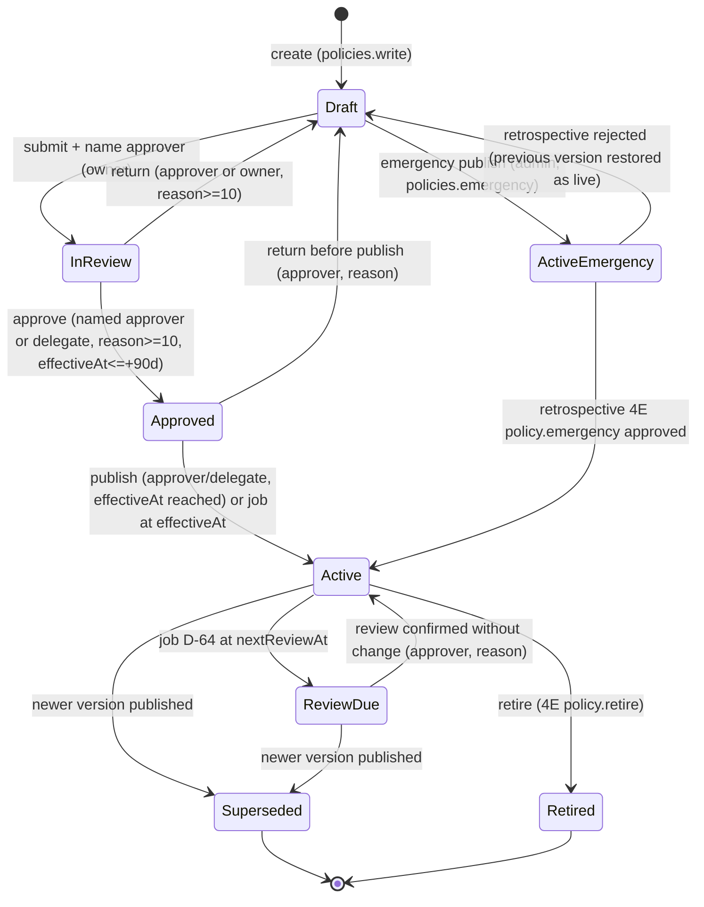

| ID | Rule |
|---|---|
| D-01a | Named approver eligibility (D-30): base permission `policies.approve`, not an author or editor of the version, not the policy owner, not the submitter. Delegation of the slot allowed (SOD_MATRIX §9). |
| D-01b | An Approved version is immutable; any edit creates a new Draft version (`policy_version` n+1). |
| D-01c | Emergency publish creates `policy_exception` (kind emergency) plus approval `policy.emergency` due in 5 business days, forbid publisher and all editors; a late decision is flagged in the audit log. If rejected, the previous Active version becomes live again and attestations revert. |
| D-01d | Publishing starts D-02 for the new version for every person in scope. |

### D-02 Policy attestation (per `policy_attestation`: person × policy version)

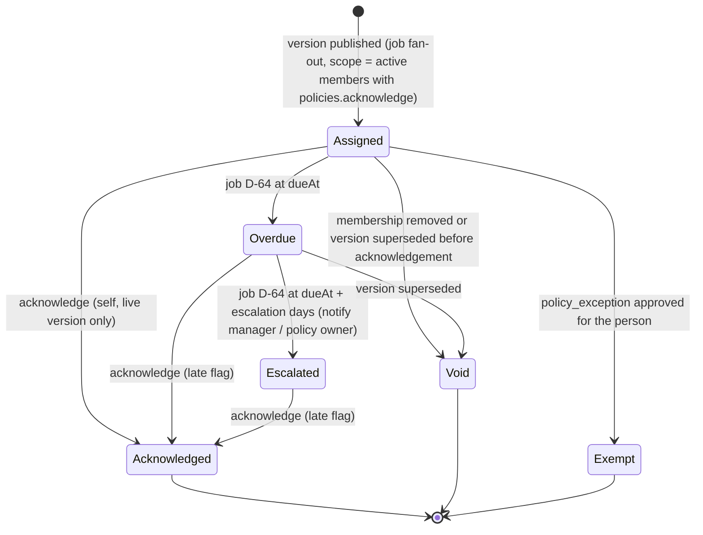

| ID | Rule |
|---|---|
| D-02a | History is per version (one row per person per version), fixing inventory AS gap 6. Acknowledged rows are never updated. |
| D-02b | Roles `auditor`, `vendor`, `viewer` are never assigned (no `policies.acknowledge`, F1-01). |
| D-02c | Reminders: at assign, at dueAt − 3 d, at dueAt; owner may remind manually at most once per 24 h. |

### D-03 Evidence review and expiry (per `evidence`, review per `evidence_version`)

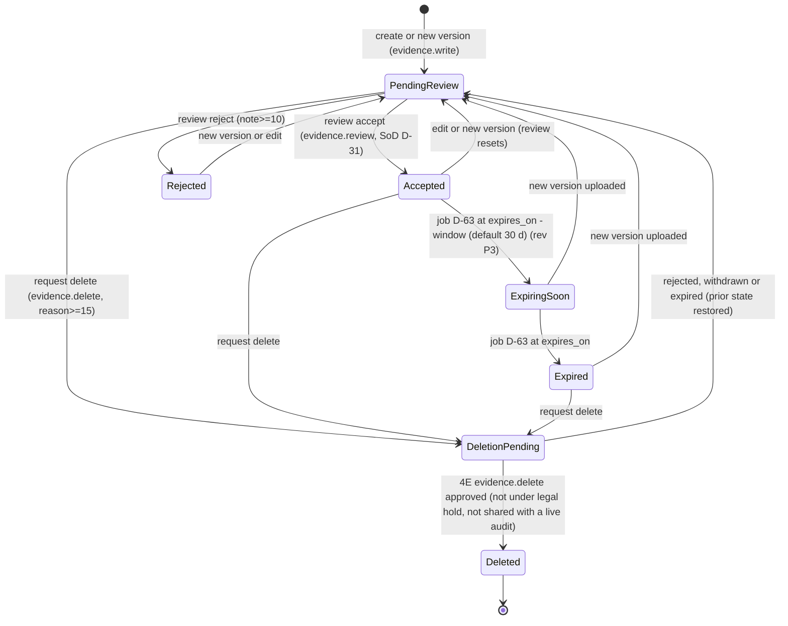

| ID | Rule |
|---|---|
| D-03a | Expiry effects: an Expired evidence item linked to a control moves the control to `NeedsEvidence` (job D-63), raises `evidence.expired` (C-73) and notifies the collector and control owner. |
| D-03b | Deletion writes a tombstone, deletes `file_object` rows and storage objects (via D-71 storage purge) and is refused while `legal_hold` or while shared with an audit whose access is Live. |
| D-03c | A file is usable only after scan state `Clean` (D-70); an `Infected` scan rejects the version automatically (`Rejected`, note "malware detected"). |

### D-04 Risk lifecycle and review cycle (per `risk`; reviews per `risk_review`)

```mermaid
stateDiagram-v2
    [*] --> Draft: create (risk.write)
    Draft --> Submitted: submit (>=1 mapped control or treatment)
    Submitted --> ChangesRequested: request changes (risk.approve, note)
    ChangesRequested --> Submitted: resubmit
    Submitted --> Open: approve (risk.approve; not last editor, not submitter)
    Open --> Treating: treatment plan active
    Treating --> Open: all actions done or cancelled
    Open --> Accepted: acceptance active (D-05)
    Treating --> Accepted: acceptance active
    Accepted --> Open: acceptance expired or invalidated (job / rescore)
    Open --> Closed: close (risk.approve; no open actions; SoD)
    Accepted --> Open: reopen
    Closed --> Open: reopen (risk.approve, reason)
```

Review cycle (`risk_review`):

```mermaid
stateDiagram-v2
    [*] --> Scheduled: on approve, close of previous review, or criteria change
    Scheduled --> Due: job D-65 at dueAt - 14 d (notify owner)
    Due --> Overdue: job D-65 at dueAt
    Due --> Completed: complete review (owner or risk.approve; outcome, rescore optional)
    Overdue --> Completed: complete review (late flag)
    Overdue --> Escalated: job D-65 at dueAt + 30 d (notify risk.approve holders)
    Escalated --> Completed: complete review
    Completed --> [*]: next review Scheduled (cycle from risk_criteria by band)
```

| ID | Rule |
|---|---|
| D-04a | Review cadence per residual band from `risk_criteria` (default Critical 3 months, High 6, Medium 12, Low 24 *(configurable)*). |
| D-04b | Every completed review writes a `risk_snapshot` row of that risk's scores for trend reporting. |

### D-05 Risk acceptance (per `risk_acceptance`)

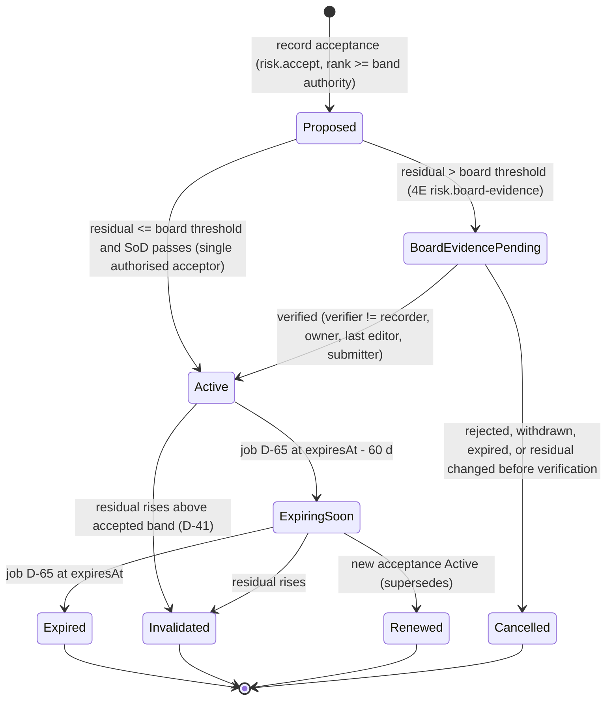

| ID | Rule |
|---|---|
| D-41 | Revalidation runs in the same transaction as any rescore (C-M06-04): if the new residual exceeds the band accepted, the acceptance becomes Invalidated and the risk returns to Open; above the board threshold without verified board evidence it is always invalidated. |
| D-05a | Expiry ≤ 12 months from acceptance; board evidence date not in the future and ≤ 90 days old; minutes stored as a scanned file (fixes "file name only", RK gap 2). |

### D-06 Vendor assessment (per `vendor_assessment`)

```mermaid
stateDiagram-v2
    [*] --> Planned: create (vendors.manage)
    Planned --> Sent: send (portal invite emailed or member assigned)
    Sent --> InProgress: vendor opens and verifies (portal) or saves draft (member)
    Sent --> Overdue: job D-62 at dueAt
    InProgress --> Overdue: job D-62 at dueAt
    Overdue --> InProgress: due date extended (vendors.manage)
    InProgress --> Submitted: submit (all answered; critical Yes has evidence)
    Submitted --> UnderReview: reviewer opens (automatic)
    UnderReview --> ClarificationRequested: reopen chosen questions (note>=10)
    ClarificationRequested --> Submitted: resubmit (new comment and evidence)
    UnderReview --> Completed: complete (score, outcome; Critical tier: reviewer != sender, D-45)
    Planned --> Cancelled: cancel (reason)
    Sent --> Cancelled: cancel
    Overdue --> Cancelled: cancel
    Sent --> LinkExpired: job at invite expiry, or 3 email mismatches
    LinkExpired --> Sent: new link
    Completed --> [*]
    Cancelled --> [*]
```

| ID | Rule |
|---|---|
| D-45 | For Critical vendors, completion needs `vendors.approve` and the completer must differ from the person who sent the assessment. Outcome "Fail" or findings create `vendor_finding` rows; a High finding offers an `issue`. |
| D-06a | Submission versions are immutable (`submissions[]`); portal evidence files go through quarantine and scanning (D-70), fixing RK gap 9. |
| D-06b | Completion sets `vendor.nextReviewAt` from tier cadence; job D-62 creates the next periodic assessment as `Planned`. |

### D-07 Audit finding (per `finding`)

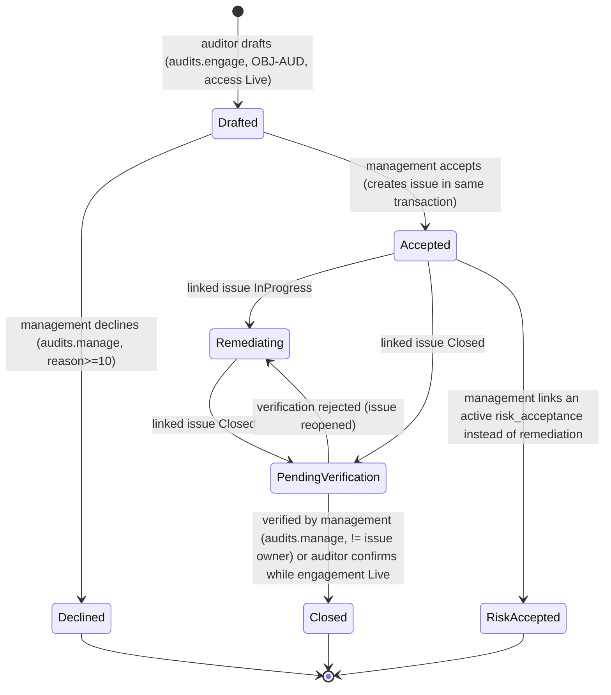

| ID | Rule |
|---|---|
| D-07a | Fixes AS gap 11: closing the issue moves the finding to PendingVerification (not silently Closed). |
| D-07b | An audit cannot complete with Drafted findings or open information requests (C-M08-07). |

### D-08 Corrective action (per `issue`)

```mermaid
stateDiagram-v2
    [*] --> Open: create (issues.write) or accept finding / signal / automation
    Open --> InProgress: start
    InProgress --> Open: pause
    InProgress --> Closed: close (Low/Medium: issues.write)
    Open --> Closed: close (Low/Medium)
    InProgress --> ClosurePending: propose closure (High/Critical, fix note>=10)
    ClosurePending --> Closed: 4E issue.close (verifier != owner, != proposer)
    ClosurePending --> InProgress: rejected, withdrawn or expired
    Closed --> Open: reopen (issues.manage, reason)
    Open --> Cancelled: delete (issues.manage; not High/Critical; no finding link)
    Cancelled --> [*]
```

| ID | Rule |
|---|---|
| D-08a | Overdue is a derived flag (dueAt < now and not Closed), not a state; job D-62 notifies owners daily and escalates after 7 days to `issues.manage` holders. |

### D-09 Trust Center access request with per-person NDA

```mermaid
stateDiagram-v2
    [*] --> Verified: visitor proves work email by OTP (or member uses trust.view)
    Verified --> Refused: domain on blocklist (automatic, audited)
    Verified --> Pending: request access (documents, reason)
    Pending --> Approved: approve (trust.approve; not requester, not unblocker, not a member address)
    Pending --> Denied: deny (note)
    Pending --> Expired: job D-66 after 30 d
    Approved --> NdaPending: account created or extended; viewer row for this person
    NdaPending --> Active: this person accepts the current NDA version
    Active --> NdaPending: NDA version changed (re-acceptance needed, job D-62 notifies)
    Active --> Revoked: account or viewer revoked (reason>=10)
    Active --> Lapsed: account end date reached (job D-66)
    Refused --> [*]
    Denied --> [*]
    Revoked --> [*]
    Lapsed --> [*]
```

| ID | Rule |
|---|---|
| D-09a | The NDA is accepted per person (`trust_nda_acceptance`: viewer id, NDA version, name typed, timestamp, IP hash). One person's acceptance never covers colleagues (OQ-07, F1-02). |
| D-09b | Access refers to documents by id; renaming a document changes nothing about who may open it. |
| D-09c | Public documents need no request; NDA documents' titles are revealed only to Active viewers. |

### D-10 Data subject request (DSAR, per `data_subject_request`)

```mermaid
stateDiagram-v2
    [*] --> Received: intake (dsar.handle) - clock starts at receivedAt
    Received --> IdentityCheck: start verification
    IdentityCheck --> Rejected: identity not verified after request for information, or manifestly unfounded (reason, dsar.approve)
    IdentityCheck --> InProgress: identity verified (method recorded)
    Received --> InProgress: identity not required (e.g. request from an authenticated member)
    InProgress --> Paused: awaiting information from subject (only where the jurisdiction allows the clock to stop)
    Paused --> InProgress: information received
    InProgress --> Extended: extension recorded (reason; subject told within the first period)
    Extended --> InProgress: continue
    InProgress --> TasksComplete: all dsr_task rows Done or NotApplicable
    TasksComplete --> ErasurePending: type erasure - 4E dsar.erasure
    ErasurePending --> Erased: approved; erasure job D-53 completes; certificate written
    ErasurePending --> TasksComplete: rejected (reason)
    TasksComplete --> ResponsePending: type access/portability - 4E dsar.disclose on the package
    Erased --> ResponsePending: confirmation letter
    ResponsePending --> Responded: response sent (channel, file)
    Responded --> Closed: job D-76 after appeal window or by handler
    Rejected --> Closed
    Closed --> [*]
```

See section 4 for the clock, tasks and erasure.

### D-11 Tenant provisioning (control plane, `control.tenants.status`)

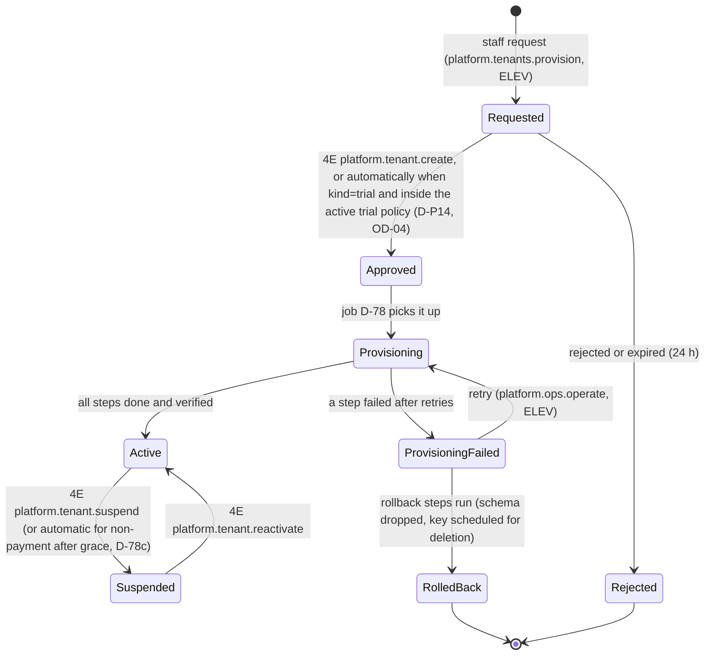

Provisioning steps (each idempotent, recorded in `ops.provisioning_steps`, D-78a):

| Step | Action | Verification |
|---|---|---|
| P1 | Allocate `tkey` (random 16-char base32), choose cell | unique in `control.tenants` |
| P2 | Create KEK in the KMS (or register the customer's BYOK key), create and wrap DEK; write `control.key_registry` (ids and versions only) | unwrap test succeeds |
| P3 | `migrator` creates schema `t_<tkey>`, roles `t_<tkey>_rw`, `t_<tkey>_ro`, grants to `selvara_router` (NOINHERIT) | catalog check: schema owner, grants exactly as S3 |
| P4 | Apply all tenant migrations; record `control.tenant_schema_versions` | version equals current |
| P5 | Seed: base roles in `tenant_role`/`tenant_role_permission`, default settings, RoPA template, risk criteria defaults; storage prefix `<tkey>/` | row counts |
| P6 | Isolation smoke test: as `t_<tkey>_rw` attempt to read another tenant schema and `control` (must fail) | expected errors |
| P7 | Routing record active; first-admin invitation created (72 h) and emailed; subscription created | invitation exists |
| P8 | Platform audit entry + tenant audit entry "tenant.provisioned" with step digests | chain verifies |

D-11a (rev P3): Trials (OD-04) are provisioned by staff only, under the single standing trial policy approved as 4E `platform.trial.policy` (D-P14): each trial must fit the policy's limits, duration (≤30 days), region and daily cap, needs no per-tenant approval, and appears in the daily trial digest to both approvers (D-80). The first-admin invitation (P7) goes by email to the invitee only; no link or token is ever returned to staff (DA-09, C-PL-05).

### D-12 Tenant offboarding and deletion

(rev P4, closes P4-A3-08: the export handed to the customer is the customer-readable final export FINAL-EXPORT of D-12b, not the nightly backup export D-73, which is encrypted with the tenant DEK, holds no `ks` subject or file keys and is unreadable to the customer.)

```mermaid
stateDiagram-v2
    [*] --> Active
    Active --> OffboardingRequested: customer admin request (C-M01-20, 4E tenant.offboard) or contract end or non-payment after grace (control.subscriptions)
    OffboardingRequested --> ExportBuilding: D-12b final export queued (members read-only, admins keep read access)
    ExportBuilding --> ExportWindow: bundle built, completeness check passed, manifest signed, recipient emailed (30-day window starts at the first ready)
    ExportBuilding --> ExportFailed: completeness mismatch or error after retries (alert R-B; no window starts)
    ExportFailed --> ExportBuilding: retry (platform ELEV) or regeneration
    ExportWindow --> ExportBuilding: regeneration requested (C-M01-23, at most 3 generations; window not restarted)
    ExportWindow --> ReceiptConfirmed: recipient confirms receipt or declines the export (C-M01-26, STEP)
    ExportWindow --> WindowExpired: 30 days after the first ready, with notices at ready, day 23 and day 29 recorded
    ReceiptConfirmed --> DeletionRequested
    WindowExpired --> DeletionRequested
    DeletionRequested --> DeletionApproved: 4E platform.tenant.delete (management_approver + ciso, D-58); precondition D-12b-7 holds
    DeletionRequested --> ExportWindow: rejected (reason), e.g. legal hold or dispute; window extended until resolved
    DeletionApproved --> Deleting: job D-78
    Deleting --> KeyDestructionPending: data removed; KMS key deletion scheduled (provider waiting period)
    KeyDestructionPending --> Deleted: KMS confirms destruction; certificate D-12e signed and anchored
    Deleting --> DeletionFailed: step failed after retries (alert)
    DeletionFailed --> Deleting: retry (ELEV)
    Deleted --> [*]
```

| ID | Rule |
|---|---|
| D-58 | Deletion approval needs two different people, one holding `management_approver` and one holding `ciso`; the requester counts as one of them only if they hold one of those roles. A tenant-level legal hold (`legal_hold` rows) blocks approval. The engine also refuses the final vote (422 `rule_refused`, reason `OFF-EXPORT-PENDING`) unless the final-export precondition D-12b-7 holds; no platform role can waive it (rev P4). |
| D-12a | Deletion steps: (1) revoke all sessions, API keys, SCIM tokens, webhooks, support grants; (2) disable routing (503 `tenant_unavailable`); (3) drop schema `t_<tkey>` and roles; (4) delete storage prefix `<tkey>/` in `tenant-files`, `quarantine`, `exports` (the final-export bundles under `exports/<tkey>/final/` included; `control.tenant_export_jobs` rows move to `purged`) (rev P4); (5) delete every `ks` row of the tenant (DEK versions, per-subject, per-file and blind-index keys; wrapped keys live only in `ks`, never in tenant tables, DA-04) (rev P3); (6) schedule KEK destruction (4E `platform.key.destroy` is satisfied by D-58's approval record for this deletion only); (7) delete memberships; for each identity with no other membership, `control.identities` is pseudonymised and the Supabase Auth user deleted through the Auth admin API 30 days later (G-RET-01, `platform_identity`), and job D-80a removes its `auth.audit_log_entries` and `auth.mfa_challenges`; remove the tenant's Supabase Auth SSO providers (`auth.sso_providers`, `sso_domains`, `saml_providers`) through the Supabase management API (2B-classification §3.1) (rev P4); (8) purge `ops` messages for the `tkey`. |
| D-12b | **Final export FINAL-EXPORT (job, rev P4; closes P4-A3-08).** Distinct from the nightly backup export D-73. Rules D-12b-1 to D-12b-9 below. |
| D-12e | Certificate (`control.deletion_certificates`): tenant ref, `tkey` hash, schema drop timestamp and catalog proof, storage object counts and manifest hash before and after, key ids and KMS destruction evidence reference, approvers and votes, request ids, the final-export record (`control.tenant_export_jobs` id and generation, manifest SHA-256, per-table counts, receipt outcome and time, or window-expiry date and notice times), certificate hash; anchored in `control.platform_audit_log` and the external anchor (ADR-013). (Was D-12b before rev P4; renumbered so that D-12b is the final export.) (rev P4) |
| D-12c | Backups: project PITR still holds the data until its window ends. E1 and E2 fields and files there are unreadable once the KEK is destroyed (S7, discovery summary §6); E0 plaintext remains readable in PITR until the window ends (ADR-004). The `ks` standby and off-site key journal roll off within 8 days (DA-11). The certificate states the PITR expiry date and the `ks` roll-off date. (rev P3) |
| D-12d | Trial tenants past expiry + 30 days are deleted under the standing trial policy approval (D-P14) instead of a per-tenant D-P03 vote; steps D-12a and certificate D-12e apply unchanged (OD-04) (rev P3). A trial tenant also gets the final export D-12b: the window starts at trial expiry and the deletion at expiry + 30 days is the window end (rev P4). |

D-12b final export FINAL-EXPORT (rev P4):

| ID | Rule |
|---|---|
| D-12b-1 | **Trigger and generations.** Entering `OffboardingRequested` enqueues generation 1 on queue `q_final_export`. While the window is open the recipient may request a regeneration (C-M01-23), at most 3 generations per offboarding; a new generation supersedes the previous one (its object deleted, `passphrase_enc` nulled, link and download tokens revoked). The window does not restart; `window_ends_at` is extended only so that it is never earlier than the newest link's expiry. State lives in `control.tenant_export_jobs` (2B B-E90.39). |
| D-12b-2 | **Runs in the tenant context.** The worker uses `router.withTenantJob(tkey, 'final_export')` (D-60) in the long-running worker of ADR-005 (bundles exceed function limits, D-88). The whole read runs in one `REPEATABLE READ` read-only transaction, so every table and file list comes from one snapshot. Members are read-only during offboarding, so the snapshot equals the live state at export time. The job unwraps the tenant DEK, subject keys and file keys through `ks` under ISO-HARD (KMS encryption context = the routed `tkey`). |
| D-12b-3 | **Bundle format** (a ZIP, documented in `README.md` inside it): `tables/<table>.json`, one file per tenant table, every E1 and E2 column decrypted, ids kept, `_bidx`/`_hmac` columns and wrapped-key references left out; `schema/<table>.schema.json` (JSON Schema per table) and `schema/dictionary.md` (column meanings, enumerations, schema version); `csv/<register>.csv` for the main registers (controls, statement of applicability, evidence list, policies, risks, issues, findings, vendors, assets, RoPA, DSARs, commitments, people and access); `files/<file_id>/<version>/<original name, sanitised>` with every non-purged file version with scan state clean, decrypted; `audit/` the tenant audit log with its ADR-013 verification bundle; `manifest.json` (tenant ref, generation, schema version, generated-at, row count per table, file count, SHA-256 of every file in the bundle, the list of excluded items with reason such as `infected`, `scan_failed` or `erased-subject field`); `manifest.sig`, a signature over `manifest.json` with the platform signing key `sig/export` in KMS, and the public key with verification steps. `record_history` is included decrypted; fields of erased subjects stay unreadable and are written as `null` with marker `erased`. |
| D-12b-4 | **Encryption and delivery.** The ZIP is streamed into an age file (scrypt passphrase recipient, which uses ChaCha20-Poly1305; or AES-256-GCM with an Argon2id-derived key if age is not used *(choice fixed at implementation, both are open formats with free tools)*) and written through `storagebroker` to `exports/<tkey>/final/<generation>.age`. Plaintext never reaches Storage, logs or `ops`. The passphrase is 128 bits from the CSPRNG, shown as 8 groups of 4 base32 characters; it is held only as `passphrase_enc` (E1, platform KEK) until the recipient reveals it **once** in the app after step-up (C-M01-24); it is never emailed, logged or shown to staff. The download link goes **by email** to the recipient: single use, valid 7 days, and it opens the app, where a signed-in recipient obtains a download token (C-M01-25). The two channels (email link, in-app passphrase) are independent. |
| D-12b-5 | **Completeness check** (before `ready`): for each table, rows written to the bundle = `count(*)` in the same snapshot; files written = non-purged clean `file_object` versions; the SHA-256 of each decrypted file = `file_object.sha256`; the bundle re-read from Storage decrypts and its manifest hash matches. Any mismatch: generation `failed`, retried 3 times with backoff, then `ExportFailed` and R-B paged (D-90 classes); the window does not start and deletion cannot proceed. |
| D-12b-6 | **Notices.** At `ready`, on day 23 and on day 29 of the window: email to the recipient and to every tenant admin, and to the contract contact of `control.subscriptions`; in-app banner. Each notice is recorded (time, channel, delivery result) on the job row. |
| D-12b-7 | **Precondition for deletion** (checked by D-58 and by D-78 before step 1): the latest generation is `ready` and either `receipt_outcome` is set (C-M01-26: `received`, or `declined` with STEP and reason) or `window_ends_at` has passed with the three notices recorded. A legal hold or dispute extends the window. |
| D-12b-8 | **Retention.** Bundles are deleted at supersession or by D-12a(4); the `control.tenant_export_jobs` row is kept under `accountability` (B-RC24) and copied into the certificate D-12e. |
| D-12b-9 | **Tests (2J, case to add; follow-up for workstream J).** Round trip on a synthetic tenant with E1, E2, files and an erased subject: export, decrypt with the passphrase, re-count rows against live counts, verify every file hash and the manifest signature, check E2 values and file content are readable; negative cases: second passphrase reveal refused, reused link refused, deletion vote refused before receipt or window end, a deliberately dropped row fails the completeness check. |

### D-13 Four-eyes approval (per `approval` / `control.platform_approvals`)

```mermaid
stateDiagram-v2
    [*] --> Pending: request (kind registered; one pending per kind+subject)
    Pending --> Pending: vote approve (needs > approvals so far)
    Pending --> Approved: final approve vote; apply handler succeeds in same transaction
    Pending --> Rejected: any reject vote
    Pending --> Withdrawn: requester withdraws
    Pending --> Expired: job D-66 at expiresAt
    Pending --> Superseded: subject changed so the request no longer applies (apply re-check fails) or newer request of same kind+subject replaces it
    Approved --> [*]
    Rejected --> [*]
    Withdrawn --> [*]
    Expired --> [*]
    Superseded --> [*]
```

### D-14 Auditor engagement access (per `auditor_access`)

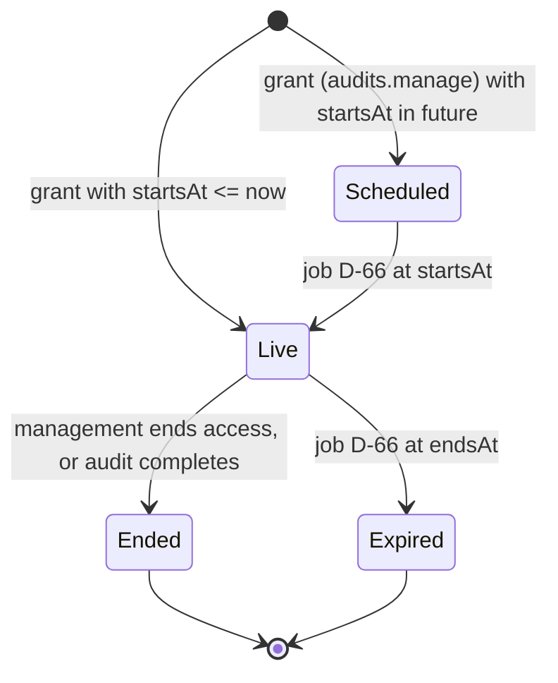

When the last live `auditor_access` of a person ends, job D-79 sets the auditor's membership to `Suspended` (control plane) and revokes their sessions in that tenant (E-44). Access can be extended while Live (`…/auditor-access/:accessId/extend`, `audits.manage`, endsAt ≤ startsAt + 180 d; rev P3).

### D-15 Questionnaire (per `questionnaire`) (rev P3)

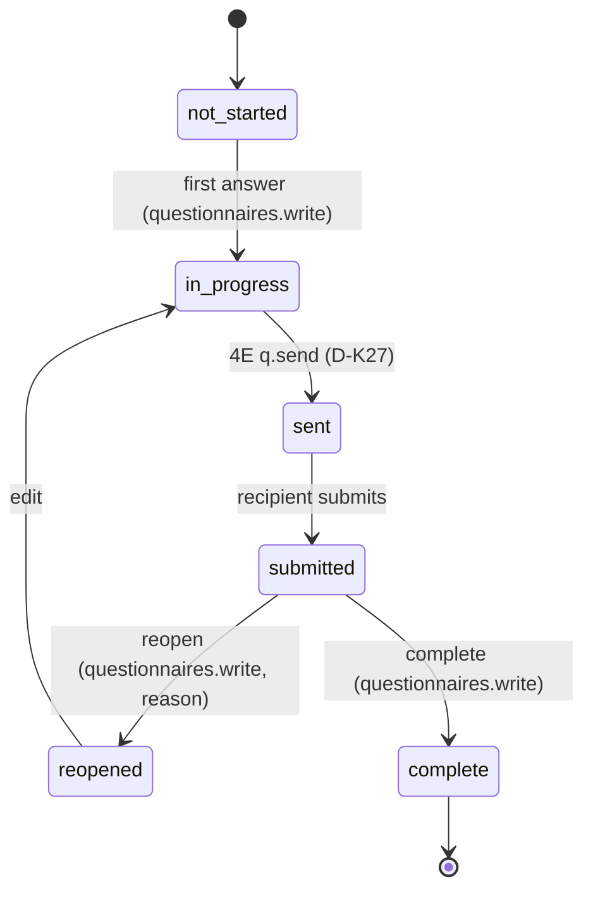

### D-16 AI system review (per `ai_system`) (rev P3)

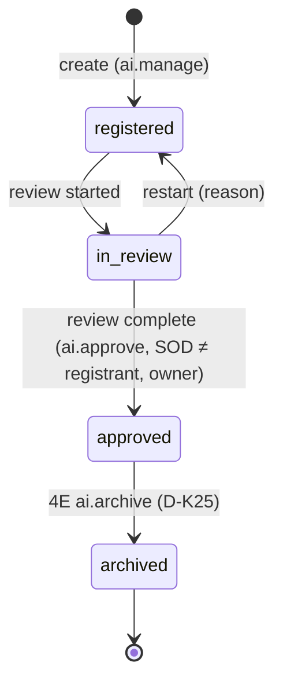

Classification: draft (C-M13-04 or the C-M13-09 proposal) → confirmed (`ai.approve`, SOD ≠ drafter, ≠ owner); a confirmed tier change that moves the guardrail tier goes through 4E `ai.guardrail` (DA-14).

### D-17 Support question (per `control.support_questions`) (rev P3)

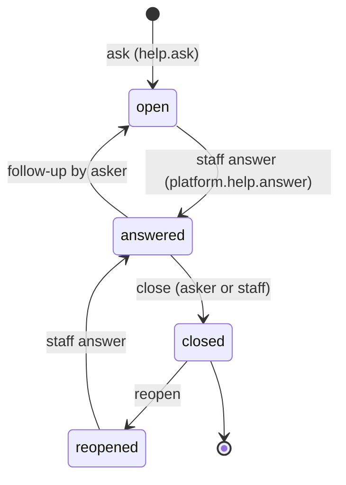

---

## 2. Approval engine (one engine, kinds registry)

### 2.1 Engine rules

| ID | Rule |
|---|---|
| D-20 | One engine, two stores: tenant approvals in `t_<tkey>.approval` / `approval_vote` / `delegation`; platform approvals in `control.platform_approvals` / `platform_approval_votes`. The same library evaluates both; the kind registry says which plane a kind belongs to. Replaces the two engines of today (F1-04). |
| D-21 | Kind registry entry: `kind`, `plane`, `module`, `subjectType`, `initiatorPerm`, `approverPerm`, `needs` (1 or 2, may depend on payload), `forbid` (roles of people on the subject: requester always, plus e.g. owner, editors, subject person, drafter), `namedApprover` (bool), `delegable` (tenant named kinds only), `ttl`, `stepUp` (bool), `elevation` (platform), `dualRole` (platform: management_approver + ciso), `recheck` (function re-running the rule at apply), `apply` (idempotent handler), `onExpire`, `notify`. Registered in code; a kind not in the registry cannot be created (deny by default). |
| D-22 | Eligibility to vote: authenticated human; holds `approverPerm` now (checked at vote time, not at request time); not the requester; not in the forbid set computed from the subject at vote time; has not voted; approval Pending and not past `expiresAt`; if `namedApprover`, is the named approver or their live delegate (SOD_MATRIX §9); STEP if `stepUp`; ELEV if platform. |
| D-23 | Reason ≥ 10 characters on every vote and withdrawal (stored up to 300 characters, free text flagged as possible personal data). |
| D-24 | One vote per person per approval (unique index on `approval_id, person_id`); a second different person is needed where `needs = 2`; a delegate counts only as the named approver, never as the second approver. |
| D-25 | The apply handler runs in the same transaction as the final vote; it re-runs `recheck` (subject version, state, legal hold, plan limit, SoD on the current subject). If `recheck` fails, the approval becomes `Superseded` with the reason and nothing applies. |
| D-26 | Platform votes: voter must hold `platform.approvals.decide` plus the kind's `approverPerm`, have a live elevation, and never be the requester. `dualRole` kinds require the set {requester if eligible, voters} to include one `management_approver` and one `ciso`, which with two super admins means "the other one". Platform approvals are never delegated. |
| D-27 | Payload: the requested change is stored in the approval (`payload jsonb`, confidential fields encrypted with the tenant DEK); the UI shows `payloadSummary`. The subject's `version` at request time is stored; a later edit of the subject by anyone supersedes the request where the kind says `supersedeOnEdit`. |
| D-28 | Expiry is applied only by job D-66 (not on read); reads compute an `effectiveStatus` so a past-due request is shown as expired without writing. |
| D-29 | Non-human principals (system jobs, agents, API keys, SCIM clients, automation rules) can request a small set of kinds where registered (`allowSystemRequest`), but can never vote. |

### 2.2 Specific separation rules referenced by modules

| ID | Rule |
|---|---|
| D-30 | Policy approver: `policies.approve`; ≠ any author or editor of the version; ≠ policy owner; ≠ submitter. |
| D-31 | Evidence reviewer: `evidence.review`; ≠ collector; ≠ any version author; ≠ any file uploader of the reviewed version. |
| D-32 | Risk approver (submit → open): `risk.approve`; ≠ last editor; ≠ submitter. Risk closer: ≠ last editor; ≠ owner when actions exist. |
| D-33 | Risk acceptor: `risk.accept` with rank ≥ band authority from `risk_criteria.acceptanceLadder`; ≠ risk owner, last editor, submitter. |
| D-34 | Access decider: ≠ requester, ≠ beneficiary; privileged second stage: ≠ first approver. |

### 2.3 Kinds registry

Tenant plane (TTL in hours; `F` = forbid set beyond the requester). "Privileged role" here and in D-K01, D-K03 and D-K22 has one definition (DA-08, 2E E-33d): `admin`, `owner`, and any custom role holding any admin-only permission; `analyst` is not privileged (rev P3).

| ID | Kind | Module | Initiator perm | Approver perm | Needs | F | Named | TTL | Step-up |
|---|---|---|---|---|---|---|---|---|---|
| D-K01 | `team.role` | M01 | members.manage | members.manage | 1 | subject person | no | 72 | yes |
| D-K02 | `team.invite` | M01 | members.manage | members.manage | 1 | — | no | 72 | no |
| D-K03 | `team.offboard` | M01/M12 | people.manage | members.manage | 1 | subject | no | 72 | yes; always used when the requester lacks `members.manage` (C-M12-04) (rev P3) |
| D-K04 | `team.setting.loosen` (incl. trusted network) | M01 | settings.manage | settings.manage | 1 | — | no | 72 | yes |
| D-K05 | `tenant.role.change` | M01 | roles.manage | roles.manage | 1 (2 if the change adds any sensitive permission, E-30 column S, E-34); a change that adds an admin-only permission makes the role privileged (E-33d), so later assignments need 4E `team.role` | — | no | 72 | yes (rev P3) |
| D-K06 | `sso.activate`, `sso.policy` | M01 | sso.manage | sso.manage | 1 | — | no | 72 | yes |
| D-K07 | `scim.token` | M01 | sso.manage | sso.manage | 1 | — | no | 24 | yes |
| D-K08 | `team.rule` | M26 | automation.manage | automation.approve | 1 | rule creator | no | 72 | no |
| D-K09 | `team.retention` | M14 | privacy.manage | privacy.manage | 1 | — | no | 72 | no |
| D-K10 | `team.hold` (release) | M14 | privacy.manage | privacy.manage | 1 | hold placer | no | 72 | no |
| D-K11 | `control.exception` | M03 | controls.exception.request | controls.exception.approve | 1 | control owner | no | 336 | no |
| D-K12 | `evidence.delete` | M04 | evidence.delete | evidence.delete | 1 | collector | no | 72 | no |
| D-K13 | `policy.approval` | M05 | policies.write | policies.approve | 1 | authors, editors, owner | **yes** (delegable) | 720 | no |
| D-K14 | `policy.emergency` | M05 | policies.emergency | policies.approve | 1 | publisher, editors | no | 8760 (due 5 business days) | no |
| D-K15 | `policy.exception`, `policy.retire` | M05 | policies.write | policies.approve | 1 | requester's editors | no | 72 | no |
| D-K16 | `risk.approval` | M06 | risk.write | risk.approve | 1 | last editor, submitter | no | 720 | no |
| D-K17 | `risk.board-evidence` | M06 | risk.accept | risk.approve | 1 | owner, last editor, submitter, recorder | no | 72 | no |
| D-K18 | `risk.import` | M06 | risk.write | risk.approve | 1 | importer | no | 72 | no |
| D-K19 | `risk.criteria` | M06 | risk.configure | risk.configure | 1 | — | no | 72 | no |
| D-K20 | `issue.close` | M07 | issues.write | issues.verify | 1 | owner, proposer | no | 336 | no |
| D-K21 | `report.distribution` | M16 | reports.manage | reports.approve | 1 | — | no | 24 | no |
| D-K22 | `mfa-reset-member` | M12 | people.mfa_reset | people.mfa_reset | 1, 2 if subject privileged | subject | **yes** (delegable) | 24 | yes |
| D-K23 | `access-request` (privileged stage 2) | M12 | access.approve | access.approve | 1 | beneficiary, first approver | no | 72 | no |
| D-K24 | `access.system.privileged` | M12 | access.manage | access.approve | 1 | — | no | 72 | no |
| D-K25 | `ai.guardrail`, `ai.archive` | M13 | ai.manage | ai.approve | 1 | system owner | no | 24 | no |
| D-K26 | `vendor.request.critical`, `vendor.gate`, `vendor.tier`, `vendor.waiver` | M09 | vendors.manage / vendors.approve | vendors.approve | 1 | requester, adder | no | 72 / 24 | no |
| D-K27 | `q.send` | M10 | questionnaires.write | questionnaires.approve | 1 | author, editors | no | 24 | no |
| D-K28 | `trust.publish`, `trust.public-page`, `trust.section.public` | M11 | trust.manage | trust.approve | 1 | editors after request | no | 24 | no |
| D-K29 | `integration.connect` | M17 | integrations.manage | integrations.approve | 1 | — | no | 24 | yes |
| D-K30 | `api.key` (write scopes), `api.webhook` | M18 | api.manage | api.approve | 1 | — | no | 24 | yes |
| D-K31 | `ai.enable`, `ai.mask` | M19 | assistant.manage | assistant.approve | 1 | — | no | 24 | yes |
| D-K32 | `assistant.agent.enable`, `.autonomy`, `.recertify`, `assistant.mcp.grant` | M19 | assistant.manage | assistant.approve | 1, 2 for service-account agents | agent creator | no | 72 | no |
| D-K33 | `dsar.erasure`, `dsar.disclose` | M14 | dsar.handle | dsar.approve | 1 | handler who prepared the package | no | 72 | yes |
| D-K34 | `privacy.dpia` | M14 | privacy.manage | dpia.approve | 1 | author, submitter | no | 336 | no |
| D-K35 | `assistant.run` (agent change in Suggests mode) | M19 | system (agent) | assistant.approve | 1 | triggerer | no | 72 | no |
| D-K36 | `content.upgrade` | M02 | frameworks.upgrade | frameworks.upgrade | 1 | requester | no | 72 | yes (DA-15, ADR-011 D11-6; C-M02-09) (rev P3) |
| D-K37 | `content.upgrade.in_audit` (framework in an audit in Fieldwork or Reporting) | M02 | frameworks.upgrade | frameworks.upgrade | 2 | requester | no | 72 | yes (DA-15, 2B B-RF16) (rev P3) |
| D-K38 | `tenant.offboard` (customer offboarding request, starts D-12) | M01 | settings.manage | settings.manage | 1 (2 when two or more admins exist) | — | no | 72 | yes (C-M01-20) (rev P3) |
| D-K39 | `tenant.byok` (register or change a customer KEK) | M01 | settings.manage | settings.manage | 2 | — | no | 72 | yes (C-M01-22, 2F F-K-21) (rev P3) |
| D-K40 | `audit.access.long` (auditor access whose window, on grant or extension, exceeds 90 days in total) | M08 | audits.manage | audits.manage | 1 | requester | no | 72 | no; tenant admins notified (C-M08-04) (rev P4, P4-A2-23) |
| D-K41 | `audit.share.late` (sharing an item with an engagement after its population freeze, including by linking evidence to a PBC request) | M08 | audits.manage | audits.manage | 1 | requester | no | 72 | no (C-M08-05, C-M08-08) (rev P4, P4-A2-23) |

Platform plane (all need ELEV to vote; requests need ELEV except D-P12 under the 2C §4 exception for `platform.mfa_reset.request` holders without `platform.elevate`; TTL 24 h unless stated) (rev P3):

| ID | Kind | Initiator perm | Approver perm | Needs | Dual role | Notes |
|---|---|---|---|---|---|---|
| D-P01 | `platform.tenant.create` | platform.tenants.provision | platform.tenants.provision | 1 | no | |
| D-P02 | `platform.tenant.suspend`, `.reactivate` | platform.tenants.lifecycle | platform.tenants.lifecycle | 1 | no | system may request suspend for non-payment (D-29) |
| D-P03 | `platform.tenant.delete` | platform.tenants.delete | platform.tenants.delete | 1–2 | **yes** | TTL 72 h; D-58 |
| D-P04 | `platform.key.destroy` | platform.keys.operate | platform.keys.operate | 1–2 | **yes** | per-subject keys for DSAR use tenant D-K33 instead |
| D-P05 | `platform.limits`, `platform.plan.change` | platform.plans.manage | platform.plans.manage | 1 | no | |
| D-P06 | `platform.provider.change` | platform.providers.manage | platform.providers.manage | 1 | yes for AI and KMS providers | ADR-007 review record required |
| D-P07 | `platform.staff.change` | platform.staff.manage | platform.staff.manage | 1–2 | **yes** | subject forbidden |
| D-P08 | `platform.role.change` | platform.roles.manage | platform.roles.manage | 1–2 | **yes** | ADR-014 |
| D-P09 | `platform.migration.rollout` | platform.migrations.operate | platform.migrations.operate | 1 | no | per release, not per wave |
| D-P10 | `billing.credit`, `.refund`, `.markpaid`, `.void` (above threshold), `.writeoff`, `.pricing` | platform.billing.operate | platform.billing.approve | 1 | no | threshold USD 1,000 as today |
| D-P11 | `rates.release`, `rates.override` | platform.rates.operate | platform.rates.approve | 1 | no | held value unchanged at apply |
| D-P12 | `mfa-reset-admin` | platform.mfa_reset.request | platform.mfa_reset.approve | 1 | no | named approver; subject forbidden; also used for multi-tenant identities (E-56) |
| D-P13 | `platform.tenant.admin-reset` (change the first-admin invitation email) | platform.tenants.lifecycle | platform.tenants.lifecycle | 1–2 | **yes** | only while the tenant has no Active admin; invitation goes by email to the invitee only (DA-09, C-PL-05) (rev P3) |
| D-P14 | `platform.trial.policy` | platform.tenants.provision | platform.tenants.provision | 1–2 | **yes** | TTL 72 h; payload: limits, duration ≤30 d, region, daily cap; standing approval for trials (OD-04, D-11a, D-12d); daily digest to both approvers (D-80) (rev P3) |
| D-P15 | `platform.tenant.restore` | platform.tenants.lifecycle (or tenant request through C-M01-21) | platform.tenants.lifecycle | 1–2 | **yes** | 2H H-RS-01; tenant informed of the write freeze (rev P3) |
| D-P16 | `billing.tax_rule` | platform.billing.operate | platform.billing.approve | 1 | no | invoicing refused without an approved rule (2I R-52; C-PL-29) (rev P3) |

---

## 3. Scheduled jobs (spine S8)

Common to every job: one message = one tenant (or one control-plane item); message body holds only `tkey`, job type, ids and a dedupe key, never business data; idempotency via a dedupe key and idempotent handlers; failures retried with backoff then dead-lettered (D-90).

| ID | Job | Schedule (dispatcher) | Inputs | Idempotency | Failure handling |
|---|---|---|---|---|---|
| D-61 | Tenant dispatcher | pg_cron every minute on each cell | `cp` routing view `control.v_routing` read through `cp_router_ro` (tenant status read live, never cached; static routing fields may be cached 30 s, R2-01); job calendar | Dedupe key `<job>:<tkey>:<window>` in `ops.job_dedupe` (unique) | If `cp` is unreachable, skip the tick and alert (fail closed); workers re-check tenant status through the router before each message (S8) (rev P3) |
| D-62 | Reminders and notifications (policy acks, issue overdue, vendor assessment due/overdue, trust NDA re-acceptance, PBC due, digest emails) | hourly per tenant; email digest daily at tenant-local 08:00 | tenant records due in window; incident notification deadlines (`incident.deadline_at`); commitment due rules (rev P3) | notification dedupe `(person, kind, record, day)` | Email provider failure: retry 6 times over 6 h; bell notice always written first |
| D-63 | Evidence expiry | daily per tenant | `evidence.expires_on` (rev P3) | state transition guarded by current state (no-op if already moved) | per-record errors logged; job continues with the next record |
| D-64 | Policy review due and attestation overdue/escalation; scheduled publish at `effectiveAt` | hourly per tenant | `policy`, `policy_attestation` | as D-63 | as D-63 |
| D-65 | Risk review due, overdue, escalation; acceptance expiring/expired | daily per tenant | `risk_review`, `risk_acceptance` | as D-63 | as D-63 |
| D-66 | Approval expiry sweep; delegation expiry; auditor access start/expiry; trust request expiry and account lapse; invitation expiry | every 5 min per tenant with pending items (the dispatcher reads a per-tenant "next due" hint) | `approval`, `delegation`, `auditor_access`, `trust_access_request`, `control.invitations`; support grant end (`control.support_grants.ends_at`): end live support sessions (rev P3) | transition only from Pending/Live | as D-63; a stuck item raises an ops alert after 3 failures |
| D-67 | Report generation and exports | on demand (queue) + `report_schedule` cron per tenant | schedule or request id | `report_run` row created first with the idempotency key; re-run overwrites the same file key | 3 retries; then run `Failed`, requester notified; partial files deleted |
| D-68 | Webhook delivery | continuous (queue), retries per C-89 | `webhook_delivery` row id | delivery id sent as `Selvara-Delivery-Id`; consumers dedupe on event id | backoff per C-89; auto-disable C-90 |
| D-69 | Integration sync (and shadow-AI signals, device posture) | per integration cadence (default 6 h), and on demand | `integration` id | `integration_sync_run` per window; upserts keyed by provider ids | provider 401/403: integration `Error`, admins notified, no retry until reconnected; 429/5xx: backoff |
| D-70 | Malware scanning | on upload (queue) | `file_object` id in `quarantine` | scan result stored with file hash; re-scan of same hash reuses result ≤ 24 h | scanner down: file stays `Pending` (never served); after 24 h `ScanFailed` and uploader notified; infected: delete object, mark `Infected`, audit, notify |
| D-71 | Retention purge (records past retention and not on hold; `webhook_delivery`, notifications, sign-in records, `ops` data) and storage purge | daily per tenant (off-peak) | `retention_rule`, `legal_hold` | purge by batches of 500 with a high-water mark; re-run safe | stops at the first error per table; no purge while the tenant has a schema-version mismatch |
| D-72 | Audit-log anchoring | hourly per tenant with new entries; platform log hourly | `audit_log_entry` head hash | `audit_anchor` unique per (tenant, hour) | anchor target down: retry; gap > 24 h alerts R-B |
| D-73 | Backup export (nightly logical export per tenant, encrypted with the tenant DEK; for restore only, never handed to the customer as the offboarding export, which is D-12b) (rev P4) | nightly, spread across the night by `tkey` hash | schema + files manifest | export object key `<tkey>/<date>`; overwrite safe | 3 retries; a missed night alerts; two missed nights is an incident |
| D-74 | Usage metering | events emitted on write; aggregation every 15 min | usage events in `ops.usage_events` (counts only) | event id unique; aggregates upserted per (tenant, meter, period) into `control.usage_meters` | at-least-once; duplicates removed by event id |
| D-75 | Automation rules | per rule trigger: on event (outbox) or schedule | `automation_rule` id | `automation_run` per (rule, trigger event or window) | rule paused automatically after 3 consecutive failures; owner notified |
| D-76 | DSAR deadline clock | hourly per tenant with open DSARs | `data_subject_request` | notifications deduped per (request, threshold) | as D-63; a breach of the deadline is an incident flag on the request |
| D-77 | Migration rollout (ADR-009) | on approval of D-P09; waves: canary tenants, then batches of N | release id | per-tenant `control.tenant_schema_versions` compare-and-set | failed tenant: stays on old version (router returns 503 for that tenant only); wave pauses on error-rate threshold |
| D-78 | Tenant provisioning and deletion steps | on approval (queue) | tenant ref | `ops.provisioning_steps` per step; each step checks its postcondition before acting | step retries 5; then `ProvisioningFailed` / `DeletionFailed`, alert |
| D-79 | Identity propagation: profile changes to `member_profile`; membership and role changes to tenant caches; session revocation fan-out; auditor membership suspension; at the end of `platform_identity` or on upheld erasure, pseudonymise `control.identities` and delete the Supabase Auth user through the Auth admin API (rev P4) | on event (queue) | identity / membership id | version-stamped upsert; Auth delete is idempotent (a missing user is success) | retry; mismatch report daily; an Auth delete that fails 5 times is dead-lettered and pages R-B (rev P4) |
| D-12b | Final export FINAL-EXPORT (offboarding) (rev P4) | on entering `OffboardingRequested`, and on regeneration (C-M01-23) | `control.tenant_export_jobs` id, generation | job row per (tenant, generation); a rerun of a `building` generation restarts from scratch and overwrites the same object key | 3 retries; then `ExportFailed`, R-B paged; rules D-12b-1 to D-12b-9 |
| D-80a | `auth` purge job (rev P4, P4-A3-01) | daily on `cp` | `auth` tables of 2B-classification §3.1 | deletes by age or by subject id; re-run safe | per-table error alerts R-B; a failed run on two consecutive days is an incident. Deletes `auth.audit_log_entries` and `auth.mfa_challenges` older than 90 days, `auth.sessions`, `refresh_tokens`, `mfa_amr_claims` 30 days after expiry, `flow_state`, `saml_relay_states`, `one_time_tokens` and unused Auth tokens older than 24 h; on an identity erasure or deletion, the subject's rows at once; runs the B-C29 minimisation probe weekly; one `control.platform_audit_log` entry per table per run (counts only) |
| D-80 | Platform hygiene: SSO certificate expiry (warn 30 d, 7 d), domain re-verification (weekly), API key and SCIM token expiry, expired session cleanup, agent certification lapse, AI provider review expiry; daily trial digest to both trial-policy approvers (D-P14, OD-04) (rev P3) | daily | control plane and per-tenant hints | as D-63 | as D-63 |

| D-82 | Content upgrade apply and forced upgrade (ADR-011 D11-6 auto-minor, D11-7) | on approval of D-K36/D-K37, and daily for retired releases | tenant, package, release | `content_upgrade` row per (tenant, package, release) | tenants in an active audit skipped and reported (DA-15) (rev P3) |

D-70a (rev P4, closes P4-A2-26): **No job or handler reads file bytes unless `file_object.scan_state = clean`.** This covers every server-side parse of an upload (risk import C-M06-18, questionnaire import C-M10-02, KB documents C-M10-07, contract import and AI analysis C-M15-02 and C-M15-04, vendor answers C-M09-13, DSAR responses) as well as downloads and D-12b. It is enforced in `storagebroker`: its read function takes a `file_object` id, re-reads `scan_state` in the caller's tenant transaction and refuses anything but `clean` (error class `permanent`, audit entry `file.read.refused`); there is no read-by-path function. A handler that receives a `pending` file returns 409 `invalid_state` (`file_not_scanned`) and the client retries after the scan. Test: a J-SEC case (to add; follow-up for workstream J) calls each parser with a `pending`, `infected` and `failed` file and expects refusal.

### 3.1 Reads never write

D-81: Every sweep that today runs inside a GET (risk, vendors, AI, trust, access, people data routes, inventory RK gap 4) moves to D-63..D-66. Read handlers compute derived flags (`effectiveStatus`, `overdue`) without writing. A lint rule forbids repository write calls in handlers registered as `GET`.

---

## 4. DSAR detail

| ID | Rule |
|---|---|
| D-50 | Intake channels: tenant staff enter requests received by email, form or letter (C-M14-04); a tenant may enable a public intake form on its Trust Center in a later release. Subject contact details are encrypted with a **per-subject key** (S7) so erasure of the DSAR record itself is possible. |
| D-51 | Deadline clock: `dueAt` computed from `receivedAt` and a jurisdiction rule in `ref.dsar_rules` (rule id, base period, maximum extension, whether identity verification or requests for information stop the clock). Seed rules (DRAFT, verify): EU/UK GDPR one month, extendable by two further months where necessary (Art. 12(3)); others to be added by legal review *(verify each)*. Notifications at 50 %, 80 %, 7 days, 1 day and at breach. |
| D-52 | Discovery: job searches the tenant schema for the subject across tables that hold personal data (catalogue from Phase 2G: `person`, `member_profile`, `vendor_contact`, `trust_viewer`, `trust_access_request`, `trust_chat`, `data_subject_request`, `access_grant`, `integration` accounts, free-text fields flagged PD) using exact-match identifiers (email hash, person id), returning record refs only. The handler confirms matches. Results feed `dsr_task` rows. |
| D-53 | Tasks per system: `dsr_task` per `system` linked from the RoPA activities that list the data category; external systems get manual tasks with an assignee and due date; Selvara-held data gets automatic tasks (export, rectify, erase). |
| D-54 | Erasure inside Selvara: after 4E `dsar.erasure`: (1) records on `legal_hold` or under a retention obligation are excluded and listed in the response with the reason; (2) personal fields are overwritten with a tombstone value and the row version incremented; (3) the subject's per-subject key is destroyed in the key store (S7), which makes the encrypted values in `record_history`, exports and backups unreadable; (4) files belonging only to the subject are deleted; (5) an erasure certificate (`data_subject_request.erasureCertificate`: tables, row counts, key id destroyed, KMS evidence ref, approvers, hash) is written and anchored. The audit log keeps the action with the subject reference pseudonymised. |
| D-55 | Response: access/portability packages are produced by D-67 as an encrypted export (password sent separately), require 4E `dsar.disclose`, and are deleted from `exports` 30 days after delivery. |
| D-56 | Selvara as controller (identities, support questions, sign-in records, billing contacts, and the Supabase `auth` schema: `auth.users`, `identities`, `sessions`, `mfa_*`, `audit_log_entries`) (rev P4): the same state machine runs in Selvara's own tenant (M14, 2G G-D-07); a staff tool in `console` reads the subject's controller data from `cp` through `cp_rw`, and the case record lives only in Selvara's tenant (rev P3); handled by holders of `platform.privacy.manage`, with erasure limited by billing and security-log retention. Erasure deletes the Auth user through the Auth admin API and the subject's `auth` rows through D-80a (rev P4). |

---

## 5. Workers across tenant schemas

### 5.1 Tenant job context

| ID | Rule |
|---|---|
| D-60 | A worker handles a message only through `router.withTenantJob(tkey, jobType, fn)`: it reads the routing record (cell, schema, version, tenant status), refuses when the tenant is not in a status that allows the job (table D-60a), sets `SET LOCAL ROLE t_<tkey>_rw`, `search_path = t_<tkey>, ref, pg_temp`, `app.tenant_id`, `app.user_id = system:<jobType>`, `app.request_id = <message id>`, exactly as the API path (S3). |
| D-60b | Nesting is forbidden: calling `withTenantJob` (or the API router) while a tenant context is open throws. A job that must touch two tenants does not exist by design; cross-tenant work (for example platform reports) reads only `control` aggregates. |
| D-60c | Schema version check: if the tenant's schema version differs from the version the worker code expects, the message is re-queued with a delay (60 s, jittered) and not counted as a failure; after 2 h it is dead-lettered as `schema_mismatch`. |
| D-60d | Workers never use the service role or `migrator` for tenant data; only D-77 and D-78 use `migrator`, on their own queues, with the approval id in the message. |

D-60a Tenant status gate:

| Tenant status | Jobs allowed |
|---|---|
| Active | all |
| Suspended | D-62 (only to admins: suspension notices), D-66, D-71, D-72, D-73, D-76 (statutory clocks continue), D-79 |
| Offboarding (`OffboardingRequested` to `DeletionRequested`) | as Suspended + D-12b (final export) (rev P4) |
| Deleting | D-78 only |
| Provisioning | D-78 only |

### 5.2 Fair scheduling

| ID | Rule |
|---|---|
| D-85 | Queues: one pgmq queue per job type in `ops` (`q_reminders`, `q_expiry`, `q_reports`, `q_webhooks`, `q_sync`, `q_scan`, `q_purge`, `q_anchor`, `q_backup`, `q_metering`, `q_automation`, `q_dsar`, `q_migrate`, `q_provision`, `q_identity`, `q_final_export` (rev P4)). |
| D-86 | The dispatcher (D-61) enqueues per-tenant messages in a shuffled order each tick, so no tenant is always first. |
| D-87 | Per-tenant concurrency: before running, the worker takes a lease in `ops.tenant_slots (tkey, job_class, holder, expires_at)` with at most 1 concurrent job per tenant for heavy classes (reports, exports, backup, purge, migration) and 2 for light classes. No free slot: the message's visibility timeout is extended by 15 to 30 s (jitter) and the worker moves on to the next tenant's message. |
| D-88 | Worker invocation: pg_cron calls the worker endpoint (C-10) through `pg_net` every minute per queue *(verify pg_net availability, A-09)*; each invocation processes messages for ≤ 50 s (below the serverless time limit), reading batches of 20 and interleaving tenants round-robin by `tkey`. Heavy jobs (backup, scan) run in the scanning container or a long-running worker *(ADR-005)*. |
| D-89 | Per-tenant budgets: a tenant whose jobs consume more than its share (CPU seconds per hour, per plan) is delayed, not failed; the platform sees it on the jobs page (C-PL-24). |

### 5.3 Poison messages and isolation of failures

| ID | Rule |
|---|---|
| D-90 | Each message has `read_ct`; after 5 failed attempts (exponential backoff 30 s → 1 h) the message moves to the job type's dead-letter queue `dlq_<type>` with error class, last error code and the tenant ref. Payloads contain only ids, so the DLQ holds no business data. |
| D-91 | Circuit breaker per (tenant, job type): 3 dead letters in an hour pause that job type for that tenant only (`ops.tenant_job_pause`) and alert; other tenants continue. |
| D-92 | Errors are classified: `retryable` (network, lock timeout, 503), `schema_mismatch` (D-60c), `permanent` (validation, missing record: no retry, dead-letter at once), `security` (router refusal, cross-tenant attempt: dead-letter, page R-B immediately). |
| D-93 | Replay from the DLQ needs `platform.ops.operate` + ELEV and is audited; discarding needs a reason. |
| D-94 | No message can carry a second `tkey`; the router refuses a context whose `tkey` differs from the message's. Tests in CI inject cross-tenant ids into messages and expect `security` errors (extends ADR-001 isolation suite). |
| D-95 | Observability: per job type and tenant: queued, running, succeeded, failed, dead-lettered, p95 duration; logs carry `tenant_ref` (not `tkey`) and message id; no record content in logs. |

---

## 6. Deliverables

- This document (`2D-workflows.md`): 17 state machines (D-01..D-17), approval engine and registry (D-20..D-35, D-K01..D-K41 (rev P4), D-P01..D-P16), job catalogue (D-61..D-82, plus D-12b final export and D-80a `auth` purge, rev P4) (rev P3), DSAR detail (D-50..D-56), worker model (D-60, D-85..D-95).

## 7. Decisions required

| ID | Decision | ADR |
|---|---|---|
| D-DR1 | One approval engine with a code registry, two stores (tenant and control plane) | Record in decisions log; part of ADR-002 follow-up |
| D-DR2 | Jobs on pgmq + pg_cron + pg_net with a Vercel worker endpoint and the scanning container for long jobs | ADR-005 |
| D-DR3 | Tenant deletion and key destruction need management_approver + ciso | ADR-003, ADR-014 |
| D-DR4 | DSAR jurisdiction rules held as versioned reference data (`ref.dsar_rules`) | ADR-011 |

## 8. Open risks

| ID | Risk | L | I | Treatment |
|---|---|---|---|---|
| R-32 | Serverless worker time limits and pg_net reliability cause missed jobs at scale (merged into R-18, Phase 3 register) | M | M | D-88 short batches; long jobs in the container; dispatcher catch-up via "next due" hints; Phase 2J load test |
| R-33 | DSAR deadlines missed because the clock rules per jurisdiction are wrong or incomplete | M | H | Legal review of `ref.dsar_rules`; conservative default (shortest known period) when jurisdiction unknown |
| R-34 | Erasure incomplete because personal data sits in an unflagged free-text field | H | H | Phase 2G PD field catalogue; free text in PD-flagged fields encrypted with per-subject keys where a subject is known; DSAR response lists residual stores |

## 9. New assumptions

| ID | Assumption | Validate by |
|---|---|---|
| A-37 | pgmq, pg_cron and pg_net are available and supported on the chosen Supabase plan | Supabase documentation check (A-09) |
| A-38 | The KMS supports scheduled key deletion with evidence (logs) usable in a deletion certificate | Phase 2F provider choice |
| A-39 | Two super admins can respond to platform approvals within their TTL (24 to 72 h) | Owner (A-08) |

## 10. Spine deviations

| ID | Deviation | Reason |
|---|---|---|
| SD-D1 | Adds `ops` tables `job_dedupe`, `tenant_slots`, `tenant_job_pause`, `provisioning_steps`, `usage_events`, `rate_buckets` and DLQ queues | S8 names queues only; fairness, dedupe and provisioning need state. None holds tenant business data. |
| SD-D2 | Adds `ref.dsar_rules` | Jurisdiction deadlines as versioned reference content |
| SD-D3 | Policy approval and risk approval are registered approval kinds (`policy.approval`, `risk.approval`) in M21, alongside `policy_approval` history in M05 | "One engine for every module" (S4 M21) |

## Sources

- GDPR Art. 12(3) for the one-month period with extension (DRAFT; confirm with counsel).
- `docs/security/SOD_MATRIX.md` sections 1, 3, 9, 13, 14.
