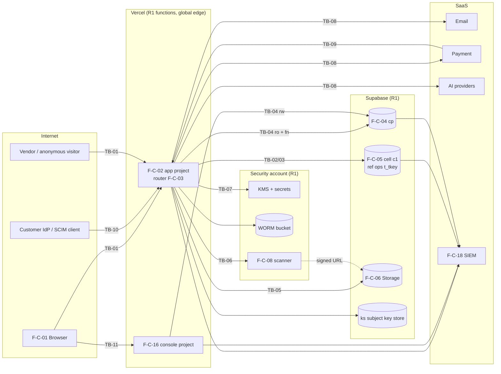

# Phase 2F: Security architecture

| | |
|---|---|
| Status | Draft for design-authority review (Phase 2). All mappings to standards are mappings, not certifications. |
| Date | 2026-11-23 |
| Binding inputs | `00-spine.md` (S0 to S9), ADR-001, Phase 1 documents, `docs/security/{SOD_MATRIX,CONTROLS,PIPELINE}.md` |
| ADRs owned | ADR-003 (keys), ADR-012 (malware scanning), ADR-013 (audit anchoring and WORM) |
| Risk and assumption ranges | Risks R-40 to R-45 (F), R-46 to R-49 (G). Assumptions A-45 to A-50 (F), A-51 to A-54 (G). |
| Owners | R-A Management Approver (management, founder). R-B CISO (security and privacy reviewer). |

Reading order: F-1 (components and boundaries), F-2 (STRIDE), F-3 (abuse cases), then the design sections F-4 to F-13 that the threats reference, then F-14 (ASVS) and F-15 (SDLC).

---

## F-0. Security decisions taken in this workstream

The spine is silent on these points; each is a decision with its rationale. Section references point to the detail.

| ID | Decision | Rationale | Detail |
|---|---|---|---|
| F-D-01 | The **security account** set is the cloud organisation of 2H (H-AC-05, AWS as the example): `kms-prod` holds KEKs, the anchor signing key and the secrets manager; `workloads-prod` runs the scanner; `offsite-prod` (different region) holds the WORM bucket and off-site exports. In this document "security account" means these accounts. They are administered separately from Supabase and Vercel by two hardware-key administrators (R-A, R-B). | The KEK must live outside the database and its backups (S7). Concentrating the high-assurance services in one separately administered account limits the number of new subprocessors (Q-11: cloud not chosen) and gives one audit trail for key use. | F-7, ADR-003 |
| F-D-02 | Vercel functions reach the security account by **OIDC workload identity federation**, never by long-lived cloud keys stored as Vercel environment variables *(verify Vercel OIDC federation support for the chosen provider)*. | Removes the most valuable static secret from the hosting platform. | F-11 |
| F-D-03 | **Two production Vercel projects** (accepted as R2-03; H-AC-04 is amended to match): `app` (tenant API, account API, SCIM, public endpoints) and `console` (platform staff API and Admin Console, own hostname). Platform-write credentials exist only in `console`. (rev P3) | Halves the blast radius of an application-layer compromise of the tenant API (F-8). | F-8 |
| F-D-04 | In `cp`, the tenant-facing deployment uses role **`cp_tenant_api`**, which has `EXECUTE` on a fixed set of narrow functions (F-CP-02) and no table grants. **`cp_router_ro`** reads the routing view only. `cp_rw` is used only by `console`. Accepted as R2-03; ADR-010 is amended to match. (rev P3) | Least privilege inside the control plane: RLS keyed on session settings protects rows, but a compromised `app` with `cp_rw` could still set those settings; function-only access bounds what it can do. | F-8 |
| F-D-05 | A **subject key store** `ks` (separate small Postgres project in `R1`, point-in-time restore off, daily backups kept 7 days) holds wrapped tenant DEKs, wrapped per-subject keys, wrapped per-file keys, wrapped blind-index keys and the wrapped platform DEK (F-K-31). For resilience it has a **standby in the DR region** and an **append-only key journal** in `offsite-prod` (compliance object lock, each object expires 8 days after it is written). A destroyed key is unrecoverable from every copy no later than **8 days after destruction** (F-7.2). `ks` is never included in tenant exports, the hourly `control` export, WORM segments or other off-site copies; only the key journal leaves `R1`. (rev P3) | S7 requires per-subject keys in a store whose backups are short; Supabase Vault keeps secrets inside the same database and its backups, so it cannot serve this purpose. Without a standby and journal, losing `ks` (or the region) makes every file and E2 field unrecoverable (P3-X3-03, DA-11). | F-7, ADR-003 |
| F-D-06 | **Per-file keys**: every stored file version is encrypted with its own key, wrapped by the tenant DEK and kept in `ks.file_key`. Per-subject keys are kept in `ks.subject_key`. **Tenant tables never hold a wrapped key**: they hold only the key id and version (for example `file_object.file_key_id`, `subject_key_id`). (rev P3) | Deleting one file (erasure, evidence withdrawal) then reaches every backup and export within the `ks` window (8 days); a wrapped key in a tenant table would survive in cell PITR and nightly exports (DA-04). | F-7, F-10 |
| F-D-07 | File bytes are **application-encrypted**; downloads are served by Selvara through short-lived, Selvara-signed download tokens on a separate cookieless hostname (`files.<domain>`), not Supabase Storage signed URLs. Uploads go straight to `quarantine` through a Supabase signed upload URL. | Storage signed URLs would return ciphertext; a cookieless origin contains any active content in a malicious file. See spine deviation SD-F-01. | F-10 |
| F-D-08 | **Storage broker exception**: one server module (`storagebroker`) holds the Storage service credential, is callable only with a path derived from the router's tenant context, and only touches application-encrypted objects. | Supabase Storage authorises by JWT role; there is no per-tenant Postgres role path into Storage. Spine deviation SD-F-02. | F-5, F-10 |
| F-D-09 | The tenant and platform audit log hash covers every column **except the personal-data ciphertexts** (`ip_enc`, `pd_enc`, `details_enc`). Those enter the hash input only as their **keyed HMACs** (`ip_hmac`, `pd_hmac`, `details_hmac`; key F-K-33), never as plaintext and never as ciphertext (2B B-D17). (rev P3) | Retention can null the personal value (2B B-RC32) and erasure can shred the subject key while the chain still verifies; the hash input reveals no plaintext (DA-03, OD-10). | F-9 |
| F-D-10 | Supabase **Data API (PostgREST) exposes no schema** in any cell or `cp`; GraphQL is disabled; the `anon` and `authenticated` roles have no grants on `control`, `ref`, `ops` or `t_*`. Realtime "Postgres changes" is off for tenant schemas. | Removes a second, unaudited path to the data that bypasses the router. | F-5 |
| F-D-11 | **Canary tenant** `t_<canary>` with synthetic records in every cell; any read of it outside the canary probe is a Sev-1 alert. | Gives a detection signal for cross-tenant reads that prevention missed. | F-12 |
| F-D-12 | Field encryption classes (the only codes used in every document): **E0** plaintext (ids, titles, refs, enums, states, dates, scores; searchable and sortable), **E1** tenant DEK (narrative and description free text that may contain personal or confidential data: descriptions, notes, reasons, comments, rationales, answers, bodies), **E2** per-subject key (direct identifiers of natural persons, listed in 2G). In `cp`, **E1** means encrypted under the **platform DEK** (F-K-31, wrapped by the platform KEK F-K-30), for example `control.identities.email` with an HMAC blind index (F-K-32) for sign-in lookup. Full-text search in SQL covers E0 columns only; search over E1 text is **decrypt-and-filter inside the tenant's own request** over bounded pages (no plaintext index anywhere); exact-match lookup on E2 emails uses a keyed blind index. Secrets are never an encryption class: they live in the secrets manager (F-11). (rev P3) | Defines what crypto-shredding can reach and what search can do. 2B marks each column (DA-01, DA-05). | F-7 |

---

## F-1. Components and trust boundaries

### F-1.1 Components

| ID | Component | Runs where | Holds |
|---|---|---|---|
| F-C-01 | Browser (React app) | Customer and staff devices | Session cookie (HttpOnly), UI state |
| F-C-02 | Vercel `app` project: tenant API `/api/v1/*`, account API, SCIM `/scim/v2`, public Trust Center and vendor portal endpoints, provider hooks `/api/v1/hooks/<provider>` and payment callbacks `/api/v1/hooks/billing/<config_ref>` (rev P3), worker endpoint `/api/internal/worker/<class>` | Vercel functions in `fra1`, next to `R1` (Frankfurt, H-AC-01) | Router credential, `cp_tenant_api` credential, OIDC federation to the security account |
| F-C-03 | `router` module (inside F-C-02 and worker) | Same process | The only code that issues `SET ROLE` (S3.5) |
| F-C-04 | Control plane project `cp` | Supabase, `R1` | S2 tables |
| F-C-05 | Cell `c1`: schemas `ref`, `ops`, `t_<tkey>`, `storage` (Supabase Auth lives in `cp`, ADR-010) | Supabase, `R1` | Tenant data (encrypted fields per F-D-12) |
| F-C-06 | Object storage: buckets `tenant-files`, `quarantine`, `exports` | Supabase Storage, `R1` | Application-encrypted files (plaintext only in `quarantine`) |
| F-C-07 | Queues and workers: pgmq queues in `ops`, pg_cron, worker endpoint | Cell plus Vercel | Job messages (tkey, job type, ids; no content) |
| F-C-08 | Malware scanner container (ADR-012) | `workloads-prod`, `R1` | Transient file bytes in memory |
| F-C-09 | KMS, secrets manager, WORM bucket (security account) and subject key store `ks` | Security account and `ks` project, `R1`; `ks` standby in the DR region; key journal in `offsite-prod` (rev P3) | KEKs (tenant and platform), anchor signing key, provider secrets, wrapped DEKs, subject and file keys, anchors |
| F-C-10 | Email provider | SaaS | Recipient addresses, message bodies (notification text only) |
| F-C-11 | Payment provider (Stripe or merchant of record, ADR-007) | SaaS | Card data (never Selvara), customer billing contact |
| F-C-12 | AI providers (off by default, ADR-007) | SaaS | Prompts and outputs in transit and per provider terms |
| F-C-13 | Public Trust Center `/api/v1/public/trust/<ref>/...` | Inside F-C-02 | Published sections, NDA records |
| F-C-14 | Vendor portal `/api/v1/public/vendor-portal/...` | Inside F-C-02 | Invite-bound vendor sessions |
| F-C-15 | SSO (SAML/OIDC via Supabase Auth) and SCIM 2.0 (Selvara) | Supabase Auth plus F-C-02 | `control.sso_connections`, hashed `control.scim_tokens` |
| F-C-16 | Vercel `console` project: `/api/v1/platform/*`, Admin Console | Vercel, `R1`, separate hostname | `cp_rw` credential, staff sessions |
| F-C-17 | CI/CD (GitHub Actions) and the `migrator` job | GitHub-hosted runners | Environment-scoped deploy and migration credentials |
| F-C-18 | Observability and security log SaaS (H-AC-08; called SIEM here) | SaaS, EU region if offered *(verify)* | Security logs (user ids, IP addresses, request ids) |

### F-1.2 Trust boundaries

| ID | Boundary | Crossing | Authentication across it |
|---|---|---|---|
| F-TB-01 | Internet to Vercel edge | Browser, IdP, SCIM client, vendor, anonymous visitor, provider webhook | TLS 1.2+; session cookie, SCIM bearer token, vendor token, webhook signature |
| F-TB-02 | Vercel function to cell pooler | `selvara_router_a` / `_b` logins (members of group `selvara_router`, ADR-002) | Password over `verify-full` TLS (existing PIPE-09 pattern) |
| F-TB-03 | `selvara_router` to `t_<tkey>_rw` | `SET LOCAL ROLE` in one transaction | Router module only; membership NOINHERIT |
| F-TB-04 | Function to `cp` | `cp_router_ro`, `cp_tenant_api`, `cp_rw` | Separate passwords per role and per Vercel project |
| F-TB-05 | Function and worker to Storage | `storagebroker` | Storage service credential (F-D-08) |
| F-TB-06 | Worker to scanner, scanner to `/api/v1/hooks/scanner` | HTTPS job with a signed token; scanner fetches bytes by a 5-minute signed URL and posts a signed verdict to the hook | Token signed by the worker; verdict signed by the scanner (ADR-012) |
| F-TB-07 | Function to KMS, secrets manager, WORM | OIDC federation to a per-project cloud role | Cloud IAM, encryption context = `tkey` |
| F-TB-08 | Function to email, payment and AI providers | Outbound HTTPS | Provider API secret fetched by reference |
| F-TB-09 | Provider to Selvara (payment webhooks, email events) | Inbound HTTPS | Provider signature plus timestamp window |
| F-TB-10 | Customer IdP to Selvara | SAML assertion, OIDC code flow, SCIM calls | Signed assertion per `control.sso_connections`; SCIM token hash |
| F-TB-11 | Platform staff to `console` | Staff session | Passkey (AUTH-16 kept), elevation for writes |
| F-TB-12 | CI to production database | `migrator` | Environment-protected secret, release approval |
| F-TB-13 | Provider operators (Supabase, Vercel, cloud) to Selvara data | Provider administrative access | Contract, provider attestations *(verify)*, application encryption limits exposure |



---

## F-2. STRIDE threat model per component

Columns: S spoofing, T tampering, R repudiation, I information disclosure, D denial of service, E elevation of privilege. "Ref" points to the design section that holds the mitigation. Residual: L low, M medium, H high. Owner: R-A or R-B.

### F-2.1 Browser and edge (F-C-01, F-TB-01)

| ID | STRIDE | Threat | Mitigation | Ref | Residual | Owner |
|---|---|---|---|---|---|---|
| F-T-001 | S | Session theft by XSS | React text rendering only (DATA-01 kept); nonce-based CSP before production (closes EX-05); HttpOnly, Secure, `SameSite=Strict` cookie; file content on a cookieless origin | F-10, F-14 V3/V14 | L | R-B |
| F-T-002 | S | CSRF on state-changing routes | Same-origin check kept (`core.ts` pattern) plus `SameSite=Strict`; SCIM and API keys use bearer tokens, never cookies | F-14 V4 | L | R-B |
| F-T-003 | T | Client sends `tenant_id`, `role`, `created_by` or `version` games | Tenant never in path or body (S6); PATCH allow-lists writable fields per table; server sets actor and tenant columns | 2C C-20, C-22; 2B write allow-lists (rev P3) | L | R-B |
| F-T-004 | I | Responses cached by a shared cache or the browser | `Cache-Control: no-store` on every `/api/v1` response except published Trust Center content; `Vary` correct on public responses | 2E E-26, 2C §1 (rev P3) | L | R-B |
| F-T-005 | D | Credential stuffing, enumeration, scraping | Proof-of-work challenge, lockout presets, per-IP and per-account throttles (existing AUTH contract); Vercel firewall rate rules *(verify plan feature)* | 2C C-55 to C-59 (§1.7), F-12 (rev P3) | M | R-B |
| F-T-006 | E | Clickjacking of approval buttons | `frame-ancestors 'none'` (HDR-01 kept) | F-14 V14 | L | R-B |

### F-2.2 Vercel API `app` and router (F-C-02, F-C-03, F-TB-02, F-TB-03)

| ID | STRIDE | Threat | Mitigation | Ref | Residual | Owner |
|---|---|---|---|---|---|---|
| F-T-010 | S | Forged or replayed session selects another tenant | Active tenant read from the server-side session record (S3.1); session id is a hash in the database; tenant switch re-checks membership and writes an audit entry | F-4.1 | L | R-B |
| F-T-011 | T | SQL injection runs `RESET ROLE` then `SET ROLE t_<other>_rw` (or `set_config('app.tenant_id', ...)`) | **If SQL injection exists, an injected `SET ROLE` inside a routed transaction succeeds** (Postgres checks the session user, which is a member of every tenant role; RLS and grants do not stop it; R-56). The controls are therefore prevention and detection, listed once in F-ISO-06: only the router issues `SET ROLE` (lint ban elsewhere); parameterised queries over the extended protocol only, the router's own setup statements included (no simple-query multi-statements); no dynamic SQL from input; pgaudit role and set statements alerted (F-M-01); F-IT-11, F-IT-12, F-IT-24, F-IT-38 and F-IT-39 prove the controls (rev P3) | F-ISO-06, F-M-01, F-SD-03 (rev P3) | M (R-56; inside the owner-accepted C1-01, R-02) (rev P3) | R-B |
| F-T-012 | T | `search_path` manipulation or object shadowing (functions or operators in `pg_temp`, `public`) | Router fixes `search_path = t_<tkey>, ref, pg_temp`; tenant roles have no `TEMPORARY` on the database and no `CREATE` anywhere; `public` schema `CREATE` revoked; `ref` owned by `migrator`; all functions `SET search_path` explicitly | F-4.2 (F-ISO-11, F-ISO-15, F-ISO-16) (rev P3) | L | R-B |
| F-T-013 | I | Cross-tenant read by a bug that forgets the tenant context | No default role grants: `selvara_router` has no table privileges, so a query without `SET ROLE` fails; `t_<tkey>_rw` has `USAGE` on one schema only; RLS check on `tenant_id`; isolation suite | F-4.2 (F-ISO-10, F-ISO-11, F-ISO-14) (rev P3) | L | R-B |
| F-T-014 | I | Connection reuse leaks a role or setting across requests through the pooler | `SET LOCAL` only (transaction scope); transaction-mode pooling; router asserts `current_user` and `current_setting('app.tenant_id')` at the start of each transaction and refuses on mismatch | F-4.1 | L | R-B |
| F-T-015 | R | A user denies an action | Every mutation writes an audit entry with actor, request id and outcome in the same transaction; hash chain and anchoring | F-9 | L | R-B |
| F-T-016 | D | Noisy tenant exhausts connections or CPU | Per-tenant and per-user rate limits (S6); `statement_timeout`, `lock_timeout` and `idle_in_transaction_session_timeout` set by the router preamble (role-level settings do not apply after `SET ROLE`, F-ISO-11) (rev P3); per-tenant query budget; job concurrency 1 to 2 (S8) | 2C C-55 to C-59 (§1.7), F-12 (rev P3) | M | R-A |
| F-T-017 | E | Mass assignment, IDOR inside a tenant, missing object-level checks | `can(actor, action, resource)` policy function in services for every route; deny by default; route-table-generated authorisation tests | F-AB-03, 2E E-35, 2C §1 (authorisation notation) (rev P3) | L | R-B |
| F-T-018 | E | Schema version mismatch runs new code on old schema | Fail closed with 503 when `control.tenant_schema_versions` disagrees with the build (S3.2) | F-4.1 | L | R-A |

### F-2.3 Control plane `cp` and console (F-C-04, F-C-16, F-TB-04, F-TB-11)

| ID | STRIDE | Threat | Mitigation | Ref | Residual | Owner |
|---|---|---|---|---|---|---|
| F-T-020 | S | Staff account takeover | Passkeys required for platform roles; no password-only path; device-bound keys; sign-in alerts | F-8 | L | R-B |
| F-T-021 | T | Routing table altered to point tenant A's membership at tenant B's schema | `cp_tenant_api` cannot write `control.tenant_cells` or `control.tenants`; routing changes only by provisioning job and console with four-eyes; routing record carries a hash of (`tenant_id`, `tkey`, `cell`) checked by the router against `app.tenant_id` stored in the tenant schema's `tenant_settings` | F-4.1, F-8 | L | R-B |
| F-T-022 | R | Super admin denies a platform action | `control.platform_audit_log` hash chain, anchored hourly; elevation reason and ticket | F-9 | L | R-B |
| F-T-023 | I | Staff browse tenant contact data beyond need (F1-06, OQ-10) | Minimal fields only (admin contact for the account, MFA status for resets); each view writes a platform audit entry; tenant content only through a support session on a tenant grant (0007 design kept) | F-8 | L | R-B |
| F-T-024 | D | Control plane outage stops every tenant | Only static routing fields (cell, schema, version) are cached in function memory, for at most 30 s; sessions, memberships and tenant status are read from `cp` on every request (R2-01), so a `cp` outage fails closed at once; `cp` on its own project, sized from the `cp` load test (2J H12); status page (rev P3) | F-ISO-02, F-ISO-31, F-CP-01 (rev P3) | M | R-A |
| F-T-025 | E | Compromised `app` deployment writes to `cp` | `app` holds no `cp_rw`; `cp_tenant_api` functions validate the caller's tenant context and cannot touch platform tables | F-8 | L | R-B |
| F-T-026 | E | Custom platform role grants more than intended | Custom platform roles only from the E-73 fixed name list (OD-07), within each name's ceiling; never grantable: `platform.staff.manage`, `platform.roles.manage`, `platform.keys.operate`, `platform.tenants.delete`, `platform.providers.manage`, `platform.breakglass.custodian`, votes on dual-role kinds (E-74); four-eyes dual role on create, change and assign (rev P3) | 2E E-71d, E-73a to E-73i, E-74; ADR-014 (rev P3) | L | R-A |

### F-2.4 Tenant schemas in the cell (F-C-05)

| ID | STRIDE | Threat | Mitigation | Ref | Residual | Owner |
|---|---|---|---|---|---|---|
| F-T-030 | T | Direct database tampering by a provider operator or a dashboard user | Dashboard use is break-glass only (F-CP-05); pgaudit on superuser sessions to SIEM; audit chain anchored outside Supabase; E1/E2 fields useless without KMS | F-CP-05, F-9 (rev P3) | M | R-B |
| F-T-031 | I | Schema names disclose customers | `tkey` is random (S1); schema names never derived from tenant name | S1 | L | R-B |
| F-T-032 | I | `LISTEN/NOTIFY`, large objects, `pg_stat_*` or advisory locks used as cross-tenant side channels | No application `NOTIFY` with payloads; large-object functions revoked from tenant roles; `pg_stat_statements` and `pg_stat_activity` not readable by tenant roles (`pg_read_all_stats` not granted) | F-4.2 (F-ISO-11, F-ISO-15, F-ISO-16) (rev P3) | L | R-B |
| F-T-033 | E | A `SECURITY DEFINER` function in `ref` or `public` runs with owner rights for any tenant | No `SECURITY DEFINER` function reachable by `t_*_rw` except this allow-list, identical in 2A A-XT-01 and 2J J-ISO-27: `ops.emit(event_type, payload)`, `ops.emit_usage(meter, qty)` and the audit append function `t_<tkey>.audit_append(...)`; `t_<tkey>.assert_context` is SECURITY INVOKER. Each has a fixed `search_path` and no dynamic SQL; any other is a CI failure (F-IT-23) (rev P3) | F-4.2 (F-ISO-11, F-ISO-15, F-ISO-16), F-15 (rev P3) | L | R-B |
| F-T-034 | D | One tenant's migration failure blocks others | Orchestrator per tenant with canaries (ADR-009); failing tenant stays on the old version and returns 503 | ADR-009 | L | R-A |

### F-2.5 Object storage (F-C-06)

| ID | STRIDE | Threat | Mitigation | Ref | Residual | Owner |
|---|---|---|---|---|---|---|
| F-T-040 | S | Guessed or replayed download link | Selvara download token: 256-bit random, bound to user, tenant, file version and purpose, 5-minute expiry, single use for exports | F-10 | L | R-B |
| F-T-041 | T | Overwrite of another tenant's object by path traversal | Object key = `<tkey>/<file_id>/v<n>` built only by `storagebroker` from router context; no user-supplied path component; `upsert` disabled | F-10 | L | R-B |
| F-T-042 | I | Plaintext exposure in Storage | Only `quarantine` holds plaintext, for at most 24 h, deleted after scanning; all other objects encrypted with per-file keys | F-7, F-10 | L | R-B |
| F-T-043 | D | Storage exhaustion by uploads | Per-plan and per-tenant quotas (super admin, under hard ceiling); bucket `file_size_limit` = ceiling | F-10 | L | R-A |
| F-T-044 | E | Browser uses the anon key against Storage directly | Storage RLS on `storage.objects` denies `anon` and `authenticated` for all three buckets; only signed upload URLs to `quarantine` | F-5 | L | R-B |

### F-2.6 Queues and workers (F-C-07)

| ID | STRIDE | Threat | Mitigation | Ref | Residual | Owner |
|---|---|---|---|---|---|---|
| F-T-050 | S | Forged invocation of the worker endpoint | pg_cron calls the endpoint with an HMAC-signed, timestamped request (secret from Supabase Vault, rotated 90 days); endpoint refuses public calls | F-11 | L | R-B |
| F-T-051 | T | Message with a forged `tkey` targets another tenant | Messages are enqueued only through `ops.emit()` (rev P3) which stamps `tkey` from the caller's router context, never from a parameter; tenant roles have no rights on `pgmq` tables; worker re-resolves the tenant through `control` and the router | F-ISO-32 (rev P3) | L | R-B |
| F-T-052 | I | Job payloads hold content | Payloads hold ids and job type only; content is read inside the tenant transaction | F-ISO-32 (rev P3) | L | R-B |
| F-T-053 | D | One tenant floods a queue | Round-robin by tenant, per-tenant concurrency 1 to 2 (S8), per-tenant enqueue quota | S8 | L | R-A |
| F-T-054 | E | Worker runs with broader rights than the API | Worker uses the same router and the same role per tenant; system jobs that span tenants (anchoring, metering) read only `ops` and the chain-head view granted to `anchor_ro` | F-9 | L | R-B |

### F-2.7 Scanner (F-C-08)

| ID | STRIDE | Threat | Mitigation | Ref | Residual | Owner |
|---|---|---|---|---|---|---|
| F-T-060 | S | Fake "clean" verdict | Verdict signed by the scanner with its own key; worker verifies signature, file hash and definitions age | ADR-012 | L | R-B |
| F-T-061 | T | Scanner compromised by a malicious file | Scanner runs unprivileged, read-only filesystem, no outbound network except signature updates and the callback; restarted per N files; no database or KMS credentials | ADR-012 | M | R-B |
| F-T-062 | I | Scanner retains files | Bytes held in memory or tmpfs only, deleted after each scan; no file logging | ADR-012 | L | R-B |
| F-T-063 | D | Scanner down, uploads pile up | Fail closed: files stay quarantined and show "awaiting scan"; alert after 15 min backlog; second instance on demand | ADR-012 | M | R-A |

### F-2.8 KMS and key store (F-C-09)

| ID | STRIDE | Threat | Mitigation | Ref | Residual | Owner |
|---|---|---|---|---|---|---|
| F-T-070 | S | Another principal decrypts a tenant DEK | KMS key policy allows only the `app` and worker federated roles; encryption context `{tkey, purpose}` required; KMS logs to SIEM with alert on any other principal | F-7 | L | R-B |
| F-T-071 | T | KEK scheduled for deletion without approval | Deletion only by the `keysvc` role after a recorded four-eyes approval id; alert on any `ScheduleKeyDeletion` or `DisableKey` event without a matching approval | F-7 | L | R-B |
| F-T-072 | I | Plaintext DEK in logs, crash dumps or caches | DEKs held only in function memory for at most 5 min; never logged (log redaction test); no DEK in error objects | F-7 | L | R-B |
| F-T-073 | D | KMS outage or BYOK revocation makes the tenant unreadable | DEK cache (5 min) rides short outages; BYOK revocation sets tenant state `KeyUnavailable` (503 `KEY_UNAVAILABLE`), communicated in the DPA as customer-controlled | F-7 | M (by design) | R-A |
| F-T-074 | D | `ks` corruption or loss (including region loss) beyond its 7-day backup window loses subject and file keys | Standby in the DR region *(verify Supabase cross-region replica)* and an 8-day off-site key journal (F-D-05, F-7.2); daily integrity check (count and checksum of wrapped keys vs `file_object` and E2 references); restore drill monthly (2J J-RST-09); tenant DEKs also escrowed wrapped with each tenant export (rev P3) | F-7.2 (rev P3) | M (R-41) | R-B |

### F-2.9 Email, payment, AI providers (F-C-10 to F-C-12)

| ID | STRIDE | Threat | Mitigation | Ref | Residual | Owner |
|---|---|---|---|---|---|---|
| F-T-080 | S | Forged payment webhook marks an invoice paid | Signature verification with the provider secret, timestamp window 5 min, event id idempotency, amount and currency re-fetched from the provider API before applying | F-3 AB-10 | L | R-A |
| F-T-081 | S | Phishing that imitates Selvara emails (vendor portal links) | SPF, DKIM, DMARC `p=reject` on the sending domain; links go only to the Selvara host; vendor proves the address with an emailed code (existing) | 2H H-EM-04 (rev P3) | M | R-B |
| F-T-082 | I | Email bodies carry tenant content to the provider | Notification emails carry a title and a link only, never record content, evidence or free text; provider click tracking off | 2G | L | R-B |
| F-T-083 | I | AI provider retains or trains on prompts (R-07) | Off by default; four-eyes to enable per tenant; provider review recorded; PII blocker before calls; zero-retention terms where offered *(verify per provider)* | F-3 AB-11 | M | R-B |
| F-T-084 | T | Prompt injection makes an agent change data | Autonomy ladder (SOD §11) kept; agent writes are proposals (`agent_change`) needing human approval above level 1; tools act with the requesting user's permissions | F-3 AB-11 | M | R-B |
| F-T-085 | D | Provider outage | Provider abstraction with retry and queue; email delivery via the queue with dead-letter | ADR-007 D7-9, 2D D-90 (rev P3) | L | R-A |

### F-2.10 Public Trust Center and vendor portal (F-C-13, F-C-14)

| ID | STRIDE | Threat | Mitigation | Ref | Residual | Owner |
|---|---|---|---|---|---|---|
| F-T-090 | I | Trust Center reveals unpublished sections or NDA document names (F1-02) | Per-section publishing set by the tenant; NDA-gated names hidden until access is granted; NDA per person; documents and viewers by id; public response built from an allow-list projection | F-3 AB-07 | L | R-B |
| F-T-091 | S | One verified address grants the whole domain | Removed: NDA acceptance and access are per person (OQ-07) | F-3 AB-07 | L | R-B |
| F-T-092 | D | Access-request spam, scraping | Per-IP and per-ref rate limits; proof-of-work on requests; email verification before a request reaches the tenant | 2C C-58, F-12 (rev P3) | L | R-A |
| F-T-093 | S | Vendor link forwarded or stolen | Link plus emailed one-time code; session bound to the invite and its `vendor_assessment` (rev P3); expiry 30 days; tenant can revoke | 2D D-06, 2B B-E09.7 (rev P3) | L | R-B |
| F-T-094 | E | Vendor reaches other vendors' assessments | Vendor session scope = one `vendor_portal_invite` → one `vendor_assessment`; queries filter by that assessment id in the repository and by restrictive RLS (`app.scope = 'vendor'`, `app.vendor_assessment_id`) (rev P3) | F-ISO-14 (rev P3) | L | R-B |

### F-2.11 SSO and SCIM (F-C-15)

| ID | STRIDE | Threat | Mitigation | Ref | Residual | Owner |
|---|---|---|---|---|---|---|
| F-T-100 | S | SAML assertion for a domain the tenant does not own | Domain verification (DNS TXT) before SSO enforcement; assertion audience and recipient checked by Supabase Auth; IdP-initiated login disabled (2E E-51) (rev P3) | ADR-006, 2E E-51 (rev P3) | L | R-B |
| F-T-101 | S | Stolen SCIM token | See F-AB-12 | F-AB-12 (rev P3) | M | R-B |
| F-T-102 | E | SCIM grants a privileged role | SCIM and JIT assign only **non-privileged** roles. Privileged role = `admin`, `owner`, or any custom role holding any admin-only permission; `analyst` is not privileged (DA-08). A SCIM or JIT request that would assign a privileged role is refused for that attribute (the user keeps a non-privileged role) and tenant admins are notified; privileged roles are assigned only in the app with four-eyes `team.role` (2E E-54a) (rev P3) | F-AB-12, 2E E-33d, E-54a (rev P3) | L | R-B |

### F-2.12 CI/CD, migrator and providers' operators (F-C-17, F-TB-12, F-TB-13)

| ID | STRIDE | Threat | Mitigation | Ref | Residual | Owner |
|---|---|---|---|---|---|---|
| F-T-110 | T | Malicious migration grants cross-tenant rights | Migrations reviewed by CODEOWNERS; CI runs the privilege diff (F-15) which fails on any new grant to `t_*` roles, `selvara_router`, `anon` or `authenticated` outside the template | F-15 | L | R-B |
| F-T-111 | E | `migrator` credential stolen from CI | Credential only in the protected `production` environment, only in the migration step, released after approval; rotated after each release *(automated)* | F-11 | M | R-B |
| F-T-112 | I | Provider operator reads data | E1/E2 fields and files are ciphertext without KMS access in a separate account; provider attestations reviewed yearly | F-7 | M (R-44) | R-A |

### F-2.13 Residual acceptance register (rev P3)

Every threat or abuse case with residual M. Acceptance is recorded here and copied into the consolidated Phase 3 risk register.

| ID | Residual | Owner | Acceptance status | Review |
|---|---|---|---|---|
| F-T-005 | M: Credential stuffing beyond throttles | R-B | Pending owner acceptance (Phase 3 register) | Phase 5 readiness gate, then yearly |
| F-T-011 | M: SQL injection `SET ROLE` escape (R-56) | R-B | Inside the owner-accepted C1-01 (R-02), DA-02 | Phase 5 readiness gate, then yearly |
| F-T-016 | M: Noisy tenant | R-A | Pending owner acceptance (Phase 3 register) | Phase 5 readiness gate, then yearly |
| F-T-024 | M: `cp` outage stops all tenants (R-62) | R-A | Pending owner acceptance (Phase 3 register) | Phase 5 readiness gate, then yearly |
| F-T-030 | M: Provider or dashboard tampering | R-B | Pending owner acceptance (Phase 3 register) | Phase 5 readiness gate, then yearly |
| F-T-061 | M: Scanner compromise | R-B | Pending owner acceptance (Phase 3 register) | Phase 5 readiness gate, then yearly |
| F-T-063 | M: Scanner backlog | R-A | Pending owner acceptance (Phase 3 register) | Phase 5 readiness gate, then yearly |
| F-T-073 | M: KMS outage or BYOK revocation (R-42) | R-A | Pending owner acceptance (Phase 3 register) | Phase 5 readiness gate, then yearly |
| F-T-074 | M: `ks` loss (R-41) | R-B | Pending owner acceptance (Phase 3 register) | Phase 5 readiness gate, then yearly |
| F-T-081 | M: Phishing imitating Selvara | R-B | Pending owner acceptance (Phase 3 register) | Phase 5 readiness gate, then yearly |
| F-T-083 | M: AI provider retention (R-07) | R-B | Pending owner acceptance (Phase 3 register) | Phase 5 readiness gate, then yearly |
| F-T-084 | M: Prompt injection | R-B | Pending owner acceptance (Phase 3 register) | Phase 5 readiness gate, then yearly |
| F-T-101 | M: Stolen SCIM token | R-B | Pending owner acceptance (Phase 3 register) | Phase 5 readiness gate, then yearly |
| F-T-111 | M: `migrator` credential theft | R-B | Pending owner acceptance (Phase 3 register) | Phase 5 readiness gate, then yearly |
| F-T-112 | M: Provider operator reads data (R-44) | R-A | Pending owner acceptance (Phase 3 register) | Phase 5 readiness gate, then yearly |
| F-AB-02 | M: Cross-tenant `SET ROLE` (R-56) | R-B | Inside the owner-accepted C1-01 (R-02), DA-02 | Phase 5 readiness gate, then yearly |
| F-AB-05 | M: Zero-day malware | R-B | Pending owner acceptance (Phase 3 register) | Phase 5 readiness gate, then yearly |
| F-AB-09 | M: Control-plane compromise | R-A | Pending owner acceptance (Phase 3 register) | Phase 5 readiness gate, then yearly |
| F-AB-10 | M: Billing abuse | R-A | Pending owner acceptance (Phase 3 register) | Phase 5 readiness gate, then yearly |
| F-AB-11 | M: AI injection and exfiltration (R-07) | R-B | Pending owner acceptance (Phase 3 register) | Phase 5 readiness gate, then yearly |
| F-AB-12 | M: SCIM token abuse | R-B | Pending owner acceptance (Phase 3 register) | Phase 5 readiness gate, then yearly |
| F-AB-16 | M: External report distribution | R-B | Pending owner acceptance (Phase 3 register) | Phase 5 readiness gate, then yearly |

---

## F-3. Abuse cases

| ID | Abuse case | Attack path | Controls (prevent / detect) | Test ids | Residual, owner |
|---|---|---|---|---|---|
| F-AB-01 | **Tenant routing manipulation** | Attacker sends `X-Tenant`, a tenant ref in a path, a crafted cursor, or a stale session after removal from tenant A, to land in tenant B | Prevent: tenant only from the session record (S3.1); every request re-checks membership `Active` and tenant `Active`; cursors are opaque, HMAC-signed and bound to tenant and route; routing integrity hash (F-T-021). Detect: membership-miss counter per user; alert on more than 5 per minute | F-IT-01 to F-IT-06 | L, R-B |
| F-AB-02 | **Cross-tenant access via `SET ROLE`, `search_path` or qualified names** | From a tenant transaction: `SET ROLE t_B_rw`; `RESET ROLE; SET ROLE ...`; `SELECT * FROM t_B.control`; `set_config('search_path', ...)`; functions in `pg_temp`; `set_config('app.tenant_id', B)` | **An injected `SET ROLE` or `RESET ROLE` inside a routed transaction succeeds if SQL injection exists** (the session user `selvara_router` is a member of every tenant role; R-56); qualified names, `search_path` and `pg_temp` attempts fail on grants. Prevent (F-ISO-06): only the router module issues `SET ROLE`, `RESET`, `set_config` or `search_path` (lint ban, CodeQL, bundle grep); parameterised queries over the extended protocol only, the router's own setup statements included (no simple-query multi-statements); no dynamic SQL built from input; `USAGE` only on `t_A` and `ref`; RLS `tenant_id` check is depth. Detect: pgaudit `ROLE` and `MISC` (SET) classes on router logins (fallback `log_statement`, VC-09); any role or `set_config('app.tenant_id')` statement outside the fixed prologue shape, and any SQLSTATE 42501 from a router session, is Sev-1 (F-M-01). The tests prove these controls; they do not claim the statement fails (rev P3) | F-IT-10 to F-IT-24, F-IT-38, F-IT-39 (rev P3) | M (R-56; inside the owner-accepted C1-01, R-02) (rev P3), R-B |
| F-AB-03 | **IDOR** | Substitute ids of other records, other tenants, other engagements | Cross-tenant: structurally impossible (other tenant's ids do not exist in `t_A`); response is 404 (S6). Intra-tenant: `can()` per route with ownership, engagement and vendor scopes; generated tests for every route x role x scope | F-IT-30 to F-IT-33 | L, R-B |
| F-AB-04 | **Privilege escalation** | Custom role above admin; self-grant; mass assignment of `role`; editing Supabase `user_metadata`; SCIM role mapping; delegation chains | Custom role permission set must be a subset of admin (validated server-side); role grants four-eyes (SOD §3); authorisation never reads `user_metadata`; delegation cannot re-delegate and never to self; elevation required for every platform write | F-IT-34 to F-IT-37 | L, R-B |
| F-AB-05 | **Malicious evidence upload** | Malware, macro documents, polyglots, SVG or HTML with script, decompression bombs, oversize, filename tricks | F-10 pipeline: type allow-list with magic bytes, size under the tenant limit and the hard ceiling, quarantine, scan, macro and active-content rejection, encrypted storage, download as attachment from a cookieless origin with `CSP: sandbox` | F-IT-40 to F-IT-46 | M (zero-day malware), R-B |
| F-AB-06 | **Audit-log tampering** | DB administrator edits, deletes or rewrites a chain; truncation of the tail; time travel by restore | Append-only grants and trigger; SHA-256 chain whose input carries personal fields only as keyed HMACs (F-D-09) (rev P3); hourly Merkle anchoring to WORM in a separate account plus RFC 3161 timestamp (ADR-013); verify job compares DB heads to anchors daily; tail truncation detected because the anchored head must still exist | F-IT-50 to F-IT-53 | L, R-B |
| F-AB-07 | **Trust Center data leakage (F1-02)** | Anonymous visitor enumerates sections, reads control status by domain, learns NDA document names; one person's NDA covers a domain; rename changes access | Public projection built from the tenant's published-section allow-list; control status hidden unless the tenant publishes that section; NDA document names hidden before grant; NDA acceptance per person (`trust_nda_acceptance` keyed by `trust_viewer` id); grants by document id; turning on the public page is four-eyes (`trust.public-page`, kept); trust chat answers only from the published or granted corpus | F-IT-60 to F-IT-64 | L, R-B |
| F-AB-08 | **External auditor over-reach (F1-01)** | Auditor reads controls, evidence, policies or risks outside the engagement, lists the risk register or the members, downloads files, acknowledges policies, keeps access after the engagement | Router uses `t_<tkey>_ro` for auditor reads (ADR-002) and sets `app.scope = 'auditor'` and `app.engagement_id` (F-ISO-03); shared item kinds are only **control, evidence (its files included), policy and risk_snapshot** (`audit_shared_item`); auditors have **no risk list**: their `risk.read` covers only risk snapshots shared with their live engagement; auditors receive **no member list and no member ids** (display names on shared records stay); restrictive RLS on every tenant table readable through `t_<tkey>_ro` admits, for scope `auditor`, only rows of items shared with that engagement and the engagement's own M08 rows, and no rows elsewhere (risk register, `member_profile`, reports, `record_history`); `auditor_access` start and end checked per request; download tokens only for files of shared evidence; auditor writes limited to information requests, draft findings and audit tests on shared controls (F-ISO-12); every view logged (F-EV-03) (rev P3) | F-IT-65 to F-IT-69 | L, R-B |
| F-AB-09 | **Control-plane compromise** | Attacker with `app` code execution or a stolen `cp` credential rewrites routing, creates staff, reads identities | F-8: split deployments, `cp_tenant_api` function-only, staff passkeys, four-eyes on staff and routing changes, routing integrity hash, `cp` audit anchored. Blast radius table F-8.2 | F-IT-70 to F-IT-72 | M, R-A |
| F-AB-10 | **Billing abuse** | Trial farming creates many schemas (catalog exhaustion); plan-limit races; forged webhooks; usage meter tampering; insider credits | Trials are provisioned only by staff under the standing four-eyes trial policy (OD-04; limits defined once in 2I I-4.4.3), with a daily cap, a cap on concurrent trials per cell and a daily digest to both approvers; trial tenants are crypto-shredded under the deletion procedure no later than 30 days after trial end (2I I-4.4.3, 2G G-RET-02) (rev P3). Plan limits checked atomically in `cp` (`SELECT ... FOR UPDATE` on the entitlement counter). Meters come from server-emitted events only. Webhook controls F-T-080. Credits above USD 1,000 four-eyes (SOD §3 kept). Card data never touches Selvara (F1-07) | F-IT-75 to F-IT-78 | M, R-A |
| F-AB-11 | **AI prompt injection and data exfiltration via providers** | Indirect injection through vendor answers, evidence text or trust chat questions; the agent calls tools to send data out; provider keeps data | AI off by default; per-tenant enable is four-eyes; context assembled from one tenant only; tool registry has no outbound network tool and no email-to-arbitrary-address tool; all tool calls use the requesting user's permissions; changes above autonomy level 1 are proposals; PII blocker; model output rendered as text; per-tenant provider choice and optional tenant-owned provider key; provider calls logged with token counts, not content | F-IT-80 to F-IT-84 | M (R-07), R-B |
| F-AB-12 | **SCIM token abuse** | Stolen token creates users, assigns roles, deactivates admins (denial of service), enumerates the directory | Token: 256-bit random, shown once, stored as hash, per tenant, expiry at most 1 year, last-used tracked; optional source IP allow-list per tenant; SCIM can assign non-privileged roles only; privileged mappings are refused and privileged roles are assigned in the app with four-eyes `team.role` (F-T-102, DA-08) (rev P3); SCIM cannot deactivate the last two admins; deactivations of admins and bulk changes over 20 users in 10 min pause and notify tenant admins; rate limit per token | F-IT-85 to F-IT-89 | M, R-B |
| F-AB-13 | **Fraudulent DSAR** | A forged requester impersonates a data subject to obtain the subject's data through `dsar.disclose`, or forges an erasure request to destroy records | Prevent: identity verification method and result recorded before any disclosure or erasure (2C C-M14-05); disclosure is four-eyes (2D D-K33) and erasure is four-eyes in the tenant (F-K-11); the package is delivered by a single-use download link only to the verified address; an erasure is held while a legal hold applies. Detect: every DSAR step audited (F-EV-03, F-EV-07); unusual DSAR volume per tenant alerts tenant admins (rev P3) | F-IT-90, F-IT-91 | L, R-B |
| F-AB-14 | **SSRF through webhooks and integrations** | A tenant admin sets a webhook URL or integration endpoint that resolves to an internal address (metadata service, `cp`, cell, Supabase internal hosts), uses DNS rebinding or a redirect | Prevent: public-address check after resolution, pinned connection to the checked address, no redirects followed, HTTPS on 443 only (2C C-88, F-TLS-06), applied to M17 integrations as well as M18 webhooks; all outbound calls leave through the 2H egress design (allow-listed destinations for platform providers, no internal or private addresses for tenant-set URLs). Detect: refused destinations logged (F-EV-11) and alerted above a threshold (rev P3) | F-IT-92, F-IT-93 | L, R-B |
| F-AB-15 | **Automation-rule abuse** | A rule (M26) is used to act without a human principal: approve, delete, publish, change access, or fan out notifications | Prevent: `automation_run` acts with `actor_kind = system` and the rule's creator recorded; its action ceiling is `issues.write` and notifications only (2C C-M26); it can never approve, delete, publish or change access, and is never an eligible voter; rule create and change are audited. Detect: run volume per rule rate-limited and alerted (rev P3) | F-IT-94, F-IT-95 | L, R-B |
| F-AB-16 | **Exfiltration by external report distribution** | An insider schedules a report or board pack to an external address | Prevent: external recipients need four-eyes (2D D-K21); recipient addresses encrypted per subject; reports delivered by a link that requires verification, not as attachments; each send audited (F-EV-03, F-EV-06). Detect: mass export and download alert (F-M-10) (rev P3) | F-IT-96, F-IT-97 | M, R-B |

---

## F-4. Tenant isolation design

### F-4.1 Request path controls (adds to S3)

| ID | Control | Detail |
|---|---|---|
| F-ISO-01 | Session to tenant | `control.sessions` holds `identity_id` and `tenant_id`; it is read on every request, never cached (R2-01). Switching is `POST /api/v1/account/session/tenant` (2C C-AC-08), which re-checks membership and writes `session.tenant_switched` to the platform log and `session.entered` to the target tenant's log only (2E E-26). (rev P3) |
| F-ISO-02 | Routing lookup | `cp_router_ro` reads view `control.v_routing(tenant_id, tkey, cell, schema_version, status, route_mac)`. `route_mac` = HMAC over (`tenant_id`, `tkey`, `cell`) with a key held in the secrets manager; the router verifies it. A tampered row fails closed. |
| F-ISO-03 | Transaction prologue | Sketch, **each statement sent as its own extended-protocol message** (no simple-query multi-statement string, F-ISO-06): `BEGIN`; `SET LOCAL ROLE t_<tkey>_rw`; `SET LOCAL search_path = t_<tkey>, ref, pg_temp`; `SET LOCAL statement_timeout = '8s'` (60 s on `ro` report and export paths); `SET LOCAL lock_timeout = '3s'`; `SELECT set_config('app.tenant_id', $1, true), set_config('app.user_id', $2, true), set_config('app.scope', $3, true), set_config('app.engagement_id', $4, true), set_config('app.vendor_assessment_id', $5, true)` (scope `member`, `auditor`, `vendor`, `support` or `trust_public`; the last two values empty unless the scope needs them); `SELECT t_<tkey>.assert_context($1)`. The last call checks that `tenant_settings.tenant_id` equals the setting; mismatch raises and the request fails. `tkey` is validated against `^[a-z2-7]{16}$` before interpolation (identifiers cannot be bound parameters); every value is bound. (rev P3) |
| F-ISO-04 | Single routing point | Only `src/server/router/**` may emit `SET`, `RESET`, `set_config`, `search_path` or open a cell pool; raw SQL is banned outside the router and migrations. Enforced by an ESLint rule, a CodeQL query and a grep of the built server bundle (F-ISO-06). (rev P3) |
| F-ISO-05 | Fail closed | Any missing piece returns 401, 403, 404 or 503 per S3.2; no fallback tenant; no default schema in the role's own `search_path` (`ALTER ROLE selvara_router SET search_path = ''`). |
| F-ISO-06 | **R-56 controls** (same statement in 2A, 2J and ADR-002) | (1) Inside a routed transaction an injected `SET ROLE` or `RESET ROLE` **succeeds** if SQL injection exists, because Postgres checks the session user, which is a member of every tenant role (R-56); RLS and grants do not stop it, and `set_config('app.tenant_id', ...)` is equally reachable. (2) Only `src/server/router/**` may emit `SET`, `RESET`, `set_config` or `search_path` or open a cell pool (ESLint rule, CodeQL query, build-output grep). (3) All SQL, the router's own setup statements included, uses parameterised queries over the extended protocol only (one statement per Parse, all values bound); the driver is configured so a simple-query multi-statement cannot be sent; no dynamic SQL is built from input anywhere. (4) Identifiers in the prologue come only from a `tkey` validated against `^[a-z2-7]{16}$`. (5) Detection: pgaudit `ROLE` and `MISC` (SET) classes on router logins (fallback `log_statement` if VC-09 fails), streamed to the SIEM; any role or `set_config('app.tenant_id')` statement outside the fixed prologue shape is Sev-1 (F-M-01). (6) Tests prove these controls (F-IT-11, F-IT-12, F-IT-24, F-IT-38, F-IT-39; 2J J-ISO-25, J-SEC-30); they document the escape rather than assert that it fails. Residual risk is inside the owner-accepted C1-01 (R-02). (rev P3) |

### F-4.2 Database privilege template

| ID | Object | Rule |
|---|---|---|
| F-ISO-10 | `selvara_router` (NOLOGIN group) and logins `selvara_router_a`, `selvara_router_b` (ADR-002) | NOINHERIT, NOBYPASSRLS, NOCREATEDB, NOCREATEROLE; membership of every `t_*_rw` and `t_*_ro` with `INHERIT FALSE, SET TRUE`; no table privileges; `CONNECT` on the cell database only; `search_path = ''`. |
| F-ISO-11 | `t_<tkey>_rw` | NOLOGIN, NOINHERIT, member of nothing; `USAGE` on `t_<tkey>` and `ref`; DML on tenant tables except append-only tables (INSERT and SELECT only on `audit_log_entry`, `record_history`); SELECT on `ref`; no `CREATE`, no `TEMPORARY`; no role-level settings (they do not apply after `SET ROLE`, 2A A-CN-05): `statement_timeout` and `lock_timeout` come from the router prologue (F-ISO-03). (rev P3) |
| F-ISO-12 | `t_<tkey>_ro` | As `_rw` with SELECT only. Used for exports, support sessions, the public Trust Center and auditor reads (ADR-002), always with `app.scope` set so restrictive RLS applies. Auditor reads admit only items shared with the engagement (control, evidence with its files, policy, risk_snapshot) and return display names, never member ids or a member list (F-AB-08). The only auditor writes (information requests, draft findings, audit tests on shared controls) run in a separate `_rw` transaction with `app.scope = 'auditor'` and policies that admit only `information_request`, `finding` and `audit_test` rows for that engagement. (rev P3) |
| F-ISO-13 | Ownership | Every tenant schema, table, sequence and function is owned by `t_owner` (NOLOGIN, used only by the migrator, ADR-002). Tenant roles own nothing, so they cannot `ALTER`, `DISABLE ROW LEVEL SECURITY` or `GRANT`. |
| F-ISO-14 | RLS | Every tenant table: `ENABLE` and `FORCE ROW LEVEL SECURITY`; permissive policy `tenant_id = current_setting('app.tenant_id')::uuid`; restrictive policies for scopes `auditor` (`app.engagement_id`), `vendor` (`app.vendor_assessment_id`), `support` (granted parts only, 2E E-75b) and `trust_public`. (rev P3) |
| F-ISO-15 | Supabase roles | `anon`, `authenticated`, `service_role` receive no grants on `control`, `ref`, `ops`, `t_*`. Default privileges for new objects in these schemas grant nothing. |
| F-ISO-16 | Extensions | `dblink`, `postgres_fdw`, `pg_net` (except the scheduler's use under its own role), `plpython`, `adminpack` not granted to tenant roles; large-object functions revoked from `PUBLIC`. |

### F-4.3 Isolation test plan (proves tenant A never reaches tenant B)

Run in CI on every pull request against a digest-pinned Postgres with the full role template, and nightly against staging with three synthetic tenants (A, B, canary). Each test asserts both the refusal and that the audit or alert path fired. A test that is skipped fails the run (existing PIPE-09 rule).

| ID | Layer | Attempt | Expected |
|---|---|---|---|
| F-IT-01 | API | Request with `X-Tenant`, `?tenant=`, body `tenant_id` naming B | Ignored; data from A only |
| F-IT-02 | API | Session whose membership in A was revoked mid-session, or tenant A suspended | Next request 403: sessions, memberships and tenant status are never cached (R2-01); test with the static routing cache warm (rev P3) |
| F-IT-03 | API | Cursor from tenant B replayed in A | 400 (HMAC mismatch) |
| F-IT-04 | API | Tenant A suspended | 403 for every route; jobs for A paused |
| F-IT-05 | API | Routing row for A edited to point at B's `tkey` | 503, `route_mac` failure alert |
| F-IT-06 | API | Idempotency key used by A replayed by B | Treated as new; keys scoped by tenant |
| F-IT-10 | DB | As `t_A_rw`: `SELECT` from `t_B.<every table>` (generated) | 42501 for every table |
| F-IT-11 | DB | Inside A's routed transaction (session user `selvara_router`): `SET ROLE t_B_rw` or `RESET ROLE` | **Succeeds (R-56).** The test documents the escape and proves the controls: the detector raises F-M-01 for the statement, and no API path can emit it (F-IT-12, F-IT-24, F-IT-38) (rev P3) |
| F-IT-12 | DB | Through the router API: a handler parameter carrying `'; RESET ROLE; SET ROLE t_B_rw; --`; and a raw multi-statement string sent through the configured driver | The parameter is bound as a value (no effect); the driver refuses the multi-statement because every query, the prologue included, uses the extended protocol; the detector shows no role statement (rev P3) |
| F-IT-13 | DB | As `t_A_rw`: `SET search_path = t_B` then unqualified select | 42501 (no `USAGE`) |
| F-IT-14 | DB | As `t_A_rw`: `CREATE FUNCTION pg_temp.f()` or `CREATE TEMP TABLE` | 42501 (no `TEMPORARY`) |
| F-IT-15 | DB | As `t_A_rw`: `set_config('app.tenant_id', B)` then select from `t_A` | 0 rows (RLS) and `assert_context` refuses on next call |
| F-IT-16 | DB | As `t_A_rw`: insert a row with `tenant_id = B` into `t_A` | RLS `WITH CHECK` refuses |
| F-IT-17 | DB | As `t_A_rw`: `ALTER TABLE ... DISABLE ROW LEVEL SECURITY`, `GRANT`, `ALTER ROLE` | 42501 |
| F-IT-18 | DB | As `t_A_rw`: call every function reachable in `ref`, `public`, `ops` | Only the allow-list executes; none returns B's data |
| F-IT-19 | DB | As `t_A_rw`: `lo_import`, `lo_get`, `LISTEN` on B's job channel, `pg_stat_activity` query text | Refused or empty |
| F-IT-20 | DB | As `t_A_rw`: `UPDATE`/`DELETE` on `audit_log_entry`, `record_history` | 42501 |
| F-IT-21 | DB | As `selvara_router` without `SET ROLE`: select anything in `t_A` or `control` | 42501 |
| F-IT-22 | DB | As `anon` and `authenticated` (Supabase JWT roles): select from `t_*`, `control`, `ops`, `ref` | 42501; Data API returns 404 for schemas |
| F-IT-23 | DB | Privilege snapshot: `pg_roles`, `pg_auth_members`, `information_schema.role_table_grants`, `pg_default_acl`, `SECURITY DEFINER` list | Equal to the approved template; any diff fails CI |
| F-IT-24 | DB | Fuzz: SQL-injection corpus through every string filter parameter of every list route | No error other than 400/422; pgaudit shows no role statements |
| F-IT-25 | Storage | A's session requests a download token for B's `file_object` id; or alters a token | 404; token MAC failure |
| F-IT-26 | Storage | Direct Storage API call with the anon key to `tenant-files/<B>/...` | Denied by storage RLS |
| F-IT-27 | Queue | Enqueue from A with a payload claiming `tkey` of B | Stamped `tkey` is A; worker processes in A |
| F-IT-28 | Export | A's export contains only A's objects (manifest compared with object listing of other prefixes) | No foreign object |
| F-IT-29 | Canary | Full API crawl as every role of A and B | Zero reads of canary records; canary alert test fires when a probe deliberately reads it |
| F-IT-30 to F-IT-33 | API (IDOR) | Generated from the route table: each `/:id` route x each role x (own, same-tenant other owner, other engagement, other vendor) | Allowed only where the permission matrix says so; otherwise 404 |
| F-IT-34 to F-IT-37 | API (escalation) | Custom role above admin; self role change; `user_metadata.role = admin`; SCIM or JIT assignment of any privileged role (admin, owner, custom role with an admin-only permission) | All refused with 403 or 422 and audited; a privileged assignment exists only through in-app four-eyes `team.role` (rev P3) |
| F-IT-38 | Static | Lint, CodeQL and built-bundle grep for `SET`, `RESET`, `set_config`, `search_path`, simple-query calls and string-built SQL outside `src/server/router/**` and migrations | Any hit fails the build (F-ISO-06 controls 2 and 3) (rev P3) |
| F-IT-39 | DB + SIEM | On staging, a synthetic role statement and a `set_config('app.tenant_id')` outside the prologue shape on a router login | F-M-01 fires within 5 minutes; with pgaudit unavailable the `log_statement` fallback is exercised (VC-09) (rev P3) |

Suites for F-AB-05 to F-AB-16 (F-IT-40 to F-IT-97) are listed with each abuse case and specified in Phase 4 from this table. (rev P3)

### F-4.4 Isolation of non-database stores

| ID | Store | Isolation design | Residual |
|---|---|---|---|
| F-ISO-30 | Object storage | Prefix `<tkey>/` built by `storagebroker` from router context; per-file encryption keys (a misrouted object is unreadable without that tenant's DEK); RLS denies JWT roles; lifecycle: `quarantine` objects older than 24 h deleted | L |
| F-ISO-31 | Cache | No shared application cache of tenant data. In-memory caches inside a function instance are keyed by (`tenant_id`, key) through one helper; static routing fields only, 30 s (sessions, memberships and tenant status never cached, R2-01) (rev P3); DEK cache 5 min keyed by `tkey` and version. CDN caches only `/api/v1/public/trust/<ref>/...` published responses, with `Vary` and a key that includes `ref` and the publish version. | L |
| F-ISO-32 | Queue | pgmq in `ops`; `tkey` stamped by `ops.emit()` (rev P3); tenant roles have no access to `pgmq`; payloads hold ids only; dead-letter rows inherit the same rules | L |
| F-ISO-33 | Search | No external search engine. Search runs inside the tenant schema (Postgres full-text on E0 columns; E1 text searched by decrypt-and-filter inside the tenant's own request over bounded pages, with no plaintext index; blind index for E2 exact match with a per-tenant HMAC key). Adding an external index later requires a per-tenant index and an ADR. (rev P3) | L |
| F-ISO-34 | Logs | Function logs carry request id, route pattern, tenant id (uuid) and user id, never bodies or field values (LOG-04 kept); SIEM access limited to R-A and R-B; tenants see their data only through their own audit log | L |
| F-ISO-35 | Email | Messages built per tenant from templates holding no record content; provider metadata tagged with a random message id, not the tenant name | L |
| F-ISO-36 | AI context | Prompt assembled within one tenant transaction; no cross-tenant memory, embedding store or fine-tuning; conversation state stored in the tenant schema (M19) | L |
| F-ISO-37 | Rate-limit and idempotency state | Stored in `cp` or `ops` keyed by tenant and user; no content | L |
| F-ISO-38 | Exports | Encrypted with the tenant DEK and per-file keys; download token bound to the requesting admin and the export id; single use | L |

---

## F-5. Platform-level exposure controls

| ID | Control | Detail |
|---|---|---|
| F-PL-01 | Data API off | Supabase API settings: exposed schemas empty; GraphQL extension not enabled *(verify the setting path in the dashboard)*. Checked daily by a config probe through the Management API; drift alerts. |
| F-PL-02 | Realtime | Postgres-changes off for all schemas. Presence (SOD §15) uses private Broadcast channels whose authorisation policy calls a membership check; payloads carry user display names only. |
| F-PL-03 | Network | Supabase network restrictions limit database connections to the Vercel egress ranges, CI runners for `migrator` (or a self-hosted runner later) *(verify availability of static egress on the Vercel plan)*. |
| F-PL-04 | Storage policies | Buckets private; `file_size_limit` = platform hard ceiling; allowed MIME list on `quarantine`; RLS denies all JWT roles; only signed upload URLs to `quarantine/<tkey>/<upload_id>`. |
| F-PL-05 | Auth settings | Email confirmations on; leaked-password check on *(verify plan)*; JWT expiry 1 h; refresh token rotation and reuse detection on; MFA enforced by Selvara at the application layer (existing). |

---

## F-6. Transport security

| ID | Link | Requirement |
|---|---|---|
| F-TLS-01 | Browser to Vercel | TLS 1.2 minimum, 1.3 preferred; HSTS `max-age=63072000; includeSubDomains; preload`; certificates managed by Vercel |
| F-TLS-02 | Function to Postgres (cells, `cp`, `ks`) | `sslmode=verify-full` with the Supabase CA pinned in the bundle (PIPE-09 kept) |
| F-TLS-03 | Function to Storage, KMS, secrets, WORM, providers | HTTPS with default trust store; no TLS verification bypass anywhere (CodeQL query and lint) |
| F-TLS-04 | Worker to scanner | HTTPS plus signed job token; scanner verdict signed (ADR-012) |
| F-TLS-05 | Email | Provider enforces TLS to receiving servers where supported; MTA-STS on the sending domain |
| F-TLS-06 | Webhooks out (M18) and integrations (M17) | HTTPS only (existing); HMAC-SHA256 signature with per-webhook secret and timestamp; SSRF guard: resolve and refuse private, loopback, link-local and metadata ranges, pin the connection to the checked address, no redirects followed; all outbound calls through the 2H egress design (F-AB-14) (rev P3) |

---

## F-7. Cryptography and key management (spine S7, ADR-003)

### F-7.1 Key hierarchy

| ID | Key | Algorithm | Where | Wrapped by | Purpose | Rotation |
|---|---|---|---|---|---|---|
| F-K-01 | Tenant KEK `kek/<tkey>` | KMS symmetric (AES-256, HSM-backed *(verify FIPS level)*) | KMS in the security account, or the customer's KMS (BYOK) | n/a | Wraps the tenant DEKs | Yearly automatic (KMS keeps old versions); on demand |
| F-K-02 | Tenant DEK `dek/<tkey>/v<n>` | AES-256-GCM | `ks.tenant_dek` (wrapped); escrow copy wrapped inside each tenant export | F-K-01 | E1 fields, wraps F-K-03 and F-K-04, encrypts exports | Yearly; new writes use the newest version; background re-encryption job; old version retired when its reference count reaches 0 |
| F-K-03 | Subject key `sk/<tkey>/<subject_id>` | AES-256-GCM | `ks.subject_key` (wrapped) | F-K-02 | E2 fields of one natural person | Re-wrapped when the DEK rotates; destroyed on erasure |
| F-K-04 | File key `fk/<file_object_id>/v<n>` | AES-256-GCM, chunked (64 KiB segments, per-segment nonce, final-segment flag) | `ks.file_key` (wrapped) | F-K-02 | One file version | Never rotated (immutable object); destroyed with the file |
| F-K-05 | Blind index key `bik/<tkey>` | HMAC-SHA-256 | `ks` (wrapped) | F-K-02 | Exact-match lookup on E2 emails | With the DEK |
| F-K-06 | Anchor signing key `sig/anchor` | ECDSA P-256 asymmetric KMS key | KMS | n/a | Signs audit anchors and deletion certificates | Every 2 years; public keys published with their validity |
| F-K-07 | Session sealing key `SERVER_SECRET` (existing `seal`) | AES-256-GCM, key id in the token | Secrets manager | n/a | Sign-in tickets | 90 days with a key-id overlap |
| F-K-08 | Routing MAC key, cursor MAC key, download token key | HMAC-SHA-256 | Secrets manager | n/a | Integrity of routing rows, cursors, tokens | 90 days with overlap |
| F-K-09 | Scanner verdict key | Ed25519 | Scanner secret store | n/a | Verdict signatures | 90 days |
| F-K-30 | **Platform KEK** `kek/platform` | KMS symmetric (AES-256, HSM-backed *(verify FIPS level)*), multi-Region replica in the DR region | KMS in `kms-prod` | n/a | Wraps the platform DEK (F-K-31); used only for control-plane encrypted fields, never for tenant data; never destroyed while the platform runs | Yearly automatic (KMS keeps old versions) (rev P3) |
| F-K-31 | Platform DEK `dek/platform/v<n>` | AES-256-GCM | `ks.platform_dek` (wrapped) | F-K-30 | **E1 fields in `cp`**: `control.identities` email and name, invitation and join-request email and name, session IP and device, billing contact and address, invoice `rendered_snapshot` buyer fields, support question and message bodies, platform audit IP and details, staff records; cached ≤ 5 min like F-K-02 | Yearly with a background re-encryption job (rev P3) |
| F-K-32 | Platform blind-index key `bik/platform` | HMAC-SHA-256 | `ks` (wrapped) | F-K-31 | Exact-match lookup on `cp` emails (for example `control.identities.email_bidx` at sign-in) | With F-K-31, re-indexing job (rev P3) |
| F-K-33 | Audit HMAC key `ahk/<tkey>` (platform log: `ahk/platform`) | HMAC-SHA-256 | `ks` (wrapped) | F-K-02 (platform: F-K-31) | Keyed HMACs of the personal fields of audit entries (`ip_hmac`, `pd_hmac`, `details_hmac`) that enter the hash input (F-D-09) | Not rotated within a chain segment; a new version starts at an anchored boundary (rev P3) |

Rules:
- F-K-R1: Ciphertext format carries `(class, key id, key version, nonce, tag)`. Additional authenticated data = (`tkey`, table, column, row id) for fields, (`tkey`, `file_object_id`, version, segment index) for files, so a ciphertext copied to another row or tenant fails to decrypt.
- F-K-R2: KMS calls always pass encryption context `{tkey, purpose}`; the key policy requires it.
- F-K-R3: Unwrapped DEKs live only in process memory for at most 5 minutes; subject and file keys are unwrapped per request and not cached.
- F-K-R4: No plaintext copies of E1, E2 or file content in logs, search indexes, exports, emails, queue payloads or caches (discovery §6 condition 3). `record_history` and exports carry ciphertext as stored (S7). The nightly export never decrypts.
- F-K-R5: Random values from WebCrypto `getRandomValues` only (existing `crypto.ts`); nonces 96-bit random per encryption; no key reuse across purposes.

### F-7.2 Where keys sit relative to backups (the shredding condition)

| Store | Backed up by | Holds key material? | Consequence |
|---|---|---|---|
| Cell `c1` (tenant data, `record_history`) | Supabase PITR and daily backups; nightly per-tenant export | No (ciphertext only) | Unreadable once the relevant key is destroyed |
| `exports` bucket (last 7) and off-site object-locked copies in `offsite-prod` (35 daily, 12 monthly, 1 yearly; ADR-004) | Object lock 35 days (compliance) off-site | Escrowed DEK wrapped by the KEK | Unreadable once the KEK is destroyed; KEK in `kms-prod`, never in `offsite-prod` |
| `ks` (live, standby, backups, key journal) | Daily backups kept 7 days; PITR off; standby in the DR region (streaming, *verify Supabase cross-region replica*); append-only key journal in `offsite-prod` (every insert and every delete as a tombstone; wrapped material only; compliance object lock; each object expires 8 days after it is written). Never in tenant exports, the `control` export, WORM segments or any other off-site copy | Wrapped DEKs (tenant and platform), subject keys, file keys, blind-index and audit HMAC keys | Recovery: promote the standby, or restore the last daily backup and replay the journal (tombstones applied, so a destroyed key is never restored); RPO 5 min, RTO 4 h. **Destruction window:** a destroyed subject or file key is removed from the live store and the standby at once (the delete replicates), from daily backups within 7 days plus the 1-day backup cycle, and from the journal when the object holding its insert expires, which is at most 8 days after the insert and therefore at most 8 days after destruction. So no copy holds a destroyed key **more than 8 days after destruction**. The deletion certificate records the date. (rev P3) |
| KMS | Provider-managed, inside the HSM boundary; multi-Region replica keys in the DR region | KEKs (tenant and platform) | Destroyed after the KMS waiting period (7 to 30 days *(verify)*), including replica keys in the DR region; evidence from KMS logs (rev P3) |
| WORM bucket (`offsite-prod`) | Object lock | Ciphertext segments and hash-only anchors | Segments unreadable after KEK destruction; anchors hold no personal data |

### F-7.3 Crypto-shredding procedures

| ID | Scope | Trigger | Steps | Evidence |
|---|---|---|---|---|
| F-K-10 | Tenant | Offboarding (2G) after four-eyes approval | Delete `ks` rows for the tenant (DEK versions, subject, file, blind-index and audit HMAC keys); schedule deletion of the KEK **and every multi-Region replica**, recording each replica's waiting period (BYOK: revoke Selvara's grant, ask the customer to delete, record) (rev P3); drop schema and roles; delete storage prefixes; record dates | Deletion certificate (2G) signed with F-K-06; platform audit entry |
| F-K-11 | Subject | Erasure decision in M14 by tenant (four-eyes in the tenant) | Delete `ks.subject_key`; null or tombstone E2 columns in live rows; blind-index rows removed | Tenant audit entry; DSR record shows `ks` backup expiry date |
| F-K-12 | File | Deletion of a file version past soft-delete | Delete `ks.file_key`, delete the object | Tenant audit entry |
| F-K-13 | Destruction approvals | Any KEK destruction or disablement | `control.platform_approvals` dual-role vote (`management_approver` + `ciso`, 2D D-P04); requester never approves (rev P3) | Alert F-M-07 if KMS event lacks an approval id |

### F-7.4 BYOK

| ID | Item | Design |
|---|---|---|
| F-K-20 | Supported providers | Launch: the security account's KMS provider family (cross-account key grant). Later adapters through the key-provider abstraction (ADR-003). |
| F-K-21 | Onboarding | Tenant admin registers a key reference; Selvara performs a test wrap and unwrap with context; four-eyes in the tenant; `control.key_registry` records key reference, provider and state; the tenant DEK is re-wrapped under the customer KEK and the Selvara KEK is destroyed after 30 days (four-eyes). |
| F-K-22 | Health | Hourly wrap test per BYOK tenant; failure sets `KeyUnavailable` after 3 consecutive failures; tenant admins and R-B alerted. |
| F-K-23 | Revocation | Customer revocation is a customer-controlled shred or suspension. Selvara keeps no unwrapped copy beyond the 5-minute cache. |
| F-K-24 | Plan | BYOK is an entitlement (`control.plan_entitlements`). |

---

## F-8. Control-plane hardening and blast radius

### F-8.1 Controls

| ID | Control |
|---|---|
| F-CP-01 | `cp` is its own Supabase project (F requirement; ADR-010 records the cost trade-off if launch uses one project). |
| F-CP-02 | Roles: `cp_router_ro` (view `v_routing`), `cp_tenant_api` (`EXECUTE` on this fixed function catalogue and no table grants: `session_resolve`, `session_create`, `session_touch`, `session_revoke`, `signin_*`, `invitation_accept`, `join_request_create`, `membership_list_mine`, `tenant_switch`, `scim_*`, `sso_connection_*`, `api_key_route_resolve`, `portal_link_resolve`, `support_grant_*`, `tenant_role_mirror`, `billing_view`, `plan_request_*`, `support_question_*`, `usage_event_emit`, `approval_request_platform`; each derives and validates the caller's tenant context from the session record), `cp_rw` (console only), `cp_worker` (usage ingestion, provisioning job), `migrator`. (rev P3) |
| F-CP-03 | Console on its own hostname and Vercel project; staff passkeys; elevation for every write (SOD §2 kept); console has no cell credentials except provisioning through a `migrator`-class job. Support views run in `app` through the router as `t_<tkey>_ro` with `app.scope = 'support'` and `app.support_session` set; restrictive RLS admits only the granted parts (2E E-75b); `console` calls `app` through an internal signed request bound to the support session id. (rev P3) |
| F-CP-04 | Four-eyes in `control.platform_approvals` for: tenant creation by staff, tenant deletion, key destruction, BYOK change, provider config change, platform role and custom role changes, price list, staff onboarding and role changes (removal is immediate by one super admin, 2E E-77) (rev P3), routing changes, raising the upload limit above the plan default. |
| F-CP-05 | Break-glass: Supabase organisation owner and security-account root credentials sealed (hardware keys held by R-A and R-B separately); each use raises Sev-1, is recorded with a reason in `control.platform_audit_log` within 24 h and reviewed by the other person. |
| F-CP-06 | Platform staff see minimal tenant contact data (OQ-10); each view logged. |

### F-8.2 Blast radius

| Compromised element | Reaches | Does not reach | Detection |
|---|---|---|---|
| `app` function code execution | All tenants' data via router (C1-01), `cp` through narrow functions, KMS decrypt with context | `cp` tables directly, platform writes, staff accounts, KMS key admin, WORM deletion | Canary, pgaudit role alerts, KMS volume anomaly |
| `console` function code execution | `cp` read and write, support sessions (read-only, grant-bound) | Tenant data without a grant, KMS decrypt (no federation role for `console`) | Platform audit anomalies, elevation without ticket |
| `selvara_router` password | Ciphertext of E1/E2 and plaintext E0 for all tenants | Keys; plaintext of encrypted fields | Network restrictions; login from unknown source |
| `migrator` password | DDL on everything in a cell | Keys | Use outside a release window = Sev-1 |
| Supabase organisation owner | Everything in Supabase (superuser), including ciphertext | KMS, WORM, anchors (tampering detected) | Supabase audit log *(verify availability)*, pgaudit |
| Security-account administrator | KMS keys, WORM (cannot delete compliance-locked objects) | Database contents without Supabase access | Cloud audit log to SIEM, root-use alert |
| Vercel account | Both projects, env vars, OIDC trust | Security account resources outside the federated roles | Vercel audit log *(verify plan)*, deployment not from CI |
| GitHub maintainer | Code path to production after approval | Production secrets outside environments | Signed tags, rulesets, release approval |

---

## F-9. Tamper-evident audit log (ADR-013)

### F-9.1 Structure

| ID | Item | Design |
|---|---|---|
| F-L-01 | Tables | Tenant: `t_<tkey>.audit_log_entry` (M22). Platform: `control.platform_audit_log`. Anchors: `t_<tkey>.audit_anchor` and `control.platform_audit_anchor` (2B to name the latter). |
| F-L-02 | Entry fields | Names as 2B B-E22.1: `chain_n bigint` (gapless per chain), `at` (database clock), `actor_kind` (member, auditor, vendor, platform_staff, system, scim, api_key, agent), `actor_id`, `actor_principal`, `on_behalf_of` (delegation, support session), `action`, `category`, `target_table`, `target_id`, `target_ref`, `outcome` (allowed, refused, error), `refusal_code`, `request_id`, `ip_enc` (E1) with `ip_hmac` and `ip_prefix` (/24 or /48), `pd_enc` (E2, per-subject key of the person named) with `pd_hmac`, `processing_activity_id` (RoPA link, replaces the client regex), `detail` (E0, ≤ 1,000, ids and codes only, no personal data), `details_enc` (E1 JSON: reasons, before/after summary) with `details_hmac`, `prev_hash`, `hash`. (rev P3) |
| F-L-03 | Hash | `hash = SHA-256(prev_hash ‖ canonical_json(hashed columns))`, canonical JSON with sorted keys over every column except `hash`, `ip_enc`, `pd_enc` and `details_enc`; those three are represented only by their keyed HMACs (`ip_hmac`, `pd_hmac`, `details_hmac`, key F-K-33), never by plaintext or ciphertext (F-D-09, 2B B-D17). Retention nulling (2B B-RC32) and subject-key shredding therefore never break the chain. Genesis `prev_hash` = SHA-256 of (`tenant_id`, creation time). (rev P3) |
| F-L-04 | Serialisation | One chain-head row per chain locked `FOR UPDATE` in the insert function; insert happens in the same transaction as the business change; existing `audit_log_chain` pattern from migration 0003. |
| F-L-05 | Append-only | Tenant roles have INSERT through the function only and SELECT; a trigger raises on UPDATE, DELETE and TRUNCATE for every role, including the owner, except a migrator-run purge that itself requires an anchored "purge" entry (used only by retention rules from 2G). |
| F-L-06 | Verification | `audit_verify()` returns the first failing seq (existing). Daily job verifies every chain against its latest anchor; tenant admins can run it and download a verification bundle (entries, anchors, Merkle proofs, public key). |
| F-L-07 | Mirroring | Platform actions affecting a tenant write to both logs (existing `admin8.ts` pattern). |
| F-L-08 | SIEM stream | Security-relevant entries (categories auth, access, security, platform) streamed to the SIEM with ids only. |

### F-9.2 Anchoring and WORM (summary of ADR-013)

Hourly job `audit-anchor`: reads each chain head through `anchor_ro`, builds a Merkle tree of leaves `SHA-256(anchor_id ‖ seq ‖ head_hash)` (anchor_id is a random per-tenant identifier, so the leaf list does not reveal tenant names), signs the root with F-K-06, obtains an RFC 3161 timestamp token, writes the anchor object to the WORM bucket (compliance mode), and writes each tenant's leaf, proof and object id to its `audit_anchor`. Daily: per-tenant audit segment (JSONL of that day's entries, ciphertext as stored, encrypted with the tenant DEK) to WORM. Missing anchor for more than 2 hours raises F-M-05.

### F-9.3 Events that must be logged

| ID | Group | Events (minimum) | Log |
|---|---|---|---|
| F-EV-01 | Authentication | sign-in success and failure, MFA challenge success and failure, passkey add and remove, recovery code use, password reset request and completion, lockout, unlock, session revoke, SSO login, SSO assertion failure, step-up | Platform (identity) and tenant (membership context) |
| F-EV-02 | Authorisation changes | role grant, change, revoke; custom role create and change; delegation create and end; SCIM create, update, deactivate; SCIM token create and revoke; API key create (with scope) and revoke; auditor access start, extend, end; vendor invite create and revoke; support grant give and revoke | Tenant |
| F-EV-03 | Sensitive data access | evidence and file download; export of any register; auditor view of a shared item; support-session view; platform staff view of tenant contact data; DSR subject search and package; audit log export; Trust Center NDA document view | Tenant (and platform for staff) |
| F-EV-04 | Configuration changes | tenant settings, SSO connection, SCIM mapping, retention rules, legal hold place and release, AI enable and provider change, integration connect and disconnect, webhook create and change, Trust Center publish set, public page on and off, upload limit change, plan and entitlement change | Tenant or platform |
| F-EV-05 | Approvals | request, vote (approve, reject), withdraw, expiry, execution, refusal on self-approval | Tenant or platform |
| F-EV-06 | Exports | export request, generation, download, expiry; nightly backup export completion (system) | Tenant |
| F-EV-07 | Deletions | soft delete, restore, purge, erasure (subject key destroyed), file key destroyed, retention purge run summary | Tenant |
| F-EV-08 | Tenant lifecycle | provision, schema version change, suspend, reactivate, offboarding request, export window, deletion approval, deletion steps, certificate issue | Platform (and tenant while it exists) |
| F-EV-09 | Platform privileged access | elevation start, end, expiry; break-glass use; support session start, view, end; staff onboarding and removal; platform role change | Platform (and tenant for support) |
| F-EV-10 | Keys | DEK create and rotate, BYOK register, wrap failure, KEK disable or deletion schedule, subject and file key destruction | Tenant and platform |
| F-EV-11 | Security events | malware detection, quarantine release refusal, isolation refusal (42501), rate-limit block, webhook signature failure, scanner definitions stale, anchor failure | Platform (and tenant where tenant-specific) |
| F-EV-12 | AI | enable, disable, provider call (provider, model, token counts, PII-blocker result), agent proposal, approval and applied change | Tenant |

---

## F-10. File upload security

### F-10.1 Flow

```mermaid
sequenceDiagram
  participant B as Browser
  participant A as app API
  participant Q as quarantine bucket
  participant W as worker
  participant S as scanner
  participant K as ks / KMS
  participant T as tenant-files bucket
  B->>A: POST /api/v1/files/uploads (name, size, type, purpose)
  A->>A: check type allow-list, size <= tenant limit <= hard ceiling, quota
  A->>Q: create signed upload URL quarantine/<tkey>/<upload_id> (10 min)
  A-->>B: upload URL, upload_id
  B->>Q: PUT bytes
  B->>A: POST /api/v1/files/uploads/:id/complete (sha256)
  A->>W: enqueue scan (ops, tkey stamped)
  W->>S: scan job token + 5-min read URL
  S->>Q: GET bytes
  S-->>A: POST /api/v1/hooks/scanner signed verdict (hash, engine, definitions date)
  A->>W: enqueue finalise (verdict verified)
  alt clean and checks pass
    W->>K: new file key, wrap with DEK
    W->>T: write encrypted object <tkey>/<file_id>/v1
    W->>Q: delete plaintext
    W->>A: file_object state = active
  else infected or failed
    W->>W: state = blocked; plaintext re-encrypted into quarantine-hold for 30 days, then deleted
  end
```

### F-10.2 Controls

| ID | Control |
|---|---|
| F-U-01 | Type allow-list (existing `EVIDENCE_FILE_TYPES` extended per purpose); extension, declared MIME and magic bytes must agree; OOXML with `vbaProject.bin` or macro-enabled extensions refused; SVG, HTML, XML, executables, scripts and archives refused at launch; PDF with JavaScript or embedded files flagged by the scanner policy and refused. |
| F-U-02 | Size: effective limit = min(per-tenant override, plan entitlement, **hard platform ceiling**). The ceiling is a code constant changed only by a release, and also set as each bucket's `file_size_limit`. Per-tenant overrides set by a super admin in an elevated session, audited, four-eyes above the plan default (F-CP-04). Supabase global limits: up to 500 GB on paid plans and 50 MB on Free; standard uploads up to 5 GB *(verify)*, so the ceiling stays well below. |
| F-U-03 | Quarantine: signed upload URL scoped to one object, 10-minute validity; object deleted after scan or 24 h. |
| F-U-04 | Scan: ADR-012; fail closed; verdict must be signed, match the SHA-256 the client and server computed, and have definitions no older than 24 h. |
| F-U-05 | Storage: encrypted with a per-file key (F-K-04); object key built by `storagebroker`; immutable versions (`evidence_version`). |
| F-U-06 | Download: `GET /api/v1/files/:id/download-token` (authorised by `can()` incl. auditor and vendor scopes) returns a token for `files.<domain>/d/<token>`; response headers `Content-Disposition: attachment`, `Content-Type` from the stored type, `X-Content-Type-Options: nosniff`, `Content-Security-Policy: sandbox; default-src 'none'`, `Cache-Control: no-store`; streaming decryption. Large-file limits of streamed responses on Vercel *(verify)*; above them the worker produces a time-limited encrypted bundle (risk R-45). |
| F-U-07 | Filenames: `safeFileName` kept; the stored name is never used in a path. |
| F-U-08 | Rescan: files uploaded in the last 30 days are rescanned when definitions add a family flagged high severity; detection after storage moves the file to `blocked` and notifies tenant admins. |
| F-U-09 | Vendor portal uploads: lower ceiling (plan setting), same pipeline, attributed to the vendor invite. |

---

## F-11. Secrets management

| ID | Secret | Stored | Reference | Rotation | Owner |
|---|---|---|---|---|---|
| F-S-01 | `selvara_router_a` / `_b` passwords (per cell) | Secrets manager in `kms-prod`; delivered to `app` through OIDC at cold start | `db/<cell>/router/{a,b}` | 90 days, automated and alternating (ADR-002): rotate the idle login, switch the active reference, drain, then rotate the other | R-B |
| F-S-02 | `cp_router_ro`, `cp_tenant_api`, `cp_rw`, `cp_worker` passwords | Secrets manager, per Vercel project | `db/cp/<role>` | 90 days, automated | R-B |
| F-S-03 | `migrator` password | GitHub `production` environment secret | n/a | After each release, automated | R-B |
| F-S-04 | Provider secrets (payment, email, AI, scanner, TSA) | Secrets manager | `control.provider_configs.secret_ref` (name and version only, S2) | Per provider policy, at most 180 days; on staff change | R-A |
| F-S-05 | Tenant integration credentials (M17) | Secrets manager under `tenants/<tkey>/integrations/<id>`, encrypted with the tenant KEK | `integration.secret_ref` | Tenant-driven; deleted on disconnect and offboarding | Tenant, R-B |
| F-S-06 | Webhook signing secrets (M18) | Secrets manager, path `tenants/<tkey>/webhooks/<webhook_id>/v<n>` (rev P3) | `webhook.signing_secret_ref` (name and version only, 2B B-E18.2) (rev P3) | Tenant-driven, overlap window 24 h | Tenant |
| F-S-07 | API keys (M18), SCIM tokens | Hash only (`api_key`, `control.scim_tokens`) | n/a | Expiry at most 1 year; shown once | Tenant |
| F-S-08 | Worker invocation HMAC | Supabase Vault (scheduler) and secrets manager (`app`) | n/a | 90 days | R-B |
| F-S-09 | MAC and sealing keys (F-K-07, F-K-08) | Secrets manager | n/a | 90 days with key id overlap | R-B |
| F-S-10 | Deploy tokens (Vercel) | GitHub environment secrets (existing) | n/a | 90 days (existing practice) | R-A |

Rules: no secret in a Vercel environment variable except the OIDC configuration (F-D-02); no secret in the database except the scheduler HMAC in Vault (accepted: it is rotated and grants only job invocation); Gitleaks and push protection kept; every secret has a named owner, a rotation date and an alert 14 days before expiry.

---

## F-12. Logging, monitoring and alerting

Sources to SIEM: Vercel log drains (both projects), Supabase log drains for Postgres (incl. pgaudit), Auth, Storage *(verify plan availability of log drains)*, security-account audit logs (KMS, secrets, WORM, IAM), scanner logs, GitHub organisation audit log, provider webhooks of security relevance. Clock: provider NTP; all timestamps UTC; database clock authoritative for audit entries.

| ID | Alert | Condition | Severity | Automated response | Notified |
|---|---|---|---|---|---|
| F-M-01 | Isolation refusal | Any SQLSTATE 42501 or RLS violation from a router session; any role statement outside the router prologue | Sev-1 | Lock the user session; freeze the tenant's job queue for review | R-B, R-A |
| F-M-02 | Canary read | Any read of canary tenant records outside the probe | Sev-1 | Disable the session and API key | R-B, R-A |
| F-M-03 | Routing integrity | `route_mac` failure | Sev-1 | Tenant returns 503 | R-B |
| F-M-04 | Audit verify failure | Chain mismatch versus anchor | Sev-1 | Freeze platform writes requiring elevation until reviewed | R-B, R-A |
| F-M-05 | Anchor missing | No anchor for 2 h | Sev-2 | Retry job | R-B |
| F-M-06 | KMS anomaly | Decrypt by an unexpected principal; decrypt volume per tenant above 5x baseline | Sev-1 / Sev-2 | None (investigate) | R-B |
| F-M-07 | Key destruction without approval | KMS disable or deletion event with no approval id | Sev-1 | Cancel scheduled deletion (automated within the waiting period) | R-B, R-A |
| F-M-08 | Break-glass | Supabase org owner login, security-account root, dashboard SQL use | Sev-1 | None | Both |
| F-M-09 | Privileged activity | Elevation start, support session start | Info | None | The other super admin |
| F-M-10 | Mass export or download | More than N downloads or exports per user per hour (N per plan) | Sev-2 | Step-up re-authentication for further downloads | Tenant admins, R-B |
| F-M-11 | Auth attacks | Failed sign-ins per account and per IP above thresholds; MFA failures | Sev-3 | Lockout and challenge (existing) | R-B |
| F-M-12 | SCIM anomaly | New source IP, bulk change, admin deactivation | Sev-2 | Pause the bulk operation | Tenant admins, R-B |
| F-M-13 | Malware | Detection; definitions older than 24 h; scan backlog above 15 min | Sev-2 | File blocked; uploads continue into quarantine | R-B, tenant admins (detection) |
| F-M-14 | Webhook signature failures | More than 5 per 10 min | Sev-3 | None | R-A |
| F-M-15 | Config drift | Data API exposure, RLS disabled, new grant, bucket made public, Supabase network restriction changed | Sev-1 | None | R-B |
| F-M-16 | Pipeline | Ruleset change, deployment not from CI, new Vercel env var | Sev-2 | None | R-B |
| F-M-17 | Trial abuse | Provisioning rate above cap | Sev-3 | Provisioning paused | R-A |
| F-M-18 | Schema drift | Tenant schema version mismatch | Sev-3 | Tenant 503 until migrated | R-A |

With no operations team (Q-23), Sev-1 and Sev-2 alerts page both R-A and R-B by phone push and email; each alert links to a runbook (Phase 2H) and creates an incident record in Selvara's own tenant (dogfooding M15 `incident`).

---

## F-13. Retained existing controls

Kept from v0.2.5 unchanged in intent: AUTH and SESS controls (MFA mandatory, passkeys for platform super admins, lockout, idle and absolute session limits), ACC and SoD (SOD_MATRIX), DATA-01 to DATA-07, LOG-04 and LOG-05, HDR-01 and PIPE-01 to PIPE-09. v2 moves their enforcement points into the new services and the router.

---

## F-14. OWASP ASVS v4.0.3 Level 2 mapping

Status: **Met by design** (design satisfies the chapter's L2 requirements once built), **Partial** (some requirements open), **Gap** (not designed). Phase 4 verifies against the requirement list.

| ID | Chapter | Status | Design coverage | Remediation for Partial or Gap |
|---|---|---|---|---|
| F-V01 | V1 Architecture, design and threat modelling | Partial | F-1 to F-3 threat model; trust boundaries; single routing point; key management architecture; secure SDLC F-15 | Threat model must be refreshed per feature (PR template, F-SD-05); component inventory with owners kept in the repository |
| F-V02 | V2 Authentication | Met by design | Credential policy (SOD §6, NIST 800-63B aligned), MFA mandatory, passkeys, breach check, throttling, SSO; SCIM tokens hashed | Breach check must call a k-anonymity API server-side (existing open item) |
| F-V03 | V3 Session management | Met by design | HttpOnly, Secure, SameSite=Strict cookie; server-side session record; idle 15/30 min, absolute 12 h; revoke on password and MFA reset; re-authentication for sensitive actions | None |
| F-V04 | V4 Access control | Met by design | Deny by default; `can()` per route; schema per tenant plus RLS; four-eyes; auditor and vendor scopes; CSRF; no IDOR across tenants by construction | None (verify by F-IT suites) |
| F-V05 | V5 Validation, sanitisation and encoding | Partial | Schema validation per route (2C), parameterised SQL only, React text encoding, CSV formula neutralisation, SSRF guard for webhooks and integrations, safe links | Nonce-based CSP to close EX-05; server-side output encoding for generated documents (board pack) re-checked in v2 |
| F-V06 | V6 Stored cryptography | Met by design | F-7: AES-256-GCM, KMS-held KEK, envelope encryption, key inventory, rotation, AAD binding, random from CSPRNG | Phase 4 checks KMS FIPS level against customer contracts |
| F-V07 | V7 Error handling and logging | Met by design | F-9 event list, hash chain, anchoring; LOG-04 generic errors; no secrets or bodies in logs; UTC timestamps | None |
| F-V08 | V8 Data protection | Partial | `no-store` caching; E1/E2 field encryption; minimal email content; retention and deletion (2G); no sensitive data in URLs except single-use tokens | Data classification marking per column (2B) not yet complete; browser autocomplete and clipboard controls for secrets screens to review in 2C |
| F-V09 | V9 Communication | Met by design | F-6: TLS 1.2+, HSTS, `verify-full` to databases, no TLS bypass | None |
| F-V10 | V10 Malicious code | Partial | Pinned dependencies, SBOM, CodeQL, OSV, Trivy, signed tags, artifact checks (existing pipeline) | Build-provenance attestation is off (EX-09); turn on before GA; integrity of third-party scripts (no third-party scripts at runtime: confirm in 2C) |
| F-V11 | V11 Business logic | Met by design | Four-eyes, no self-approval, idempotency keys, optimistic locking, atomic plan limits, rate limits, anti-automation on public endpoints | None |
| F-V12 | V12 Files and resources | Met by design | F-10 pipeline, size ceiling, quarantine, scanning, cookieless download origin, no user path components, SSRF guard | Large-file streaming limit (R-45) |
| F-V13 | V13 API and web service | Partial | `/api/v1` conventions, schema validation, content-type checks, rate limits, signed webhooks, SCIM auth | Machine-readable API schema (OpenAPI) and schema-validation tests from 2C must exist before the chapter is Met |
| F-V14 | V14 Configuration | Partial | Security headers (HDR-01), pipeline gates, secrets management F-11, config drift probes F-M-15, separate environments | Nonce CSP (EX-05); Supabase and Vercel settings as code with drift detection to be built (F-SD-08) |

---

## F-15. Secure SDLC

Existing and kept: PIPE-01 to PIPE-09 (typecheck, lint with zero warnings, unit and end-to-end tests, CodeQL, Gitleaks, dependency review, licence policy, OSV, Trivy, ZAP baseline, workflow policy, pinned actions, signed tags, shipped-artifact check, database tests against digest-pinned Postgres). Organisation policy kept: every generated change gets technical, security and management review before deployment.

| ID | Addition | Gate |
|---|---|---|
| F-SD-01 | Isolation suite F-IT-01 to F-IT-39 on every pull request; F-IT-40+ as each module lands (rev P3) | Blocks merge |
| F-SD-02 | Privilege snapshot diff (F-IT-23) and `SECURITY DEFINER` inventory | Blocks merge |
| F-SD-03 | Lint rules: no raw SQL outside router and migrations; no `SET`, `RESET`, `set_config` or `search_path` outside router; no simple-query (multi-statement) calls anywhere (F-ISO-06) (rev P3); no `user_metadata` in authorisation; no `dangerouslySetInnerHTML`; feature boundaries (existing) | Blocks merge |
| F-SD-04 | Migration review: CODEOWNERS (R-B) on `supabase/` and router; migration dry-run on a canary tenant schema in CI | Blocks merge |
| F-SD-05 | Pull request template: threat model delta (new boundary, new data class, new provider), data classification of new columns (E0/E1/E2) | Review |
| F-SD-06 | Authenticated active DAST (ZAP) against staging with synthetic tenants A, B and canary, weekly and before release (closes the passive-only accepted risk) | Blocks release on High |
| F-SD-07 | Log redaction test: synthetic secrets and E2 values injected in requests must not appear in captured logs | Blocks merge |
| F-SD-08 | Configuration as code: Supabase project settings (exposed schemas, auth settings, network restrictions, bucket policies) and Vercel settings checked by a scheduled probe against an expected file | Alert (F-M-15) |
| F-SD-09 | Build-provenance attestation on (EX-09 closed) before GA | Release |
| F-SD-10 | Independent penetration test before GA and yearly, scope including the isolation abuse cases; vulnerability disclosure policy and `security.txt` | Release (GA) |
| F-SD-11 | Restore drill monthly (tenant restore from export plus journal) and crypto-shred drill quarterly on a synthetic tenant, with evidence in Selvara's own tenant | Operational |
| F-SD-12 | Fuzzing of the SCIM parser, SAML handling inputs, CSV and spreadsheet import, and the file-type detector | Nightly, report |

---

## Deliverables

| ID | Deliverable | File |
|---|---|---|
| F-DL-01 | Security architecture (this document) | `p2/2F-security.md` |
| F-DL-02 | ADR-003 Envelope encryption, crypto-shredding and BYOK | `p2/adr/ADR-003-envelope-encryption-byok.md` |
| F-DL-03 | ADR-012 Malware scanning service | `p2/adr/ADR-012-malware-scanning.md` |
| F-DL-04 | ADR-013 Audit-log anchoring and WORM export | `p2/adr/ADR-013-audit-anchoring-worm.md` |

## Decisions required

| ID | Decision | ADR | Owner |
|---|---|---|---|
| F-DR-01 | Approve envelope encryption with per-tenant KEK, `ks` store, per-subject and per-file keys, BYOK via cross-account KMS | ADR-003 | R-A, R-B |
| F-DR-02 | Approve the scanner container design and its hosting in the security account | ADR-012 | R-A, R-B |
| F-DR-03 | Approve hourly Merkle anchoring with RFC 3161 timestamps and a compliance-mode WORM bucket | ADR-013 | R-A, R-B |
| F-DR-04 | Confirm 2H's cloud provider and account layout (H-AC-05, A-19) for KMS, secrets manager, object lock and the scanner | ADR-003, ADR-012, ADR-013 | R-A |
| F-DR-05 | Accept F-D-04 (`cp_tenant_api` function-only access, `cp_rw` only in `console`) as an amendment to ADR-010 (which already makes `cp` a separate project). Accepted (R2-03). (rev P3) | ADR-010 | R-A, R-B |
| F-DR-06 | Confirm two Vercel projects (F-D-03) and router credential rotation mechanism (F-S-01). Two projects accepted (R2-03); rotation mechanism still to confirm. (rev P3) | ADR-005, ADR-002 | R-A, R-B |
| F-DR-07 | Accept E0-only full-text search in SQL, with decrypt-and-filter search over E1 text inside the tenant's own request on bounded pages (F-D-12, DA-01), as a product constraint (rev P3) | ADR-008 input | R-A |
| F-DR-08 | Choose the observability SaaS (H-AC-08) with security alerting able to run F-12 rules | none (procurement) | R-B |

## Open risks

| ID | Risk | Likelihood | Impact | Owner | Treatment |
|---|---|---|---|---|---|
| R-40 | SQL injection or a router bug defeats C1-01 compensating controls and reaches another tenant (merged into R-56, Phase 3 register) (rev P3) | Low | Critical | R-B | R-56 controls (F-ISO-06): router-only `SET ROLE`, extended-protocol-only parameterised queries, no dynamic SQL, CodeQL, isolation suite, pgaudit and canary alerts; residual inside the owner-accepted C1-01 (R-02) (rev P3) |
| R-41 | `ks` loss beyond its 7-day backup window, including loss of the region, loses subject and file keys, making files and E2 fields of every tenant unrecoverable (rev P3) | Medium (rev P3) | Critical (rev P3) | R-B | Standby in the DR region and 8-day off-site key journal (F-D-05, F-7.2; DU-36), daily integrity check, monthly restore drill, DEK escrow in exports (rev P3) |
| R-42 | A KMS outage or a BYOK customer revocation makes tenants unavailable | Medium | Medium | R-A | 5-minute DEK cache, `KeyUnavailable` state, DPA wording, multi-AZ KMS *(verify)* |
| R-43 | Security-account provider adds a new subprocessor and cost before revenue | Medium | Low | R-A | Use only managed services with per-use pricing; one provider |
| R-44 | Supabase or Vercel operator access exposes E0 plaintext (titles, statuses, ids) and metadata | Low | Medium | R-A | Attestation review, contract terms, E1/E2 encryption for narrative and personal data |
| R-45 | Streaming download limits on Vercel functions block large evidence files | Medium | Low | R-A | Verify limits; fallback encrypted bundle path; ceiling sized to limits |

## New assumptions

| ID | Assumption | Validate by | Status |
|---|---|---|---|
| A-45 | Vercel supports OIDC workload federation to the chosen cloud for both projects | Vendor documentation check in 2A | Open |
| A-46 | Supabase allows exposing no schema through the Data API and disabling GraphQL per project, and offers pgaudit and log drains on the chosen plan | Supabase documentation, 2A spike | Open |
| A-47 | Supabase Storage objects are not kept in database backups, so deleting an object (and its key) leaves no Supabase-held copy beyond the provider's own deletion window | Supabase documentation and support confirmation | Open |
| A-48 | The chosen KMS supports cross-account key grants with encryption-context conditions and logs every use | Provider documentation | Open |
| A-49 | A compliance-mode object-lock bucket and an RFC 3161 timestamp service are available in `R1` | Provider documentation | Open |
| A-50 | Application-level field encryption (E1/E2) keeps API latency within the 2J budget (KMS call only on cold start and DEK cache miss) | 2J load test | Open |

## Spine deviations

| ID | Spine text | Deviation | Reason |
|---|---|---|---|
| SD-F-01 | S1: "Access is only through signed URLs issued by the API." | Downloads use **Selvara-signed** download tokens on a cookieless hostname that streams and decrypts; Supabase Storage signed URLs are used only for uploads into `quarantine`. | Files are application-encrypted (S7), so Storage signed URLs would serve ciphertext; a separate origin contains active content. The intent (no direct, unauthenticated bucket access) is kept. |
| SD-F-02 | S3.4: "No application path uses a superuser or the service role for tenant data." | The `storagebroker` module uses the Storage service credential for object operations only. | Supabase Storage has no per-tenant Postgres role path. Compensated: path built from router context only, all stored objects encrypted with per-file keys under the tenant DEK, the credential never reaches Postgres tenant tables (Data API exposes no schema, F-D-10), isolation tests F-IT-25 to F-IT-28. |
| SD-F-03 | S2 lists `control.platform_audit_log` only | Adds `control.platform_audit_anchor` and a separate `ks` project outside S1's schema list. | Anchors need a home in `cp`; `ks` is required by S7's own rule that subject keys sit in a separate store with short backups. |

## Sources

1. Supabase documentation, "File limits" (Storage uploads): global limit up to 500 GB on paid plans, 50 MB on Free.
2. Supabase documentation, "Upload file size restrictions" (troubleshooting): standard uploads up to 5 GB.
3. Supabase documentation, "pgsodium (pending deprecation): Encryption Features" and "Vault": pgsodium not recommended for new use; Vault stores secrets inside the database.
4. Supabase documentation, "Supabase Queues" (pgmq-based durable queues).
5. Supabase, "Supabase Features" page (SAML SSO listed).
6. OWASP Application Security Verification Standard 4.0.3 (chapter structure V1 to V14).
