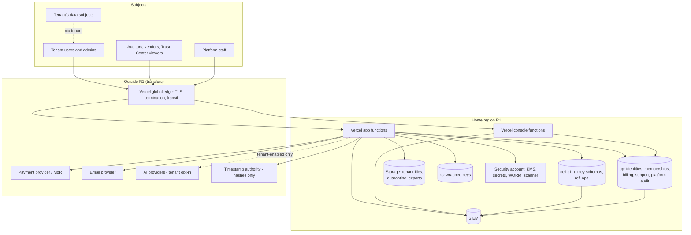
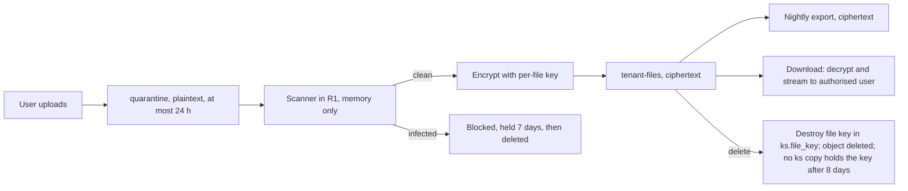
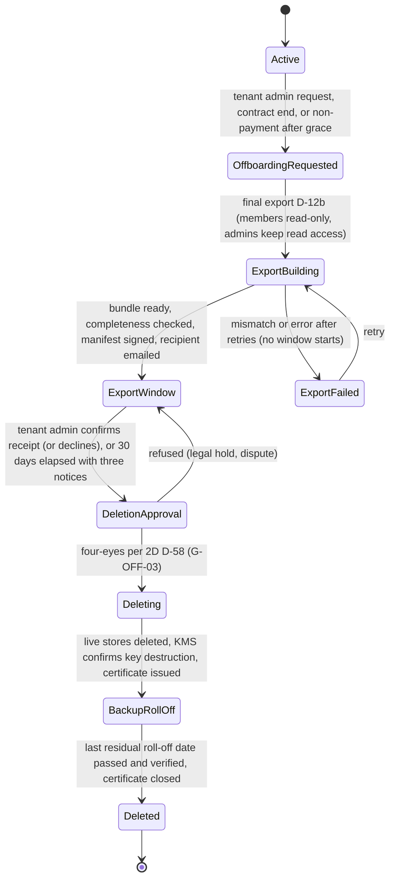

# Phase 2G: Privacy and compliance

| | |
|---|---|
| Status | **DRAFT pending qualified legal and compliance review.** Nothing here is legal advice or a compliance determination. Clause and article references marked *(verify)* must be checked against the primary text. |
| Date | 2026-11-23 |
| Binding inputs | `00-spine.md`, Phase 1 discovery summary §5 and §6, OQ-03, OQ-08, OQ-10, Q-04, Q-06, Q-24, `2F-security.md` |
| Risk and assumption ranges | Risks R-46 to R-49. Assumptions A-51 to A-54. |
| Roles | R-A Management Approver (ISMS owner). R-B CISO (privacy lead; DPO candidate, R-G). |
| Phase 5 | Items changed in the Phase 5 documentation pass end with "(rev P5)": G-6 offboarding aligned with 2D D-12 and D-58 (single approval rule, certificate issued at KMS destruction and closed at the last roll-off, one field and store list with 2D D-12e and 2J J-SHR-11), `auth` deletion timing (G-RET-01, G-OFF-04), `ks` copies with KS-SNAP and the keep-newest hold (G-RET-16, G-OFF-10, G-DR-06, G-DR-13). |
| Phase 4 | Items changed for the Phase 4 audit end with "(rev P4)": Supabase `auth` schema in the inventory, RoPA, retention schedule, DSAR and offboarding (P4-A3-01); customer-readable final export FINAL-EXPORT in G-6 (P4-A3-08); ISMS remediation plan G-14 (P4-A3-12); ISO ratings and the 27701 mapping (P4-A3-13); billing retention anchor (P4-A3-03); member display data class (P4-A3-04). |

Selvara acts in two capacities:
- **Controller** for its own processing: platform accounts and identity, security logging, billing, support, service communications, staff administration.
- **Processor** for everything a tenant puts into its own schema, its files and its Trust Center and vendor portal.

The tenant is the controller of its own data, including its workforce, vendors, Trust Center viewers and its own data subjects (M14).

---

## G-0. Decisions taken in this workstream

| ID | Decision | Rationale |
|---|---|---|
| G-D-01 | **No marketing processing at launch.** No analytics or advertising cookies on the product or public Trust Center; only strictly necessary cookies. Adding marketing needs a RoPA entry, a lawful-basis record and a consent mechanism first. | Keeps the controller footprint small for a two-person company. |
| G-D-02 | **E2 (per-subject key) scope** (answers discovery §6 condition 1): `member_profile`, `person` (members, workforce and contractors), `vendor_contact`, `trust_viewer` and `trust_nda_acceptance` (signer name), `data_subject_request` (requester identity and contact), `integration_account` (IdP-synced accounts), `visitor_session` (email), `audit_log_entry.pd_enc`, `integration.config_contact_enc`, `report_schedule.external_recipients_enc`. `trust_account`, `interested_party` and `incident` hold no direct identifiers by design (2B B-E11.4, A-32, B-E15.3): people are referenced by `person` id only. Narrative free text is E1 (tenant DEK, DA-01); everything else personal is E1 or references a person by id. Classes are only E0, E1 and E2 (2F F-D-12). (rev P3) | These are the fields an erasure request most often targets and that recur in history and exports. Free text cannot be keyed per subject; per-file keys (F-D-06) cover files. |
| G-D-03 | **Names are resolved at read time.** Tables reference people by `person` or member id; display names are not copied into other records (fixes F1-09). Internal report recipients are member ids; external recipients (four-eyes `report.distribution`, D-K21) are stored encrypted with a per-subject key and purged when the schedule is removed (2B B-E16.1). (rev P3) | Erasure then reaches every reference by destroying one key. |
| G-D-04 | **Nightly tenant export retention** follows ADR-004: last 7 in `exports`, and 35 daily, 12 monthly and 1 yearly off-site, not every nightly export for life. The change journal (`record_history`) provides lifetime history. All destroyed or made unreadable at offboarding. | Storage limitation; the journal already meets Q-24. |
| G-D-05 | **Home region** `R1` = Frankfurt (EU), as 2H records (H-AC-01, Vercel `fra1`); G endorses it. Off-site copies (ADR-004) go to a second EU region. | UK to EU and EU to UK flows rely on adequacy decisions *(verify current status)*; an EU region removes the transfer step for the largest regulated markets. |
| G-D-06 | **Special-category flag per tenant**: a tenant states at onboarding whether it will store special-category data (health in particular). When set: AI features stay off unless a tenant DPIA is recorded, evidence files are labelled, the tenant is shown the DPA special-category clause, and Selvara's processor records list the tenant. | Q-04 (health customers) and A-14. |
| G-D-07 | Selvara's own DSAR and privacy work runs in **Selvara's own tenant** of the product (M14), dogfooding the module, with controller data read from `cp` by a staff tool in `console` (through `cp_rw`); the case record lives only in Selvara's tenant, never in `control` tables (X1-11). (rev P3) | No team (Q-23); one process and one evidence trail. |

---

## G-1. Data inventory

### G-1.1 Data categories

| ID | Category | Examples (fields, not values) | Store | Capacity | Special category possible? | Encryption class |
|---|---|---|---|---|---|---|
| G-DC-01 | Platform identity | Supabase user id, email, display name, status; Auth metadata, IdP identities and claims, last sign-in | `control.identities`; Supabase Auth `auth.users`, `auth.identities` (2B-classification §3.1) | Controller | No | **Two states, stated honestly (rev P4, P4-A3-01):** in `control.identities`, email and display name are E1 under the platform KEK (2F F-K-30, F-K-31) with exact-match lookup by HMAC blind index `email_bidx` (F-K-32) (DA-05). In the Supabase-managed `auth` schema the email, IdP claims and metadata are **E0 at the application layer** (plaintext columns), covered only by Supabase's storage encryption at rest *(verify)*. Minimised: no display name or custom claim in Auth metadata (2B B-C29); Auth row deleted with the identity (G-RET-01) |
| G-DC-02 | Membership and roles | user, tenant, role id, status | `control.memberships`, `control.tenant_roles` | Controller (platform access); processor for the tenant's use | No | E0 |
| G-DC-03 | Authentication and session security | sessions (cookie hash, device, IP), MFA factors, passkeys, recovery code hashes, sign-in records; Supabase Auth sessions, refresh tokens, MFA factors (TOTP seed) and challenges (IP), SAML relay state, PKCE flow state, one-time tokens, Auth audit log (IP, email) | `control.sessions`, `auth_throttle`, `passkeys`, `recovery_codes`; Supabase Auth `auth.sessions`, `refresh_tokens`, `mfa_factors`, `mfa_challenges`, `mfa_amr_claims`, `saml_relay_states`, `flow_state`, `one_time_tokens`, `audit_log_entries` | Controller | No | In `control`: hashes; IP E1 under the platform KEK plus `ip_hmac` and `ip_prefix` (2B B-E90.5) (rev P3). In `auth`: **E0 at the application layer** (IP, user agent and email in plaintext; TOTP seed as Supabase stores it *(verify)*), provider storage encryption only; kept short instead (G-RET-28 to G-RET-30) (rev P4) |
| G-DC-04 | Platform audit and security logs | actor ids, IP prefix, actions, elevation reasons | `control.platform_audit_log`, SIEM | Controller | No | E1 under the platform KEK for IP and details; hash input uses keyed HMACs (F-K-33, 2B B-D17) (rev P3) |
| G-DC-05 | Billing | billing contact name, email, address, tax id, invoices, payments (no card data) | `control.subscriptions` (`contact_enc`, `address_enc`), `invoices` (`rendered_snapshot_enc`), `payments`, `provider_events`; payment provider | Controller | No | E1 under the platform KEK (2F F-K-31); `control.billing_entities` holds Selvara's own selling entities, not customer data (X1-47) (rev P3) |
| G-DC-06 | Support | questions and messages (free text), asker id | `control.support_questions`, `support_messages` | Controller | Possible in free text (warned against) | E1 under the platform KEK (rev P3) |
| G-DC-07 | Staff | platform staff identity, roles, elevations, approvals | `control.platform_staff`, `elevations`, `platform_approvals` | Controller | No | E0 ids; E1 under the platform KEK for names, emails, reasons and sensitive approval payloads (rev P3) |
| G-DC-08 | SSO and SCIM metadata | IdP metadata, domain, SCIM token hash | `control.sso_connections`, `scim_tokens` | Controller (security) | No | E0, hashes |
| G-DC-09 | Tenant GRC records | controls, risks, policies, audits, findings, issues, commitments, reports | `t_<tkey>` M02 to M08, M15, M16 | Processor | Rarely (free text) | E0 titles, E1 narratives |
| G-DC-10 | Tenant workforce and access data | person, contractor, systems, access grants and reviews, IdP-synced accounts (F1-08: name, email, MFA status, admin flag, last login) | `t_<tkey>` M12, M17 | Processor | No (by design) | E2 identifiers, E0 status fields |
| G-DC-11 | Evidence and files | any document the tenant uploads | `tenant-files`, `file_object`, `evidence_version` | Processor | **Yes** (health customers) | Per-file key |
| G-DC-12 | Vendor and third-party data | vendor contacts, assessments, questionnaire answers, vendor uploads | `t_<tkey>` M09, M10 | Processor | Rarely | E2 contacts, E1 answers |
| G-DC-13 | Trust Center viewers | viewer email, NDA signer name, company, NDA acceptance, access requests, chat questions | `t_<tkey>` M11 | Processor | No | E2 email and signer name, E1 chat and request reasons (rev P3) |
| G-DC-14 | Tenant privacy module | the tenant's RoPA, DPIAs, DSR records (requester identity, verification evidence), retention rules, legal holds | `t_<tkey>` M14 | Processor | **Yes** (DSR content, identity documents) | E2 requester, E1 content, per-file key for documents |
| G-DC-15 | AI governance and assistant | AI systems register, assessments, prompts and outputs, agent runs | `t_<tkey>` M13, M19; AI provider in transit | Processor | Possible | E1 |
| G-DC-16 | Tenant audit log and journal | actor ids, actions, ciphertext of changed fields | `audit_log_entry`, `record_history` | Processor | Indirectly (ciphertext) | As source fields |
| G-DC-17 | Notifications and email | recipient address, title, link | M20, email provider | Processor | No | E0 titles only |
| G-DC-18 | Usage meters | per-tenant aggregated counts | `control.usage_meters` | Controller (billing) | No | E0, no personal data |
| G-DC-19 | Backups and exports | copies of G-DC-09 to G-DC-16 | PITR, `exports`, WORM segments | Processor | Yes (as source) | As source plus tenant DEK |
| G-DC-20 | Deletion certificates and offboarding evidence | tenant reference, approver ids, key ids, counts, hashes | `control.deletion_certificates` | Controller (accountability) | No | E0 |
| G-DC-21 | Selvara's own RoPA and privacy records | `control.ropa_selvara`, Selvara tenant M14 | `cp`, Selvara tenant | Controller | Possible (DSR content) | E1/E2 |

### G-1.2 Data-flow diagram: platform

### G-1.3 Data-flow diagram: evidence file lifecycle

### G-1.4 Cross-border transfers

| ID | Flow | Data | From | To | Mechanism (draft) | Notes |
|---|---|---|---|---|---|---|
| G-TR-01 | Control plane global (Q-06) | G-DC-01 to G-DC-08, G-DC-18, G-DC-20 for tenants in any future cell | Tenant's region (future cells) | `R1` | UK: adequacy regulations or IDTA / UK Addendum to EU SCCs (UK GDPR Art. 45 to 46) *(verify)*. EU: adequacy or SCCs 2021/914 (Art. 46) *(verify)*. UAE federal: PDPL Art. 22 (adequate country) or Art. 23 (listed exceptions, contract) *(verify; executive regulations status to confirm)*. DIFC: DP Law 2020 Art. 26 to 27 *(verify)*. | At launch all tenants are in `R1`, so this flow is within region. It matters when a second region opens. |
| G-TR-02 | Remote access by Selvara staff from Pakistan | Control-plane data in the console; tenant data only through a support grant | `R1` | Pakistan | EU/UK customers: Selvara as importer under SCCs Module 2 (controller to processor) and Module 4 or Module 1 for controller data *(verify module choice)*; UK Addendum; transfer risk assessment for Pakistan | Pakistan has no adequacy decision *(verify)*. Staff access is minimal and logged (OQ-10). |
| G-TR-03 | Vercel global edge | Request and response bytes in transit, TLS terminated at the nearest edge | Visitor's country | Edge location, then `R1` | Vercel DPA and its transfer terms *(verify)* | Transient; functions and logs pinned to `R1` where the plan allows *(verify log location)*. |
| G-TR-04 | Email | Recipient address, title, link | `R1` | Email provider's region (often the US) *(verify per provider)* | Provider DPA with SCCs / UK Addendum / Data Privacy Framework where certified *(verify)* | Content minimised (no record content). |
| G-TR-05 | Payment | Billing contact, invoice amounts; card data handled only by the provider | `R1` | Provider region | Provider DPA; Stripe or merchant of record (ADR-007) | A merchant of record may act as an independent controller for the sale *(legal to confirm)*. |
| G-TR-06 | AI providers | Prompts and outputs (PII-blocker applied) | `R1` | Provider region | Provider DPA, zero-retention and no-training terms where offered *(verify per provider)*; tenant opt-in, four-eyes | Off by default. Refused for tenants with the special-category flag unless a tenant DPIA is recorded. |
| G-TR-07 | Timestamp authority | Merkle root hash only | `R1` | TSA location | Not personal data | Not a subprocessor. |
| G-TR-08 | UAE health data | Health data from UAE health-sector tenants | UAE | `R1` | UAE Federal Law No. 2 of 2019 (ICT in health fields) restricts storing health data outside the UAE except where permitted *(verify article and exceptions)* | Likely needs an in-country cell. Tracked as R-47 and R-01. |

---

## G-2. Records of processing (RoPA)

DRAFT. Kept in `control.ropa_selvara` (S2); exported as part of Selvara's own evidence. Format follows GDPR Art. 30(1) for controller entries and Art. 30(2) for processor entries *(verify field list)*.

### G-2.1 Selvara as controller

| ID | Activity | Purpose | Data subjects | Data categories | Lawful basis (UK/EU GDPR) | Recipients | Transfers | Retention | Measures |
|---|---|---|---|---|---|---|---|---|---|
| G-RC-01 | Account and identity management | Create and run platform accounts, memberships, MFA, SSO | Customer users, auditors, vendor contacts with accounts | G-DC-01, G-DC-02, G-DC-08; stores `control.identities`, `memberships`, `invitations`, `join_requests`, `recovery_codes`, `passkeys` and Supabase Auth `auth.users`, `identities`, `mfa_factors`, `flow_state`, `saml_relay_states`, `one_time_tokens`, `sso_providers` (rev P4) | Art. 6(1)(b) for the contracting customer's account holder; Art. 6(1)(f) for users who are the customer's staff (legitimate interest in providing the contracted service) | Supabase, Vercel, email provider | G-TR-01, G-TR-03, G-TR-04 | G-RET-01, G-RET-30 (rev P4) | F-14 V2/V3; minimal fields; no custom claims or display name in Supabase Auth metadata (2B B-C29); `auth` fields are E0 (provider encryption at rest only) and deleted through the Auth admin API with the identity (rev P4) |
| G-RC-02 | Security logging, fraud and abuse prevention | Protect the service, detect attacks, investigate incidents | All users, visitors, staff | G-DC-03, G-DC-04; stores `control.sessions`, `auth_throttle`, `account_notices`, `platform_audit_log` and Supabase Auth `auth.sessions`, `refresh_tokens`, `mfa_challenges`, `mfa_amr_claims`, `audit_log_entries` (rev P4) | Art. 6(1)(f); Art. 6(1)(c) where a law requires security records *(verify per jurisdiction)* | SIEM provider, Supabase, Vercel | G-TR-03 | G-RET-03, G-RET-04, G-RET-28, G-RET-29 (rev P4) | F-9, F-12; IP stored encrypted in `control`, prefix for analytics; plaintext IP in `auth` kept 90 days at most (rev P4) |
| G-RC-03 | Billing, invoicing and tax records | Charge for the service, meet tax and accounting law | Customer billing contacts | G-DC-05, G-DC-18 | Art. 6(1)(b); Art. 6(1)(c) for tax record keeping | Payment provider or MoR, tax adviser | G-TR-05 | G-RET-06 | Hosted payment pages; no card data (F1-07) |
| G-RC-04 | Customer support | Answer questions and incidents raised by tenants | Customer users | G-DC-06 | Art. 6(1)(b) / 6(1)(f) | Email provider | G-TR-04 | G-RET-07 | Free-text warning; E1 |
| G-RC-05 | Service communications | Security notices, invoices, product changes that affect the contract | Customer users | G-DC-01, G-DC-17 (platform notices) | Art. 6(1)(b) / 6(1)(f) | Email provider | G-TR-04 | Email logs per provider *(verify)* | No tracking pixels |
| G-RC-06 | Platform staff administration | Staff accounts, elevations, approvals, break-glass | Selvara staff | G-DC-07 | Art. 6(1)(b) (employment or engagement); Art. 6(1)(f) | None | G-TR-02 | G-RET-05 | Passkeys, four-eyes |
| G-RC-07 | Trials and prospect sign-up | Provision trials, prevent trial abuse | Prospects | G-DC-01, G-DC-03 | Art. 6(1)(b) (steps before a contract); Art. 6(1)(f) for abuse prevention | Supabase, Vercel, email | G-TR-03, G-TR-04 | G-RET-02 | F-AB-10 throttles |
| G-RC-08 | Privacy rights handling (Selvara's own) | Answer DSARs and complaints | Any person who asks | G-DC-21 | Art. 6(1)(c) | Legal adviser if needed | none | G-RET-12 | G-7 process |
| G-RC-09 | Offboarding and deletion evidence | Prove deletion and the approval chain (Q-24) | Approving staff, tenant contact | G-DC-20 | Art. 6(1)(c) / 6(1)(f) (accountability, Art. 5(2)) | Tenant contact receives the certificate | none | G-RET-13 | Signed certificate, anchored |
| G-RC-10 | Supplier and subprocessor management | Assess providers, record AI provider reviews | Supplier contacts | Names, business emails | Art. 6(1)(f) | none | none | Contract term + 6 years *(verify)* | — |
| G-RC-11 | Platform staff view of tenant contact data (OQ-10) | Account administration and MFA reset verification | Tenant admins | Name, email, MFA status | Art. 6(1)(f); disclosed in the DPA | none | G-TR-02 | Logged view retained as G-RET-04 | Each view in the platform audit log |
| G-RC-12 | Marketing | None at launch (G-D-01) | — | — | — | — | — | — | — |

### G-2.2 Selvara as processor (on behalf of each tenant)

Processor: Selvara (billing entity, Pakistan, with Art. 27 representatives R-E and R-F where required *(verify)*). Controller: each tenant, as named in its subscription.

| ID | Processing category | Data subjects | Data categories | Subprocessors | Transfers | Measures |
|---|---|---|---|---|---|---|
| G-RP-01 | Hosting and processing of GRC records | Tenant staff, auditors, named owners | G-DC-09, G-DC-16 | Supabase, Vercel, security-account provider | G-TR-03 | Schema per tenant, F-4, F-7 |
| G-RP-02 | Workforce, access and identity-provider sync | Tenant employees and contractors | G-DC-10 | Supabase, Vercel | G-TR-03 | E2 identifiers; read-only connectors; erasure on disconnect |
| G-RP-03 | Evidence and file storage, including malware scanning | Anyone named in documents; patients for health tenants | G-DC-11 | Supabase, security-account provider (scanner) | none | Per-file keys, quarantine, scanning in `R1` |
| G-RP-04 | Vendor risk, questionnaires and vendor portal | Vendor contacts | G-DC-12 | Supabase, Vercel, email provider | G-TR-04 | Invite-bound sessions, emailed codes |
| G-RP-05 | Trust Center | Viewers, requesters | G-DC-13 | Supabase, Vercel, email provider | G-TR-04 | Per-person NDA; minimal fields |
| G-RP-06 | Tenant privacy module (RoPA, DPIA, DSR) | The tenant's data subjects | G-DC-14 | Supabase, Vercel, email provider | G-TR-04 | E2, deadline clock, four-eyes erasure |
| G-RP-07 | AI assistant and agents (opt-in) | Any person in prompted records | G-DC-15 | AI providers chosen by the tenant | G-TR-06 | Off by default, PII blocker, no training |
| G-RP-08 | Notifications | Tenant users | G-DC-17 | Email provider | G-TR-04 | Title and link only |
| G-RP-09 | Integrations and webhooks | Tenant staff in third-party systems | G-DC-10, webhook payload ids | Tenant's own systems (not Selvara subprocessors) | Tenant-directed | Secrets by reference, SSRF guard |
| G-RP-10 | Backups, exports, restore | As source | G-DC-19 | Supabase, security-account provider (WORM) | none | Encrypted, crypto-shredding; return of data at offboarding by FINAL-EXPORT (G-OFF-01) (rev P4) |
| G-RP-11 | Support sessions under tenant grant | Tenant users | Members, settings, audit log | none | G-TR-02 | Read-only, grant-bound, logged in the tenant log |

---

## G-3. Lawful basis summary

| Activity | Basis (draft) | Note for counsel |
|---|---|---|
| Controller activities | As G-2.1 | Legitimate-interest assessments needed for G-RC-01 (users who are not the contracting party), G-RC-02, G-RC-04, G-RC-05, G-RC-11 |
| Processor activities | The tenant's basis; Selvara acts on documented instructions (Art. 28(3)(a)) | The DPA (G-9) is the instruction set |
| Special-category data (health) in tenant evidence | The tenant's Art. 9(2) condition (and UK DPA 2018 Schedule 1 condition) *(verify)* | Selvara needs none as processor but must apply Art. 32 measures proportionate to the risk |
| Security logging of tenant users by Selvara | Selvara as controller for platform security (Art. 6(1)(f)); tenant audit log content processed for the tenant | Two capacities over the same events: documented in the DPA |

---

## G-4. DPIA for the platform (DPIA-SEL-01)

DRAFT. Selvara is likely to process special-category data at scale as a processor for health customers (A-14), and tenants use it for workforce access monitoring. The tenant carries its own DPIA as controller; this DPIA covers the platform design and feeds the tenants' DPIAs.

### G-4.1 Description and necessity

| ID | Item | Assessment |
|---|---|---|
| G-DP-01 | Nature | Multi-tenant SaaS storing GRC records, evidence, workforce access data and privacy records; optional AI processing |
| G-DP-02 | Scope | All sectors including health; worldwide customers; one region at launch |
| G-DP-03 | Necessity | Each data category maps to a product function (G-2.2). Identity data in `cp` is the minimum to route and authenticate (S2). Workforce data is needed for access reviews; IdP sync limited to the fields listed in F1-08 and configurable per connector. |
| G-DP-04 | Proportionality | Names resolved at read time (G-D-03); E2 for identifiers; email content minimised; AI off by default; staff access only by tenant grant; retention per G-5 |
| G-DP-05 | Consultation | Tenants' DPOs through the DPA and Trust Center documentation; R-B as privacy lead; external counsel review |

### G-4.2 Risks to data subjects and measures

Scores: likelihood (L) and severity (S) 1 to 3 before and after measures.

| ID | Risk to individuals | L/S before | Measures | L/S after |
|---|---|---|---|---|
| G-DR-01 | Disclosure of one tenant's data (including health data) to another tenant | 2/3 | Schema per tenant, router, RLS, isolation tests, canary (F-4); per-file and field encryption (F-7) | 1/3 |
| G-DR-02 | Exposure of special-category data in evidence files through a breach | 2/3 | Per-file keys in a separate account's KMS hierarchy; scanning; download tokens; access logging; special-category flag (G-D-06) | 1/3 |
| G-DR-03 | Platform staff or insider access | 2/3 | No standing access; tenant-granted read-only support sessions; passkeys; four-eyes; logging in the tenant's own log | 1/2 |
| G-DR-04 | AI provider retains, trains on or transfers personal data | 2/2 | Off by default; four-eyes enable; provider review; PII blocker; refusal for special-category tenants without a DPIA; tenant-chosen provider | 1/2 |
| G-DR-05 | Excessive retention ("back up every change for the client's lifetime", Q-24) | 3/2 | Retention schedule G-5; tenant retention rules and purge job; export rotation (G-D-04); E2 shredding reaches the journal | 2/1 |
| G-DR-06 | Erasure not effective in backups | 3/2 | Per-subject and per-file keys in `ks` (destroyed keys gone from every copy, including PITR, backups, the off-site key journal and KS-SNAP, within 8 days, 2B B-K05; the only exception is the keep-newest legal hold after a declared `ks` loss, recorded on the certificate) (rev P3, rev P5); tenant KEK destruction at offboarding; certificate with backup roll-off date | 1/2 |
| G-DR-07 | Public Trust Center over-disclosure (F1-02) | 2/2 | Per-section publishing, per-person NDA, id-based access, four-eyes to go public | 1/1 |
| G-DR-08 | External auditor over-reach (F1-01) | 3/2 | Engagement-scoped RLS, expiry, view logging | 1/2 |
| G-DR-09 | Employees of tenants feel monitored (access data, MFA status, last login from IdP sync) | 2/2 | Minimum fields; tenant transparency obligations named in the DPA; no behavioural analytics; purpose limitation in the DPA | 2/1 |
| G-DR-10 | Transfers to countries without adequate protection (staff in Pakistan, providers) | 2/2 | SCCs / UK Addendum, transfer risk assessment, minimal staff access, encryption with keys in `R1` | 1/2 |
| G-DR-11 | Data subject rights not met in time | 2/2 | M14 deadline clock (S8 job), processor assistance SLA, Selvara own process (G-7) | 1/2 |
| G-DR-12 | Breach not notified in time | 2/3 | Alerts F-12; incident runbooks (2H); DPA notification commitment 48 h to the controller | 1/2 |
| G-DR-13 | Data unavailable (KMS outage, BYOK revocation, `ks` loss) | 2/2 | DEK cache, `ks` standby in the DR region, `ks` PITR 7 days, 8-day off-site key journal (DA-11) and daily KS-SNAP with the keep-newest hold after a declared loss (2B B-K05), restore drills (rev P3, rev P5) | 1/2 |
| G-DR-14 | Phishing using vendor-portal and Trust Center emails | 2/2 | DMARC reject, emailed codes, links only to Selvara host | 1/2 |
| G-DR-15 | Function creep (usage meters used to profile users) | 1/2 | Meters aggregated per tenant only (S2); no per-user analytics | 1/1 |
| G-DR-16 | Plaintext identity and security data in the Supabase-managed `auth` schema (email, IdP claims, IPs, user agents, TOTP seeds) exposed through a `cp` compromise or a provider incident (rev P4, P4-A3-01) | 2/2 | Minimisation (2B B-C29: no display name or custom claims, phone off, SAML mapping limited to email); short retention (Auth audit and challenge IP 90 days, Auth sessions expiry + 30 days, transients 24 h, D-80a); Auth user deleted with the identity; `cp` access controls (ADR-010); provider attestation review (G-14, 5.19); disclosed in the DPA (G-DPA-06) | 1/2 |
| G-DR-17 | Customer cannot read its data after offboarding (export unreadable, incomplete or lost before deletion) (rev P4, P4-A3-08) | 2/3 | FINAL-EXPORT (2D D-12b): decrypted open-format bundle, signed manifest with per-table counts and file hashes, completeness check against live counts, passphrase and link on separate channels, deletion blocked until receipt or a 30-day window with three notices, round-trip test | 1/2 |

### G-4.3 Outcome

Residual risks are low to medium after measures. **Prior consultation (Art. 36) is not expected** *(counsel to confirm)*. Review: at each new region, provider or AI feature, and yearly. Sign-off: R-B (privacy lead) recommends, R-A approves; the DPO (R-G, if designated) gives advice on record.

---

## G-5. Retention and deletion schedule

DRAFT; periods need legal confirmation per jurisdiction. "Tenant-configurable" means the tenant's `retention_rule` (M14) within the stated bounds; legal hold (`legal_hold`) suspends deletion.

Each row names the retention class of 2B §7.1 (B-RC) that implements it; the names are identical in 2B, 2B-classification and here (rev P3).

| ID | Category | Retention | Trigger and mechanism | Basis note | 2B retention class |
|---|---|---|---|---|---|
| G-RET-01 | Platform identity (G-DC-01) | 30 days after the end of the last membership or after account deletion, whichever is first (rev P3); at once on an upheld erasure | Then `control.identities` is pseudonymised (email and name removed, id kept so audit references stay valid) **and, in the same D-79 run,** the Supabase Auth user is deleted through the Auth admin API, removing `auth.users`, `auth.identities`, `auth.mfa_factors` and the user's remaining sessions and tokens (job D-79; 2B-classification §3.1). Sessions, including `auth.sessions` and `auth.refresh_tokens`, are revoked at once when the last membership ends; the identity and Auth deletion waits for the 30 days and is cancelled if a new membership starts meanwhile (rev P5). Ended memberships hard-deleted 30 days after their end (rev P4) | Storage limitation | `platform_identity` (B-RC19) |
| G-RET-02 | Trials without conversion | 30 days after trial end | Tenant crypto-shredded (F-K-10); identity per G-RET-01 | | offboarding (2B B-DL08) |
| G-RET-03 | Sessions and sign-in records | 90 days | Purge job | Security | `sign_in_record` (B-RC21) (rev P3) |
| G-RET-04 | Platform audit log | 7 years *(verify against certification evidence needs)*; IP and details nulled after 1 year | Append-only; purge only through an anchored purge entry | Accountability, ISO 27001 evidence | `audit_log` (B-RC01, platform-set), column purge B-RC32 (rev P3) |
| G-RET-05 | Staff records (elevations, approvals, support grants, break-glass) | Engagement end + 7 years | Purge job | | `staff_record` (B-RC25) (rev P3) |
| G-RET-06 | Billing and tax records | **6 years from the date each record was created**, for every selling entity (owner decision OQ-25). Anchor stored per record: invoice and credit-note issue date, ledger and payment entry date, subscription end, tenant closure. Counsel confirms that no jurisdiction requires longer (OD-08, DU-21); if one does (Pakistan Income Tax Ordinance 2001 record-keeping period *(verify)*), that selling entity's `retention_years` and anchor are raised, so the period is the later of the two (rev P4, P4-A3-03) | Purge job | Legal obligation | `financial` (B-RC15) (rev P4) |
| G-RET-07 | Support questions and messages | 2 years after closure | Purge job | | `support` (B-RC26) (rev P3) |
| G-RET-08 | Security and application logs (observability SaaS, H-OB-01) | 30 days hot, 1 year encrypted archive, then deleted | Provider retention setting | Security | outside the database (provider setting) |
| G-RET-09 | Tenant business records (G-DC-09 to G-DC-15) | Per record class, tenant-configurable within floors; soft-deleted content purged after 30 days; tombstone kept to the end of the record's retention class (2B B-DL01) (rev P3) | Retention purge job (S8), skips legal hold, writes F-EV-07 | Processor instruction | per table: `evidence`, `risk`, `policy`, `assurance`, `issue`, `access`, `vendor`, `commitment`, `privacy_register`, `ai_governance`, `external_contact`, `tenant_lifetime` (B-RC02 to B-RC20) |
| G-RET-10 | `record_history` | Kept with its row; purged with the row by the retention job, leaving a content-free purge marker (2B B-PG03); deleted with the tenant. E2 fields shredded by subject erasure; redaction procedure for E1 free text on a valid erasure (tenant four-eyes, migrator function, anchored audit entry) (rev P3) | | Q-24 vs Art. 5(1)(e): tension resolved by shredding, redaction and row-level retention | parent row's class (B-H09) |
| G-RET-11 | Tenant audit log | 7 years by default, tenant-configurable down to the 5-year floor; IP, personal and detail ciphertexts nulled after 1 year; delivered in the final export and deleted with the tenant (rev P3) | Retention purge; deleted with the tenant | | `audit_log` (B-RC01), column purge B-RC32 |
| G-RET-12 | Selvara's own DSAR records | 3 years after closure *(verify)* | Purge job in Selvara's tenant | | `privacy_case` (B-RC11) |
| G-RET-13 | Deletion certificates | 10 years after deletion *(verify)* | Kept in `cp` | Accountability | `accountability` (B-RC24) (rev P3) |
| G-RET-14 | Nightly tenant exports | Last 7 in `exports`; 35 daily, 12 monthly, 1 yearly off-site (ADR-004); object lock 35 days | Rotation job; crypto-shredding at offboarding (KEK destruction makes locked copies unreadable) | | outside the class scheme (ADR-004 rotation) |
| G-RET-15 | Supabase PITR and daily backups | Provider window (7 days on Pro *(verify)*) | Rolls off; data within is ciphertext for E1/E2/files | | provider window |
| G-RET-16 | `ks` copies: PITR, backups, standby, key journal and KS-SNAP (rev P5) | PITR 7 days (DU-02 recommendation); daily backups 7 days; the DR-region standby follows the live store; off-site key journal objects expire 8 days after they are written (DA-11); KS-SNAP objects in `ks-snap` (`offsite-prod`, under `kek/ks-snap`) are locked exactly 8 days, then deleted | A destroyed key leaves the live store and standby at once and every other copy within **8 days after destruction** (2B B-K05, ADR-003), plus the deletion-job latency stated on the certificate. Exception: after a declared `ks` loss or compromise (S1), the newest KS-SNAP object and the journal segments after it are held (keep-newest, 2B B-K05, 2F F-K-47) until `ks` is restored and verified; a key destroyed in the 8 days before the declared loss is certified as "destroyed; unrecoverable once the hold is released", with the release timestamp (rev P3, rev P5) | | `ks` (2B B-K01 to B-K05) |
| G-RET-17 | WORM audit segments | 13 months (compliance mode); unreadable after tenant KEK destruction | Object lock expiry | ADR-013 | outside the class scheme (ADR-013) |
| G-RET-18 | WORM anchors (hashes only) | 10 years | Object lock | Not personal data | `accountability` (B-RC24) (rev P3) |
| G-RET-19 | Quarantine objects and blocked files | Quarantine objects: removed at promotion, or within 24 h if the scan never completes; blocked (infected) files: 7 days, then hard-deleted (2B B-DL07) (rev P3) | Lifecycle rule; purge job | | 2B B-DL07 |
| G-RET-20 | Vendor portal invites | Invites expire after at most 30 days; the invite row is hard-deleted 30 days after its terminal state; the assessment it served keeps the `vendor` class (rev P3) | Purge job | | `transient` (B-RC09) |
| G-RET-21 | Webhook deliveries; integration sync runs | 30 days; 90 days | Purge job | | `ops_short` (B-RC27); `ops_medium` (B-RC28) (rev P3) |
| G-RET-22 | Notifications | 1 year | Purge job | | `operational` (B-RC10), capped at 12 months for notifications (rev P3) |
| G-RET-23 | Tenant DSR records (M14) | Tenant-configurable, default 3 years after closure | Purge job | Tenant's accountability | `privacy_case` (B-RC11) |
| G-RET-24 | AI provider side | Zero retention where offered; otherwise the provider's stated period *(verify per provider)* | Provider terms | | provider terms |
| G-RET-25 | Email provider logs | Provider default *(verify)*, minimised | Provider setting | | provider setting |
| G-RET-26 | Tenant member display data (`member_profile`) | Display name: 7 years after membership end *(legal to confirm, OD-10, OD-08)*; earlier on an upheld erasure. Email, job title and department: 30 days after membership end, at once on erasure (B-RC38) (rev P4) | Subject-key shred (F-K-11); E0 personal columns nulled (2B B-DL06) | Attribution of audit entries (R-23) | `member_display` (B-RC29) (rev P4, P4-A3-04) |
| G-RET-27 | Sign-up and join requests (`control.join_requests`), invitations | Invitations and approved requests: 30 days after the terminal state; rejected requests: 3 months | Purge job | Storage limitation | `transient` (B-RC09); `rejected_request` (B-RC14) (rev P3) |
| G-RET-28 | Supabase Auth audit log and MFA challenge records (`auth.audit_log_entries`, `auth.mfa_challenges`, incl. plaintext IP) | **90 days** (the owner may choose shorter, never longer); the subject's entries at once on erasure or identity deletion | `auth` purge job D-80a | Security; storage limitation for plaintext IP | `sign_in_record` (B-RC21) (rev P4, P4-A3-01) |
| G-RET-29 | Supabase Auth sessions (`auth.sessions`, `auth.refresh_tokens`, `auth.mfa_amr_claims`) | Until expiry or sign-out (Selvara signs the Auth session out at the end of each sign-in, 2E E-10) **+ 30 days at most** | Sign-out; D-80a backstop; Auth admin delete with the user | Security | `auth_session` (B-RC36) (rev P4, P4-A3-01) |
| G-RET-30 | Supabase Auth transient records (`auth.flow_state`, `auth.saml_relay_states`, `auth.one_time_tokens`, unused Auth tokens on `auth.users`) | 24 hours | D-80a | Storage limitation | `auth_transient` (B-RC37) (rev P4, P4-A3-01) |
| G-RET-31 | Supabase Auth identities, factors and SSO configuration (`auth.identities`, `auth.mfa_factors`, `auth.sso_providers`, `sso_domains`, `saml_providers`) | Identities and factors: while the account exists (deleted with the Auth user, G-RET-01) or until the factor is removed. SSO configuration: while the tenant's SSO connection exists | Auth admin delete; Supabase management API at SSO removal or offboarding (G-OFF-04) | Storage limitation | `platform_identity` (B-RC19); `account_credential` (B-RC22); `tenant_lifetime` (B-RC16) (rev P4) |
| G-RET-32 | Final-export bundles and their record (FINAL-EXPORT) | Bundle: until superseded or the tenant is deleted (at most the export window plus approval time); the record in `control.tenant_export_jobs`: 10 years *(verify)*, copied into the certificate | Supersession; D-12a(4) | Return obligation (Art. 28(3)(g)) and accountability | bundle: outside the class scheme; record: `accountability` (B-RC24) (rev P4, P4-A3-08) |

---

## G-6. Tenant offboarding: export and full deletion (Q-24)

### G-6.1 States

States and rules follow 2D D-12 and D-12b (rev P4); `BackupRollOff` here is 2D's `KeyDestructionPending` plus `ResidualRollOff` (rev P5). Deletion approval is refused until the final-export precondition (2D D-12b-7: latest generation `confirmed` or `window_expired`, manifest re-checked) holds. The export window is 30 days from the first `ready` generation, never earlier than the newest link expiry, and extended while a legal hold or dispute is open (2D D-12b-1) (rev P5).

### G-6.2 Steps and evidence

| ID | Step | Store | Action | Evidence captured |
|---|---|---|---|---|
| G-OFF-01 | Final export (FINAL-EXPORT, 2D D-12b) (rev P4) | Tenant schema, files, audit log | Job D-12b runs in the tenant context and builds a ZIP: JSON per table (E1 and E2 decrypted, schema documented by JSON Schema and a data dictionary), CSV for the main registers, every clean file version decrypted, the audit log with its verification bundle (RoPA and DSR records are tables in it), and `manifest.json` (per-table row counts, file count, SHA-256 per file, schema version, generated-at) signed with the platform signing key. Completeness: bundle counts equal live counts in the same snapshot, and each file hash equals the stored hash. The bundle is encrypted with a one-time passphrase-derived key (age or AES-256-GCM). The passphrase is shown **once** in the app to the export recipient (a tenant admin) after step-up (2C C-M01-24); the download link goes by email, single use, valid 7 days (C-M01-25). The recipient confirms receipt or declines (C-M01-26); otherwise the 30-day window ends after notices at ready, day 23 and day 29 | `control.tenant_export_jobs` id and generation, manifest SHA-256 and signature, per-table counts, passphrase reveal time, download events, receipt outcome or window expiry with notice times; round trip and negative cases tested by 2J J-FEX-01 to J-FEX-12 (rev P5) |
| G-OFF-02 | Check holds and export | M14 `legal_hold`, contract, `control.tenant_export_jobs` | Any active legal hold or unresolved dispute blocks deletion; so does a final export without receipt and with the window still open (2D D-12b-7) (rev P4) | Check result |
| G-OFF-03 | Approval | `control.platform_approvals` | Four-eyes per 2D D-58, the single rule (rev P5, P4-A3-09): two different people, one holding `management_approver` and one holding `ciso` (or a custom role holding `tenant.delete` with the same split; the deputy approver R-DEP may act for either, never both); the requester may cast one of the two votes only if they hold one of those roles; nobody votes twice. An active legal hold blocks approval with no override (2B B-DL08) | Approval id, votes, times |
| G-OFF-04 | Access revocation and identity | `cp`, Supabase Auth | Memberships ended, sessions revoked, SCIM tokens and API keys revoked, SSO connection removed (including its Supabase Auth `sso_providers`, `sso_domains` and `saml_providers` rows, through the Supabase management API), webhooks disabled, Trust Center and vendor portal disabled. For each identity with no other membership: its sessions, including `auth.sessions` and `auth.refresh_tokens`, revoked at once; 30 days after its last membership ended (G-RET-01; cancelled if it gains a new membership) `control.identities` pseudonymised **and, in the same run,** the Supabase Auth user deleted through the Auth admin API, and its `auth.audit_log_entries` and `mfa_challenges` removed by D-80a (rev P4; one timing with 2B-classification §3.1 and 2D D-12a(7), rev P5) | Counts, including `auth.users` deleted and `auth` rows remaining for those users (0) (rev P4) |
| G-OFF-05 | Database | Cell | Drop schema `t_<tkey>` and roles `t_<tkey>_rw`, `t_<tkey>_ro`; remove `selvara_router` membership | Object counts before drop; drop confirmation |
| G-OFF-06 | Object storage | `tenant-files`, `quarantine`, `exports`; off-site export prefix (H-PV-07) | Delete prefix `<tkey>/` in each bucket (final-export bundles included); off-site: delete unlocked objects at once and the locked rest at lock expiry, at most 35 days (2D D-12a(4)) (rev P5) | Object counts and manifest hash; off-site lock-expiry date |
| G-OFF-07 | Keys | `ks`, KMS | Delete all `ks` rows for the tenant (DEK versions, subject, file, blind-index and audit HMAC keys); schedule deletion of the KEK **and every multi-Region replica** with the minimum waiting period, recording each replica's waiting period (A-23; rev P3); BYOK: revoke Selvara's grant and request the customer to delete its key | KMS key id, deletion date, KMS log event id |
| G-OFF-08 | Secrets | Secrets manager | Delete `tenants/<tkey>/*` | Count |
| G-OFF-09 | Control plane | `cp` | Tenant record becomes a tombstone (tkey, dates, certificate id, legal name kept only in billing records under G-RET-06); routing removed; usage meters kept as aggregates for billing | Fields kept, listed |
| G-OFF-10 | Residual copies | Every store of 2D D-12c | Not edited. (1) Cell and `cp` PITR and daily backups: ciphertext of E1/E2/files plus E0 plaintext until roll-off; (2) nightly exports in `exports` and off-site (35 daily, 12 monthly, 1 yearly): ciphertext under the destroyed KEK, unlocked copies deleted at once, locked copies at lock expiry (at most 35 days); (3) hourly `control` exports off-site (35 days); (4) `ks` copies (PITR, backups, standby, key journal, KS-SNAP): destroyed keys gone within 8 days (2B B-K05), subject to the keep-newest hold; (5) WORM segments: unreadable at KEK destruction, kept to lock expiry; (6) observability and email-provider logs: provider retention (G-RET-08, G-RC-05); (7) `auth` rows of offboarded identities: at the G-RET-01 point (G-OFF-04) (rev P3, rev P5) | One roll-off date per store, computed and stated on the certificate |
| G-OFF-11 | Certificate | `control.deletion_certificates` | **Issued** when KMS confirms destruction of the KEK and every replica (2D D-12e), listing the roll-off date of every G-OFF-10 store; **closed** when the last of those dates has passed and the roll-off check (2J J-SHR-11) has confirmed each store, with a second signature and anchor. One timing in 2D, 2G and 2A A-LC-08 ("after KEK destruction" = issue) (rev P5, P4-A3-10) | See G-6.3 |

E0 plaintext residue: titles, statuses, refs and dates remain in Supabase PITR until roll-off (7 days *(verify)*). The certificate states this, and the DPA discloses it.

### G-6.3 Deletion certificate (fields)

| Field | Content |
|---|---|
| Certificate id | `DC-<yyyy>-<n>` |
| State (rev P5) | `issued` (at KMS destruction) or `closed` (last residual roll-off passed and verified), with both timestamps; the same field list as 2D D-12e |
| Tenant | `tkey`, customer reference, subscription id |
| Request | Requester id, reason, date |
| Approvals | Approval id, two approver ids, timestamps |
| Export | `control.tenant_export_jobs` id and generation, manifest SHA-256 and signature, per-table row counts and file count, download date, receipt outcome (received or declined) and time, or window expiry date with the three notice times (rev P4) |
| Database (rev P5) | Schema drop timestamp and catalog proof (no `t_<tkey>` schema and no `t_<tkey>_*` role in the cell catalog), object counts before the drop |
| Per store | Store name, action, objects counted before, objects remaining after (0), manifest hash, completion time; one row for each of: tenant schema, `tenant-files`, `quarantine`, `exports` (final-export bundles included), off-site prefixes, secrets, `cp` tombstone, `auth` rows of offboarded identities (`auth.users` deleted and remaining rows 0, with the G-RET-01 date for identities still inside their 30 days) (rev P5) |
| Keys | KEK id and versions, and each multi-Region replica key, deletion scheduled and completed times, KMS log event ids; BYOK status; count of `ks` keys destroyed (rev P3) |
| Residual copies | One row per G-OFF-10 store with its roll-off date: cell and `cp` PITR and daily backups (E0 plaintext residue until then); nightly exports off-site (lock expiry); hourly `control` exports off-site; `ks` copies: PITR 7 days, daily backups, standby, key journal and KS-SNAP (at most 8 days after the `ks` row deletion, plus the deletion-job latency); WORM segments retained (ciphertext, count, lock expiry); observability and email-provider log expiry. **Keep-newest hold:** if a `ks` loss was declared within 8 days after one of the tenant's keys was destroyed, so that a held KS-SNAP object or journal segment still contains it (2F F-K-47), that row reads "destroyed; unrecoverable once the hold is released" with the hold release timestamp, and the certificate is closed only after the release (2B B-K05) (rev P3, rev P5) |
| Retained by law | Billing records (legal name, invoices) with period; platform audit entries; anchors; this certificate |
| Integrity | SHA-256 of the certificate body; signature by `sig/anchor` (F-K-06); platform audit entry hash and anchor id |
| Delivery | Sent to the tenant's contract contact; copy available on request |

---

## G-7. DSAR handling

### G-7.1 Selvara as controller

| ID | Step | Detail |
|---|---|---|
| G-SAR-01 | Intake | Account page form (signed in) or a published privacy contact address (`privacy@example.com` placeholder); recorded in Selvara's own tenant M14 `data_subject_request` |
| G-SAR-02 | Verification | Signed-in session with MFA, or a code sent to the account email; no extra identity documents unless needed |
| G-SAR-03 | Clock | One month, extendable by two months for complex requests (UK/EU GDPR Art. 12(3)); UAE PDPL period *(verify)*; the S8 DSAR clock job reminds R-B at 50%, 80% and 95% |
| G-SAR-04 | Search | `control.identities`, `memberships`, sessions and sign-in records, `platform_audit_log` by actor id, support questions, billing contacts, SIEM by user id, email provider logs, and the Supabase `auth` schema by user id and email (`users`, `identities`, `sessions`, `mfa_factors`, `mfa_challenges`, `audit_log_entries`) (rev P4) |
| G-SAR-05 | Tenant data | Data inside a tenant is the tenant's: Selvara tells the requester which organisations it can confirm the person belongs to only where the person is already a member, and directs them to those controllers |
| G-SAR-06 | Erasure | Ends memberships at the person's request (a tenant's last admin is warned to appoint another), pseudonymises identity (G-RET-01), deletes the Supabase Auth user through the Auth admin API and the person's `auth.audit_log_entries` and `mfa_challenges` through D-80a at once (rev P4); keeps what law requires (billing, security logs within retention in `control.platform_audit_log`) and says so |
| G-SAR-07 | Response | Export in JSON plus a readable summary; audit entry; closure record |

### G-7.2 Selvara as processor (assisting tenants)

| ID | Step | Detail |
|---|---|---|
| G-SAR-10 | Misdirected requests | A request sent to Selvara about tenant data is forwarded to the tenant's privacy contact within 2 business days; Selvara does not answer the substance |
| G-SAR-11 | Tooling | M14 in each tenant: intake, verification evidence (per-file key), deadline clock, subject search across the tenant schema using E2 blind indexes and `person` references, export package, erasure workflow |
| G-SAR-12 | Erasure in a tenant | Tenant four-eyes; deletes or anonymises live rows; destroys the subject key (F-K-11) so `record_history`, exports and backups become unreadable for E2 fields within 8 days; files linked to the subject deleted with their keys; E1 free-text mentions found by search are redacted through G-RET-10 |
| G-SAR-13 | What cannot be erased by the tenant | Audit log entries (integrity): they hold the actor id and E1 details; the actor's name disappears with the subject key; counsel to confirm the Art. 17(3) position |
| G-SAR-14 | Selvara-held data about tenant users | Platform-side records (sign-in records, support messages) found by Selvara on the tenant's request within 10 business days |
| G-SAR-15 | Evidence | M14 record and audit entries; Selvara's assistance logged in the platform log |

---

## G-8. Data residency design

| ID | Item | Design |
|---|---|---|
| G-RES-01 | Launch | `R1` (Frankfurt) hosts `cp`, `c1`, `ks`, Storage, KMS and the scanner; Vercel functions in `fra1`; edge is global (G-TR-03). Off-site exports and WORM objects (ciphertext and hashes) sit in a second EU region (ADR-004, ADR-013); the observability SaaS in an EU region if offered *(verify)*. |
| G-RES-02 | Future cells | New region = new cell. Tenant data (schema, files, exports, `ks` rows for that cell, KMS keys in that region) stays in the cell's region. |
| G-RES-03 | What the control plane holds outside a tenant's region (Q-06) | Identity (email, display name, status; including the Supabase Auth copy in `auth`, rev P4), memberships and role ids, sessions and sign-in records, SSO metadata and SCIM token hashes, billing records, support messages, platform audit log entries about the tenant, usage aggregates, key registry metadata (no key material), deletion certificates. Nothing from S2's exclusion list. |
| G-RES-04 | UK GDPR position | If a UK tenant's cell is in the UK and `cp` in `R1`: transfer of G-RES-03 data relies on UK adequacy regulations for `R1`'s country, or IDTA / UK Addendum *(verify)*. With `R1` in the UK or EEA (G-D-05), launch needs no restricted-transfer mechanism for UK/EU tenants, apart from staff access (G-TR-02) and providers. |
| G-RES-05 | UAE PDPL position | Federal PDPL Art. 22 (transfer to an adequate country) and Art. 23 (other permitted cases, including contract) *(verify; executive regulations and the Data Office's adequacy list to confirm)*. The federal PDPL does not apply in DIFC and ADGM, which have their own laws (DIFC DP Law 2020 Art. 26 and 27 *(verify)*). Health data: UAE health-data localisation (G-TR-08) likely requires an in-country cell for UAE health tenants. |
| G-RES-06 | Residency option for regulated buyers | Option (not MVP): a regional `cp` read replica is not enough because identity is written centrally; the alternative is a dedicated cell with identity minimised in `cp` to a pseudonymous id plus an email hash, with the email held in the cell. Record as a later ADR if a buyer requires it (R-01). |

---

## G-9. Customer DPA template outline

DRAFT outline for counsel. Aligned to GDPR Art. 28(3) *(verify)*; UK and UAE variations as schedules.

| ID | Section | Content |
|---|---|---|
| G-DPA-01 | Parties and roles | Customer as controller, Selvara as processor; Selvara as independent controller for G-2.1 activities, listed |
| G-DPA-02 | Subject matter, duration, nature, purpose | Per G-2.2; duration = subscription plus offboarding |
| G-DPA-03 | Data categories and subjects | Annex 1 from G-1.1 and G-2.2; special-category clause (G-D-06) |
| G-DPA-04 | Instructions | The agreement, configuration choices in the product, and written instructions; Selvara informs if an instruction appears unlawful |
| G-DPA-05 | Confidentiality | Staff bound by confidentiality; staff access only by tenant support grant; OQ-10 minimal contact view disclosed |
| G-DPA-06 | Security | Annex 2: technical and organisational measures from 2F (isolation, encryption, keys, BYOK, logging, scanning, SDLC); states that sign-in data in the Supabase-managed Auth schema is protected by provider encryption at rest only, minimised and kept short (G-DR-16) (rev P4) |
| G-DPA-07 | Subprocessors | General authorisation; list in G-10; 30 days' notice of changes through the Trust Center subscription; right to object; flow-down terms |
| G-DPA-08 | International transfers | SCCs 2021/914 Modules 2 and 3 as relevant, UK Addendum or IDTA, UAE contract clauses; transfer risk assessment summary for Pakistan staff access |
| G-DPA-09 | Assistance with rights | G-7.2 tooling and SLAs |
| G-DPA-10 | Assistance with DPIAs and consultation | Platform DPIA summary (G-4) shared under NDA through the Trust Center |
| G-DPA-11 | Breach notification | Without undue delay, target 48 h after Selvara becomes aware, with the information Art. 33(3) lists as available *(verify)* |
| G-DPA-12 | Deletion and return | Customer-readable final export (G-OFF-01: open format, signed manifest, completeness check, passphrase and link on separate channels); export window 30 days from the first export being ready (never before the newest link expires; extended while a hold or dispute is open), ended early by the customer's receipt; deletion process G-6; crypto-shredding description; backup roll-off periods, including the keep-newest exception after a declared key-store loss; E0 residue disclosure; certificate issued at key destruction and closed at the last roll-off (rev P4, rev P5) |
| G-DPA-13 | Audits | Reports and certifications when available (ISO 27001, SOC 2 planned 6 to 36 months, Q-17); questionnaires; on-site audit on reasonable notice with limits |
| G-DPA-14 | AI schedule | Opt-in; tenant-selected providers; no training on customer data where terms allow; PII blocker; four-eyes enablement; per-provider review summary |
| G-DPA-15 | BYOK schedule | Customer key responsibilities; revocation effects (unavailability, shredding) |
| G-DPA-16 | Liability, governing law | Per main agreement |

---

## G-10. Subprocessor list (draft)

| ID | Subprocessor | Service | Data | Location | Condition |
|---|---|---|---|---|---|
| G-SP-01 | Supabase | Postgres (cells, `cp`, `ks`), Auth, Storage, Queues | All tenant and platform data | `R1` | Always |
| G-SP-02 | Vercel | Hosting of API and web app, edge network, function logs | Data in transit, logs (ids) | `R1` functions, global edge | Always |
| G-SP-03 | Cloud provider for KMS, scanner and off-site copies (H-AC-05; AWS as the example, A-19) | KMS, secrets manager, scanner container, off-site object-locked storage | Key material, ciphertext, transient file bytes | `R1` and a second EU region | Always |
| G-SP-04 | Payment provider: Stripe (later entities) or a merchant of record (ADR-007) | Payments, invoicing support | Billing contact, amounts | Provider region | Always (controller data); MoR role to confirm |
| G-SP-05 | Email provider (Resend or Postmark, existing adapters) | Transactional email | Addresses, titles, links | Provider region *(verify)* | Always |
| G-SP-06 | Observability SaaS (H-AC-08: logs, errors, paging) | Log storage and alerting | User ids, IPs, events | EU region if offered *(verify)* | Always |
| G-SP-07 | AI providers (per ADR-007; Anthropic adapter exists) | Assistant and agents | Prompts and outputs | Provider region | Only when a tenant enables AI and selects the provider |
| — | Timestamp authority | RFC 3161 timestamps | Hashes only | — | Not a subprocessor (no personal data) |
| — | Customer-chosen integrations (identity providers, cloud accounts, code hosts) | Tenant-directed connectors | Tenant data in the tenant's own systems | — | Tenant's own processors, not Selvara's |

---

## G-11. ISO/IEC 27001:2022 Annex A mapping

Status: **D** designed in v2 (evidence will come from the build and operation), **P** partially designed, **O** organisational process still to write (ISMS document), **I** inherited from providers (supplier attestations reviewed), **N/A** not applicable with justification. 93 controls. Mapping only, not a certification statement.

### G-11.1 Organisational controls (5.1 to 5.37)

| Control | Title (short) | Status | Design reference or gap |
|---|---|---|---|
| 5.1 | Policies for information security | O | ISMS policy set to write; `docs/security` is a start |
| 5.2 | Roles and responsibilities | P | R-A to R-G (discovery §4); ISMS role document |
| 5.3 | Segregation of duties | D | SOD_MATRIX, four-eyes engines, F-CP-04 |
| 5.4 | Management responsibilities | O | Management review by R-A |
| 5.5 | Contact with authorities | O | Regulator and police contact list per jurisdiction |
| 5.6 | Contact with special interest groups | O | — |
| 5.7 | Threat intelligence | P | Dependency and advisory feeds (OSV, Dependabot); formal process to write |
| 5.8 | Security in project management | P | F-SD-05 PR template; phase gates |
| 5.9 | Inventory of information and assets | P | G-1 data inventory, F-1 components; asset register in Selvara's own tenant |
| 5.10 | Acceptable use | O | — |
| 5.11 | Return of assets | O | Two people; device return procedure |
| 5.12 | Classification of information | P | E0/E1/E2 classes (F-D-12); org classification scheme to align |
| 5.13 | Labelling | P | Column markers; document labels to define |
| 5.14 | Information transfer | D | TLS, signed tokens, export encryption, DPA |
| 5.15 | Access control | D | F-4, `can()`, RLS |
| 5.16 | Identity management | D | Supabase Auth, SSO, SCIM, `control.identities` |
| 5.17 | Authentication information | D | Credential policy, hashed tokens, secrets manager |
| 5.18 | Access rights | D | Role grants four-eyes, access reviews (M12 used internally) |
| 5.19 | Supplier relationships | P | Subprocessor list G-10; supplier review process to write |
| 5.20 | Security in supplier agreements | O | DPAs with each subprocessor |
| 5.21 | ICT supply chain | D | Pinned dependencies, SBOM, licence policy |
| 5.22 | Supplier service monitoring | O | Yearly attestation review |
| 5.23 | Use of cloud services | P | Provider settings as code (F-SD-08); cloud policy to write |
| 5.24 | Incident management planning | P | F-12 alerts; runbooks in 2H |
| 5.25 | Assessment of events | P | Severity scheme F-12 |
| 5.26 | Response to incidents | P | Runbooks (2H) |
| 5.27 | Learning from incidents | O | Post-incident review template |
| 5.28 | Collection of evidence | D | Anchored audit log, verification bundles |
| 5.29 | Security during disruption | P | Fail-closed design; continuity plan in 2H |
| 5.30 | ICT readiness for continuity | P | ADR-004 backups, restore drills (F-SD-11) |
| 5.31 | Legal, regulatory and contractual requirements | P | G-1.4, G-8; legal register to write |
| 5.32 | Intellectual property rights | D | Licence policy gate |
| 5.33 | Protection of records | P | Append-only logs, WORM, retention G-5; re-rated from D: the retention schedule is still a draft pending counsel (DU-21) (rev P4, P4-A3-13) |
| 5.34 | Privacy and protection of PII | P | This document; DPA; M14; re-rated from D: DPO (DU-22), Art. 27 representatives (DU-23), retention counsel (DU-21) and the LIAs are open (rev P4, P4-A3-13) |
| 5.35 | Independent review | O | R-D outsourced internal auditor; pen test (F-SD-10) |
| 5.36 | Compliance with policies and standards | P | Pipeline gates; periodic compliance check to define |
| 5.37 | Documented operating procedures | P | Runbooks (2H) |

### G-11.2 People controls (6.1 to 6.8)

| Control | Title (short) | Status | Note |
|---|---|---|---|
| 6.1 | Screening | O | For any future staff and contractors |
| 6.2 | Terms of employment | O | Security clauses |
| 6.3 | Awareness and training | O | Yearly training record |
| 6.4 | Disciplinary process | O | — |
| 6.5 | Responsibilities after termination | O | Access removal via four-eyes staff removal |
| 6.6 | Confidentiality agreements | O | Staff and contractors |
| 6.7 | Remote working | O | Two-person remote company: device and network rules |
| 6.8 | Event reporting | P | Alert routing F-12; reporting channel for staff and customers (VDP) |

### G-11.3 Physical controls (7.1 to 7.14)

| Control | Title (short) | Status | Note |
|---|---|---|---|
| 7.1 to 7.6, 7.8, 7.11 to 7.13 | Perimeters, entry, offices, monitoring, environmental threats, secure areas, equipment siting, utilities, cabling, maintenance | I | Data centres of Supabase, Vercel and the security-account provider; attestations reviewed. Selvara has no office facilities holding customer data (justify in the Statement of Applicability) |
| 7.7 | Clear desk and clear screen | O | Remote-work rule |
| 7.9 | Security of assets off-premises | O | Laptops: full-disk encryption, screen lock, managed updates |
| 7.10 | Storage media | O | No removable media for customer data |
| 7.14 | Secure disposal or re-use | P | Cloud side: crypto-shredding (F-7); devices: wipe procedure |

### G-11.4 Technological controls (8.1 to 8.34)

| Control | Title (short) | Status | Design reference or gap |
|---|---|---|---|
| 8.1 | User endpoint devices | O | Device baseline for staff (hardware keys, encryption) |
| 8.2 | Privileged access rights | D | Elevation, break-glass, passkeys, F-CP |
| 8.3 | Information access restriction | D | F-4, auditor and vendor scopes |
| 8.4 | Access to source code | D | GitHub rulesets, CODEOWNERS |
| 8.5 | Secure authentication | D | MFA, passkeys, SSO |
| 8.6 | Capacity management | P | 2J load tests, cell threshold |
| 8.7 | Protection against malware | D | ADR-012 |
| 8.8 | Management of technical vulnerabilities | D | Pipeline scanners, Dependabot, pen test |
| 8.9 | Configuration management | P | F-SD-08 drift probe |
| 8.10 | Information deletion | P | G-5, G-6, crypto-shredding; `auth` schema now designed (G-RET-28 to G-RET-31, rev P4) but not built or tested, and the schedule is a draft; re-rated from D (rev P4, P4-A3-13) |
| 8.11 | Data masking | P | E1/E2 encryption, IP prefixing, PII blocker; masking in support views to define |
| 8.12 | Data leakage prevention | P | Export and download alerts F-M-10, minimal email content, AI controls |
| 8.13 | Information backup | P | ADR-004, S7, KS-SNAP off-site key-store snapshot (2H); re-rated from D: backup windows and vendor facts unverified (VC-02) and no restore drill run yet (rev P4, P4-A3-13) |
| 8.14 | Redundancy | P | Provider HA; `ks` standby; single region accepted (R-01) |
| 8.15 | Logging | D | F-9 |
| 8.16 | Monitoring activities | D | F-12 |
| 8.17 | Clock synchronisation | I | Provider NTP; database clock authoritative |
| 8.18 | Privileged utility programs | P | Dashboard SQL editor as break-glass only (F-CP-05) |
| 8.19 | Software installation on operational systems | D | Deploy only attested artefacts through CI |
| 8.20 | Networks security | P | Supabase network restrictions (F-PL-03) |
| 8.21 | Security of network services | I/D | Provider services; TLS (F-6) |
| 8.22 | Segregation of networks | P | Separate projects and accounts; no private networking at launch |
| 8.23 | Web filtering | O | Staff devices |
| 8.24 | Use of cryptography | D | F-6, F-7, ADR-003 |
| 8.25 | Secure development life cycle | D | F-15 |
| 8.26 | Application security requirements | D | ASVS L2 mapping F-14 |
| 8.27 | Secure architecture principles | D | Deny by default, fail closed, single routing point |
| 8.28 | Secure coding | D | Lint rules, CodeQL, review |
| 8.29 | Security testing | D | Isolation suite, DAST, pen test |
| 8.30 | Outsourced development | P | **Priority control** (AI-generated code with no in-house engineers is the main delivery route). Owner decision 2026-11-24: a contracted technical code reviewer (fractional senior engineer) reviews code at every release gate; the recorded review procedure is G-14 (rev P4, P4-A3-13) |
| 8.31 | Separation of environments | D | Staging and production environments, separate projects |
| 8.32 | Change management | D | Pull requests, signed tags, approvals |
| 8.33 | Test information | D | Synthetic data only |
| 8.34 | Protection during audit testing | P | Pen test rules of engagement; canary-tenant use |

Summary: 93 controls. Designed or inherited: about half of the technological controls fully, most organisational and people controls need ISMS documents (O). This is the expected shape for a pre-certification start (Q-17). Every O and P row has a remediation row in G-14 (rev P4). A D rating means "designed"; it becomes evidence only when the build and operation produce it.

---

## G-12. ISO/IEC 27701 mapping

Mapped to ISO/IEC 27701:2019 structure *(verify; a revised edition was published in 2025 as a standalone management system standard, and the clause numbers below may differ in it)*. This area-level mapping is interim: G-14 row 27701-MAP re-maps to the 2025 edition control by control once the text is verified (VC-12) (rev P4, P4-A3-13).

| ID | Area | Status | Reference or gap |
|---|---|---|---|
| G-27701-01 | Clause 5: PIMS requirements extending ISO 27001 clauses 4 to 10 (context incl. controller/processor role, privacy risk assessment) | P | Roles in G-0 and G-2; privacy risk assessment = G-4; scope statement to write |
| G-27701-02 | Clause 6: extensions to ISO 27002 controls | P | G-11 statuses apply; privacy-specific extensions in classification (F-D-12), logging (F-9), deletion (G-6) |
| G-27701-03 | Annex A (controller): conditions for collection and processing (identify purposes, lawful basis, consent, DPIA, records) | P | G-2.1, G-3, G-4; LIAs to write |
| G-27701-04 | Annex A: obligations to PII principals (notice, access, correction, erasure, objection, automated decisions) | P | G-7.1; privacy notice to write |
| G-27701-05 | Annex A: privacy by design and default (minimisation, de-identification and deletion at end of processing, retention, temporary files) | P | G-D-03, G-5, F-10 quarantine lifetime, `auth` minimisation (2B B-C29); re-rated from D: the retention schedule is a draft (DU-21) (rev P4) |
| G-27701-06 | Annex A: PII sharing, transfer and disclosure | P | G-1.4; transfer risk assessment to write |
| G-27701-07 | Annex B (processor): customer agreement, instructions, marketing use prohibited, infringing instruction notice | D | G-9 DPA |
| G-27701-08 | Annex B: obligations to PII principals (assist the customer) | D | G-7.2, M14 |
| G-27701-09 | Annex B: privacy by design and default (return, transfer, disposal; temporary files) | D | G-6, FINAL-EXPORT (2D D-12b) for return, deletion certificate (rev P4) |
| G-27701-10 | Annex B: sharing, transfer and disclosure (transfer bases, subprocessor disclosure and approval, legally binding disclosure handling) | P | G-10, G-DPA-07, G-DPA-08; government-access request procedure to write |

---

## G-13. Jurisdiction notes

| ID | Jurisdiction | Status (draft) |
|---|---|---|
| G-J-01 | Pakistan | No comprehensive personal data protection law enacted as of the latest sources found (September 2026); the Personal Data Protection Bill (2023 draft, later revisions) is pending in Parliament *(verify current status before relying on this)*. The draft includes localisation and cross-border transfer rules that, if enacted, may require in-country storage for some data of Pakistan customers. The Prevention of Electronic Crimes Act 2016 applies to unauthorised access *(verify sections)*. Sector rules for banking customers come from the State Bank of Pakistan (outsourcing and cloud requirements) *(verify current framework)*. Data Governance Policy 2026 consultation covers government data. |
| G-J-02 | United Kingdom | UK GDPR and DPA 2018; Art. 27 representative if no UK establishment (R-E) *(verify)*; ICO erasure guidance on backups "beyond use" *(verify wording)*. |
| G-J-03 | European Union | GDPR; Art. 27 representative if targeting EU subjects (R-F); DPO under Art. 37 likely for processor of special-category data at scale (R-G) *(verify)*. |
| G-J-04 | UAE | Federal Decree-Law No. 45 of 2021 (PDPL); executive regulations status to confirm; erasure right *(article to verify)*; transfers Art. 22 and 23 *(verify)*; DIFC and ADGM separate regimes; health data localisation (G-TR-08). |

---

## G-14. ISMS remediation plan (rev P4, closes P4-A3-12 and P4-A3-13)

DRAFT. One row for every ISO/IEC 27001:2022 clause 4 to 10 requirement area, every Annex A control rated O or P in G-11, and every ISO/IEC 27701 row rated P in G-12. Owners: R-A Management Approver (ISMS owner), R-B CISO. Target release is the 2K release (V2-R0 to V2-R6) whose gate must show the evidence; "pre-certification" means after V2-R6 and before the certification audit (Q-17: 6 to 36 months after launch). Calendar dates follow the owner's per-release target dates (2K K-M07) and are re-planned with them after V2-R0; each owner confirms their rows at the V2-R0 gate. **Priority rows** (marked ★) must be complete before the first external tenant, that is at the V2-R6 gate at the latest: 5.1, 5.19, 5.20, 5.24 to 5.27, 5.30, 6.3, 8.1 and 8.30. Evidence is kept in Selvara's own tenant (policies in M05, risks in M06, issues in M07, audits in M08), so it is collected from day one. A contracted technical code reviewer (fractional senior engineer, owner decision 2026-11-24) takes part at every release gate.

### G-14.1 ISMS clauses 4 to 10 and the Statement of Applicability

| Control | Gap | Remediation | Owner (R-A/R-B) | Target release | Evidence produced |
|---|---|---|---|---|---|
| Cl. 4 Context, interested parties, scope | No ISMS scope or interested-party list | Scope statement (Selvara platform, `cp`, cells, `ks`, providers, two people and contractors, remote working); interested parties and their requirements (customers, regulators, providers) | R-A | V2-R0 | Approved scope document; interested-party register in Selvara's tenant |
| Cl. 5 Leadership | Commitment, policy and roles not documented | Covered by rows 5.1 and 5.2; R-A signs the policy and the role document | R-A | V2-R0 | Signed policy and role document |
| Cl. 6 Planning: risk assessment and treatment, objectives | No ISMS risk methodology, treatment plan or objectives | Risk methodology on ISO 27005 using M06 in Selvara's tenant; ISMS risk register seeded from `risks.md`; risk treatment plan; measurable security objectives | R-B | V2-R1 | Methodology, risk register, treatment plan, objectives |
| Cl. 7 Support: competence, awareness, communication, documented information | No competence records, document control or communication plan | Competence record per person and contractor (including the technical code reviewer and pen tester); document control: ISMS documents versioned in the repository with owner, review date and approval; communication plan | R-A | V2-R1 | Competence records, document register, approvals |
| Cl. 8 Operation | Treatment not yet operated | Operate the treatment plan; risk re-assessment at each release gate and on each significant change | R-B | V2-R6 | Gate risk reviews, updated register |
| Cl. 9 Performance evaluation: monitoring, internal audit, management review | No internal audit programme or management review | Monitoring metrics from F-12 and the compliance check (5.36); internal audit programme by the outsourced internal auditor R-D; management review agenda; first review at the V2-R6 gate | R-A | Management review: V2-R6; internal audit: pre-certification | Metrics report, audit programme and report, review minutes |
| Cl. 10 Improvement: nonconformity, corrective action | No procedure | Nonconformities and corrective actions recorded as M07 issues in Selvara's tenant with root cause and verification | R-B | V2-R2 | Issue records with verification |
| Statement of Applicability | None planned | SoA draft from G-11 (inclusion, justification, status, reference), updated at each gate | R-B | Draft: V2-R6; final: pre-certification | SoA versions approved by R-A |

### G-14.2 Annex A controls rated O or P

| Control | Gap | Remediation | Owner (R-A/R-B) | Target release | Evidence produced |
|---|---|---|---|---|---|
| 5.1 ★ | No ISMS policy set | Information security policy and topic policies (access control, cryptography, supplier, incident, backup, acceptable use, remote work, secure development including AI-generated code) | R-A | V2-R0 | Approved policies in M05 with attestations |
| 5.2 | Roles exist in discovery only | ISMS roles and responsibilities document (R-A to R-G, contracted reviewer, pen tester); deputy for each duty (R-03, OQ-22) | R-A | V2-R0 | Approved role document, appointment letters |
| 5.4 | Management responsibilities not defined | Management responsibility statement; quarterly management check-in agenda | R-A | V2-R1 | Statement, minutes |
| 5.5 | No authority contact list | Contact register per jurisdiction (data protection authorities, CERTs, police cyber units) *(verify each)* | R-B | V2-R4 | Register reviewed yearly |
| 5.6 | No special interest group contacts | List of advisory sources and groups subscribed to | R-B | Pre-certification | Register |
| 5.7 | Feeds exist, no process | Threat-intelligence procedure: weekly review of OSV, Dependabot and provider advisories; actions as M07 issues | R-B | V2-R1 | Review log, issues |
| 5.8 | Gates exist, no project security procedure | Security checklist per release gate (2K), signed by R-B and the technical reviewer | R-B | V2-R0 | Signed gate checklists |
| 5.9 | No asset register | Asset and information inventory (G-1, F-1, providers, devices), kept in Selvara's tenant | R-B | V2-R0 | Asset register |
| 5.10 | No acceptable use rules | Acceptable use policy | R-A | V2-R0 | Policy and acknowledgements |
| 5.11 | No return procedure | Offboarding checklist for people and contractors (devices, keys, accounts) | R-A | V2-R6 | Completed checklists |
| 5.12 | E-classes not aligned with an org scheme | Map the organisation's classification levels to B-C01 to B-C05 and E0 to E2 | R-B | V2-R0 | Mapping in the classification policy |
| 5.13 | Document labels not defined | Labelling procedure (document footers, export watermarks, report labels) | R-B | V2-R2 | Labelled templates |
| 5.19 ★ | No supplier review process | Supplier security review procedure; review of Supabase, Vercel, cloud provider, email, payment, observability and AI providers (attestations, DPA, subprocessors, location) | R-B | V2-R0 (core providers); each later provider before its release | Completed supplier reviews |
| 5.20 ★ | DPAs not in place | Accept or sign DPAs and transfer terms with each subprocessor (G-10) | R-A | V2-R0 for Supabase, Vercel and the cloud provider; others before their release; all by V2-R6 | DPA register with signed copies |
| 5.22 | No monitoring of suppliers | Yearly attestation review, subprocessor-change watch, status-page incident log | R-B | V2-R6 | Review records |
| 5.23 | No cloud policy | Cloud services policy including exit and data-return plans per provider | R-B | V2-R0 | Policy; settings-as-code drift reports |
| 5.24 ★ | Alerts and runbooks, no incident plan | Incident response plan: roles, severity, communication, customer notification within 48 h (G-DPA-11), regulator notification support | R-B | V2-R0 (draft); V2-R6 (tested) | Plan; tabletop exercise report |
| 5.25 ★ | Severity scheme only | Event triage procedure with decision record per event | R-B | V2-R1 | Triage log |
| 5.26 ★ | Runbooks only | Response procedures and breach notification templates; exercise | R-B | V2-R6 | Exercise report |
| 5.27 ★ | No post-incident review | Post-incident review template; lessons as M07 issues | R-B | V2-R2 | Review records |
| 5.29 | Continuity plan not written | Business continuity plan (provider outage, loss of one of two people, region loss under SLA-U exclusions) | R-A | V2-R6 | Plan and test record |
| 5.30 ★ | Drills designed, not run | ICT continuity: restore drills of ADR-004 and the KS-SNAP restore drill (2H, quarterly and in the V2-R0 exit), DR drill at V2-R6 | R-B | V2-R0 (first drill); V2-R6 (DR drill) | Drill reports with measured RPO and RTO |
| 5.31 | No legal register | Legal, regulatory and contractual register (G-13 jurisdictions, sector rules) reviewed by counsel | R-A | V2-R4 | Register with counsel sign-off |
| 5.33 | Retention schedule in draft | Counsel confirms G-5 (DU-21); machine-readable registry B-V11 live in CI | R-A | V2-R4 | Approved schedule; CI registry check |
| 5.34 | DPO, Art. 27 representatives, LIAs, privacy notice open | Decide on the DPO (DU-22), appoint representatives where required (DU-23), write the LIAs for G-RC-01, -02, -04, -05, -11, publish the privacy notice | R-B | LIAs and notice: V2-R4; DPO and representatives: V2-R6 | Decisions, appointments, LIAs, notice |
| 5.35 | No independent review | Engage the outsourced internal auditor (R-D); external pen test (F-SD-10) | R-A | Pen test: V2-R6; internal audit: pre-certification | Pen-test report, internal audit report |
| 5.36 | No periodic compliance check | Quarterly compliance check using Selvara's own control tests in its tenant | R-B | V2-R2 | Check records |
| 5.37 | Runbooks not indexed | Index of operating procedures with owner and review date | R-B | V2-R6 | Procedures index |
| 6.1 | No screening | Screening procedure proportionate to law for people and contractors (including the technical reviewer) | R-A | V2-R0 | Screening records |
| 6.2 | No security terms | Security and confidentiality clauses in employment and contractor agreements | R-A | V2-R0 | Signed agreements |
| 6.3 ★ | No training | Yearly security and privacy training, including secure use of AI coding tools; induction for contractors | R-B | V2-R0 | Training log |
| 6.4 | No disciplinary process | Disciplinary process statement | R-A | Pre-certification | Policy |
| 6.5 | No post-termination rules | Offboarding checklist; access removal through four-eyes staff removal (C-PL-17); confidentiality after termination | R-A | V2-R1 | Completed checklists |
| 6.6 | No confidentiality agreements | NDAs for people and contractors | R-A | V2-R0 | Signed NDAs |
| 6.7 | No remote working rules | Remote working policy (devices, networks, locations) | R-B | V2-R0 | Policy and acknowledgements |
| 6.8 | No reporting channel | Staff reporting route; vulnerability disclosure policy and `security.txt` for customers and researchers | R-B | V2-R6 | Published VDP, report log |
| 7.7 | No clear desk rule | Clear desk and screen rule in the remote working policy | R-B | V2-R0 | Acknowledgements |
| 7.9 | Devices off-premises | Device baseline (full-disk encryption, screen lock, managed updates) with quarterly attestation | R-B | V2-R0 | Attestations |
| 7.10 | Storage media | No removable media for customer data; rule and attestation | R-B | V2-R0 | Policy, attestations |
| 7.14 | Device disposal | Device wipe procedure (cloud side covered by crypto-shredding) | R-B | V2-R6 | Wipe records |
| 8.1 ★ | No endpoint baseline | Staff and contractor device baseline: full-disk encryption, hardware security keys, updates, endpoint protection; quarterly attestation | R-B | V2-R0 | Attestations |
| 8.6 | Capacity not measured | Capacity plan from CR-1 thresholds and the 2J load tests | R-B | V2-R6 | Load-test report, capacity plan |
| 8.9 | Drift probe designed only | Baselines for Supabase, Vercel and cloud settings as code; drift probe running | R-B | V2-R0 | Drift reports |
| 8.10 | `auth` deletion designed, not built; schedule in draft | Build D-80a and the Auth admin delete (D-79); J tests that no `auth` row with a readable email remains; counsel confirms G-5 | R-B | V2-R4 | Test results, deletion certificates |
| 8.11 | Masking in support views not defined | Masking rules for support views (E-75) and exports | R-B | V2-R1 | Specification and tests |
| 8.12 | Alert thresholds not tuned | Export and download alert thresholds (F-M-10) tested | R-B | V2-R6 | Alert test records |
| 8.13 | Vendor backup facts unverified; no drill | Owner verifies VC-02 before the gate; restore drills including KS-SNAP | R-B | V2-R0 | Verification record, drill report |
| 8.14 | Single region | Record the single-region acceptance (R-01) and the DR-region standby; DR drill | R-A | V2-R6 | Acceptance record, drill report |
| 8.18 | SQL editor and provider dashboards | Dashboard SQL editor only under break-glass; quarterly review of provider organisation members and roles | R-B | V2-R1 | Access review records |
| 8.20 | Network restrictions undecided (DU-34) | Decide and apply Supabase network restrictions or static IPs *(verify plan availability)*; fallback: record the residual risk | R-B | V2-R0 | Configuration evidence or risk acceptance |
| 8.22 | No private networking | Document project and account segregation and the reason private networking is not used at launch | R-B | V2-R0 | Architecture record |
| 8.23 | No web filtering | DNS filtering on staff devices, or a justified exclusion in the SoA | R-B | V2-R0 | Device configuration or SoA entry |
| 8.30 ★ | AI-written code with no in-house engineers | Recorded review procedure: every pull request reviewed by a person other than its author (no self-approval, AGENTS.md, SOD_MATRIX); the contracted technical reviewer reviews the release diff, the isolation and security-sensitive paths (router, `ks`, `storagebroker`, approval engine) and signs each release gate; AI tool use and prompts for security-sensitive code noted in the PR | R-A | V2-R0 (before the first V2 merge) | PR review records, signed gate reviews, reviewer contract |
| 8.34 | Pen-test rules not written | Rules of engagement; canary tenant only; no customer data | R-B | V2-R6 | Signed rules of engagement |

### G-14.3 ISO/IEC 27701 rows rated P

| Control | Gap | Remediation | Owner (R-A/R-B) | Target release | Evidence produced |
|---|---|---|---|---|---|
| 27701-MAP | Area-level mapping to the 2019 structure | Re-map to ISO/IEC 27701:2025 control by control (Annex A and B equivalents) once the text is obtained and verified (VC-12) | R-B | V2-R4 (draft); pre-certification (final) | Control-by-control mapping |
| G-27701-01 | No PIMS scope statement | PIMS scope with controller and processor roles, joined to the ISMS scope (Cl. 4) | R-B | V2-R0 | Scope document |
| G-27701-02 | Extensions follow G-11 | Closed through the G-14.2 rows | R-B | Pre-certification | As G-14.2 |
| G-27701-03 | LIAs not written | LIAs for the Art. 6(1)(f) activities; RoPA entries reviewed | R-B | V2-R4 | LIAs, reviewed RoPA |
| G-27701-04 | No privacy notice | Privacy notice for platform users, linked at sign-in and in the account page | R-B | V2-R1 | Published notice |
| G-27701-05 | Retention schedule in draft | As 5.33; `auth` minimisation probe running (2B B-C29) | R-B | V2-R4 | Approved schedule, probe reports |
| G-27701-06 | No transfer risk assessment | Transfer risk assessment for Pakistan staff access and each provider (G-1.4) | R-B | V2-R4 | TRA documents |
| G-27701-10 | No government-access procedure | Procedure for legally binding disclosure requests (challenge, minimise, notify the customer where lawful) | R-B | V2-R6 | Procedure |

---

## Deliverables

| ID | Deliverable | File |
|---|---|---|
| G-DL-01 | Privacy and compliance design (this document) | `p2/2G-privacy.md` |
| G-DL-02 | Inputs to ADR-003 (E2 scope, retention of `ks` backups) | `p2/adr/ADR-003-envelope-encryption-byok.md` |

## Decisions required

| ID | Decision | ADR | Owner |
|---|---|---|---|
| G-DR-01 | Approve E2 per-subject key scope (G-D-02) and names-by-reference rule (G-D-03) | ADR-003, ADR-008 | R-B |
| G-DR-02 | Confirm ADR-004 export rotation also meets storage limitation (G-D-04) | ADR-004 | R-A |
| G-DR-03 | Confirm Frankfurt as `R1` for privacy reasons (G-D-05) | ADR-010, 2H | R-A |
| G-DR-04 | Approve the retention schedule G-5 for legal review | none | R-A, counsel |
| G-DR-05 | Designate a DPO (R-G) or record why not | none | R-A, counsel |
| G-DR-06 | Appoint UK and EU Art. 27 representatives if required | none | R-A, counsel |
| G-DR-07 | Approve the DPA outline and subprocessor list for counsel drafting | ADR-007 input | R-A |
| G-DR-08 | Confirm owner and target release of each G-14 remediation row; set calendar dates with the per-release targets (2K K-M07) (rev P4) | none | R-A, R-B |

## Open risks

| ID | Risk | Likelihood | Impact | Owner | Treatment |
|---|---|---|---|---|---|
| R-46 | Free-text fields (E1) and evidence content hold personal data that subject erasure cannot find, so erasure is incomplete in history and exports until rotation | Medium | Medium | R-B | Redaction procedure (G-RET-10), search assist, export rotation, DPA disclosure (merged into R-34, Phase 3 register) |
| R-47 | UAE health-sector (and possibly future Pakistan) localisation rules block single-region hosting for some buyers | Medium | High | R-A | Cell per region later (R-01); flag at sales; G-RES-06 option |
| R-48 | Staff access from Pakistan is a restricted transfer for UK/EU data and needs a defensible transfer risk assessment | High | Medium | R-B | SCCs / UK Addendum, minimal access, keys in `R1`, logging |
| R-49 | Lifetime retention of `record_history` (Q-24) is challenged as excessive by a customer or regulator | Medium | Medium | R-A | Tenant retention rules, redaction, shredding; legal confirmation of the position |
| R-49a | Certification readiness: the ISMS documents and evidence of G-14 are not ready when a customer or tender requires ISO 27001 (Q-17), because two people carry all rows (rev P4, P4-A3-12; to be added to `risks.md`) | High | Medium | R-A | G-14 plan with priority rows by V2-R6; progress reviewed at each gate; outsourced internal auditor before certification |

## New assumptions

| ID | Assumption | Validate by | Status |
|---|---|---|---|
| A-51 | Supabase PITR and daily backup windows can be set and evidenced per project (7 days on Pro) | Supabase documentation | Open |
| A-52 | Selvara is a processor (not a joint controller) for tenant data, including AI processing the tenant enables | Counsel | Open |
| A-53 | Pseudonymising `control.identities` while keeping ids in audit logs meets erasure for platform identity | Counsel | Open |
| A-54 | A merchant of record, if chosen, takes the controller role for the sale and payment data | Counsel and provider terms (2I) | Open |
| A-54a | Supabase Auth allows deleting a user through the Auth admin API with cascading deletion of identities, sessions, tokens and factors, allows pruning `auth.audit_log_entries`, and lets Selvara keep user metadata empty (no custom claims) (rev P4). Fallbacks are stated in 2B-classification §3.1 | Owner verifies against Supabase documentation before the V2-R1 gate | Open |

## Spine deviations

| ID | Spine text | Deviation | Reason |
|---|---|---|---|
| — | None of G's own. G relies on ADR-004's export rotation and 2H's SD-H2 (off-site copies in a second region), which G-1.4 and G-5 reflect. | | |

## Sources

1. Chambers and Partners, "Data Protection & Privacy 2026: Pakistan" (practice guide): no enacted comprehensive law; bill pending.
2. Ministry of IT and Telecom (Pakistan), "Data Governance Policy June 2026" (consultation draft), as reported in the press.
3. DLA Piper, "Data Protection in UAE": transfer rules under PDPL Art. 22 and 23.
4. Supabase documentation, "File limits" and "Upload file size restrictions".
5. ISO/IEC 27001:2022 Annex A control list (5.1 to 8.34).
