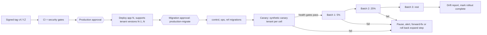

# Phase 2H: Infrastructure and DevOps

| | |
|---|---|
| Status | Draft for the design authority (Phase 2). Documents only. |
| Date | 2026-11-23 |
| Binding input | `00-spine.md`, ADR-001, `2A-architecture.md` |
| ADRs owned | ADR-004 (backup and restore), ADR-005 (hosting and jobs), ADR-009 (migration orchestration) |
| Pipeline baseline | `docs/security/PIPELINE.md`, `.github/workflows/{ci,security,deploy-staging,release}.yml` (unchanged by this design; new workflows below are **proposals** that need the owner's explicit approval, because `.github/workflows/` is protected) |
| Price note | Every price is an assumption with a source or *(verify)*. Web fetch of vendor pages was blocked in this session; figures come from search summaries of vendor pages and must be re-checked before any commercial use. |

---

## H-1. Account, project and region structure

| ID | Provider | Unit | Purpose | Region | Notes |
|---|---|---|---|---|---|
| H-AC-01 | Supabase | Organisation **prod** | Production `cp`, `c1`, later `c2..cN`, dedicated `d-<tkey>` | Frankfurt (eu-central-1) today (`docs/guides/SUPABASE.md`) | Two members only (R-A, R-B), MFA enforced; Pro now, Team when SOC 2 report, dashboard SSO or PrivateLink is needed *(verify plan features)* |
| H-AC-02 | Supabase | Organisation **nonprod** | Staging `cp-stg`, `c1-stg`, `c2-stg` (two cells so cross-cell routing and relocation are tested) | Same region | Spend cap on; smallest compute |
| H-AC-03 | Supabase CLI (local) | Docker on developer machines and CI | Dev and ephemeral CI databases | n/a | No cloud cost; synthetic seed only |
| H-AC-04 | Vercel | One team; projects **web-staging** and **web-prod** | API, web, worker endpoints | Function region fra1 (next to the database) | Separate projects keep production secrets out of staging; Git auto-deploy stays off (`vercel.json`) |
| H-AC-05 | Cloud provider for KMS, scanner and off-site copies (AWS recommended as the example; any equivalent satisfying ADR-003 works, A-19) | Organisation with accounts: `mgmt` (billing, Terraform state), `kms-prod`, `kms-nonprod`, `workloads-prod` (scanner), `workloads-nonprod`, `offsite-prod` | Key plane, scanner host, off-site backup | KMS in the home region with multi-Region replica keys in the DR region *(verify)*; off-site bucket in a **different** region | `kms-*` and `offsite-*` are separate accounts so that keys never sit with the backups they protect (S7) |
| H-AC-06 | GitHub | Repository environments `staging`, `production`, plus proposed `production-migrate`, `fleet-ops`, `infra` | Deploy, migrate, privileged fleet operations, Terraform apply | n/a | Each environment has its own secrets and required reviewers |
| H-AC-07 | Email provider | One account, two streams (transactional, auth) | H-9 | EU data region if offered *(verify)* | |
| H-AC-08 | Observability SaaS | Error tracking, logs and metrics, uptime and paging | H-7 | EU region if offered *(verify)* | Subprocessors to list in the DPA (2G) |

## H-2. Network segmentation and private connectivity

| ID | Path | Launch control | Later control | Vendor facts |
|---|---|---|---|---|
| H-NW-01 | Vercel to Supabase pooler | TLS with the Supabase CA pinned (`DATABASE_CA_CERT`, as `db.ts` does today), SCRAM, 64-hex passwords, two rotating router logins | Vercel **Static IPs** (about USD 100 per project per month *(source 8, verify)*) plus Supabase **network restrictions** allowing only those IPs | Network restrictions limit IP ranges for Postgres and the pooler; IPv4 and IPv6 ranges both needed if direct connections resolve to IPv6 *(source 5)* |
| H-NW-02 | GitHub Actions migrator and fleet-ops to Supabase | Session pooler port 5432 (IPv4) *(source 4)*; credentials only in the environment | The job adds its own egress IP as a /32 through the Management API at start and removes it at the end *(verify API support)* | |
| H-NW-03 | Scanner (in `workloads-prod`) to Storage | Pulls one object by a signed URL; no inbound ports; egress only to Storage, the worker endpoint and signature updates | Supabase **PrivateLink** for database paths from AWS (beta, Team plan or above, same-region VPC, database ports only; Storage, Auth and API stay public *(source 5)*) | Not usable from Vercel functions |
| H-NW-04 | Vercel to KMS | Vercel OIDC federation to a narrowly scoped IAM role per environment; no long-lived cloud keys *(verify Vercel OIDC federation)* | Key policy conditions on the federated role and source | |
| H-NW-05 | pg_cron to worker | `pg_net` HTTPS POST with an HMAC header (secret in Supabase Vault), timestamp and nonce; the worker rejects older than 60 s | Static IP allowlist on the worker route | |
| H-NW-06 | Data API exposure | Data API disabled or no schemas exposed on every project (A-17) | | |
| H-NW-07 | Dashboard access | Supabase org MFA; dashboard SSO when on Team *(verify)* | | |

Residual: until H-NW-01 "later" is in place the pooler accepts connections from any IP with valid credentials (R-15).

## H-3. Infrastructure as code

| ID | Layer | Tool | Notes |
|---|---|---|---|
| H-IAC-01 | Supabase projects, settings, API keys | Terraform provider `supabase/supabase` (labelled Public Alpha *(source 7)*) for project settings; Supabase **Management API** scripts for what the provider lacks (network restrictions, PITR add-on, compute size, pooler settings) *(verify each endpoint)* | Pin the provider version; treat alpha drift as a risk (R-16) |
| H-IAC-02 | Database objects in `control`, `ops`, `ref` | Supabase CLI migrations (versioned SQL), applied by the migrator job | Replaces manual D6 |
| H-IAC-03 | Tenant schema template | Versioned tenant migrations applied per schema by the orchestrator (ADR-009); not through `supabase db push` | Catalog fingerprint per version is a build artefact |
| H-IAC-04 | Vercel projects, env var names, domains, function region | Terraform provider `vercel/vercel` *(verify)* | Secret values set by rotation jobs, never in state |
| H-IAC-05 | Cloud accounts, KMS keys for the platform, IAM, scanner service, off-site bucket with object lock | Terraform cloud provider | Per-tenant KEKs are created by the provisioning pipeline, not Terraform (thousands of resources, lifecycle tied to tenants) |
| H-IAC-06 | GitHub settings | Existing `.github/scripts/apply-settings.sh` | Unchanged |
| H-IAC-07 | DNS and email authentication records | Terraform DNS provider | H-9 |
| H-IAC-08 | State and drift | Remote state in `mgmt` (encrypted, locked, versioned); `terraform plan` weekly in CI, any drift alerts S3; apply only through environment `infra` with approval | |

Proposed repository path: `infra/` (Terraform) and `ops/migrations/{control,ops,ref,tenant}/`. Neither path is in the protected list; the new workflows are.

## H-4. Tenant provisioning pipeline

Runs as a job chain in the worker (Vercel) with state in `control.tenants` (`status`, `provisioning_step`, `provisioning_attempt`). Every step is idempotent (create-if-absent, verify-after), retried with backoff, and compensated on terminal failure.

| ID | Step | Mechanism | Idempotency key | Compensation |
|---|---|---|---|---|
| H-PV-01 | Gate | `control.platform_approvals` with two distinct approvers, neither the requester (or the standing trial policy, A-LC-02) | approval id | none |
| H-PV-02 | Allocate | Random 16-char base32 `tkey`, uniqueness checked in `control`; tenant row `Provisioning`; cell chosen (A-PH-04) | tenant id | mark `Failed` |
| H-PV-03 | Schema and roles | Worker calls `ops.provision_tenant(tkey, tenant_uuid)` on the cell: SECURITY DEFINER, owned by `tenant_admin` (CREATEROLE, not superuser), validates `tkey` against `^[a-z2-7]{16}$`, creates `t_<tkey>`, `t_<tkey>_rw`, `t_<tkey>_ro`, grants (own schema, `ref` SELECT), membership to `selvara_router`, tables at the current tenant version with the `tenant_id` CHECK and RLS | `tkey` | `ops.unprovision_tenant` only while status is `Provisioning` |
| H-PV-04 | Warm pool (optional path) | Each cell keeps 5 to 10 pre-built schemas (status `Pooled`), kept current by every rollout; claiming binds `tenant_id` (CHECK constraint rewritten) and the `tkey` already assigned | pool row | return to pool |
| H-PV-05 | Keys | Create KEK (KMS key, alias by `tkey`, tags: environment and `tkey` only), generate and wrap the first DEK, register ids and versions in `control.key_registry` (ADR-003 decides wrapped-DEK storage) | `tkey` + key purpose | schedule key deletion |
| H-PV-06 | Seed | A-LC-03 through the router as `t_<tkey>_rw` | seed version | truncate seed tables |
| H-PV-07 | Storage | Create `<tkey>/` prefix marker in `tenant-files`, `exports`; off-site prefix with object-lock retention | `tkey` | delete markers |
| H-PV-08 | Backups | Insert nightly export schedule in `ops`; first export runs within 1 h | `tkey` | delete schedule |
| H-PV-09 | Monitoring | Register in the fleet report; enterprise tenants get a dedicated synthetic probe | `tkey` | deregister |
| H-PV-10 | Health check | Router round trip as `_rw` and `_ro`; isolation probe: from `t_<tkey>_rw`, reading a canary tenant table must fail with a permission error; RLS probe with a wrong `app.tenant_id` returns zero rows | n/a | fail the run |
| H-PV-11 | Activate | Status `Active`; invite the first admin; platform audit entry with every step's evidence | tenant id | n/a |

Decommission drop (A-LC-08) does **not** run in Vercel: a proposed `fleet-ops.yml` workflow in environment `fleet-ops` (required reviewers) re-verifies the control-plane approval (two distinct approvers, not the requester, not expired) before dropping. Two independent gates, neither held by one person.

## H-5. Environments

| ID | Environment | Data | Infrastructure | Access |
|---|---|---|---|---|
| H-EN-01 | Dev | Synthetic seed generator (deterministic seed, `example.com` addresses, 3 tenants) | Local Supabase CLI, `NEXT_PUBLIC_API_MODE=http` against it, or the in-browser demo | Developer |
| H-EN-02 | CI (ephemeral) | Synthetic, created per job | Local Supabase in GitHub Actions; at least 3 tenant schemas for escape tests | Pipeline |
| H-EN-03 | Staging | Synthetic only; staging tenants older than 14 days auto-decommissioned | `nonprod` org: `cp-stg`, `c1-stg`, `c2-stg`; `web-staging`; `kms-nonprod` | R-A, R-B |
| H-EN-04 | Production | Customer data; synthetic canary tenants (one per cell) for probes and migration canaries | `prod` org; `web-prod`; `kms-prod` | Application only; humans via break-glass |
| H-EN-05 | Rule | **Production data is never copied down.** No restore of a production export into a non-production project; enforced by key policy (non-production roles cannot use `kms-prod` keys, so a copied export is unreadable) | | |

## H-6. CI/CD with security gates

### H-6.1 Kept as is (from `PIPELINE.md`)

Typecheck, lint, unit, build, `npm audit`, Playwright end-to-end; workflow policy; CodeQL; Gitleaks (full history); dependency review; licence policy; OSV (reported); Trivy; ZAP baseline; signed commits and signed tags; SBOM, build-provenance attestation, optional Sigstore signature; production approval with wait timer; header smoke test.

### H-6.2 Added gates

| ID | Gate | Blocks | Where |
|---|---|---|---|
| H-CI-01 | Migration lint: no `SET` outside `LOCAL`, no table rewrite without an expand/contract plan, `lock_timeout` declared, no `DROP` in an expand migration, no grants to `PUBLIC`, `SECURITY DEFINER` functions pin `search_path` | merge | `ci.yml` (approval needed) |
| H-CI-02 | Isolation and escape suite against local Supabase with 3 tenants: API-level cross-tenant attempts, `SET ROLE` to another tenant from `t_<tkey>_rw`, `search_path` injection, schema-qualified names, `ref` write attempt, `ops.emit` spoofing | merge, deploy | `ci.yml` |
| H-CI-03 | Router lint: only `router` imports the cell pool or issues `SET ROLE`; `pg` `name` option banned | merge | ESLint |
| H-CI-04 | Version-window contract test: the build passes the API contract suite against tenant schemas at `N-1` and `N` | merge | `ci.yml` |
| H-CI-05 | Catalog fingerprint for tenant version `N` generated, attested with the build | release | deploy action |
| H-CI-06 | Terraform `plan` with policy checks (no public buckets, no wildcard IAM, KMS deletion window at its maximum) | merge of `infra/` | proposed `infra.yml` |

### H-6.3 Release and migration flow

| ID | Rule |
|---|---|
| H-CI-10 | Order: app first (window `[N-1, N]`), then migrations; **contract** steps (drops, renames) only in a later release once every tenant reports `N` (ADR-009). |
| H-CI-11 | Concurrency: 4 schemas at a time per cell; one transaction per schema; `lock_timeout 3s`, up to 5 retries; per-schema state in `control.tenant_schema_versions`. |
| H-CI-12 | Health gates between batches: API 5xx rate under 0.5%, p95 within 20% of baseline, zero schema-mismatch 503 for migrated tenants, migration failures 0 in canary and under 1% in a batch. |
| H-CI-13 | Pause: automatic on a failed gate; manual by either admin via a `pause` flag in `control`. Resume needs the same environment approval. |
| H-CI-14 | Rollback: forward-fix by default; an expand step may ship a tested `down` script that runs per schema in reverse order. A tenant whose migration failed stays at `N-1` (still inside the window) and is retried; a tenant outside the window is set to `Maintenance` (503) rather than served on an unknown schema. |
| H-CI-15 | Approvals: production deploy and production migration are separate environment approvals; with two maintainers, `prevent_self_review` is on (closes EX in `PIPELINE.md` "Sole-maintainer exception"). |

## H-7. Observability for a no-team operation

| ID | Signal | Source | Retention | Notes |
|---|---|---|---|---|
| H-OB-01 | Structured logs (`api.error`, `router.*`, `job.*`, `audit.*` pointers) | Vercel log drain to the log SaaS; Supabase logs via log drain *(verify plan)* or API pull | 30 days hot, 1 year archive (off-site, encrypted) | Fields: `request_id`, `tkey`, `cell`, route, status, latency; **no request bodies, no record content, no emails** |
| H-OB-02 | Errors | Error-tracking SaaS with server-side scrubbing (deny-list plus allow-list of fields) | 90 days | Tenant tagged by `tkey` only |
| H-OB-03 | Metrics | Supabase Prometheus-compatible metrics endpoint scraped per project *(verify)*; app metrics per cell (not per tenant, to keep cardinality bounded) | 13 months | Per-tenant numbers come from the fleet report (H-8) |
| H-OB-04 | Traces | OpenTelemetry spans for router, DB, KMS, storage, external calls; 10% sampling, 100% on errors | 14 days | |
| H-OB-05 | Uptime and synthetics | External probes every minute: `/api/health`, login page, a canary-tenant authenticated read per cell, public Trust Center canary, worker heartbeat (last tick under 3 min) | 13 months | |
| H-OB-06 | Security signals | Platform audit log events (elevation, break-glass, approvals, key schedule-deletion via cloud audit trail), WAF/rate-limit spikes, repeated routing failures | per 2F | Routed as S1 |

Alert routing (two people, no rota of a team):

| ID | Severity | Examples | Route | Auto-action |
|---|---|---|---|---|
| H-AL-01 | S1 page | API down, cell unreachable, routing-failure spike, isolation probe failure, KMS key scheduled for deletion outside a certificate flow, break-glass used, backup export failed twice for a tenant | Push and phone to both R-A and R-B; acknowledgement within 15 min, escalates to the other after 15 min | Isolation probe failure sets all tenants of the cell to `Maintenance` (fail closed) |
| H-AL-02 | S2 same day | Migration paused, queue lag over 15 min, p95 breach 1 h, disk 75%, pooler clients 70%, drift detected | Chat channel plus email to both | Pause rollouts |
| H-AL-03 | S3 digest | Cost anomaly, cert expiry under 30 days, token expiry, dependency alerts, cell threshold at 80% | Daily digest | Open a tracking issue |

## H-8. Fleet monitoring per tenant schema

Nightly job per cell, run as `fleet_observer` (statistics and catalog only, no table data), written to `control` as aggregates.

| ID | Measure | Query basis | Threshold / action |
|---|---|---|---|
| H-FL-01 | Schema size (tables, indexes, TOAST) | `pg_total_relation_size` summed by namespace | Over 10% of the cell, or over plan storage: notify; enterprise move proposal (A-PH-05) |
| H-FL-02 | Row estimates of the top 10 tables | `pg_class.reltuples` | Trend only |
| H-FL-03 | Slow queries per tenant | `pg_stat_statements` grouped by `userid` (tenant role), mean and p95 approximations, hourly sampling (A-CN-10) | Top 20 tenants by total time; S2 if one tenant takes over 25% of cell DB time |
| H-FL-04 | Schema version | `control.tenant_schema_versions` vs the schema's own version row | Mismatch outside window: `Maintenance`, S1 |
| H-FL-05 | Drift | Catalog fingerprint (columns, types, constraints, indexes, policies, grants, function definitions) vs the attested fingerprint for that version | Grants, RLS or function drift: tenant to `Maintenance` and S1 (security-relevant); index-only drift: S2 |
| H-FL-06 | Bloat and vacuum | `pg_stat_user_tables` dead tuples, last autovacuum | S3 |
| H-FL-07 | Journal and audit integrity | Hash-chain verify of `audit_log_entry` sample; `record_history` gap check | S1 on break |
| H-FL-08 | Backup freshness | Last successful export per tenant | Over 26 h: S2; over 50 h: S1 |
| H-FL-09 | Cell totals | Schemas, `pg_class` rows, DB size, connections | Feeds the cell threshold (A-PH-03) |

## H-9. Backup, single-tenant restore and DR (S7, ADR-004)

### H-9.1 Backup layers

| ID | Layer | Scope | Frequency | Retention | Encryption | Location |
|---|---|---|---|---|---|---|
| H-BK-01 | Supabase PITR | Whole project (`cp`, each cell) | Continuous WAL *(verify interval)* | 7 days shared cells and `cp`; 14 or 28 days dedicated | Provider at rest | Supabase |
| H-BK-02 | Supabase daily backups | Whole project | Daily | Per plan (7 days on Pro *(verify)*) | Provider | Supabase |
| H-BK-03 | Change journal `record_history` | Every change per tenant | Every transaction | While the tenant is active | Encrypted fields stay encrypted | Tenant schema |
| H-BK-04 | Per-tenant logical export | Tenant schema (JSONL per table, version, fingerprint) + file manifest | Nightly (staggered, round-robin) | In `exports`: last 7; off-site: 35 daily, 12 monthly, 1 per year while active | Tenant DEK (envelope) | `exports` bucket and off-site bucket with object lock (compliance mode, 35 days) |
| H-BK-05 | Files | Encrypted objects | On upload (incremental copy by the export job) | While active; deleted on decommission | Tenant DEK | `tenant-files` and off-site |
| H-BK-06 | Control plane logical export | `control` schema | Hourly | 35 days off-site | Platform key in `kms-prod` | Off-site |

Off-site object lock and crypto-shredding: locked objects cannot be deleted before their lock expires, but they are encrypted with the tenant DEK, so KEK destruction makes them unreadable; the certificate states the lock-expiry date as the physical-deletion date.

### H-9.2 Single-tenant restore procedure

| ID | Step | Detail |
|---|---|---|
| H-RS-01 | Request and approve | Tenant admin (or platform, for incidents) requests a restore with a target time; four-eyes approval in `control.platform_approvals`; tenant informed of the write freeze |
| H-RS-02 | Freeze | Tenant to `Maintenance` (writes 503, reads optional read-only) |
| H-RS-03 | Choose path | **Path A** (cell intact, logical error): latest export before the target time + journal replay. **Path B** (journal also damaged or schema dropped): PITR of the cell **into a new scratch project** *(verify "restore to new project" availability)*, then logical export of `t_<tkey>` from the scratch project |
| H-RS-04 | Build | Create `t_<tkey>__r` at the export's schema version via `ops.provision_tenant` variant; load JSONL; migrate to the current version |
| H-RS-05 | Replay | Apply `record_history` entries after the export time up to the target time (Path A), using `after` images; entries keep their original actors and request ids |
| H-RS-06 | Verify | Row counts vs journal, `audit_log_entry` hash chain, `record_history` continuity, file manifest hashes, catalog fingerprint, isolation probe |
| H-RS-07 | Swap | One transaction: rename live schema to `t_<tkey>__old_<ts>`, rename restored to `t_<tkey>`; grants recreated for the renamed objects; routing epoch bumped |
| H-RS-08 | Release | Tenant to `Active`; restore recorded in both audit logs; old schema dropped after 7 days under four-eyes |
| H-RS-09 | Target | RTO 8 h shared, 4 h enterprise (A-NFR-15) |
| H-RS-10 | Drill | Quarterly automated drill on a synthetic canary tenant in staging and production; measured RTO and evidence stored |

### H-9.3 DR plan

| ID | Scenario | Response | RPO / RTO |
|---|---|---|---|
| H-DR-01 | Cell database corruption or loss | PITR restore of the cell (all its tenants) or restore to a new project and repoint `control.tenant_cells` | 5 min / 4 h |
| H-DR-02 | `cp` loss | PITR of `cp`; cells untouched; API fails closed (503) until `cp` is back | 5 min / 2 h |
| H-DR-03 | Region outage | IaC creates `cp` and cells in the DR region; `cp` from the hourly off-site export; tenants from nightly exports (priority: enterprise, then by plan); keys from KMS multi-Region replicas *(verify)* | 24 h / 72 h shared, 24 h enterprise |
| H-DR-04 | Supabase account compromise or deletion | As H-DR-03, from off-site object-locked copies in a separate cloud account | 24 h / 72 h |
| H-DR-05 | Vercel outage | Static status page on a separate host; no failover compute at launch (accepted) | n/a / provider |
| H-DR-06 | KMS key wrongly scheduled for deletion | Alert from the cloud audit trail (S1); cancel within the waiting period | 0 / 1 h |
| H-DR-07 | Scanner down | Uploads stay in `quarantine` (not downloadable); queue backlog drains on recovery | 0 / 4 h |

Annual DR exercise: H-DR-03 tabletop plus a partial rebuild of staging in the DR region.

## H-10. Email deliverability

| ID | Item | Setting |
|---|---|---|
| H-EM-01 | Sending domains | `mail.example.com` (product notifications), `auth.example.com` (Supabase Auth SMTP: sign-in, MFA, invites). Root domain does not send. |
| H-EM-02 | SPF | On each sending subdomain: provider include only, `-all`. Non-sending domains: `v=spf1 -all` and a null MX. |
| H-EM-03 | DKIM | 2048-bit keys via provider CNAMEs; rotate yearly; old selector kept 7 days |
| H-EM-04 | DMARC | Root: `p=reject; sp=reject` after ramp. Subdomains ramp `p=none` (2 weeks, aggregate reports) → `quarantine` → `reject`; alignment strict (`adkim=s; aspf=s`) once reports are clean |
| H-EM-05 | Transport | MTA-STS (enforce) and TLS-RPT for inbound mail domains |
| H-EM-06 | Streams | Separate transactional and auth streams; no marketing on these domains |
| H-EM-07 | Bounces and complaints | Provider webhooks (signature verified) to the worker; the provider's suppression list is authoritative; hard bounce suspends notifications for that person and shows a banner to the tenant admin |
| H-EM-08 | Content | Notifications carry record ref, title and a link; never confidential field content or attachments (keeps plaintext out of mail stores; ADR-003 condition 3) |
| H-EM-09 | Tenant branding | Display name may include the tenant name; From address stays on Selvara's domain; custom tenant sending domains are out of MVP scope |

## H-11. Cost model

### H-11.1 Price assumptions

| ID | Item | Price used | Source |
|---|---|---|---|
| H-P-01 | Supabase Pro organisation | USD 25 per month, includes USD 10 compute credit | Supabase pricing (source 2) |
| H-P-02 | Supabase Team organisation | USD 599 per month | Supabase pricing (source 2) |
| H-P-03 | Compute per project | Micro 10, Small 15, Medium 60, Large 110 per month; XL 210, 2XL 410 *(verify)* | Supabase pricing / Compute docs (sources 1, 2) |
| H-P-04 | PITR add-on per project | 7 days 100, 14 days 200, 28 days 400 per month; may require Small compute or above *(verify)* | Supabase changelog "hourly usage-based billing for IPv4, custom domain and PITR" (source 9) |
| H-P-05 | Database disk | 8 GB included per project; 0.125 per GB-month over *(verify; third-party figure)* | Supabase pricing (source 2) |
| H-P-06 | Storage | 100 GB included; about 0.021 per GB-month over *(verify)* | *(verify)* |
| H-P-07 | Egress | 250 GB included; about 0.09 per GB over *(verify)* | Supabase pricing (source 2), third-party rate |
| H-P-08 | Auth MAU | 100,000 included, then 0.00325 per MAU; SSO MAU 50 included, then 0.015 *(verify on Pro)* | Supabase pricing and "Manage Monthly Active SSO Users usage" (source 10) |
| H-P-09 | Vercel Pro | USD 20 per member per month, includes USD 20 usage credit *(verify seats)* | Vercel pricing (source 8) |
| H-P-10 | Vercel Static IPs | USD 100 per project per month *(verify)* | Vercel Pro plan docs (source 8) |
| H-P-11 | KMS | USD 1 per customer-managed key per month; 0.03 per 10,000 symmetric requests after 20,000 free | AWS KMS pricing (source 11) |
| H-P-12 | Scanner container | about USD 35 per month (1 vCPU, 2 GB, always on) *(verify)* | *(verify)* |
| H-P-13 | Off-site object storage | about USD 0.0125 to 0.023 per GB-month (infrequent vs standard tier) *(verify)* | *(verify)* |
| H-P-14 | Observability (errors, logs, uptime, paging) | 60 / 100 / 300 per month at 10 / 100 / 1,000 tenants *(verify)* | *(verify)* |
| H-P-15 | Email provider | 20 / 40 / 150 per month *(verify)* | *(verify)* |
| H-P-16 | GitHub Team | USD 4 per user per month *(verify)* | *(verify)* |

Usage assumptions: 25 members per tenant, 10% of members on SSO, database 0.3 GB and files 2 GB per tenant (A-18 upper bound is higher; this is the mean), 3 GB egress per tenant per month, export footprint off-site about 16 GB per tenant (A-21).

### H-11.2 Monthly cost (USD, production plus staging)

| ID | Line | 10 tenants | 100 tenants | 1,000 tenants |
|---|---|---|---|---|
| H-C-01 | Supabase plan (prod) | 25 (Pro) | 25 (Pro) | 599 (Team) |
| H-C-02 | Compute, net of credit | `cp` Small + `c1` Small = 20 | `cp` Small + `c1` Large = 115 | `cp` Medium + 4 cells Large = 490 |
| H-C-03 | PITR 7 days | 200 (2 projects) | 200 | 500 (5 projects) |
| H-C-04 | Disk, storage, egress overage | 0 | about 15 | about 370 |
| H-C-05 | SSO MAU | 0 | about 7 | about 75 |
| H-C-06 | Staging (`nonprod` Pro + 3 Micro, net) | 45 | 45 | 60 |
| H-C-07 | Vercel (2 seats + usage) | 40 | 90 | 340 |
| H-C-08 | Vercel Static IPs (H-NW-01 later) | 0 | 0 | 100 |
| H-C-09 | KMS (one KEK per tenant + platform keys + requests) | 15 | 110 | 1,040 |
| H-C-10 | Scanner | 35 | 35 | 70 |
| H-C-11 | Off-site copies | 4 | 37 | 200 |
| H-C-12 | Observability | 60 | 100 | 300 |
| H-C-13 | Email | 20 | 40 | 150 |
| H-C-14 | GitHub, DNS | 10 | 10 | 10 |
| H-C-15 | **Total per month** | **about 474** | **about 829** | **about 4,304** |
| H-C-16 | **Per tenant per month** | **about 47** | **about 8.3** | **about 4.3** |

| ID | Unit | Cost | Note |
|---|---|---|---|
| H-C-20 | Marginal cost of one more shared tenant at scale | about USD 2.5 to 3.5 per month | KMS key 1.0, compute and PITR share about 0.7, storage and egress about 0.5, off-site about 0.2, the rest telemetry and email |
| H-C-21 | Dedicated cell (enterprise) | about USD 230 to 450 per month before support | Small to Large compute, PITR 14 days (200), disk; PrivateLink needs Team (already paid at scale) |
| H-C-22 | Trial tenant (30 days) | about USD 1.5 | Mostly the KMS key; deleted keys stop billing once deleted *(verify billing during the waiting period)* |
| H-C-23 | Cost lever (decision for 2F/2G) | KMS becomes about 24% of cost at 1,000 tenants | A per-cell KMS key wrapping per-tenant KEKs held in a separate short-retention key store would cut this, at the cost of moving shredding evidence from KMS to that store |

### H-11.3 Cost controls per environment

| ID | Environment | Control |
|---|---|---|
| H-CC-01 | Dev / CI | Local Supabase only; no cloud databases per branch; Vercel preview deployments off (Git deploys disabled already) |
| H-CC-02 | Staging | Supabase spend cap on; Micro compute; no PITR; staging tenants auto-decommissioned after 14 days; KMS keys in `kms-nonprod` scheduled for deletion with the tenant |
| H-CC-03 | Production | Spend cap off (it would stop service) with billing alerts at 80% and 100% of the monthly budget per provider; cloud budgets with anomaly alerts; Vercel spend management alert *(verify)* |
| H-CC-04 | Product | Trials limited (5 members, 1 GB files, 30 days, auto-decommission); plan limits on storage, API calls and users enforced on the server; AI off by default with provider costs passed through; log sampling and retention caps |

### H-11.4 Pricing-plan implications (for 2I)

| ID | Implication |
|---|---|
| H-PR-01 | Fixed platform cost is about USD 470 per month before the first customer; break-even needs roughly 5 to 10 paying tenants at an entry price of USD 50 to 100 per month. |
| H-PR-02 | Entry plan floor: at least 5 times the marginal cost (H-C-20), so USD 15 to 20 per tenant per month is the lowest sensible price; per-seat pricing scales with SSO MAU and email volume. |
| H-PR-03 | Storage overage must be priced per GB at several times provider cost, because files dominate storage and off-site copies multiply it (16 GB off-site per 2 GB of files plus exports). |
| H-PR-04 | Enterprise with a dedicated cell needs a floor of about USD 500 per month in infrastructure alone before support and margin; longer PITR windows are a priced option. |
| H-PR-05 | BYOK: the customer's KMS bills the customer; Selvara's KMS line falls for those tenants. |

---

## Deliverables

| ID | Deliverable | Location |
|---|---|---|
| H-DL-01 | This document | `p2/2H-infrastructure.md` |
| H-DL-02 | ADR-004 Backup and restore | `p2/adr/ADR-004-backup-and-restore.md` |
| H-DL-03 | ADR-005 Hosting and jobs | `p2/adr/ADR-005-hosting-and-jobs.md` |
| H-DL-04 | ADR-009 Migration orchestration | `p2/adr/ADR-009-migration-orchestration.md` |
| H-DL-05 | Proposed workflows (owner approval needed): `migrate.yml`, `fleet-ops.yml`, `infra.yml`; additions to `ci.yml` (H-CI-01..04) | Phase 5 |

## Decisions required

| ID | Decision | ADR | Who |
|---|---|---|---|
| H-DR-A | Per-tenant export + journal + PITR for DR; restore paths A and B | ADR-004 | Owner |
| H-DR-B | Vercel API and workers, pgmq + pg_cron, one scanner container | ADR-005 | Owner |
| H-DR-C | Orchestrated, batched, version-windowed migrations from GitHub Actions | ADR-009 | Owner |
| H-DR-D | AWS (or equivalent) accounts for KMS, scanner and off-site backup (A-19) | ADR-003 / ADR-005 | Owner |
| H-DR-E | PITR on from the first paying tenant (about USD 200 per month) | ADR-004 | Owner |
| H-DR-F | Approval to add the proposed workflows to `.github/workflows/` in Phase 5 | n/a | Owner |

## Open risks

| ID | Risk | L | I | Treatment |
|---|---|---|---|---|
| R-15 | Pooler reachable from any IP until Vercel Static IPs and network restrictions are in place | Medium | High | Strong rotated credentials and CA-pinned TLS now; Static IPs + allowlist at the first regulated customer or 100 tenants |
| R-16 | Supabase Terraform provider is alpha and Queues maturity is uncertain; IaC and jobs depend on them | Medium | Medium | Pin versions; Management API scripts as fallback; ADR-005 fallback (worker polling a plain `ops.job` table) |
| R-17 | Region loss gives a 24 h RPO; some regulated buyers will ask for less | Medium | High | Hourly `cp` export now; enterprise option for more frequent exports or a warm standby cell later |
| R-18 | Vercel function duration limits (300 s default, up to 800 s on Pro *(source 8)*) break long exports or restores | Medium | Medium | Chunked, resumable jobs via queue continuation; large restores run in `fleet-ops` on GitHub runners |
| R-19 | Cost per tenant at small scale (about USD 47 at 10 tenants) outruns early revenue | High | Medium | PITR only from the first paying tenant; staging on Micro; pricing floor H-PR-01 |

## New assumptions

| ID | Assumption | Validate by |
|---|---|---|
| A-19 | A cloud account (AWS or equivalent) is acceptable for KMS, the scanner and off-site copies, despite Q-11 "cloud not chosen" | Owner |
| A-20 | Supabase can restore a PITR point into a new project, enabling single-tenant restore path B | Supabase documentation |
| A-21 | Off-site footprint is about 16 GB per tenant under the H-BK-04 retention scheme | Telemetry |
| A-22 | The Management API can change network restrictions per job run | Supabase documentation |
| A-23 | KMS multi-Region replica keys are available in the chosen DR region and are covered by the crypto-shredding procedure | Provider documentation, 2F |
| A-24 | Two people can acknowledge an S1 page within 15 minutes around the clock, or the owner accepts a business-hours target | Owner |

## Spine deviations

| ID | Spine item | Deviation | Reason |
|---|---|---|---|
| SD-H1 | S1 Hosting "one small managed container does malware scanning" | Adds GitHub Actions as a privileged runner for migrations, decommission drops and large restores (not a container) | Keeps CREATEROLE/DROP-level credentials out of the always-on Vercel runtime and behind environment approval |
| SD-H2 | S1 bucket `exports` | Exports are also copied to an off-site object-locked bucket in a separate cloud account and region | Region loss and Supabase account compromise (H-DR-03, H-DR-04) |

## Sources

1. Supabase documentation, "Compute and Disk".
2. Supabase, "Predictable pricing" (pricing page).
3. Supabase documentation, "Disabling Prepared statements".
4. Supabase changelog, "Supabase Connection Pooler Deprecating Session Mode on Port 6543".
5. Supabase documentation, "PrivateLink" and "Network restrictions"; Supabase blog, "Supabase PrivateLink is now available".
6. Supabase, "Queues" feature page and documentation.
7. Supabase, "Terraform provider" feature page and Terraform reference.
8. Vercel, "Pricing" and "Pro plan" documentation.
9. Supabase changelog, "Moving to hourly usage-based billing for IPv4, Custom Domain and Point-in-time recovery"; Supabase docs "Manage Point-in-Time Recovery usage".
10. Supabase documentation, "Manage Monthly Active SSO Users usage".
11. AWS, "AWS Key Management Service pricing".
