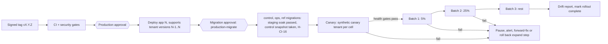

# Phase 2H: Infrastructure and DevOps

| | |
|---|---|
| Status | Draft for the design authority (Phase 2). Documents only. |
| Date | 2026-11-23; revised 2026-11-24 for the Phase 4 findings (rev P4) |
| Binding input | `00-spine.md` (spine v2), ADR-001, `2A-architecture.md`, design-authority rulings DA-01 to DA-15 (rev P3); Phase 4 shared specifications KS-SNAP, ISO-HARD, FINAL-EXPORT and SLA-U (rev P4) |
| ADRs owned | ADR-004 (backup and restore), ADR-005 (hosting and jobs), ADR-009 (migration orchestration) |
| Pipeline baseline | `docs/security/PIPELINE.md`, `.github/workflows/{ci,security,deploy-staging,release}.yml` (unchanged by this design; new workflows below are **proposals** that need the owner's explicit approval, because `.github/workflows/` is protected) |
| Price note | Every price is an assumption with a source or *(verify)*. Web fetch of vendor pages was blocked in this session; figures come from search summaries of vendor pages and must be re-checked before any commercial use. |

---

## H-1. Account, project and region structure

| ID | Provider | Unit | Purpose | Region | Notes |
|---|---|---|---|---|---|
| H-AC-01 | Supabase | Organisation **prod** | Production `cp`, `c1`, `ks` (key store) and its DR-region standby, later `c2..cN`, dedicated `d-<tkey>` (rev P3) | Frankfurt (eu-central-1) today (`docs/guides/SUPABASE.md`) | Two members only (R-A, R-B), MFA enforced; Pro now, Team when SOC 2 report, dashboard SSO or PrivateLink is needed *(verify plan features)* |
| H-AC-02 | Supabase | Organisation **nonprod** | Staging `cp-stg`, `c1-stg`, `c2-stg` (two cells so cross-cell routing and relocation are tested), `ks-stg` (rev P3) | Same region | Spend cap on; smallest compute |
| H-AC-03 | Supabase CLI (local) | Docker on developer machines and CI | Dev and ephemeral CI databases | n/a | No cloud cost; synthetic seed only |
| H-AC-04 | Vercel | One team; projects **app-staging**, **app-prod** (web, tenant API, account API, SCIM, public endpoints, provider hooks, worker endpoints) and **console-staging**, **console-prod** (platform API and Admin Console, own hostname) | `app` and `console` (R2-03) | Function region fra1 (next to the database) | Platform-write credentials (`cp_rw`) exist only in `console-*` (2F F-D-03, R2-03); `app-*` holds only `cp_router_ro`, `cp_tenant_api`, the router logins and `ks_rw`. Separate projects keep production secrets out of staging; Git auto-deploy stays off (`vercel.json`) (rev P3) |
| H-AC-05 | Cloud provider for KMS, scanner and off-site copies (AWS recommended as the example; any equivalent satisfying ADR-003 works, A-19) | Organisation with accounts: `mgmt` (billing, Terraform state), `kms-prod`, `kms-nonprod`, `workloads-prod` (scanner), `workloads-nonprod`, `offsite-prod` | Key plane, scanner host, off-site backup | KMS in the home region `R1` (Frankfurt). The DR region is pinned to an EU region other than `R1` (for example Ireland or Paris *(verify KMS and Supabase availability)*), for the `ks` standby, the KMS DR keys and the DR rebuild; the off-site bucket is in a second EU region, also not `R1`. Per tenant KEK: a multi-Region replica in the DR region if VC-14 holds, otherwise an independent second KEK in the DR region wrapping the same DEKs (H-9.4, ADR-004) (rev P4) | `kms-*` and `offsite-*` are separate accounts so that keys never sit with the backups they protect (S7). `offsite-prod` also holds the KS-SNAP bucket and its own off-site KEK (H-BK-08); its account root and administrators are separate from `kms-prod`, and it belongs to a provider organisation other than Supabase (rev P4) |
| H-AC-06 | GitHub | Repository environments `staging`, `production`, plus proposed `production-migrate`, `fleet-ops`, `infra` | Deploy, migrate, privileged fleet operations, Terraform apply | n/a | Each environment has its own secrets and required reviewers |
| H-AC-07 | Email provider | One account, two streams (transactional, auth) | H-9 | EU data region if offered *(verify)* | |
| H-AC-08 | Observability SaaS | Error tracking, logs and metrics, uptime and paging | H-7 | EU region if offered *(verify)* | Subprocessors to list in the DPA (2G) |

## H-2. Network segmentation and private connectivity

| ID | Path | Launch control | Later control | Vendor facts |
|---|---|---|---|---|
| H-NW-01 | Vercel to Supabase pooler | TLS with the Supabase CA pinned (`DATABASE_CA_CERT`, as `db.ts` does today), SCRAM, 64-hex passwords, two rotating router logins | Vercel **Static IPs** (about USD 100 per project per month *(source 8, verify)*; two production projects, `app` and `console`) plus Supabase **network restrictions** allowing only those IPs; owner decision DU-34 proposes this before the first external tenant (rev P3). **Recommended as a launch gate** (P4-A1-14): Static IPs on both production projects and network restrictions on `cp`, every cell and `ks` before the first external tenant; costed from launch in H-C-08 and H-C-20a (rev P4) | Network restrictions limit IP ranges for Postgres and the pooler; IPv4 and IPv6 ranges both needed if direct connections resolve to IPv6 *(source 5)* |
| H-NW-02 | GitHub Actions migrator and fleet-ops to Supabase | Session pooler port 5432 (IPv4) *(source 4)*; credentials only in the environment | The job adds its own egress IP as a /32 through the Management API at start and removes it at the end *(verify API support)* | |
| H-NW-03 | Scanner (in `workloads-prod`) to Storage | Pulls one object by a signed URL; no inbound ports; egress only to Storage, the worker endpoint and signature updates | Supabase **PrivateLink** for database paths from AWS (beta, Team plan or above, same-region VPC, database ports only; Storage, Auth and API stay public *(source 5)*) | Not usable from Vercel functions |
| H-NW-04 | Vercel to KMS | Vercel OIDC federation to a narrowly scoped IAM role per environment; no long-lived cloud keys *(verify Vercel OIDC federation)*. From launch (ISO-HARD a): every decrypt of a tenant KEK goes through a grant or key-policy condition bound to the encryption context `tkey`, and only the router requests it, with the routed tenant's `tkey`; a DEK unwrapped for one tenant cannot be used for another (AAD and cache keyed by `tkey`). The cloud audit trail feeds the tenant-mismatch detector (H-AL-01) (rev P4) | Key policy conditions on the federated role and source | *(verify grant and encryption-context conditions, VC-21)*; fallback: per-tenant key policy statement with the `tkey` context condition |
| H-NW-05 | pg_cron to worker | `pg_net` HTTPS POST with an HMAC header (secret in Supabase Vault), timestamp and nonce; the worker rejects older than 60 s | Static IP allowlist on the worker route | |
| H-NW-06 | Data API exposure | Data API disabled or no schemas exposed on every project (A-17) | | |
| H-NW-07 | Dashboard access | Supabase org MFA; dashboard SSO when on Team *(verify)* | | |
| H-NW-08 | Outbound calls from `app` functions and the worker (webhooks M18, integrations M17, AI providers M19, email, payment, KMS) | Egress design (DA-15): every outbound URL is resolved by DNS before the call and refused unless every resolved address is public (no loopback, link-local, RFC 1918, unique-local, metadata or Supabase/Vercel internal ranges); the connection is pinned to the checked address; no redirects; 10 s timeout; response size cap (2C C-88). Provider hosts (AI, email, payment, KMS) are allow-listed per adapter in `control.provider_configs`; tenant webhook and integration targets are tenant-supplied but pass the same public-address check, and only `https` on port 443 is allowed | Fixed egress IPs through Vercel Secure Compute or an egress proxy in `workloads-prod` that enforces the allow-list at the network layer *(verify availability)* | Vercel functions have no fixed egress by default *(verify)* (rev P3) |

Residual: until H-NW-01 "later" is in place the pooler accepts connections from any IP with valid credentials (R-15).

## H-3. Infrastructure as code

| ID | Layer | Tool | Notes |
|---|---|---|---|
| H-IAC-01 | Supabase projects, settings, API keys | Terraform provider `supabase/supabase` (labelled Public Alpha *(source 7)*) for project settings; Supabase **Management API** scripts for what the provider lacks (network restrictions, PITR add-on, compute size, pooler settings) *(verify each endpoint)* | Pin the provider version; treat alpha drift as a risk (R-16) |
| H-IAC-02 | Database objects in `control`, `ops`, `ref` | Supabase CLI migrations (versioned SQL), applied by the migrator job | Replaces manual D6 |
| H-IAC-03 | Tenant schema template | Versioned tenant migrations applied per schema by the orchestrator (ADR-009); not through `supabase db push` | Catalog fingerprint per version is a build artefact |
| H-IAC-04 | Vercel projects, env var names, domains, function region | Terraform provider `vercel/vercel` *(verify)* | Secret values set by rotation jobs, never in state |
| H-IAC-05 | Cloud accounts, KMS keys for the platform, IAM, scanner service, off-site bucket with object lock | Terraform cloud provider | Per-tenant KEKs are created by the provisioning pipeline, not Terraform (thousands of resources, lifecycle tied to tenants) |
| H-IAC-06 | GitHub settings | Existing `.github/scripts/apply-settings.sh` | Unchanged |
| H-IAC-07 | DNS and email authentication records | Terraform DNS provider | H-9 |
| H-IAC-08 | State and drift | Remote state in `mgmt` (encrypted, locked, versioned); `terraform plan` weekly in CI, any drift alerts S3; apply only through environment `infra` with approval | |

Proposed repository path: `infra/` (Terraform) and `ops/migrations/{control,ops,ref,tenant}/`. Neither path is in the protected list; the new workflows are.

## H-4. Tenant provisioning pipeline

Runs as a job chain in the worker (Vercel) with state in `control.tenants` (`status`, `provisioning_step`, `provisioning_attempt`). Every step is idempotent (create-if-absent, verify-after), retried with backoff, and compensated on terminal failure.

| ID | Step | Mechanism | Idempotency key | Compensation |
|---|---|---|---|---|
| H-PV-01 | Gate | `control.platform_approvals` with two distinct approvers, neither the requester (or the standing trial policy, A-LC-02) | approval id | none |
| H-PV-02 | Allocate | Random 16-char base32 `tkey`, uniqueness checked in `control`; tenant row `Provisioning`; cell chosen (A-PH-04) | tenant id | mark `Failed` |
| H-PV-03 | Schema and roles | Worker calls `ops.provision_tenant(tkey, tenant_uuid)` on the cell: SECURITY DEFINER, owned by `tenant_admin` (CREATEROLE, not superuser), validates `tkey` against `^[a-z2-7]{16}$`, creates `t_<tkey>`, `t_<tkey>_rw`, `t_<tkey>_ro`, grants (own schema, `ref` SELECT), membership to `selvara_router`, tables at the current tenant version with the `tenant_id` CHECK and RLS | `tkey` | `ops.unprovision_tenant` only while status is `Provisioning` |
| H-PV-04 | Warm pool (optional path) | Each cell keeps 5 to 10 pre-built schemas (status `Pooled`), kept current by every rollout; claiming binds `tenant_id` (CHECK constraint rewritten) and the `tkey` already assigned | pool row | return to pool |
| H-PV-05 | Keys | Create KEK (KMS key, alias by `tkey`, tags: environment and `tkey` only) and its DR-region copy: the multi-Region replica, or under the VC-14 fallback an independent second KEK in the DR region, with the DEK wrapped by both (H-VF-02) (rev P4); generate and wrap the first DEK and store it in `ks.tenant_dek` (ADR-003); register ids and versions in `control.key_registry`; no key material in the tenant schema (DA-04) | `tkey` + key purpose | schedule key deletion (KEK and replica); delete the `ks` rows (rev P3) |
| H-PV-06 | Seed | A-LC-03 through the router as `t_<tkey>_rw` | seed version | truncate seed tables |
| H-PV-07 | Storage | Create `<tkey>/` prefix marker in `tenant-files`, `exports`; off-site prefix with object-lock retention | `tkey` | delete markers |
| H-PV-08 | Backups | Insert nightly export schedule in `ops`; first export runs within 1 h | `tkey` | delete schedule |
| H-PV-09 | Monitoring | Register in the fleet report; enterprise tenants get a dedicated synthetic probe | `tkey` | deregister |
| H-PV-10 | Health check | Router round trip as `_rw` and `_ro`; isolation probe: from `t_<tkey>_rw`, reading a canary tenant table must fail with a permission error; RLS probe with a wrong `app.tenant_id` returns zero rows | n/a | fail the run |
| H-PV-11 | Activate | Status `Active`; invite the first admin; platform audit entry with every step's evidence | tenant id | n/a |

Decommission drop (A-LC-08) does **not** run in Vercel: a proposed `fleet-ops.yml` workflow in environment `fleet-ops` (required reviewers) re-verifies the control-plane approval (two distinct approvers, not the requester, not expired) before dropping. Two independent gates, neither held by one person.

## H-5. Environments

| ID | Environment | Data | Infrastructure | Access |
|---|---|---|---|---|
| H-EN-01 | Dev | Synthetic seed generator (deterministic seed, `example.com` addresses, 3 tenants) | Local Supabase CLI, `NEXT_PUBLIC_API_MODE=http` against it, or the in-browser demo | Developer |
| H-EN-02 | CI (ephemeral) | Synthetic, created per job | Local Supabase in GitHub Actions; at least 3 tenant schemas for escape tests | Pipeline |
| H-EN-03 | Staging | Synthetic only; staging tenants older than 14 days auto-decommissioned | `nonprod` org: `cp-stg`, `c1-stg`, `c2-stg`, `ks-stg`; `app-staging`, `console-staging`; `kms-nonprod` (rev P3) | R-A, R-B |
| H-EN-04 | Production | Customer data; synthetic canary tenants (one per cell) for probes and migration canaries | `prod` org; `app-prod`, `console-prod`; `kms-prod` (rev P3) | Application only; humans via break-glass |
| H-EN-05 | Rule | **Production data is never copied down.** No restore of a production export into a non-production project; enforced by key policy (non-production roles cannot use `kms-prod` keys, so a copied export is unreadable) | | |

## H-6. CI/CD with security gates

### H-6.1 Kept as is (from `PIPELINE.md`)

Typecheck, lint, unit, build, `npm audit`, Playwright end-to-end; workflow policy; CodeQL; Gitleaks (full history); dependency review; licence policy; OSV (blocking from V2-R0 for High or Critical findings with a fix available; others reported) (rev P4); Trivy; ZAP baseline; signed commits and signed tags; SBOM, build-provenance attestation (turned on before the first production tenant, not deferred to GA) (rev P4), optional Sigstore signature; production approval with wait timer; header smoke test.

### H-6.2 Added gates

| ID | Gate | Blocks | Where |
|---|---|---|---|
| H-CI-01 | Migration lint: no `SET` outside `LOCAL`, no table rewrite without an expand/contract plan, `lock_timeout` declared, no `DROP` in an expand migration, no grants to `PUBLIC`, `SECURITY DEFINER` functions pin `search_path` | merge | `ci.yml` (approval needed) |
| H-CI-02 | Isolation and escape suite against local Supabase with 3 tenants: API-level cross-tenant attempts; R-56 controls (an injected `SET ROLE` inside a routed transaction **succeeds**, so the suite proves that no API input can reach SQL text, that handler SQL is extended-protocol only, and that the detector alerts on a direct `SET ROLE`; DA-02); `search_path` injection, schema-qualified names, `ref` write attempt, `ops.emit` spoofing | merge, deploy | `ci.yml` (rev P3) |
| H-CI-03 | Router lint: only `router` imports the cell pool or issues `SET ROLE`, `RESET ROLE`, `set_config('role'|'search_path'|'app.*')`; no simple-query multi-statement strings anywhere (router included); no string-built SQL outside `router` and migrations; `pg` `name` option banned (2A A-RT-10) | merge | ESLint and CodeQL (rev P3) |
| H-CI-04 | Version-window contract test: the build passes the API contract suite against tenant schemas at `N-1` and `N` | merge | `ci.yml` |
| H-CI-05 | Catalog fingerprint for tenant version `N` generated, attested with the build | release | deploy action |
| H-CI-06 | Terraform `plan` with policy checks (no public buckets, no wildcard IAM, KMS deletion window at its maximum, object lock in compliance mode on every off-site bucket including KS-SNAP, DR resources only in the pinned EU regions) | merge of `infra/` | `infra.yml` (proposed; **mandatory before any infrastructure goes live**, so no production resource is created outside it) (rev P4) |

### H-6.3 Release and migration flow

| ID | Rule |
|---|---|
| H-CI-10 | Order: app first (window `[N-1, N]`), then migrations; **contract** steps (drops, renames) only in a later release once every tenant reports `N` (ADR-009). |
| H-CI-11 | Concurrency: 4 schemas at a time per cell; one transaction per schema; `lock_timeout 3s`, up to 5 retries; per-schema state in `control.tenant_schema_versions`. |
| H-CI-12 | Health gates between batches: API 5xx rate under 0.5%, p95 within 20% of baseline, zero schema-mismatch 503 for migrated tenants, migration failures 0 in canary and under 1% in a batch. |
| H-CI-13 | Pause: automatic on a failed gate; manual by either admin via a `pause` flag in `control`. Resume needs the same environment approval. |
| H-CI-14 | Rollback: forward-fix by default, but every expand step ships a tested `down` script that runs per schema in reverse order, or carries an explicit `irreversible` label approved by the other approver; migration lint (H-CI-01) fails a step that has neither (rev P4). A tenant whose migration failed stays at `N-1` (still inside the window) and is retried; a tenant outside the window is set to `Maintenance` (503) rather than served on an unknown schema. |
| H-CI-15 | Approvals: production deploy and production migration are separate environment approvals; `prevent_self_review` is on **from launch** for `production`, `production-migrate`, `fleet-ops` and `infra`, and the approver must be the other named approver (R-A or R-B) or the contracted technical reviewer, never the release author (two approvers are confirmed, OQ-12). Any sole-maintainer exception is a dated, owner-accepted risk entry (closes EX in `PIPELINE.md` "Sole-maintainer exception") (rev P4). |
| H-CI-16 | Global tracks (`control`, `ops`, `ref`): each global migration soaks on staging for at least 24 h with the J-MIG suite green, a snapshot export of `control` is taken immediately before it runs in production, and it carries a documented rollback (tested `down` or restore from that snapshot). A `ref` change that alters tenant-visible content ships behind a version flag so tenants move in the same batches as tenant migrations (rev P4). |

## H-7. Observability for a no-team operation

| ID | Signal | Source | Retention | Notes |
|---|---|---|---|---|
| H-OB-01 | Structured logs (`api.error`, `router.*`, `job.*`, `audit.*` pointers) | Vercel log drain to the log SaaS; Supabase logs via log drain *(verify plan)* or API pull | 30 days hot, 1 year archive (off-site, encrypted) | Fields: `request_id`, `tkey`, `cell`, route, status, latency; **no request bodies, no record content, no emails** |
| H-OB-02 | Errors | Error-tracking SaaS with server-side scrubbing (deny-list plus allow-list of fields) | 90 days | Tenant tagged by `tkey` only |
| H-OB-03 | Metrics | Supabase Prometheus-compatible metrics endpoint scraped per project *(verify)*; app metrics per cell (not per tenant, to keep cardinality bounded) | 13 months | Per-tenant numbers come from the fleet report (H-8) |
| H-OB-04 | Traces | OpenTelemetry spans for router, DB, KMS, storage, external calls; 10% sampling, 100% on errors | 14 days | |
| H-OB-05 | Uptime and synthetics | External probes every minute from three locations: `/api/health`, login page, a canary-tenant authenticated read per cell, public Trust Center canary, worker heartbeat (last tick under 3 min); dependency probes for `cp`, `ks`, KMS and the `ks` standby lag (A-NFR-01) (rev P3) | 13 months (SLA evidence kept 6 years with billing records) (rev P4) | The SLA-U availability figure is computed from these probes by the method in 2J J-SLA (a minute is down when two of three locations fail the canary read or the login page); results feed the monthly SLA report and credits (2I I-4.6) (rev P4) |
| H-OB-06 | Security signals | Platform audit log events (elevation, break-glass, approvals, key schedule-deletion via cloud audit trail), WAF/rate-limit spikes, repeated routing failures | per 2F | Routed as S1 |

Alert routing (two people, no rota of a team):

| ID | Severity | Examples | Route | Auto-action |
|---|---|---|---|---|
| H-AL-01 | S1 page | API down, cell unreachable, routing-failure spike, isolation probe failure, KMS key scheduled for deletion outside a certificate flow, break-glass used, backup export failed twice for a tenant, tenant-mismatch detector hit (a KMS call whose encryption context differs from the routed tenant, ISO-HARD d), KS-SNAP older than 50 h or its object lock not in compliance mode for 8 days (H-FL-10), security-relevant drift on any project (H-FL-05) (rev P4) | Push and phone to both R-A and R-B; acknowledgement within 15 min, escalates to the other after 15 min | Isolation probe failure sets all tenants of the cell to `Maintenance` (fail closed) |
| H-AL-02 | S2 same day | Migration paused, queue lag over 15 min, p95 breach 1 h, disk 75%, pooler clients 70% on any project (cell, `cp`, `ks`; A-CN-07), `cp` read p95 above 5 ms (A-NFR-07a), `ks` standby lag or key-journal write failure, KS-SNAP run failed or older than 26 h (H-FL-10), index-only drift (rev P3, rev P4) | Chat channel plus email to both | Pause rollouts |
| H-AL-03 | S3 digest | Cost anomaly, cert expiry under 30 days, token expiry, dependency alerts, a cell at 0.8 × `T` or any CR-1 secondary trigger at 80% (provision ahead) (rev P3) | Daily digest | Open a tracking issue |

## H-8. Fleet monitoring per tenant schema

Nightly job per cell, run as `fleet_observer` (statistics and catalog only, no table data), written to `control` as aggregates.

| ID | Measure | Query basis | Threshold / action |
|---|---|---|---|
| H-FL-01 | Schema size (tables, indexes, TOAST) | `pg_total_relation_size` summed by namespace | Over 10% of the cell, or over plan storage: notify; enterprise move proposal (A-PH-05). Feeds the `db_bytes` meter (2I I-4.2.10, DA-13) (rev P3) |
| H-FL-02 | Row estimates of the top 10 tables | `pg_class.reltuples` | Trend only |
| H-FL-03 | Slow queries per tenant | `pg_stat_statements` grouped by `userid` (tenant role), mean and p95 approximations, hourly sampling (A-CN-10) | Top 20 tenants by total time; S2 if one tenant takes over 25% of cell DB time |
| H-FL-04 | Schema version | `control.tenant_schema_versions` vs the schema's own version row | Mismatch outside window: `Maintenance`, S1 |
| H-FL-05 | Drift | Catalog fingerprint (columns, types, constraints, indexes, policies, grants, function definitions) vs the attested fingerprint for that version, for every tenant schema **and** for the `cp`, `ks`, `ref` and `ops` catalogs, plus cluster roles, role attributes and memberships (`pg_roles`, `pg_auth_members`) on every project (rev P4) | Grants, RLS, function, role or membership drift: tenant (or the whole cell, for cluster-level drift) to `Maintenance` and S1 (security-relevant); index-only drift: S2 |
| H-FL-06 | Bloat and vacuum | `pg_stat_user_tables` dead tuples, last autovacuum | S3 |
| H-FL-07 | Journal and audit integrity | Hash-chain verify of `audit_log_entry` sample; `record_history` gap check | S1 on break |
| H-FL-08 | Backup freshness | Last successful export per tenant | Over 26 h: S2; over 50 h: S1 |
| H-FL-10 | KS-SNAP freshness and lock (rev P4) | Newest KS-SNAP object in `offsite-prod` (manifest time, journal high-water mark), its retention mode and retain-until date, and the daily restore-verify result (H-BK-08) | Older than 26 h or verify failed: S2; older than 50 h, retention not compliance mode, or retain-until not 8 days after write: S1 |
| H-FL-09 | Cell totals | Schemas (warm-pool, canary, trial and `__r`/`__old` restore schemas included), `pg_class` rows, DB size, connections, backend memory | Feeds the capacity rule CR-1 (A-PH-02, A-PH-03) (rev P3) |

## H-9. Backup, single-tenant restore and DR (S7, ADR-004)

### H-9.1 Backup layers

| ID | Layer | Scope | Frequency | Retention | Encryption | Location |
|---|---|---|---|---|---|---|
| H-BK-01 | Supabase PITR | Whole project (`cp`, each cell and `ks`) | Continuous WAL *(verify interval, VC-16)*. **Recommendation (DU-02, rev P4): enable PITR 7 days on `cp`, `c1` and `ks` at launch**, before the first external tenant, trial or paid *(verify plan tier, minimum compute and price, VC-08, VC-19)*. On `ks` the 7-day window stays inside the 8-day destruction bound | 7 days shared cells, `cp` and `ks`; 14 or 28 days dedicated | Provider at rest | Supabase (rev P3, rev P4) |
| H-BK-02 | Supabase daily backups | Whole project | Daily | Per plan (7 days on Pro *(verify)*) | Provider | Supabase |
| H-BK-03 | Change journal `record_history` | Every change per tenant | Every transaction | While the tenant is active | Encrypted fields stay encrypted | Tenant schema |
| H-BK-04 | Per-tenant logical export | Tenant schema (JSONL per table, version, fingerprint) + file manifest; the tenant DEK travels only wrapped by the KEK (escrow, F-K-02); no `ks` subject or file keys | Nightly, fixed slot per tenant (stable round-robin order), consecutive exports ≤ 26 h apart (rev P3) | In `exports`: last 7; off-site: 35 daily, 12 monthly, 1 per year while active | Tenant DEK (envelope) | `exports` bucket and off-site bucket with object lock (compliance mode, 35 days) |
| H-BK-05 | Files | Encrypted objects | On upload (incremental copy by the export job) | While active; deleted on decommission | Per-file key (F-K-04), wrapped by the tenant DEK and held in `ks.file_key` (rev P3) | `tenant-files` and off-site |
| H-BK-06 | Control plane logical export | `control` schema | Hourly | 35 days off-site | Platform KEK F-K-30 in `kms-prod` (personal fields already E1 under the platform DEK F-K-31) (rev P3) | Off-site |
| H-BK-07 | `ks` continuity (DA-11) | `ks` project: wrapped DEKs, subject, file and blind-index keys, wrapped platform DEK (F-K-31) | Daily provider backup and PITR 7 days (H-BK-01, rev P4); continuous standby (read replica) in the DR region *(verify Supabase cross-region replicas, VC-14 family)*; an append-only **key journal** of every `ks` insert and every deletion (as a tombstone), wrapped material only, written to `offsite-prod` within 5 min | Daily backups 7 days; journal objects under compliance object lock, each expiring **8 days** after it is written; standby live | Wrapped material only (already wrapped by the tenant DEK or the KEK) | Supabase `ks`; DR region; `offsite-prod`. `ks` is **never** included in H-BK-04 exports, the H-BK-06 `control` export or WORM segments; only the key journal and KS-SNAP (H-BK-08) leave `R1`. A destroyed key is unrecoverable from every copy no later than 8 days after its destruction (rev P3, rev P4) |
| H-BK-08 | **KS-SNAP** off-site `ks` snapshot (P4-A1-07) (rev P4) | Daily encrypted logical snapshot of `ks`: wrapped tenant DEKs (both wraps where H-9.4 VC-14 fallback applies), subject keys, file keys, blind-index keys, wrapped platform DEK and key metadata; wrapped material only | Daily at a fixed slot (03:00 UTC), plus on demand before a `ks` migration | Each object under compliance-mode object lock for **exactly 8 days**, then deleted by a lifecycle rule *(verify lifecycle deletion lag; if any, the certificate states 8 days plus that lag)* | Encrypted under the dedicated off-site KEK in the `offsite-prod` account's KMS (envelope; the snapshot job may only encrypt, decryption is granted only to the restore role under four-eyes) | Bucket `ks-snap` in `offsite-prod` (second EU region, provider organisation other than Supabase). Details in H-9.1a |

Off-site object lock and crypto-shredding: locked objects cannot be deleted before their lock expires, but they are encrypted with the tenant DEK, so destroying the KEK and its DR-region copy (multi-Region replica or second KEK, H-9.4) makes them unreadable; the certificate states the lock-expiry date as the physical-deletion date, and the `ks` roll-off date (≤ 8 days, covering the `ks` PITR window, daily backups, the key journal and KS-SNAP) for subject and file keys (rev P3, rev P4).

### H-9.1a KS-SNAP operation (S-1, closes P4-A1-07 operationally) (rev P4)

| ID | Item | Setting |
|---|---|---|
| H-KS-01 | Account and bucket | `offsite-prod` (H-AC-05), bucket `ks-snap`, created by Terraform with object lock enabled at creation, default retention compliance mode 8 days, versioning on, public access blocked, no replication out of the account. Staging uses `ks-snap-stg` in a non-production off-site account with the same settings. |
| H-KS-02 | Off-site KEK | A dedicated symmetric KMS key in `offsite-prod`, in the bucket's region, used for nothing else. Key policy: the snapshot role may `GenerateDataKey` only; the restore role may `Decrypt` only, and that role is assumable only from the `fleet-ops` environment after a four-eyes platform approval. The key is never scheduled for deletion while snapshots exist; deletion of this key is an S1 alert. |
| H-KS-03 | Writer | A proposed `fleet-ops` scheduled job (GitHub Actions, environment `fleet-ops`) or the worker container in `workloads-prod`, logged in to `ks` as `ks_snapshot` (SELECT on the `ks` key tables only, no access to tenant schemas or KMS keys of tenants). It writes through a write-only IAM role (`PutObject` only: no `GetObject`, `DeleteObject` or retention changes). |
| H-KS-04 | Format | One consistent read (`REPEATABLE READ`) of every `ks` table to JSONL, plus a manifest: row count per table, SHA-256 per part, `ks` schema version, the key-journal sequence high-water mark at snapshot time, generation time; the manifest is signed with the platform signing key. Parts are encrypted with a fresh data key from the off-site KEK. |
| H-KS-05 | Schedule | Daily at 03:00 UTC; a run retries three times within 2 h. A snapshot is also taken before any `ks` migration. |
| H-KS-06 | Verification | After each write the job re-reads the object's retention (mode and retain-until) through a separate read-metadata role and records it; a nightly verify job decrypts the latest manifest in a scratch process and checks the signature and counts against `ks` live counts (no key material is unwrapped). |
| H-KS-07 | Monitoring and alert | H-FL-10: snapshot older than 26 h or a failed verify is S2; older than 50 h, retention not compliance mode, or retain-until not 8 days after write is S1 (H-AL-01). A KMS event on the off-site KEK other than the job's `GenerateDataKey` or a drill `Decrypt` is S1. |
| H-KS-08 | Restore | Rebuild `ks` into a fresh project (any Supabase organisation or, if Supabase is unavailable, a Postgres host in the DR region) from the newest valid snapshot, then replay the key journal from the manifest's high-water mark (inserts and tombstones). Destroyed keys stay destroyed because tombstones are always younger than the snapshot that held the key. |
| H-KS-09 | Drill | Quarterly (staging and production) and in the V2-R0 exit criteria: treat the Supabase `prod` (or `nonprod`) organisation as lost, run H-KS-08 into a fresh project, decrypt a sample of E2 fields and files of the synthetic canary tenants, record RPO and RTO against A-NFR-19 (2J J-KSS, ADR-004 V-004-10). |
| H-KS-10 | Destruction bound | Snapshots and journal objects both expire 8 days after they are written, so a key destroyed on day D is absent from every copy by D + 8 days. The certificate lists KS-SNAP among the stores. |

### H-9.2 Single-tenant restore procedure

| ID | Step | Detail |
|---|---|---|
| H-RS-01 | Request and approve | Tenant admin (or platform, for incidents) requests a restore with a target time; four-eyes approval in `control.platform_approvals`; tenant informed of the write freeze. A restore driven by a platform incident (data corruption, a failed migration, a security incident) is classified S1 and paged 24/7; a tenant-requested restore for its own logical error runs in business hours (OQ-22) (rev P4) |
| H-RS-02 | Freeze | Tenant to `Maintenance` (writes 503, reads optional read-only) |
| H-RS-03 | Choose path | **Path A** (cell intact, logical error): latest export before the target time + journal replay. **Path B** (journal also damaged or schema dropped): PITR of the cell **into a new scratch project** *(verify "restore to new project" availability, VC-02)*, then logical export of `t_<tkey>` from the scratch project. If VC-02 fails, path B is withdrawn and the RPO is the last export (≤ 26 h). Neither path restores erased subjects or deleted file versions whose keys were destroyed (rev P3) |
| H-RS-04 | Build | Create `t_<tkey>__r` (counted toward CR-1) at the export's schema version via `ops.provision_tenant` variant; load JSONL; migrate to the current version |
| H-RS-05 | Replay | Apply `record_history` entries after the export time up to the target time (Path A), using `after` images; entries keep their original actors and request ids |
| H-RS-06 | Verify | Row counts vs journal, `audit_log_entry` hash chain, `record_history` continuity, file manifest hashes, catalog fingerprint, isolation probe |
| H-RS-07 | Swap | One transaction: rename live schema to `t_<tkey>__old_<ts>`, rename restored to `t_<tkey>`; grants recreated for the renamed objects; routing epoch bumped |
| H-RS-08 | Release | Tenant to `Active`; restore recorded in both audit logs; old schema dropped after 7 days under four-eyes |
| H-RS-09 | Target | RTO from the second approval: 8 h shared and 4 h enterprise for S1 restores (24/7); 8 and 4 **business hours** for tenant-requested restores (A-NFR-15, OQ-22). RPO/RTO are objectives, not contractual (SLA-U) (rev P4) |
| H-RS-10 | Drill | Quarterly automated drill on a synthetic canary tenant in staging and production; measured RTO and evidence stored |

### H-9.3 DR plan

| ID | Scenario | Response | RPO / RTO |
|---|---|---|---|
| H-DR-01 | Cell database corruption or loss | PITR restore of the cell (all its tenants) or restore to a new project and repoint `control.tenant_cells`. Fallback if in-place or new-project PITR fails (VC-02, VC-16): rebuild every tenant of the cell from its nightly export plus `record_history` replay where the journal survives (H-9.4) | 5 min / 4 h (24 h RPO where PITR is not yet on, DU-02) (rev P3) |
| H-DR-02 | `cp` loss | PITR of `cp`; cells untouched; API fails closed (503) until `cp` is back. Fallback: rebuild from the hourly off-site export. Before routing reopens after any `cp` restore, the restore job re-applies tenant deletions, offboarding tombstones and issued certificates recorded after the restore point (from `platform_audit_log` and the WORM anchors), so a deleted tenant's identities, memberships and routing rows are not resurrected (P4-A3-11 b) (rev P4) | 5 min / 2 h (hourly export fallback: 1 h / 4 h) (rev P4) |
| H-DR-03 | Region outage | IaC creates `cp`, `ks` and cells in the pinned EU DR region. Restore order (rev P4): (1) `cp` from the hourly off-site export, with tombstones re-applied as in H-DR-02, routing kept closed; (2) `ks` from its DR standby if it survived, otherwise from the newest KS-SNAP plus key-journal replay (H-KS-08); (3) tenants from their nightly exports (priority: enterprise, then by plan), DEKs unwrapped by the tenant's DR-region KEK (multi-Region replica, or the second KEK of the H-9.4 VC-14 fallback); (4) `record_history` replay only where a newer surviving journal exists; (5) verify (counts, hash chains, manifests, isolation probe), then reopen routing. Region-wide vendor outages are excluded from the SLA (SLA-U) | 26 h (tenants), 1 h (`cp`), `ks` ≤ 5 min from the journal / 72 h shared, 24 h enterprise; objectives only (rev P3, rev P4) |
| H-DR-04 | Supabase account compromise or deletion | As H-DR-03, from off-site object-locked copies in a separate cloud account, into a new Supabase organisation (or, if Supabase is unusable, self-hosted Postgres in the DR region); `ks` rebuilt from the newest KS-SNAP plus key-journal replay, so no key older than 8 days depends on any Supabase copy (closes the P4-A1-07 loss; supersedes the journal-only rebuild that DU-36 accepted) (rev P4) | 26 h (tenants), 1 h (`cp`), `ks` ≤ 5 min / 72 h (rev P3, rev P4) |
| H-DR-05 | Vercel outage | Static status page on a separate host; no failover compute at launch (accepted) | n/a / provider |
| H-DR-06 | KMS key wrongly scheduled for deletion | Alert from the cloud audit trail (S1); cancel within the waiting period | 0 / 1 h |
| H-DR-07 | Scanner down | Uploads stay in `quarantine` (not downloadable); queue backlog drains on recovery | 0 / 4 h |
| H-DR-08 | `ks` loss | Promote the DR standby; or PITR of `ks` (H-BK-01); or restore the newest KS-SNAP (or daily backup) and replay the key journal (inserts and tombstones, so destroyed keys stay destroyed) (DA-11, H-KS-08) | 5 min / 4 h (A-NFR-19) (rev P3, rev P4) |

Annual DR exercise: H-DR-03 tabletop plus a partial rebuild of staging in the DR region, following the H-DR-03 restore order. Quarterly: the KS-SNAP drill (H-KS-09) and the restore drills of H-RS-10. Before the first external tenant: one paging drill of the S1 route (both approvers acknowledge within 15 minutes, out of hours) (P4-A3-19, partial) (rev P4).

### H-9.4 Vendor-fact dependencies and fallbacks (P4-A1-08) (rev P4)

The DR design is made independent of unverified vendor facts where possible. For each fact the auditor cited, the fallback below avoids data loss; where it changes an RPO or RTO, the changed figure is stated. **The owner verifies every VC fact below against the vendors' own documentation before the Phase 5 gate** (owner decision 2026-11-24), records the result in P3-X3, and RPO/RTO are published to customers only after drills V-004-02, V-004-07 and V-004-10 have run in production.

| ID | Fact *(verify)* | Used by | Fallback that avoids data loss | Effect if the fact fails |
|---|---|---|---|---|
| H-VF-01 | VC-02: PITR restore into a new project | Path B (H-RS-03), H-DR-01 second branch | Single-tenant: restore from the nightly export plus `record_history` replay (path A); if the journal is damaged, the last export. Cell: in-place PITR of the whole cell, or rebuild every tenant of the cell from exports plus journals | Path B withdrawn; single-tenant RPO with a damaged journal is the last export (≤ 26 h). No data that a surviving journal holds is lost |
| H-VF-02 | VC-14: KMS multi-Region replica keys in the DR region | H-DR-03 (DEKs after a region loss), crypto-shredding | **Chosen fallback: an independent second KEK per tenant in the DR region** (`kms-prod`, same `tkey` alias and tags, same encryption context), created at provisioning (H-PV-05); every DEK version is wrapped by both KEKs and both wraps are stored in `ks` and KS-SNAP, and carried in exports. Why this one: key material never leaves the KMS HSMs, destruction of both keys is evidenced by KMS itself, it works with any KMS, and it costs the same as a replica (one key per tenant). Rejected: replicating imported key material (the material exists outside the HSM at creation and on import, so destruction of that copy cannot be evidenced by KMS logs, and it needs a custody ceremony for every tenant); an escrowed offline KEK under four-eyes (same evidence weakness plus manual handling) | No loss. Cost: DEK create and rotation do two wrap calls; the certificate lists two KEK ids; destruction schedules both. BYOK tenants supply a key in each region, or accept in writing that a region loss makes their data unreadable until their key is available |
| H-VF-03 | VC-14 family: Supabase cross-region read replica for the `ks` standby | H-DR-03, H-DR-08 | KS-SNAP plus key-journal replay (H-KS-08) | `ks` RPO stays ≤ 5 min (journal written within 5 min); `ks` RTO grows to the rebuild time measured in the drill (target 4 h) |
| H-VF-04 | VC-16: WAL archive interval and PITR restore duration | A-NFR-13, A-NFR-14, H-DR-01, H-DR-02 | If the WAL interval exceeds 5 min, the cell RPO is restated to that interval; the journal (`record_history`) and nightly export still hold every committed change for path A. If PITR restore exceeds 4 h, the RTO is restated to the measured drill time | Figures restated, no data lost beyond the WAL interval |
| H-VF-05 | DU-02 / VC-19: PITR enabled and its window settable and evidenced | A-NFR-13, H-BK-01 | Daily backup (24 h) plus nightly export plus journal; the certificate states the provider window as published | Cell RPO 24 h until PITR is on; the recommendation is PITR at launch (H-BK-01) |
| H-VF-06 | VC-22: compliance-mode object lock in the off-site provider | H-BK-04, H-BK-06, H-BK-07 journal, H-BK-08 KS-SNAP | Governance mode plus an account-level deny on `DeleteObject` and retention changes, with the account root held under the two hardware keys | Weaker immutability (a compromised root could delete); recorded as a risk; no loss in normal operation |
| H-VF-07 | VC-20: Management API for PITR, network restrictions and compute | H-IAC-01, H-NW-02 | Dashboard changes under four-eyes with a recorded checklist; self-hosted runner with a static IP | Manual steps in the DR runbook; RTO measured in the drill |
| H-VF-08 | VC-13: Supabase and Vercel SLAs per plan | SLA-U (A-NFR-01) | SLA-U figure lowered to the vendor-backed figure, or the contingent plan upgrade (H-C-25) | Commercial only (H-11.2a) |

## H-10. Email deliverability

| ID | Item | Setting |
|---|---|---|
| H-EM-01 | Sending domains | `mail.example.com` (product notifications), `auth.example.com` (Supabase Auth SMTP: sign-in, MFA, invites). Root domain does not send. |
| H-EM-02 | SPF | On each sending subdomain: provider include only, `-all`. Non-sending domains: `v=spf1 -all` and a null MX. |
| H-EM-03 | DKIM | 2048-bit keys via provider CNAMEs; rotate yearly; old selector kept 7 days |
| H-EM-04 | DMARC | Root: `p=reject; sp=reject` after ramp. Subdomains ramp `p=none` (2 weeks, aggregate reports) → `quarantine` → `reject`; alignment strict (`adkim=s; aspf=s`) once reports are clean |
| H-EM-05 | Transport | MTA-STS (enforce) and TLS-RPT for inbound mail domains |
| H-EM-06 | Streams | Separate transactional and auth streams; no marketing on these domains |
| H-EM-07 | Bounces and complaints | Provider webhooks (signature verified) to the worker; the provider's suppression list is authoritative; hard bounce suspends notifications for that person and shows a banner to the tenant admin |
| H-EM-08 | Content | Notifications carry record ref, title and a link; never confidential field content or attachments (keeps plaintext out of mail stores; ADR-003 condition 3) |
| H-EM-09 | Tenant branding | Display name may include the tenant name; From address stays on Selvara's domain; custom tenant sending domains are out of MVP scope |

## H-11. Cost model

### H-11.1 Price assumptions

| ID | Item | Price used | Source |
|---|---|---|---|
| H-P-01 | Supabase Pro organisation | USD 25 per month, includes USD 10 compute credit | Supabase pricing (source 2) |
| H-P-02 | Supabase Team organisation | USD 599 per month | Supabase pricing (source 2) |
| H-P-03 | Compute per project | Micro 10, Small 15, Medium 60, Large 110 per month; XL 210, 2XL 410 *(verify)* | Supabase pricing / Compute docs (sources 1, 2) |
| H-P-04 | PITR add-on per project | 7 days 100, 14 days 200, 28 days 400 per month; may require Small compute or above *(verify; if so, `ks` moves from Micro to Small, about +5 net per month)* (rev P4) | Supabase changelog "hourly usage-based billing for IPv4, custom domain and PITR" (source 9) |
| H-P-05 | Database disk | 8 GB included per project; 0.125 per GB-month over *(verify; third-party figure)* | Supabase pricing (source 2) |
| H-P-06 | Storage | 100 GB included; about 0.021 per GB-month over *(verify)* | *(verify)* |
| H-P-07 | Egress | 250 GB included; about 0.09 per GB over *(verify)* | Supabase pricing (source 2), third-party rate |
| H-P-08 | Auth MAU | 100,000 included, then 0.00325 per MAU; SSO MAU 50 included, then 0.015 *(verify on Pro)* | Supabase pricing and "Manage Monthly Active SSO Users usage" (source 10) |
| H-P-09 | Vercel Pro | USD 20 per member per month, includes USD 20 usage credit *(verify seats)* | Vercel pricing (source 8) |
| H-P-10 | Vercel Static IPs | USD 100 per project per month *(verify)* | Vercel Pro plan docs (source 8) |
| H-P-11 | KMS | USD 1 per customer-managed key per month; 0.03 per 10,000 symmetric requests after 20,000 free | AWS KMS pricing (source 11) |
| H-P-12 | Scanner container | about USD 35 per month (1 vCPU, 2 GB, always on) *(verify)* | *(verify)* |
| H-P-13 | Off-site object storage | about USD 0.0125 to 0.023 per GB-month (infrequent vs standard tier) *(verify)* | *(verify)* |
| H-P-14 | Observability (errors, logs, uptime, paging) | 60 / 100 / 300 per month at 10 / 100 / 1,000 tenants *(verify)* | *(verify)* |
| H-P-15 | Email provider | 20 / 40 / 150 per month *(verify)* | *(verify)* |
| H-P-16 | GitHub Team | USD 4 per user per month *(verify)* | *(verify)* |

Usage assumptions: 25 members per tenant; SSO is Enterprise-only (OQ-20), and 10% of tenants are assumed Enterprise with all their members on SSO (rev P4); database 0.3 GB and files 2 GB per tenant (A-18 upper bound is higher; this is the mean), 3 GB egress per tenant per month for user traffic, plus about 9 GB per tenant per month of nightly export traffic (H-C-19), export footprint off-site about 16 GB per tenant (A-21) (rev P3).

### H-11.2 Monthly cost (USD, production plus staging)

| ID | Line | 10 tenants | 100 tenants | 1,000 tenants |
|---|---|---|---|---|
| H-C-01 | Supabase plan (prod) | 25 (Pro) | 25 (Pro) | 599 (Team) |
| H-C-02 | Compute, net of credit (`cp` compute sized from 2J H12; Small at launch is provisional; cell count from CR-1) (rev P3) | `cp` Small + `c1` Small = 20 | `cp` Small + `c1` Large = 115 | `cp` Medium + 4 cells Large = 490 |
| H-C-03 | PITR 7 days (`cp`, cells and `ks`, DU-02 recommendation) (rev P4) | 300 (3 projects) | 300 | 600 (6 projects) |
| H-C-04 | Disk, storage, egress overage | 0 | about 15 | about 370 |
| H-C-05 | SSO MAU (Enterprise tenants only, OQ-20) | 0 | about 3 | about 37 (rev P3; recomputed for Enterprise-only SSO with the same result, rev P4) |
| H-C-06 | Staging (`nonprod` Pro + 3 Micro, net) | 45 | 45 | 60 |
| H-C-07 | Vercel (2 seats + usage) | 40 | 90 | 340 |
| H-C-08 | Vercel Static IPs, `app-prod` (H-NW-01, launch gate per DU-34 recommendation) (rev P4) | 100 | 100 | 100 |
| H-C-09 | KMS (one KEK per tenant + platform keys + requests) | 15 | 110 | 1,040 |
| H-C-10 | Scanner | 35 | 35 | 70 |
| H-C-11 | Off-site copies | 4 | 37 | 200 |
| H-C-12 | Observability | 60 | 100 | 300 |
| H-C-13 | Email | 20 | 40 | 150 |
| H-C-14 | GitHub, DNS | 10 | 10 | 10 |
| H-C-17 | `ks` + DR standby *(verify)* (rev P3) | 30 | 30 | 120 |
| H-C-18 | KMS multi-Region replica keys *(verify, VC-14)* (rev P3) | 10 | 100 | 1,000 |
| H-C-19 | Export egress (nightly exports, cell to worker to buckets) *(verify, VC-22)* (rev P3) | 0 | about 80 | about 810 |
| H-C-20a | Static IPs, `console-prod` (launch gate, as H-C-08) *(verify)* (rev P3, rev P4) | 100 | 100 | 100 |
| H-C-20b | Secrets manager, anchor bucket, TSA *(verify)* (rev P3) | 10 | 10 | 10 |
| H-C-20c | Perf cell on demand (J-DR3) *(verify)* (rev P3) | 30 | 30 | 30 |
| H-C-24 | KS-SNAP: off-site storage (8 daily snapshots), off-site KEK, requests *(verify)* (rev P4) | 2 | 2 | 5 |
| H-C-15 | **Total per month** (rev P4: adds PITR on `ks`, Static IPs from launch and KS-SNAP; excludes the revenue-linked SLA credits and the contingent H-C-25 of H-11.2a) | **about 856** | **about 1,377** | **about 6,441** |
| H-C-16 | **Per tenant per month** (rev P4) | **about 86** | **about 13.8** | **about 6.4** |

| ID | Unit | Cost | Note |
|---|---|---|---|
| H-C-20 | Marginal cost of one more shared tenant at scale | about USD 4.5 to 5.5 per month (rev P3) | KMS key and replica 2.0, export egress about 0.8, compute and PITR share about 0.7, storage and egress about 0.5, off-site about 0.2, the rest telemetry and email |
| H-C-21 | Dedicated cell (enterprise) | about USD 230 to 450 per month before support | Small to Large compute, PITR 14 days (200), disk; PrivateLink needs Team (already paid at scale) |
| H-C-22 | Trial tenant (14 days, OQ-21; I-4.4.3) (rev P4) | about USD 1 | Mostly the KMS key and its DR-region key for half a month; deleted keys stop billing once deleted *(verify billing during the waiting period)* |
| H-C-23 | Cost lever (decision for 2F/2G) | KMS (keys and replicas) is the largest single line at 1,000 tenants | A per-cell KMS key wrapping per-tenant KEKs held in a separate short-retention key store would cut this, at the cost of moving shredding evidence from KMS to that store. Not adopted for the MVP (DU-03): it conflicts with S7 and BYOK; revisit above 1,000 tenants through an ADR-003 amendment (rev P3) |

### H-11.2a SLA-U and fixed overheads (rev P4)

| ID | Line | 10 tenants | 100 tenants | 1,000 tenants | Note |
|---|---|---|---|---|---|
| H-C-26 | SLA-U service credits (S-4: 10% of the monthly fee below 99.5%, 25% below 99.0%) | 2% of revenue | 2% of revenue | 2% of revenue | Budgeted, not an infrastructure cost; the 25% cap per tenant per month bounds the worst month. Plan prices carry it (2I I-4.6) |
| H-C-25 | Contingent plan upgrade to back SLA-U | 0, or +574 | 0, or +574 | 0 (Team already) | Only if VC-13 shows that Supabase Pro carries no SLA and Team does. If Vercel Pro carries no SLA, there is no priced upgrade path short of an Enterprise quote; then SLA-U is lowered to the vendor-backed figure (S-4), not backed by a purchase. Region-wide vendor outages are excluded from SLA-U, so no warm DR standby is needed to back it |
| H-C-27 | Fixed overheads outside infrastructure (P4-A3-15 b, c): pen test, legal reviews (OD-08), outsourced internal auditor (R-D), Art. 27 representatives and DPO, certification audits, insurance, contracted technical reviewer, payment and bank-wire fees, bank-transfer reconciliation labour | owner estimate | owner estimate | owner estimate | To be quantified by the owner in the Phase 5 readiness plan; plan prices are not final until this line has figures |

### H-11.3 Cost controls per environment

| ID | Environment | Control |
|---|---|---|
| H-CC-01 | Dev / CI | Local Supabase only; no cloud databases per branch; Vercel preview deployments off (Git deploys disabled already) |
| H-CC-02 | Staging | Supabase spend cap on; Micro compute; no PITR; staging tenants auto-decommissioned after 14 days; KMS keys in `kms-nonprod` scheduled for deletion with the tenant |
| H-CC-03 | Production | Spend cap off (it would stop service) with billing alerts at 80% and 100% of the monthly budget per provider; cloud budgets with anomaly alerts; Vercel spend management alert *(verify)* |
| H-CC-04 | Product | Trials limited by the standing trial policy (2I I-4.4.3, OD-04; the limits are defined once there), including a cap on concurrent trials; plan limits on storage, database size, API calls and users enforced on the server; AI off by default with provider costs passed through; log sampling and retention caps (rev P3) |
| H-CC-05 | Lever | Incremental nightly export (journal since the last full export) with a weekly full export cuts export egress (H-C-19) by about 80%; evaluate under ADR-004 (rev P3) |

### H-11.4 Pricing-plan implications (for 2I)

| ID | Implication |
|---|---|
| H-PR-01 | Fixed platform cost is about USD 850 per month before the first customer (rev P4: PITR on `ks`, Static IPs from launch, KS-SNAP; about 1,430 if the contingent H-C-25 applies), plus the H-C-27 overheads; re-state after VC-08. Break-even on infrastructure alone needs roughly 9 to 17 paying tenants at an entry price of USD 50 to 100 per month, before H-C-27. |
| H-PR-02 | Entry plan floor: at least 5 times the marginal cost (H-C-20), so USD 25 per tenant per month is the lowest sensible price (rev P3); per-seat pricing scales with SSO MAU and email volume. |
| H-PR-03 | Storage overage must be priced per GB at several times provider cost. Off-site retention multiplies **database** exports (48 retained copies × about 0.3 GB) more than files (copied once), so database size is metered (`db_bytes`, 2I) and large tenants move to dedicated cells (rev P3). |
| H-PR-04 | Enterprise with a dedicated cell needs a floor of about USD 500 per month in infrastructure alone before support and margin; longer PITR windows are a priced option. Plan entitlements carry `dedicated_cell`, `pitr_days`, `byok`, `sso` and `scim` so these drivers are enforceable (2I, DA-13) (rev P3). |
| H-PR-05 | BYOK: the customer's KMS bills the customer; Selvara's KMS line falls for those tenants. |

---

## Deliverables

| ID | Deliverable | Location |
|---|---|---|
| H-DL-01 | This document | `p2/2H-infrastructure.md` |
| H-DL-02 | ADR-004 Backup and restore | `p2/adr/ADR-004-backup-and-restore.md` |
| H-DL-03 | ADR-005 Hosting and jobs | `p2/adr/ADR-005-hosting-and-jobs.md` |
| H-DL-04 | ADR-009 Migration orchestration | `p2/adr/ADR-009-migration-orchestration.md` |
| H-DL-05 | Proposed workflows (owner approval needed): `migrate.yml`, `fleet-ops.yml`, `infra.yml`; additions to `ci.yml` (H-CI-01..04) (OD-03 covers the three new workflows; edits to `ci.yml` and `release.yml` need DU-07) (rev P3) | Phase 5 |

## Decisions required

| ID | Decision | ADR | Who |
|---|---|---|---|
| H-DR-A | Per-tenant export + journal + PITR for DR; restore paths A and B | ADR-004 | Owner |
| H-DR-B | Vercel API and workers, pgmq + pg_cron, one scanner container | ADR-005 | Owner |
| H-DR-C | Orchestrated, batched, version-windowed migrations from GitHub Actions | ADR-009 | Owner |
| H-DR-D | AWS (or equivalent) accounts for KMS, scanner and off-site backup (A-19) | ADR-003 / ADR-005 | Owner: decided (OD-02); provider choice open as DU-04 (rev P3) |
| H-DR-E | PITR on before the first external tenant, trial or paid: **recommendation** PITR 7 days on `cp`, `c1` and `ks` at launch (about USD 300 per month) *(verify plan tier and cost)* | ADR-004 | Owner (DU-02) (rev P3, rev P4) |
| H-DR-G | VC-14 fallback: second KEK per tenant in the DR region (H-VF-02), adopted in advance so a negative VC-14 result needs no new decision | ADR-004, ADR-003 | Owner (rev P4) |
| H-DR-H | KS-SNAP (H-BK-08, H-9.1a) replaces the journal-only `ks` rebuild accepted under DU-36 / OQ-17 | ADR-004 | Owner (rev P4) |
| H-DR-I | SLA-U: 99.5% monthly, credits only, region loss and vendor-wide outages excluded; credits budgeted at 2% of revenue; H-C-25 only if VC-13 requires it | 2I I-4.6, 2A A-NFR-01 | Owner (decided in principle, OQ-23; figure *(verify)* against VC-13) (rev P4) |
| H-DR-F | Approval to add the proposed workflows to `.github/workflows/` in Phase 5 | n/a | Owner: decided in principle (OD-03); existing-workflow edits open as DU-07 (rev P3) |

## Open risks

| ID | Risk | L | I | Treatment |
|---|---|---|---|---|
| R-15 | Pooler reachable from any IP until Vercel Static IPs and network restrictions are in place | Medium | High | Strong rotated credentials and CA-pinned TLS now; Static IPs + allowlist recommended as a launch gate before the first external tenant (DU-34, P4-A1-14), costed in H-C-08 and H-C-20a (rev P4) |
| R-16 | Supabase Terraform provider is alpha and Queues maturity is uncertain; IaC and jobs depend on them | Medium | Medium | Pin versions; Management API scripts as fallback; ADR-005 fallback (worker polling a plain `ops.job` table) |
| R-17 | Region loss gives a 26 h RPO per tenant (1 h for `cp`); some regulated buyers will ask for less (rev P3) | Medium | High | Hourly `cp` export now; enterprise option for more frequent exports or a warm standby cell later; region loss is excluded from SLA-U and the RPO/RTO are objectives (rev P4) |
| R-18 | Vercel function duration limits (300 s default, up to 800 s on Pro *(source 8)*) break long exports or restores (master for R-32 in the Phase 3 register) (rev P3) | Medium | Medium | Chunked, resumable jobs via queue continuation; large restores run in `fleet-ops` on GitHub runners |
| R-19 | Cost per tenant at small scale (about USD 86 at 10 tenants after the Phase 4 additions) outruns early revenue | High | Medium | Staging and `ks` on Micro where PITR allows; pricing floor H-PR-01; H-C-27 overheads quantified; recompute after VC-08 (R-63) (rev P3, rev P4) |
| R-65 | SLA-U committed above what Supabase and Vercel back (master in `risks.md`) | Medium | Medium | SLA-U at or below the vendor-backed figure (VC-13), credits only with a 25% cap, region loss and vendor-wide outages excluded, credits budgeted (H-C-26), contingent upgrade H-C-25 (rev P4) |

Phase 3: the unified register (`risks.md`) adds R-62 (`cp` load), R-63 (cost model omissions) and R-64 (trial flood) for this workstream (rev P3).

## New assumptions

| ID | Assumption | Validate by |
|---|---|---|
| A-19 | A cloud account (AWS or equivalent) is acceptable for KMS, the scanner and off-site copies, despite Q-11 "cloud not chosen" | Owner: **validated** (OD-02) (rev P3) |
| A-20 | Supabase can restore a PITR point into a new project, enabling single-tenant restore path B | Owner, against Supabase documentation, before the Phase 5 gate (VC-02); fallback H-VF-01 (rev P4) |
| A-21 | Off-site footprint is about 16 GB per tenant under the H-BK-04 retention scheme | Telemetry |
| A-22 | The Management API can change network restrictions per job run | Supabase documentation (VC-20) (rev P3) |
| A-23 | KMS multi-Region replica keys are available in the chosen DR region and are covered by the crypto-shredding procedure (KEK destruction includes every replica) | Owner, against provider documentation, before the Phase 5 gate (VC-14); fallback H-VF-02 adopted in advance (rev P3, rev P4) |
| A-24 | Two people can acknowledge an S1 page within 15 minutes around the clock, or the owner accepts a business-hours target (then the RTO figures grow by the off-hours gap) | **Closed by OQ-22** (2026-11-23): 24/7 for S1 only; other RTOs in business hours (A-NFR-15, H-RS-09); paging drill before the first external tenant (H-9.3) (rev P4) |

## Spine deviations

SD-H1 and SD-H2 are folded into spine v2 (Phase 3) and are no longer deviations (rev P3).

| ID | Spine item | Deviation | Reason |
|---|---|---|---|
| SD-H1 | S1 Hosting "one small managed container does malware scanning" | Adds GitHub Actions as a privileged runner for migrations, decommission drops and large restores (not a container) | Keeps CREATEROLE/DROP-level credentials out of the always-on Vercel runtime and behind environment approval |
| SD-H2 | S1 bucket `exports` | Exports are also copied to an off-site object-locked bucket in a separate cloud account and region | Region loss and Supabase account compromise (H-DR-03, H-DR-04) |

## Sources

1. Supabase documentation, "Compute and Disk".
2. Supabase, "Predictable pricing" (pricing page).
3. Supabase documentation, "Disabling Prepared statements".
4. Supabase changelog, "Supabase Connection Pooler Deprecating Session Mode on Port 6543".
5. Supabase documentation, "PrivateLink" and "Network restrictions"; Supabase blog, "Supabase PrivateLink is now available".
6. Supabase, "Queues" feature page and documentation.
7. Supabase, "Terraform provider" feature page and Terraform reference.
8. Vercel, "Pricing" and "Pro plan" documentation.
9. Supabase changelog, "Moving to hourly usage-based billing for IPv4, Custom Domain and Point-in-time recovery"; Supabase docs "Manage Point-in-Time Recovery usage".
10. Supabase documentation, "Manage Monthly Active SSO Users usage".
11. AWS, "AWS Key Management Service pricing".
