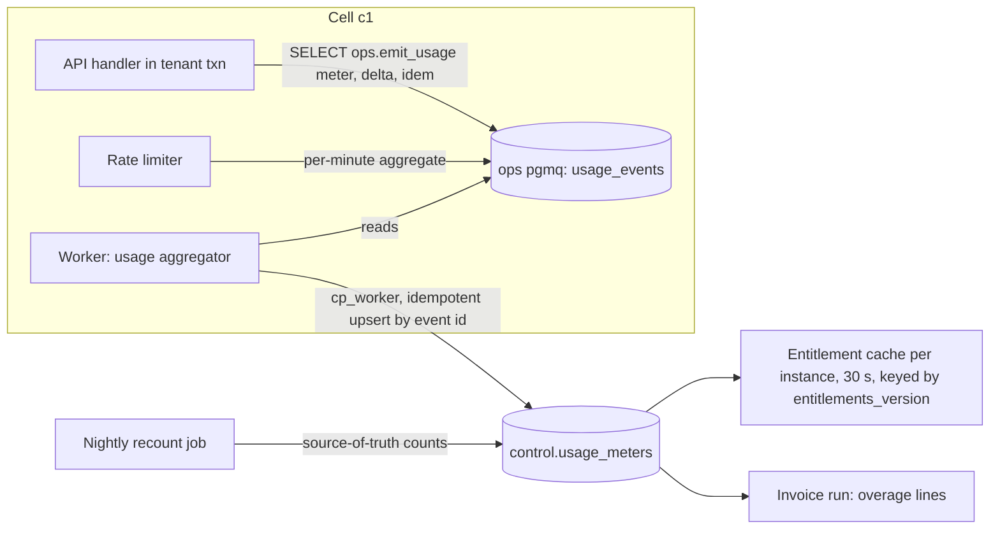

# Phase 2I: Billing and commercial

| | |
|---|---|
| Status | Phase 2 design, for the owner's review; revised 2026-11-24 for Phase 4 findings (rev P4) |
| Workstream | I (Billing and commercial) |
| ADR owned | [ADR-007](../adr/ADR-007-provider-abstractions.md) (payment, tax, invoice numbering and AI provider abstractions) |
| Risk and assumption block | R-50 to R-54, A-55 to A-59 (block shared with 2J, which uses R-55 to R-59 and A-60 to A-64) |
| Compliance note | Tax, invoicing, payments regulation and foreign-exchange content is a **DRAFT** pending review by a qualified tax adviser in each relevant market and by legal counsel. It lists what must be decided or checked. It is not advice. |
| Inputs | Spine S0 to S9; discovery summary §5 (BL-01 to BL-04); inventory groups AD (S-AD-10 to S-AD-15, E-AD-15 to E-AD-26) and ST (S-ST-28 to S-ST-31, E-ST-31 to E-ST-37); `front-end/src/server/billing.ts`, `admin8.ts`, `ws/billingws.ts`, `claude.ts`; SOD_MATRIX §3 (Billing, Rates, AI); CONTROLS ACC-22, ACC-24 |

## I-1. Summary

| ID | Point |
|---|---|
| I-1.1 | **Stripe availability for a Pakistan entity (verified as far as this session allows):** Stripe does **not** currently onboard businesses registered in Pakistan. Stripe's own country list could not be fetched from this session (the host is outside its allowed network). Every secondary source found agrees that Pakistan is absent from the list. The UAE, the US and the UK are on it. Source list in I-13. Status: **verified against secondary sources; confirm on Stripe's global availability page before the owner relies on it (A-55).** |
| I-1.2 | **Consequence:** "Stripe now" works only if the **contracting and billing entity is outside Pakistan** in a Stripe-supported country, for example the planned UAE, US or UK entity, with a local bank account, tax ID and address there. Stripe's help page on accounts outside your home country lists these. Opening a Stripe account for a Pakistan business through a nominee or borrowed address is **not** a route this design supports. It breaks Stripe's terms and creates KYB, tax and foreign-exchange exposure. |
| I-1.3 | The design does not depend on Stripe. Billing runs through a **payment provider abstraction** with these adapters: `stripe` (the existing code, as an adapter), `bank_transfer` (manual invoice and reconciliation, which works for a Pakistan entity today), `mor_<provider>` (merchant of record) and `psp_<provider>` (local or regional processors). A super admin configures each one in the Admin Console. The owner does **not** have to choose among them now (I-3). |
| I-1.4 | Plans and limits cover **users, frameworks, storage, API calls**, plus module add-ons and AI usage (the parity items carried over from the demo). Each is metered by events into `control.usage_meters`. Each is enforced on the server, either hard or soft, with a stated grace band and a stated user message. |
| I-1.5 | Card data never touches Selvara. Payments go through the provider's hosted checkout and customer portal only, and the demo card form (S-ST-30, F1-07) is replaced. |
| I-1.6 | AI providers sit behind the same provider registry. They are off by default, each one has a recorded data-handling review, platform approval is four-eyes and the tenant enables AI with four-eyes (`ai.enable`, kept). |

## I-2. Billing entity and provider availability

### I-2.1 Billing entity model

| ID | Decision | Rationale |
|---|---|---|
| I-2.1.1 | `control.billing_entities` holds one row per legal seller: `id`, `code` (placeholder, for example `ENT-PK`), `country`, `legal_name` (placeholder), `tax_registrations` (array of `{jurisdiction, scheme, number_ref}`), `functional_currency`, `invoice_series_prefix`, `bank_details_ref` (a secret reference, because bank details are shown on invoices but kept out of logs), `status` (`draft`, `active`, `closed_to_new`, `closed`) and `version`. | BL-04: a second entity is added without a schema change. |
| I-2.1.2 | Every `control.subscriptions` row carries `billing_entity_id` and `provider_config_id`. An invoice inherits both and **never** changes them after issue. | An invoice belongs to the seller that issued it. Re-pointing it would break numbering and tax records. |
| I-2.1.3 | Moving a customer to a new entity (for example from Pakistan to the UAE) means ending the old subscription at a period boundary and starting a new subscription under the new entity. Old invoices, credit notes and ledger stay with the old entity. | Clean audit trail; each entity keeps its own invoice sequence. |
| I-2.1.4 | Activating a billing entity, or changing its tax registrations or bank reference, is a four-eyes kind `billing.entity` done under elevation. | It changes who is paid and what tax is shown on invoices. |
| I-2.1.5 | Launch configuration: one entity, `ENT-PK`, `active`. The UAE, US and UK entities are added as `draft` rows only when they legally exist. | Owner OQ-02. |

### I-2.2 Provider availability for the launch entity (DRAFT, verify)

| ID | Route | Available to a Pakistan-registered entity? | What has to be true | Fit |
|---|---|---|---|---|
| I-2.2.1 | Stripe (direct) | **No** (I-1.1). | A Selvara entity registered in a Stripe-supported country (UAE, US or UK planned), with a bank account, tax ID, address, website and a representative's ID **in that country**. | Best fit once a foreign entity exists. The adapter already exists. |
| I-2.2.2 | Bank transfer, invoiced directly (`bank_transfer`) | **Yes.** No processor is needed. | Inward foreign-currency remittance rules and export-proceeds rules of the State Bank of Pakistan; an export-of-services tax position *(verify with a Pakistan tax adviser, BL-03)*. Manual reconciliation (I-8). | Works on day one. Best for annual and enterprise contracts. Weak for self-serve card buyers. |
| I-2.2.3 | Merchant of record (`mor_*`) | **Varies by provider.** Of the providers checked through secondary sources, at least one states that it does not onboard Pakistan-based merchants. For others the seller-country list could not be confirmed (Paddle) or is reported only second-hand (Lemon Squeezy lists Pakistan for bank payouts). **Verify per provider against its own seller-country page and terms, and through its KYB (A-56).** | The provider accepts the entity, the GRC SaaS product category and the payout route to Pakistan. A DPA with the provider; the provider is listed as a subprocessor (it sees customer billing contacts). | Moves most indirect-tax registration and collection to the provider (BL-02). Selvara gets payouts and a statement, not customer invoices of its own. |
| I-2.2.4 | Local or regional processor (`psp_*`) | Pakistani processors serve Pakistan entities. Cross-border card acceptance and settlement in foreign currency depend on the processor and the State Bank of Pakistan rules *(verify)*. | Processor support for international cards, foreign currency, hosted pages (SAQ A-style scope), webhooks with signatures and API refunds. | Possible fallback. Selvara stays the seller and still owns tax. |
| I-2.2.5 | Payment-account or payout services for freelancers and exporters | Out of scope. These collect money; they do not provide subscription billing, hosted checkout for B2B SaaS or tax. | — | Not an adapter. |

**I-2.3 Recommendation, with no decision needed from the owner now.** Ship the abstraction with `bank_transfer` and `stripe` adapters (both exist in v0.2.5 behaviour). Keep `mor_*` and `psp_*` as adapter slots behind the same interface. The owner's choice of route (I-2.2.1 to I-2.2.4) is an **Admin Console configuration** made when a route is commercially and legally confirmed, through I-4.3. Until then, the Pakistan entity bills by bank transfer and the `stripe` adapter config stays `draft`. R-04 stays open and visible, and R-50 records the specific consequence.

## I-3. Provider abstraction (payment, tax, invoice numbering)

ADR-007 holds the decision. This section gives the contract.

### I-3.1 Billing modes

| ID | Mode | Seller of record | Invoice to customer | Indirect tax | Selvara's records |
|---|---|---|---|---|---|
| I-3.1.1 | `direct` | Selvara entity | Selvara issues it (`control.invoices`, I-7) | Selvara calculates, collects and files, through `TaxProvider` | Authoritative ledger |
| I-3.1.2 | `merchant_of_record` | The provider | The provider issues it | The provider | A **mirror**: provider order, invoice reference and payout. Selvara issues **no** customer tax invoice, so it allocates no number from the customer series. |

The mode belongs to the `provider_config` (payment kind), and the subscription inherits it. A tenant never sees two modes at once.

### I-3.2 Interfaces (sketch, TypeScript, not implementation)

```ts
// SKETCH: names are binding, signatures are illustrative
interface PaymentProvider {
  readonly adapter: string;            // "stripe" | "bank_transfer" | "mor_x" | "psp_y"
  readonly mode: "direct" | "merchant_of_record";
  readonly capabilities: { hostedCheckout: boolean; customerPortal: boolean; recurring: boolean;
                           apiRefund: boolean; currencies: string[]; webhook: boolean };
  createCheckout(req: CheckoutReq, idemKey: string): Promise<{ sessionRef: string; url: string }>;
  createPortalLink?(subRef: string, idemKey: string): Promise<{ url: string }>;
  expireCheckout(sessionRef: string): Promise<void>;
  refund(paymentRef: string, minor: number, idemKey: string): Promise<{ refundRef: string }>;
  verifyWebhook(rawBody: Uint8Array, headers: Headers, now: number): VerifiedEvent | null;  // signature on raw body
  normalise(e: VerifiedEvent): BillingEvent;   // payment.succeeded | payment.failed | refund.succeeded | dispute.opened | mor.order.completed | mor.payout ...
}
interface TaxProvider {                  // "rules_table" (internal, today's rates module) | external tax service adapter
  quote(ctx: TaxCtx): Promise<TaxQuote>; // seller entity, buyer country/region, buyer tax id + validation state, B2B/B2C, product tax code, currency
  commit?(invoiceId: string, q: TaxQuote): Promise<void>;
}
interface InvoiceNumbering { allocate(entityId: string, series: "INV" | "CN", year: number): Promise<string> } // gapless, in the issuing transaction
```

| ID | Rule |
|---|---|
| I-3.2.1 | Every provider call carries an idempotency key that comes from the ledger operation (for example `refund-<ledger_entry_id>`), never from wall-clock time alone. The current `checkout-<invoice>-<amount>-<hour>` key stays acceptable for checkout only. |
| I-3.2.2 | Provider events reach Selvara only through `POST /api/v1/hooks/billing/<provider_config_ref>` (aligned with 2C C-09; rev P3). The handler verifies the signature on the raw body with the config's webhook secret, enforces a 5-minute tolerance and dedupes by `(provider_config_id, event_id)` in `control.provider_events`. Money is recorded only after the event is checked against the invoice, the currency and the live or test mode, the same as today. A mismatch becomes an `unmatched` ledger entry for review (kept from v0.2.5). |
| I-3.2.3 | Adapters are code. Adding an adapter is a release through the normal pipeline, never a runtime upload. Configuring an adapter is data (I-4). |
| I-3.2.4 | `TaxProvider` launches as `rules_table`, the current per-country tax rule from the rates module made into typed `control.tax_rules`. An external tax-calculation adapter is a later slot (BL-02). In `merchant_of_record` mode `TaxProvider` is not called. |
| I-3.2.5 | `InvoiceNumbering` allocates from `control.invoice_series` (`entity_id`, `series`, `year`, `next`) with a row lock **inside the transaction that inserts the invoice**. A rollback therefore leaves no gap, and nothing is ever renumbered. Format: `<series>-<entity code>-<YYYY>-<nnnnnn>`, for example `INV-PK-2027-000001`. Credit notes have their own series, `CN`. Whether yearly reset and gapless numbering meet each entity's local rules is listed in I-6.3 *(verify)*. |

### I-3.3 Provider configuration by a super admin

`control.provider_configs` (spine S2) columns: `id`, `ref`, `kind` (`payment`, `tax`, `ai`, `email`, `scanner`), `adapter`, `billing_entity_id` (payment and tax only), `environment` (`test`, `live`), `settings` (non-secret JSON, schema-validated per adapter), `secret_refs` (map from role to a secret **reference**, for example `{api_key: "sec://cp/payment/<ref>/api_key@v3"}`), `secret_fingerprints` (a keyed HMAC of each secret, for change detection, never reversible), `review_id` (AI and any processor of personal data, I-10), `status` (`draft`, `pending_approval`, `active`, `disabled`, `retired`) and `version`.

```mermaid
sequenceDiagram
  participant S1 as Super admin 1 (elevated)
  participant API as /api/v1/platform/providers
  participant SS as Secret store (ADR-003 key-provider family)
  participant CP as control.provider_configs
  participant S2 as Super admin 2 (elevated)
  S1->>API: POST draft (adapter, settings, environment)
  S1->>API: PUT secret (write-only field, TLS, never echoed)
  API->>SS: store secret -> reference
  API->>CP: save secret_ref + fingerprint (status draft)
  S1->>API: POST /:id/test (sandbox call, webhook ping)
  API-->>S1: test result (pass/fail, no secret)
  S1->>API: POST /:id/request-activation (reason >= 15, ticket)
  API->>CP: platform_approvals kind provider.activate (payload: diff of settings, fingerprints, test result)
  S2->>API: approve (reason; != requester; elevated)
  API->>CP: status active, version+1, platform_audit_log entry
```

| ID | Rule |
|---|---|
| I-3.3.1 | Secrets are written once through a write-only endpoint, go straight to the secret store and are never returned, logged or put in an approval payload. The approval shows the **fingerprint change** ("API key changed: fingerprint A to B"), never the value. The secret store is the one Phase 2F chooses under ADR-003, outside the database and its backups *(verify the Supabase Vault versus external KMS choice with 2F)*. |
| I-3.3.2 | Four-eyes kinds: `provider.activate` (any first activation), `provider.change` (settings or secret rotation on an active config), `provider.live` (switching `test` to `live`). Each needs an elevated requester and a different elevated approver, expires after 24 hours and is rechecked when applied: the config version must be unchanged since the request. |
| I-3.3.3 | Disabling a config needs one elevated super admin with a reason. It is the safe direction for AI, scanner and email. For payment, disabling stops new checkouts. Existing invoices stay payable by bank transfer, and webhooks for in-flight payments are still accepted for 30 days (`disabled` still verifies, `retired` does not). |
| I-3.3.4 | At most one `active` payment config per `(billing_entity_id, adapter)`. A subscription points to exactly one. Switching a tenant's provider takes effect at a period boundary. |
| I-3.3.5 | Test-mode configs never process live money. The webhook handler refuses an event whose mode differs from the config's `environment`. This rule is kept from v0.2.5. |
| I-3.3.6 | Environment variables (`STRIPE_SECRET_KEY` and similar) are **retired** in v2 for providers. The only environment secret is the credential the server uses to reach the secret store. This replaces `stripeFromEnv` and `claudeFromEnv`. |

## I-4. Plans, entitlements and limits

### I-4.1 Model

| ID | Table (control) | Content |
|---|---|---|
| I-4.1.1 | `control.plans` | `id`, `code`, `name`, `version`, `status` (`draft`, `published`, `retired`), `billing_cycles[]` and `trial_days`. A published version is immutable (SOD principle 5). |
| I-4.1.2 | `control.plan_entitlements` | Per plan version: `key` (see I-4.2), `kind` (`limit`, `flag`), `value`, `enforcement` (`hard`, `soft`), `grace_pct` and `overage_unit_price_minor` (nullable). |
| I-4.1.3 | `control.price_lists` | Spine extension. Versioned prices per plan version and currency, replacing `billing-price`. USD base, with optional local price points. |
| I-4.1.4 | `control.entitlement_overrides` | Spine extension. Per-subscription exceptions (for example a negotiated extra 50 GB): `key`, `value`, `reason`, `expires_at` and `approval_id`. Four-eyes kind `entitlement.override`. |
| I-4.1.5 | Effective entitlements | `plan_entitlements(plan version) ⊕ overrides`, capped by `platform ceilings` (for example the maximum upload size, Q-10). The result is cached per function instance alongside the static routing fields (TTL 30 s, R2-01) and keyed by `entitlements_version`; state limits are always checked against the source inside the transaction (I-4.3.3). (rev P3) |
| I-4.1.6 | Publishing a plan version or price list | Four-eyes `billing.pricing` (kept). Applies to invoices issued afterwards. A running subscription moves to the new plan version only at renewal, unless a migration request is approved. |

### I-4.2 Entitlement keys, metering and enforcement

| ID | Key | Unit | Source of truth | Metering event (to `control.usage_meters`) | Enforcement point (server) | Type | Grace | What the user sees |
|---|---|---|---|---|---|---|---|---|
| I-4.2.1 | `seats` | Active members with a paid role (`admin`, `owner`, `analyst`, `employee` and custom roles based on them) | `control.memberships` | `member.activated` and `member.deactivated` (+1/-1) | Invitation create, invitation accept, join approval, SCIM create or activate, role change from a free to a paid role. All are checked in the control-plane transaction with a row lock on the subscription. | Hard | 0 (no over-seating) | 422 `limit.seats`: "Your plan includes N users and N are active. Remove a user or ask your admin to change the plan." SCIM gets an error response that names the limit *(map to the SCIM error schema, verify)*. Admins see a banner at 90%. |
| I-4.2.2 | `seats` (external roles) | `auditor`, `vendor`, `viewer` | — | Counted for information only | Not limited by seats. Abuse is limited by `external_users` (I-4.2.14; rev P3). | Soft | — | Admin notice (A-59) |
| I-4.2.3 | `frameworks` | Active rows in `framework_scope` plus active `custom_framework` rows | Tenant schema | `framework.activated` and `framework.deactivated` | Framework activation endpoint, in the tenant transaction (count, then insert, under an advisory lock keyed on the tenant) | Hard | 0 | 422 `limit.frameworks`. Already-active frameworks are never deactivated by the platform. |
| I-4.2.4 | `storage_bytes` | Sum of the `file_object.size` values that are not purged, including all versions and quarantine | Tenant schema (`file_object`) | `storage.reserved`, `storage.committed`, `storage.released` | Signed upload URL issue: reserve the declared size against `used + reserved`. On scan completion, commit the actual size and release the difference. | Hard at `limit × (1 + grace_pct)` | 5% (default) for uploads in flight | At 80% and 95% a notice goes to admins. At 100% plus the grace band, upload URL requests get 422 `limit.storage` with the usage figures. Reads, downloads and deletes always work. |
| I-4.2.5 | `max_upload_bytes` | Per file | min(plan value, tenant setting, platform hard ceiling) | — | Upload URL issue (declared size) and scanner (actual size). Storage enforces the ceiling as well *(Supabase bucket file-size limit, verify)*. | Hard | 0 | 422 `limit.upload_size` with the effective maximum |
| I-4.2.6 | `api_calls_month` | Successful and refused calls to the company API (M18 keys, `/api/v1` with an API key), excluding the UI session API | Rate limiter counters (Phase 2F mechanism) | `api.calls` aggregated per tenant per minute (one event per minute, not per call) | Rate limiter: per-minute burst limits are always hard (429 with `Retry-After`). The monthly allowance is checked against the cached meter. | Soft by default; hard if the plan says so | Soft: unlimited above the allowance, billed as overage if the plan has `overage_unit_price_minor`, else a notice only. Hard: 10% grace, then 429 `limit.api_calls_month` until the period resets. | API clients get 429 with an `{ error: { code, message } }` envelope, `Retry-After` and the period reset time. Admins get a notice at 80% and 100%. |
| I-4.2.7 | `module.<M>` | Flag per module add-on (for example M11 Trust Center, M13 AI governance) | `plan_entitlements` plus overrides | — | Router middleware, before the handler: a module not entitled refuses **writes**. Reads of existing data and exports still work. | Hard (writes) | Data kept read-only | 403 `plan.module_not_included` with the reason. The navigation shows the module with a lock icon and a label (design system: never colour alone). |
| I-4.2.8 | `ai_tokens_month` | Input plus output tokens of Assistant asks and agent runs | M19 `agent_run` and Assistant metadata (token counts are already stored on drafts) | `ai.tokens` per request | Before the provider call: refuse if the meter is already above the limit. The call that crosses the limit completes. | Hard | One call of overshoot | 422 `limit.ai`: "Your AI allowance for this month is used. It resets on <date>." |
| I-4.2.9 | `exports_day` (demo parity: exports and evidence packages) | Count | Tenant `report_run` and export jobs | `export.created` | Export endpoint | Soft | — | Notice. **Data export is never blocked by billing state or limits** (I-5.4). |
| I-4.2.10 | `db_bytes` | Tenant schema size | Fleet observer (2H H-FL-01) | Nightly measurement | None (display and billing) | Soft | — | Notice to admins at 80%; above the plan value, a proposal to move to a dedicated cell (2A A-PH-05). (rev P3) |
| I-4.2.11 | `byok` | Flag | Plan plus overrides | — | BYOK onboarding endpoint (2F F-K-21) | Hard | — | 403 `plan.feature_not_included` (rev P3) |
| I-4.2.12 | `sso`, `scim` | Flags | Plan | — | SSO and SCIM configuration endpoints | Hard | — | 403 `plan.feature_not_included` (rev P3) |
| I-4.2.13 | `dedicated_cell`, `pitr_days` | Flag, limit | Plan | — | Provisioning placement (2A A-PH-04, A-PH-05); a dedicated cell does not count toward a shared cell's CR-1 threshold | Hard | — | n/a (platform-side) (rev P3) |
| I-4.2.14 | `external_users` | Count of auditor, vendor and viewer members | `control.memberships` | As I-4.2.1 | Invitation create and accept | Soft (default ≥ 5 × seats) | — | Admin notice (rev P3) |

### I-4.3 Metering pipeline



| ID | Rule |
|---|---|
| I-4.3.1 | `ops.emit_usage(meter text, delta bigint, idem text)` is a narrow `SECURITY DEFINER` function with a pinned `search_path`. It takes the tenant from `current_setting('app.tenant_id')` and `current_user`, **never from an argument**. It enqueues into `ops` in the **same transaction** as the business change (transactional outbox: no lost or phantom events). Tenant roles get `EXECUTE` on this function only, never `USAGE` on `ops` (consistent with S3 and S8). |
| I-4.3.2 | `control.usage_meters` (spine S2: aggregated counts only) has key `(tenant_id, meter, period_start)` and columns `value`, `last_event_at`, `events_applied` and `recount_at`. Each event id is applied once (a dedupe table, `control.usage_event_receipts`, kept for 35 days, a spine extension). |
| I-4.3.3 | Hard limits on **state** (seats, frameworks, storage) are enforced against the **source of truth** inside the transaction that would exceed them, not against the meter. The meter is for display, billing and soft limits. This removes the race that a lagging meter would cause. |
| I-4.3.4 | Hard limits on **flow** (API calls, AI tokens) are enforced against the meter plus the rate limiter's live counter. Accepted overshoot is bounded by aggregation lag (A-58: at most 5 minutes) and recorded. |
| I-4.3.5 | A nightly recount recomputes seats, frameworks and storage from source, writes the corrected value, and raises an operations alert if the drift is over 1% or over 1 unit for seats (R-53). |
| I-4.3.6 | Meter events carry no personal data: tenant, meter, delta, time and an idempotency key only. |

### I-4.4 Plan changes, downgrades and trials

| ID | Rule |
|---|---|
| I-4.4.1 | A company admin requests a plan change (one open request at a time, kept). Upgrades apply immediately with proration *(proration rule to confirm with finance; MoR providers prorate themselves)*. Downgrades apply at the next period. Both are recorded in `control.plan_change_requests` (a spine extension that replaces `billing-plan-request` and `billing-plan-answer`). |
| I-4.4.2 | A downgrade that would put state over the new limits is accepted, but the tenant is told before confirming exactly what will be over the limit. From the effective date, creation is blocked for that key only. Nothing is deleted or deactivated by the platform. |
| I-4.4.3 | **Trial limits (defined here once; 2H and 2F refer to this row).** Trials are provisioned only by staff under the **standing trial policy** approved four-eyes under OD-04 (`control.trial_policies`; daily digest to both approvers): seats 5, `storage_bytes` 500 MB, `trial_days` 14 (OQ-21, rev P4), region `R1`, AI off, no BYOK, SSO, SCIM or dedicated cell, a daily provisioning cap, and at most 10% of the CR-1 threshold of a cell in concurrent trials (trial schemas count toward CR-1, 2J J-7.2). Feature flags follow the trialled plan within those caps. At trial end without a payment route the subscription becomes `restricted` (I-5); 14 days later the tenant is proposed for decommissioning under the deletion procedure (four-eyes, certificate), and deletion completes no later than 30 days after trial end (2G G-RET-02). A trial tenant has its own schema from day one (Q-08). (rev P3) |
| I-4.4.4 | Self-serve upgrades through the MoR or Stripe hosted checkout are allowed when the active payment config has `recurring` capability. Otherwise the request goes to the platform (existing accept or decline flow, single elevated super admin, kept). |

### I-4.5 Cost coverage (rev P3)

| ID | Rule |
|---|---|
| I-4.5.1 | Plan prices are set against the **corrected** 2H cost model (P3-X3-08, DA-13): it adds the `ks` project and its DR standby, KMS multi-Region replica keys, nightly export egress, the second Vercel project (`console`), the secrets manager, WORM anchors and timestamp service, and the perf cell. Planning figures per tenant per month: about USD 86 at 10 tenants, 13.8 at 100 and 6.4 at 1,000 (rev P4: adds PITR on `ks`, Static IPs from launch and KS-SNAP, 2H H-C-15; were 55, 10.8 and 6.4 in Phase 3, and 47, 8.3 and 4.3 before); marginal cost of one more shared tenant about USD 4.5 to 5.5 *(verify prices, VC-08; OD-11 is restated after verification)*. Prices also carry the SLA-U credit budget (2% of revenue, I-4.6) and, once the owner quantifies them, the fixed overheads of 2H H-C-27. |
| I-4.5.2 | Every cost driver that grows with one tenant's use is an entitlement key: seats, storage, API calls, AI tokens (I-4.2.1 to I-4.2.8), database size (`db_bytes`, I-4.2.10), BYOK (`byok`, I-4.2.11, one more KMS key and replica), SSO and SCIM (I-4.2.12, SSO MAU), dedicated cell and PITR window (I-4.2.13). A plan that grants one of them is priced to cover it (risk R-63 in the Phase 3 register). |
| I-4.5.3 | Capacity rule CR-1 (2J J-7.2, DA-10) sets how many tenants a shared cell holds (provisional 300, then floor_100(0.6 × K)); the shared-cell share of compute in the cost model uses that value. Trial, canary, warm-pool and restore schemas count toward CR-1. |

### I-4.6 Service level in plan terms (SLA-U) (rev P4)

The owner decided one uniform SLA for every plan (OQ-23). This section states it in plan and invoice terms; the technical definition is 2A A-NFR-01 and the measurement method is 2J J-SLA. The wording below is a **DRAFT** for the terms of service, pending legal review (OD-08).

| ID | Rule |
|---|---|
| I-4.6.1 | **Commitment.** Every paid plan, shared or dedicated, carries the same SLA: 99.5% monthly availability of the tenant API and web app *(verify that this does not exceed the serial composite of the Supabase and Vercel commitments, VC-13; if it does, the published figure is lowered to the vendor-backed figure before any contract)*. The SLA is not an entitlement key and cannot be overridden per subscription; a negotiated higher figure needs a new owner decision. Trials (`trialing`) carry no SLA. |
| I-4.6.2 | **Measured availability.** `(eligible minutes − down minutes) / eligible minutes` for the calendar month in UTC, where eligible minutes exclude the excluded events (I-4.6.4); a minute is down when two of three external probe locations fail the login page or the authenticated canary read for the tenant's cell (2J J-SLA). The monthly figure per cell is stored in `control` with its evidence, kept with billing records (6 years, OQ-25). |
| I-4.6.3 | **Service credits (the sole remedy).** Below 99.5% and at or above 99.0%: 10% of that month's subscription fee. Below 99.0%: 25%. The fee base is the recurring plan fee for the month, excluding usage overage, taxes and one-off charges. Credits are never paid as cash, cannot exceed 25% of the monthly fee, and are lost if the subscription ends before they are applied. |
| I-4.6.4 | **Exclusions.** Scheduled maintenance announced at least 72 h ahead (in-app and by email to tenant admins); vendor-wide region outages of Supabase, Vercel or the KMS provider, including region loss (RPO/RTO are objectives, not contractual: 2A A-NFR-21); issues caused by the customer (its users, integrations, IdP, BYOK key disabled, exceeded limits); suspension or restriction under I-5; and the Trust Center public pages. |
| I-4.6.5 | **Claim and issue.** A tenant admin claims within 30 days of month end from the billing page; the platform also proposes a credit automatically when the monthly report shows a breach. The credit is issued as a credit note against the next invoice (I-7.3), ledger type `credit` with reason `sla_credit`, under the existing four-eyes kind `billing.credit` (the requester never approves). In MoR mode the credit is applied through the provider's credit or discount mechanism and mirrored. |
| I-4.6.6 | **Cost.** Credits are budgeted at 2% of revenue (2H H-C-26) and priced into every plan. Any plan upgrade needed to back the SLA (2H H-C-25, contingent on VC-13) is costed there. Region-wide outages are excluded, so the SLA needs no warm DR standby. |
| I-4.6.7 | **Communication.** The plan catalogue, order form and terms of service show the same figure, credits and exclusions for every plan. RPO and RTO are published as objectives, separately from the SLA, and only after the matching drills have run in production (2H H-9.4). |

## I-5. Dunning, suspension and the tenant lifecycle

`control.subscriptions.status`: `trialing`, `active`, `past_due`, `restricted`, `suspended`, `canceled`. The tenant's own lifecycle status (`control.tenants.status`, owned by Phase 2A or 2H) changes only at `suspended` (to `Suspended`) and at offboarding.

| ID | Day (from due date, configurable per plan or subscription; `net_terms` for invoiced customers) | Step | Who or what | Effect on access |
|---|---|---|---|---|
| I-5.1 | D−3 | Reminder by email and in-app notice to the billing contact and tenant admins | Job | None |
| I-5.2 | D+1, D+7 | Reminders. A card adapter retries according to the provider's own retry schedule. | Job or provider | None. Status `past_due`. Admins see a banner with an icon and the label "Payment overdue". |
| I-5.3 | D+14 | `restricted` | **Automatic** (job), audited in the platform log and in the tenant's own log | Read-only for everyone: every write endpoint returns 403 `billing.restricted`. **Exempt from the block:** billing pages and payment, data export, DSAR handling in M14 (statutory clocks, I-5.6), sign-in, MFA and account security, the audit log and support questions. |
| I-5.4 | D+30 | Suspension request | The job pre-fills a `platform-company-suspend` request with reason code `non_payment`. An elevated super admin submits it and a **different** elevated super admin approves it (the existing four-eyes kind). | `control.tenants.status = Suspended`. Routing refuses tenant requests (spine S3), except that a tenant admin can still reach `/api/v1/billing/*`, pay, and request an export of their own data. Data is kept, encrypted and backed up. |
| I-5.5 | Payment confirmed (provider webhook or bank reconciliation) | Reinstatement | **Automatic** if every open suspension or restriction has reason `non_payment` (a pre-approved rule). Otherwise the existing `platform-company-reactivate` four-eyes kind. | Back to `active` |
| I-5.6 | D+90 suspended and unpaid | Offboarding proposal | Raised by the job and decided under the deletion procedure: four-eyes, export offered, retention period, then crypto-shredding and a deletion certificate (spine S7, ADR-003). **Never automatic.** | — |

| ID | Rule |
|---|---|
| I-5.7 | Billing state never blocks a tenant's statutory obligations. M14 DSAR handling (deadline clock), legal holds and exports stay usable while restricted, because the tenant is a controller with legal deadlines. Selvara keeps processing as processor until termination under the DPA *(DPA wording, Phase 2G and legal)*. |
| I-5.8 | Disputes and chargebacks (`dispute.opened`) create a ledger entry of type `dispute`, alert both super admins, and do **not** restrict the tenant automatically. |
| I-5.9 | All dunning messages contain no amounts beyond the invoice total and no links other than the Selvara billing page. Payment links are created on demand from that page, never sent by email as long-lived bearer links (phishing resistance). The existing email "payment link" action stays, but its link points to the billing page. |

## I-6. Tax, VAT and invoicing requirements (DRAFT, to verify)

### I-6.1 Design position

| ID | Point |
|---|---|
| I-6.1.1 | In `merchant_of_record` mode the provider is the seller for indirect-tax purposes in the markets it covers. What Selvara still has to check: Pakistan income tax and sales tax on its export-of-services income, and that the provider covers each target market. |
| I-6.1.2 | In `direct` mode Selvara is the seller. For every market and buyer type (B2B or B2C) it must decide: whether it must register, which rate applies, whether the reverse charge applies, the invoice content, the currency in which tax is shown, e-invoicing mandates, buyer withholding tax, and filing. `TaxProvider.rules_table` holds the result per jurisdiction. **Nothing is invoiced into a jurisdiction that has no approved tax rule.** The existing "no tax rule for country" skip is kept as a hard refusal. |
| I-6.1.3 | Selvara sells B2B. The design records the buyer's tax ID and its validation state (`unverified`, `valid`, `invalid`, with source and time) on the subscription. B2C sales are refused at sign-up unless a market's rule set covers B2C (A-57). |
| I-6.1.4 | Tax rules are rows in `control.tax_rules` (`jurisdiction`, `region`, `buyer_type`, `scheme`, `rate`, `reverse_charge` bool, `invoice_notes`, `tax_currency_rule`, `effective_from`, `effective_to`, `approved_by_approval_id`). A change is four-eyes `rates.override` (kept). The rule in force at issue is copied into the invoice. |

### I-6.2 Market matrix: what must be decided or verified

All entries are *(verify)* with a qualified adviser. They are the questions Phase 3 must close, not conclusions.

| ID | Market (owner list) | Indirect-tax points to verify for a foreign B2B SaaS seller | Invoicing and other points |
|---|---|---|---|
| I-6.2.1 | **Pakistan** (seller's home; also a buyer market) | Provincial sales tax on services (provinces differ) for domestic buyers; zero-rating or exemption of exported IT services; Federal Board of Revenue export income regime and IT export incentives | State Bank of Pakistan export-proceeds realisation and inward remittance rules (the payout route matters); FBR invoice and e-invoicing requirements for domestic sales; withholding tax by Pakistani buyers |
| I-6.2.2 | **GCC**: UAE, Saudi Arabia, Bahrain, Oman, Qatar, Kuwait | UAE VAT: B2B reverse charge and non-resident registration triggers; Saudi VAT and the ZATCA e-invoicing regime for registered persons; Bahrain and Oman VAT on digital services; whether Qatar and Kuwait have introduced VAT yet | Arabic or bilingual invoice content where required; buyer withholding tax on services paid abroad (common in Saudi Arabia, and in Oman for some services); a future UAE entity changes this to a domestic position, and DIFC and ADGM are separate legal regimes but not separate VAT regimes |
| I-6.2.3 | **South Asia**: India, Bangladesh, Sri Lanka, Nepal | India GST on online information services (B2C registration; B2B reverse charge); Bangladesh and Sri Lanka VAT on foreign digital services | Buyer withholding tax (India TDS and equalisation levy history); permanent-establishment risk; invoice currency |
| I-6.2.4 | **Central Asia**: Kazakhstan, Uzbekistan and others | VAT on electronic services from foreign suppliers (simplified registration regimes) | Currency controls and invoicing in the local language |
| I-6.2.5 | **Asia** (wider): Singapore, Malaysia, Indonesia, Philippines, Japan and others | Singapore GST overseas vendor regime (mainly B2C); Malaysia service tax on digital services and its e-invoicing programme; Japan consumption tax (registered-invoice system); Indonesia and Philippines VAT on digital services | Local-currency tax amounts on invoices where required |
| I-6.2.6 | **Europe (EU)** | VAT place of supply for B2B services (reverse charge by the customer; seller's invoice carries the customer's VAT ID and reverse-charge wording); the non-Union OSS scheme only for B2C; VIES validation of VAT IDs | Invoice content rules (VAT Directive invoicing articles, *verify*); EU GDPR Art. 27 representative is a separate obligation (discovery R-F) |
| I-6.2.7 | **UK** | UK VAT: B2B reverse charge for services from overseas; registration of a non-established taxable person for B2C sales (no threshold, *verify*) | VAT amount shown in GBP where VAT is charged; Making Tax Digital if registered; a future UK entity becomes a domestic seller |
| I-6.2.8 | **Australia** | GST on imported services and digital products: B2C under the simplified regime; B2B normally not taxed if the buyer is GST-registered and gives an ABN | Tax invoice rules apply only if registered |
| I-6.2.9 | **Central America**: Mexico (if counted), Costa Rica, Panama, Guatemala and others | VAT on digital services from foreign providers (Mexico and Costa Rica have specific regimes); registration and withholding by card issuers in some countries | Buyer withholding; local e-invoicing (Mexico CFDI applies to domestic issuers) |
| I-6.2.10 | **North America**: US, Canada | US state sales tax on SaaS: taxability differs by state, economic nexus thresholds by state, exemption certificates; Canada GST/HST (simplified registration for B2C; B2B usually reverse-charged or exempt from collection) and Quebec QST | A future US entity creates domestic nexus considerations; 1099 and W-8BEN-E forms requested by US buyers of a foreign seller |

### I-6.3 Invoice content and numbering requirements to confirm

| ID | Requirement to confirm per entity and market | Design support |
|---|---|---|
| I-6.3.1 | Sequential numbering: gapless or not, per year or continuous, separate series for credit notes | `control.invoice_series` (I-3.2.5), configurable reset per entity |
| I-6.3.2 | Mandatory fields: seller and buyer legal name, address, tax IDs, supply date, description, net, rate, tax, gross, currency, reverse-charge statement, exemption reason | `invoices` holds an immutable `rendered_snapshot` (JSON plus a PDF hash). Fields come from the entity, the subscription and `tax_rules.invoice_notes`. |
| I-6.3.3 | Tax amount in local currency, and which exchange-rate source is allowed (central bank, or the tax authority's published rate) | `tax_currency_rule` on the tax rule; the invoice stores `tax_amount_local` and `rate_source`. The existing ECB-plus-second-feed rates module supplies rates; a jurisdiction that needs a specific source gets a rule that names it (I-9). |
| I-6.3.4 | E-invoicing or clearance mandates (for example Saudi Arabia, Malaysia, India for domestic B2B) | Out of scope at launch. `TaxProvider` or an e-invoice adapter slot can be added. A market under a mandate stays blocked until it is supported (I-6.1.2). |
| I-6.3.5 | Retention of invoices (years per jurisdiction) | `retention_class = 'financial'` (2B B-RC15), kept beyond tenant deletion **in the control plane** (invoices hold only the billing contact, not tenant business data); period per billing entity (`billing_entities` row), provisionally 6 years after the end of the tax year *(verify, OD-08)*. (rev P3) |
| I-6.3.6 | Language (Arabic in some GCC cases, local languages in Central Asia) | Invoice template per entity and language, which needs translation review |

## I-7. Invoices, credit notes, refunds, ledger

| ID | Rule |
|---|---|
| I-7.1 | Typed control-plane tables (spine extensions; they replace the `platform_records` kinds): `invoices` (S2), `invoice_lines`, `ledger_entries` (append-only; types `payment`, `credit`, `refund`, `writeoff`, `markpaid`, `unmatched`, `dispute`, `payout_mor`), `credit_notes`, `payments` (S2), `provider_events` and `invoice_series`. Money is in integer minor units. Two-decimal currencies only, kept from v0.2.5. |
| I-7.2 | **"Void" changes meaning.** An issued invoice is never voided in place. "Void" in the UI (S-AD-12) issues a **full credit note** that references the invoice, so the number sequence stays intact, as many VAT regimes require *(verify)*. Parity: the action stays in the UI with the same four-eyes threshold. This is an intended change and goes on the parity ledger (2J, J-9). |
| I-7.3 | Credits and refunds after issue produce a credit note (`CN` series) plus ledger entries. A refund to a card goes through `PaymentProvider.refund` with the idempotency key `refund-<ledger_entry_id>`, after the ledger checks (kept). |
| I-7.4 | Four-eyes thresholds are kept: above the equivalent of USD 1,000 (counting earlier single-person amounts on the invoice), or with no applied rate, a second elevated super admin approves. Write-off is always four-eyes. Approvals are rechecked when applied. |
| I-7.5 | In MoR mode, refunds start in Selvara and run through the provider's refund API. The provider's credit note is mirrored. Selvara allocates no number. |
| I-7.6 | Bank-transfer reconciliation: an elevated super admin records `markpaid` with the bank reference (kept). Partial payments and buyer withholding-tax short payments are recorded as `payment` plus `credit` with reason `wht_certificate` and an attached certificate reference. Four-eyes above the threshold. |
| I-7.7 | Each invoice action writes to `control.platform_audit_log` and, as now, a line in the tenant's own audit log (M22) with no amounts beyond the invoice total. |
| I-7.8 | Accounting export (per entity, per period, CSV or JSON) for an external accounting system: invoices, credit notes, payments and payouts. Selvara is not the general ledger. |

## I-8. Card data never touches Selvara (F1-07)

| ID | Control | Verification (2J) |
|---|---|---|
| I-8.1 | Payment only through the provider's hosted checkout or customer portal (a redirect). No iframe-embedded card fields at launch. That keeps Selvara's PCI DSS scope at the minimum for fully outsourced e-commerce *(SAQ A eligibility, verify with a QSA or the acquirer)*. | J-SEC-20 |
| I-8.2 | No API schema contains a card number, CVC, expiry or cardholder field. The OpenAPI contract test fails on field names matching a card-data pattern. Request bodies are scanned in tests for a primary-account-number pattern with a Luhn check. | J-SEC-21 |
| I-8.3 | The demo payment form (S-ST-30) is replaced by a "Manage payment method" button that opens the provider portal. In demo mode it opens a synthetic page with **no card fields**. Parity ledger: intended change. | J-PAR |
| I-8.4 | CSP `form-action` and navigation targets allow only the configured provider's checkout origins. They are taken from the active payment config's adapter metadata at build time. Changing `next.config.js` or `vercel.json` **needs owner approval** (AGENTS.md). | J-SEC-22 |
| I-8.5 | Selvara stores only provider references (`customer`, `payment`, `checkout session`), card brand and last four digits **if the provider returns them**, and the expiry month and year for the dunning notice. | J-SEC-21 |

## I-9. Currency and exchange rates

| ID | Rule |
|---|---|
| I-9.1 | The existing Admin Console rates module (S-AD-14 and S-AD-15) is kept and moves to typed `control.fx_rates` (spine extension): two public feeds cross-checked; a rate is held on a 3% move, a 1% disagreement between feeds, or no feed fresher than 48 hours; releasing a held rate is four-eyes; rejecting one needs one super admin. The demo makes rejection four-eyes. The server rule stays, recorded on the parity ledger as an intended difference. |
| I-9.2 | Price base is USD. Invoice currency is set per subscription. Local price points (from `control.price_lists`) take precedence over conversion. The rate is locked on the invoice when it is issued (kept). |
| I-9.3 | In MoR mode the provider converts and settles. Selvara stores the provider's figures, the settlement currency and the payout amount, and does not recompute them. |
| I-9.4 | Entity functional currency (PKR for `ENT-PK`). Conversion for statutory accounts happens in the accounting system using the rate source the law requires *(verify)*. Selvara exports the transaction currency and the locked rate. |
| I-9.5 | The rate feeds are public data and go through the egress allow-list (2H egress design; rev P3). The second feed is a free public service: availability risk is accepted, because the hold rules fail safe. |

## I-10. AI provider abstraction

| ID | Rule |
|---|---|
| I-10.1 | `AiProvider` adapter interface (ADR-007): `capabilities` (context size, tool use, streaming, region, zero data retention available), `ask(req) -> {text, tokens, model}` and `estimate(req)`. The existing Claude client becomes the `anthropic` adapter. Other adapters cover other hosted APIs and **self-hosted open-weight models** (free models) behind an HTTPS endpoint that the platform operates. |
| I-10.2 | Each AI `provider_config` must reference a `control.ai_provider_reviews` row (spine extension) before it can be activated. The review covers: whether inputs are used for training (default and contractual), retention period, processing regions and subprocessors, DPA and transfer mechanism, security attestations, whether zero data retention is available, the model licence (for open weights: whether commercial use is allowed), content-filter behaviour, and whether the provider's terms allow customer confidential data. The review result is `approved`, `approved_with_conditions` or `rejected`, with a review date (12 months) and a reviewer. Reviewer and activator are different people. |
| I-10.3 | **Free hosted tiers that train on or keep prompts are rejected by rule** (R-07). Free models are acceptable when self-hosted, or through a provider whose terms exclude training and retention for API traffic. |
| I-10.4 | Platform activation is four-eyes `provider.activate` (I-3.3). Tenant side: AI stays **off by default** (M19 `ai_tenant_settings`). A tenant admin chooses among platform-approved providers. Enabling is four-eyes `ai.enable` and masking mode is four-eyes `ai.mask`; both are kept. Turning AI off is immediate. |
| I-10.5 | A change of provider or model for a tenant re-asks tenant consent (four-eyes `ai.enable` again) if the new provider's review differs in training, retention or region. |
| I-10.6 | The PII blocker and record-selection rules (CONTROLS ACC-22) run **before** any adapter and are adapter-independent. Prompts are not stored (kept). Token usage is metered (I-4.2.8). |
| I-10.7 | Health or special-category tenants (A-14): AI can be enabled only with a provider whose review is `approved` with zero data retention, and the tenant admin sees a DPIA prompt (M14 `dpia` link). |
| I-10.8 | The provider list shown to tenants (name, region, retention, training) is generated from the reviews and appears in the subprocessor list on the Trust Center (Selvara's own) and in the DPA annex. |

## I-11. API surface (additions; follows spine S6)

| ID | Endpoint family | Who |
|---|---|---|
| I-11.1 | `GET /api/v1/billing/subscription`, `GET /api/v1/billing/usage`, `GET /api/v1/billing/invoices`, `GET /api/v1/billing/invoices/:id` (PDF through a signed URL), `POST /api/v1/billing/plan-requests`, `POST /api/v1/billing/invoices/:id/checkout`, `POST /api/v1/billing/portal-link` | Tenant `admin` (M25, served by `cp_tenant_api` functions such as `billing_view` and `plan_request_*`, which derive the tenant from the session record, R2-03; rev P3) |
| I-11.2 | `/api/v1/platform/billing/{entities,plans,price-lists,subscriptions,invoices,credit-notes,ledger,rates,tax-rules,usage}` | Platform staff: read for `support` and `ciso`, writes under elevation by permitted platform roles, approvals as listed |
| I-11.3 | `/api/v1/platform/providers` (CRUD on drafts, `PUT /:id/secret/:role` write-only, `POST /:id/test`, `POST /:id/request-activation`, `POST /:id/disable`) and `/api/v1/platform/ai-reviews` | Elevated platform staff with permission `providers.manage` |
| I-11.4 | `POST /api/v1/hooks/billing/<config_ref>` (rev P3) | Provider only (signature) |

## I-12. Mapping to the existing system (parity)

| ID | v0.2.5 item | v2 |
|---|---|---|
| I-12.1 | `platform_records` kinds `billing-account`, `-invoice`, `-entry`, `-plan-request`, `-plan-answer`, `-price`, `-checkout`, `-provider-event`, `-rate`, `-rate-refresh` | `subscriptions`, `invoices` + `invoice_lines`, `ledger_entries`, `plan_change_requests`, `price_lists`, `payments`, `provider_events`, `fx_rates` + `tax_rules`, an `ops` job state row |
| I-12.2 | Demo plans, module entitlements and usage meters (E-AD-03 to E-AD-05; S-AD-01, S-AD-03; S-ST-28) | `plans`, `plan_entitlements`, `entitlement_overrides`, `usage_meters`. The `screenings` and `idv` meters inherited from an earlier product are **dropped** with owner sign-off (AD gap 1) and replaced by the I-4.2 keys. This goes on the parity ledger. |
| I-12.3 | Demo "Onboard a customer" with region, currency and billing method (S-AD-02) | Tenant provisioning (Phase 2A or 2H) plus subscription creation (this workstream), combined in one platform request (four-eyes `platform-company-create`, kept) |
| I-12.4 | Demo "Issue monthly invoices" (S-AD-10), API "issue up to a date" (S-AD-12) | The invoice run is a scheduled job (S8 jobs) plus a manual trigger for an elevated super admin. In `direct` mode only. |
| I-12.5 | Demo card form (S-ST-30) | Replaced (I-8.3) |
| I-12.6 | Demo customer user management by platform staff (S-AD-04) | Out of the billing scope. Flagged to Phase 2E: it conflicts with "platform never writes company rows" (OQ-10). |

## I-13. Sources

1. "Global availability" (Stripe), the supported-countries page. **Could not be fetched from this session.** Its content was taken from the secondary sources below. *(Verify directly.)*
2. "Requirements to open a Stripe account in another country" (Stripe Support), seen as a search result summary: a legal entity, tax ID, address, phone number, government ID, website and bank account in that country.
3. "Global businesses" (Stripe use-case page, regional variant), seen as a search result: the UAE is listed among the supported countries.
4. Secondary sources stating that Stripe does not support Pakistan-registered businesses: a payments-provider guide for South Asia (WorldFirst blog) and a company-formation blog (2026). Both are third-party; the second is promotional.
5. "Supported countries" (Paddle developer documentation) and "Which countries are supported by Paddle" (Paddle help): the seller-country table could not be confirmed in this session *(verify)*.
6. A merchant-of-record provider's blog stating it does not currently onboard Pakistan-based merchants; a third-party gateway guide covering Lemon Squeezy payouts to Pakistan *(second-hand, verify)*.

## I-14. Deliverables

| ID | Deliverable |
|---|---|
| I-D1 | This document |
| I-D2 | ADR-007 (provider abstractions: payment, tax, invoice numbering, AI) |
| I-D3 | Control-plane table list for Phase 2B (spine extensions, see Spine deviations) |
| I-D4 | Four-eyes kinds for Phase 2E: `billing.entity`, `provider.activate`, `provider.change`, `provider.live`, `entitlement.override`; kept: `billing.pricing`, `billing.credit`, `.refund`, `.markpaid`, `.writeoff`, `.void` (now a credit note), `rates.release`, `rates.override`, `platform-company-suspend`, `-reactivate`, `ai.enable`, `ai.mask` |
| I-D5 | Entitlement keys and error codes (`limit.seats`, `limit.frameworks`, `limit.storage`, `limit.upload_size`, `limit.api_calls_month`, `limit.ai`, `plan.module_not_included`, `plan.feature_not_included` (rev P3), `billing.restricted`) for Phase 2C (API) |
| I-D6 | Tax and invoicing verification checklist (I-6) for the owner's advisers |

## I-15. Decisions required

| ID | Decision | Owner | ADR |
|---|---|---|---|
| I-DR1 | Accept the provider abstraction with `bank_transfer` and `stripe` adapters at launch, and MoR or PSP adapters as configurable slots | Owner | ADR-007 |
| I-DR2 | Launch billing route for `ENT-PK`: bank transfer only, until either a foreign entity exists (for Stripe) or a MoR or PSP passes KYB. This is a configuration, not a redesign. | Owner, after tax and legal advice | ADR-007 |
| I-DR3 | Restriction at D+14 is automatic; suspension at D+30 is four-eyes; reinstatement after payment is automatic for `non_payment` only | Owner | — (policy; SOD_MATRIX update by 2E) |
| I-DR4 | "Void" becomes a full credit note | Owner and finance | — |
| I-DR5 | Drop the `screenings` and `idv` meters | Owner (parity sign-off) | — |
| I-DR6 | External roles (auditor, vendor, viewer) do not consume paid seats | Owner (commercial) | — |
| I-DR7 | The secret store for provider secrets is chosen by 2F under ADR-003 | 2F | ADR-003 |
| I-DR8 | SLA-U in plan terms (I-4.6): 99.5% monthly *(verify, VC-13)*, credits 10% and 25%, exclusions, 2% revenue budget; terms-of-service wording to legal review | Owner (decided in principle, OQ-23), legal (OD-08) | 2A A-DR-05 (rev P4) |

## I-16. Open risks

| ID | Risk | Likelihood | Impact | Owner | Treatment | Status |
|---|---|---|---|---|---|---|
| R-04 | (existing) No payment provider for a Pakistan entity | High | High | R-A | This workstream: bank transfer at launch; the abstraction allows MoR, PSP or Stripe (foreign entity) later | Open, visible |
| R-50 | "Stripe now" cannot be met by `ENT-PK`. Card self-serve is unavailable at launch, which slows conversion of small buyers. | High (confirmed by secondary sources) | Medium (commercial) | R-A | Bank transfer; prioritise a MoR KYB check or a foreign entity; adapter ready | Open |
| R-51 | A MoR or PSP rejects the entity or the product category, or changes its terms after onboarding (payout freeze) | Medium | High | R-A | Keep `bank_transfer` always available as fallback; a 30-day webhook tail after disable; no single-provider lock-in for invoices | Open |
| R-52 | In direct mode, tax registrations or e-invoicing mandates are missed in a market (I-6.2) | Medium | High (penalties) | R-A | Hard refusal to invoice without an approved `tax_rules` row; adviser sign-off per market; prefer MoR for B2C | Open |
| R-53 | Metering drift (lost or duplicate events) leads to wrong limits or wrong overage invoices | Low (outbox and dedupe) | Medium | R-B | Outbox in the same transaction, receipt dedupe, nightly recount with alerts, state limits enforced on source | Open |
| R-54 | Provider secret misuse or misconfiguration (live key in test, stolen webhook secret, a malicious config change) leads to refund fraud or diverted payouts | Low | High | R-B | Secret references only; fingerprints; four-eyes on activate, change and live; mode check on webhooks; refunds only to the original payment method through the provider | Open |
| R-64 | Trial flood fills cell capacity (CR-1) and the KMS key count (proposed in the Phase 3 register) (rev P3) | Medium | Medium | R-A | Concurrent-trial cap and daily cap in the trial policy (I-4.4.3); trials provisioned only by staff (OD-04) | Open |
| R-07 | (existing) Free AI models train on customer data | Medium | High | R-B | I-10.2 and I-10.3: review required; free tiers that train are rejected by rule | Open |
| R-65 | SLA-U committed above what Supabase and Vercel back, creating credit exposure (master in `risks.md`) (rev P4) | Medium | Medium | R-A | I-4.6: figure at or below the vendor-backed level (VC-13), credits only with a 25% cap, region loss and vendor-wide outages excluded, credits budgeted at 2% of revenue (2H H-C-26) | Open until VC-13 is verified |

## I-17. New assumptions

| ID | Assumption | Impact if wrong | How to validate | Status |
|---|---|---|---|---|
| A-55 | Stripe's supported-countries list excludes Pakistan and includes the UAE, US and UK (secondary sources) | If Pakistan were added, Stripe could serve `ENT-PK` directly | Check Stripe's global availability page directly | Open (verify) |
| A-56 | At least one MoR or regional PSP will onboard a Pakistan-registered B2B SaaS seller with payouts to Pakistan | Bank transfer stays the only route until a foreign entity exists | KYB application with candidate providers; read each provider's seller-country page | Open |
| A-57 | Selvara sells B2B only; B2C is refused at sign-up | B2C would require registrations in many markets (I-6.2) | Owner (commercial) | Open |
| A-58 | Up to 5 minutes of lag in flow meters (API calls, AI tokens) is acceptable, with bounded overshoot | Synchronous counters needed, which adds latency and contention | Owner; 2J load test of the rate limiter | Open |
| A-59 | External roles (auditor, vendor, viewer) are not paid seats | Seat model and pricing change | Owner (I-DR6) | Open |

## I-18. Spine deviations

| ID | Spine item | Deviation | Reason |
|---|---|---|---|
| I-SD1 | S2 "holds (and only this)" | **Additions** to the control plane: `price_lists`, `invoice_lines`, `ledger_entries`, `credit_notes`, `invoice_series`, `provider_events`, `fx_rates`, `tax_rules`, `entitlement_overrides`, `plan_change_requests`, `usage_event_receipts`, `ai_provider_reviews`, `trial_policies` (rev P3). All are platform commercial or configuration data. None holds tenant business data. | Typed replacements for today's `platform_records` kinds (AD gap 4), plus four-eyes support records. Consistent with the S2 principle; only the list grows. |
| I-SD2 | S6 public paths | Adds `/api/v1/hooks/billing/<config_ref>` (one path with 2C C-09 and ADR-007 D7-6; rev P3) | Provider callbacks are unauthenticated by session and verified by signature, like the other public families |
| I-SD3 | S3 role grants | Tenant roles get `EXECUTE` on `ops.emit_usage` (a `SECURITY DEFINER` function that derives the tenant from context) but no `USAGE` on `ops` | Transactional outbox for metering (I-4.3.1). The tenant cannot name another tenant. Covered by 2J J-ISO tests. |
