# Phase 2J: Testing and quality

| | |
|---|---|
| Status | Phase 2 design, for the owner's review; revised 2026-11-24 for Phase 4 findings: J-ISO ISO-HARD cases, J-AUD, J-KSS, J-FEX, J-SLA (rev P4) |
| Workstream | J (Testing and quality) |
| Risk and assumption block | R-55 to R-59, A-60 to A-64 (block shared with 2I) |
| Inputs | Spine S1 to S9; ADR-001 (C1-01 to C1-08); Phase 1 inventory (166 screens, 125 rule-bearing actions, F1-01 to F1-10); existing suites: `front-end/tests/unit` (45 files), `front-end/tests/db/isolation.test.ts` (real Postgres, RLS), `front-end/e2e` (37 Playwright specs); `.github/workflows/{ci,security,release,deploy-staging}.yml`; CONTROLS.md test references |
| Constraint | Changes to `.github/workflows/` need the owner's explicit approval (AGENTS.md). This document places suites in CI. The workflow edits themselves are a Phase 5 change request (J-DR1). |

## J-1. Strategy

| ID | Principle |
|---|---|
| J-1.1 | **Security properties are proven against the real database, not against stand-ins.** Isolation, authorisation, migration, restore and shredding run against Postgres with the same extensions, roles and grants as Supabase. In-memory fakes are allowed only in unit tests of pure rules. |
| J-1.2 | **Tests are generated from the single sources of truth:** the RBAC permission matrix (2E) produces the authorisation suite; the OpenAPI contract (2C) produces the contract suite; the Phase 1 inventory produces the parity suite; the S4 catalogue produces the catalogue checks. A new endpoint, role or table therefore gets tests by default, and a missing declaration fails the build (deny by default). |
| J-1.3 | **Zero tolerance on boundary suites.** Isolation, authorisation, crypto-shredding and card-data suites have no retry-to-green. A flaky boundary test is treated as a defect with severity High. |
| J-1.4 | **Synthetic data only.** A seeded generator creates tenants, people and records with `example.test` addresses. `tkey` values are random, as in production. No production snapshot is ever used in tests. |
| J-1.5 | **Performance targets are hypotheses** (J-7) until measured. The measured values replace the provisional cell threshold. |
| J-1.6 | **Every test that serves as control evidence is named in CONTROLS.md** (existing practice). The CI run artefact is the evidence (ISO 27001 Annex A 8.29 security testing, *verify the control number*; SOC 2 change management). |

### J-1.7 Suite catalogue

| ID | Suite | Level | Runs against | Generated from | Gate |
|---|---|---|---|---|---|
| J-S01 | Unit | Pure rules (`src/lib`, `src/services`), adapters with stand-ins, money and tax arithmetic, rule parity between browser and server (F1-04) | Node | — | PR, blocking |
| J-S02 | Database integration | Router, roles, grants, RLS, functions, triggers, `ops.emit_usage`, hash chain | Supabase Postgres image with N tenant schemas | S4 catalogue | PR, blocking |
| J-S03 | API integration | Route handlers through the real request pipeline (auth to routing to tenant transaction) | Postgres + Auth stand-in (signed test tokens) + provider fakes | — | PR, blocking |
| J-S04 | Contract | Front-end client ↔ API: request and response schemas, error envelope, pagination, idempotency headers; demo adapter ↔ http adapter conformance | OpenAPI document + J-S03 server + demo services | OpenAPI (2C) | PR, blocking |
| J-S05 | End-to-end | Browser journeys in `http` mode against a local Supabase stack, and in demo mode | Playwright, Chromium | Inventory (parity) | PR smoke; merge full |
| J-ISO | Tenant isolation and routing | J-2 | J-S02 + J-S03 | — | PR, blocking, zero tolerance |
| J-AUTHZ | Authorisation matrix and object-level checks | J-3 | J-S03 | RBAC matrix (2E) | PR, blocking, zero tolerance |
| J-SEC | Security | J-4 | J-S03 + J-S05 + scanners | — | PR (fast part), nightly (DAST) |
| J-MIG | Migration orchestration | J-5 | J-S02 at scale | Migration set (ADR-009) | PR (small N), nightly (large N) |
| J-RST | Single-tenant restore | J-6.1 | Staging cell | — | Weekly + release, blocking for release |
| J-SHR | Crypto-shredding verification | J-6.2 | Staging cell + test KMS | — | Weekly + release, zero tolerance |
| J-PERF | Performance, load and cell threshold | J-7 | Dedicated perf cell | — | Weekly trend; release gate on regressions |
| J-AUD | Audit-event coverage (rev P4) | J-3.3 | J-S03 | Endpoint registry (2C) and the F-EV event list (2F) | PR, blocking |
| J-KSS | KS-SNAP restore drill (rev P4) | J-6.3 | Staging `ks-stg` and off-site staging account; production quarterly | — | Quarterly + V2-R0 exit, blocking for the release that follows a failed drill |
| J-AUTHER | Erasure and offboarding reach the Supabase `auth` schema (rev P4, P4-A3-01): after a DSAR erasure or tenant offboarding, no `auth.users`, identities, sessions, refresh tokens, MFA factors or audit entries remain for the subject; auth audit entries older than their retention class are purged | J-6.4 | Staging `cp` with Auth | — | Weekly + release, blocking |
| J-FEX | FINAL-EXPORT round trip (rev P4) | J-6.4 | Staging cell + test KMS | — | Weekly + release, blocking |
| J-SLA | SLA-U measurement (rev P4) | J-7.3 | Unit (calculator) + staging probes | — | PR (calculator), quarterly (probe drill) |
| J-PAR | Parity (no downgrade) | J-8 | J-S05 + J-S03 | Inventory | Merge (subset), release (all), blocking |

```mermaid
flowchart TB
  PR[Pull request] --> U[J-S01 unit + lint + typecheck]
  PR --> DB[J-S02 DB + J-ISO DB part, 3 to 10 schemas]
  PR --> API[J-S03 API + J-AUTHZ + J-SEC fast + J-S04 contract]
  PR --> M1[J-MIG smoke, 20 schemas]
  PR --> E1[J-S05 + J-PAR smoke]
  MQ[Merge to main] --> E2[J-S05 full, http and demo]
  MQ --> M2[J-MIG 200 schemas + failure injection]
  N[Nightly] --> M3[J-MIG 1,000 schemas]
  N --> Z[DAST ZAP on staging]
  N --> P1[J-PERF baseline at 100 schemas]
  W[Weekly + pre-release] --> R[J-RST + J-SHR + J-FEX on staging cell]
  Q[Quarterly + V2-R0 exit] --> KS[J-KSS KS-SNAP drill + J-SLA probe drill]
  W --> P2[J-PERF 1,000 and 5,000 schemas]
  REL[Release gate] --> ALL[J-PAR full + evidence bundle]
```

## J-2. Tenant isolation and routing suite (J-ISO)

Builds on `tests/db/isolation.test.ts` (decision D5, kept) and on ADR-001's requirement for direct escape attempts. Fixture: at least three tenants (A, B, C) per run, each with the full S4 schema and seeded rows carrying a per-tenant canary string. C is created **after** A and B, to catch grant drift on new schemas.

### J-2.1 API-level attempts

| ID | Attempt | Expected |
|---|---|---|
| J-ISO-01 | A's session requests B's record by `id` and by `ref` on every `GET /:id`, `PATCH`, `POST /:id/<verb>` of every module (generated from the route registry) | 404 (S6), no timing difference above noise (J-ISO-01b checks the p95 delta is under 10 ms) |
| J-ISO-02 | A's session sends `tenant_id`, `tkey`, `schema` or `X-Tenant-*` in the body, query or headers | Ignored, or 400 for an unknown field. The result is always scoped to A. |
| J-ISO-03 | Lists, search, exports, reports, notifications, webhooks, audit log and Trust Center for A never contain B's canary | Canary absent (scan the whole response body) |
| J-ISO-04 | A user who belongs to A and B switches the active tenant | Only through the server-side session switch endpoint. The next request routes to B; a concurrent in-flight A request completes in A. |
| J-ISO-05 | Membership revoked, or tenant suspended, between two requests | The next request gets 403: sessions, memberships and tenant status are never cached (R2-01); run with the static routing cache warm. (rev P3) |
| J-ISO-06 | The schema version in `control.tenant_schema_versions` differs from the code's expected version | 503 for that tenant only |
| J-ISO-07 | A job message whose `tkey` does not match its payload's record tenant, or whose `tkey` is unknown | Rejected, dead-lettered and alerted. Nothing is written. |
| J-ISO-08 | Storage: A asks for a signed URL for `<tkey_B>/...`, for a path with `..`, `%2e%2e`, a doubled slash or Unicode look-alikes, or for a `file_object` id of B | 404. Path built only from `file_object` with A's prefix. |
| J-ISO-09 | Public Trust Center and vendor portal: tokens or refs of A used with B's ref | 404 |
| J-ISO-10 | Support session for A (platform staff with a grant) tries B, or tries to write | 403. The read appears in A's audit log. |

### J-2.2 Direct database attempts (as the roles the application uses)

Run on a connection logged in as `selvara_router`, through the pooler in transaction mode where the test says so.

| ID | Attempt | Expected | Note |
|---|---|---|---|
| J-ISO-20 | As `selvara_router` with no `SET ROLE`: read or write any `t_*` table, `ref`, `ops`, `control` | Permission denied | Proves NOINHERIT and that it owns nothing (S3) |
| J-ISO-21 | In A's transaction (`SET LOCAL ROLE t_A_rw`): `SELECT` from `t_B.<table>` (qualified names, for every table in S4) | Permission denied (no USAGE on `t_B`) | Generated over the catalogue |
| J-ISO-22 | In A's transaction: `SET LOCAL search_path = t_B, ref` then unqualified reads | Permission denied | |
| J-ISO-23 | In A's transaction: `set_config('app.tenant_id', <B uuid>, true)` then read A's tables | Zero rows (RLS on `tenant_id`) | Defence-in-depth check |
| J-ISO-24 | In A's transaction with `app.tenant_id` unset or empty | Zero rows, and writes refused (the policy uses `current_setting(..., true)` and compares with NULL, so it fails closed) | |
| J-ISO-25 | **In A's transaction: `SET ROLE t_B_rw` or `RESET ROLE`** | **Succeeds** if SQL injection exists. Postgres checks `SET ROLE` against the **session** user, and `selvara_router` is a member of every tenant role; RLS and grants do not stop it (R-56). | **Residual inside the owner-accepted C1-01 (R-02).** Controls are prevention plus detection, stated once in 2F F-ISO-06 (same text in 2A and ADR-002). This suite proves each control; it does not claim the attack fails: (a) lint, CodeQL and a built-bundle grep: only the `router` module emits `SET`, `RESET`, `set_config` or `search_path` (2F F-IT-38); (b) every query, the router's own setup statements included, is parameterised over the extended protocol; the driver refuses a simple-query multi-statement and no SQL is string-built from input (2F F-IT-12, CodeQL); (c) the database-side detector raises an alert for a role or `set_config('app.tenant_id')` statement outside the router's fixed statement shape *(`pgaudit` or `log_statement` on Supabase, verify, A-63, VC-09)* (2F F-IT-39); (d) the SQL-injection fuzz in J-SEC-30 finds no injectable parameter. The test documents the escape so it is never assumed impossible. (rev P3) |
| J-ISO-26 | `t_A_rw` tries `CREATE` in `t_A`, `public`, `ref`, `pg_temp` (temp objects that shadow names), `CREATE FUNCTION`, `ALTER`, `GRANT`, `TRUNCATE`, `COPY ... TO PROGRAM`, `dblink` or `postgres_fdw` | Denied (no exceptions: tenant roles have no `TEMPORARY` privilege, 2F F-ISO-11). `pg_temp` is last in `search_path`, so it never shadows. (rev P3) | |
| J-ISO-27 | Catalogue checks (pure SQL assertions, run on every schema) | Every `t_*` table has `relrowsecurity` and `relforcerowsecurity`; no policy is `USING (true)`; every policy references `app.tenant_id`; the owner is not `t_*_rw`; no role has `BYPASSRLS` except Supabase-managed ones; views are `security_invoker`; every `SECURITY DEFINER` function has a pinned `search_path` in `proconfig`; `t_A_rw` has grants only in `t_A` and `SELECT` in `ref`; the only `SECURITY DEFINER` functions executable by `t_*_rw` are `ops.emit(event_type, payload)`, `ops.emit_usage(meter, qty)` and `t_<tkey>.audit_append(...)` (`t_<tkey>.assert_context` is SECURITY INVOKER); the list is identical in 2A A-XT-01 and 2F F-T-033, and any other is a failure (rev P3) | Runs on all schemas in J-MIG too |
| J-ISO-28 | `ops.emit_usage` called by `t_A_rw` with crafted arguments | The message's `tkey` is always A's. No argument can name B. | |
| J-ISO-29 | `t_A_rw` reads `pg_namespace` or `pg_class` (schema names are visible in the catalogue) | Visible names are `t_<random tkey>` only, with no tenant name or customer reference anywhere in the catalogue (comments included) | Accepted information leak: the schema count is visible. Recorded. |
| J-ISO-30 | `t_A_ro` (exports and auditor reads) tries any write | Denied | |

### J-2.3 Connection reuse under transaction pooling

| ID | Scenario | Expected |
|---|---|---|
| J-ISO-40 | Pool forced to **one** server connection. Interleave transactions A, B, A, C. After each, run a probe transaction **without** routing. | Probe sees `current_user = selvara_router`, `current_setting('app.tenant_id', true)` empty, `search_path` at its default. No `SET` survived (`SET LOCAL` only). |
| J-ISO-41 | Same as J-ISO-40, but A's transaction ends by an exception, a statement timeout, an `idle_in_transaction` timeout, a client abort (serverless function killed mid-request) or a deadlock | Same as J-ISO-40. No half-routed connection is reused. |
| J-ISO-42 | Static and runtime check that the router never issues session-level `SET ROLE`, `SET search_path` or `set_config(..., false)` | Lint plus a runtime guard in test mode that rejects them |
| J-ISO-43 | Named prepared statements under the pooler in transaction mode | Not used (the driver setting is checked). A test runs the same query for A then B on a shared connection and gets the correct schema resolution (catches plan-cache surprises with `search_path`). |
| J-ISO-44 | A request routes, then calls a provider and awaits (long I/O) inside the transaction | Forbidden by design. Test: the router's transaction wrapper fails if held more than N ms without a query, to keep pooled connections free and avoid leaks. |
| J-ISO-45 | The worker processes A then B messages back to back on one connection | Same guarantees as J-ISO-40 |

### J-2.4 ISO-HARD tenant-mismatch tests (S-2, with the re-confirmed acceptance of P4-A1-01) (rev P4)

Each case proves one ISO-HARD control. KMS cases run against the test KMS in staging (nightly and pre-release); the database and lint cases run in PR.

| ID | Attempt | Expected |
|---|---|---|
| J-ISO-50 | (a) Routed to tenant A, the router or a handler requests KMS decrypt of A's wrapped DEK with encryption context `tkey = B`, and of B's wrapped DEK with context `tkey = A` | KMS refuses both (grant or key-policy condition bound to the encryption context); no plaintext DEK is returned |
| J-ISO-51 | (a) A DEK unwrapped for A is offered to decrypt B's ciphertext (field and file), through the key cache and directly | Decryption fails (AAD binds `tkey`; the cache is keyed by `tkey` and version); nothing is returned |
| J-ISO-52 | (a) Static: only the `router` and `keysvc` modules call KMS, and every call passes the routed `tkey` from the router context, never from request input | Lint and CodeQL query pass; a seeded violation fails the build |
| J-ISO-53 | (b) Catalogue check on `ks`: every function executable by `ks_rw` is `SECURITY DEFINER` with a pinned `search_path`, takes **no** tenant or `tkey` argument and reads `app.tkey`; `ks_rw` has no direct SELECT, INSERT, UPDATE or DELETE on any `ks` table | Pass; any other grant or signature fails |
| J-ISO-54 | (b) Routed to A (`app.tkey = A`), call each `ks` function to fetch B's DEK, subject key or file key (by id); call with `app.tkey` unset, empty or malformed | B's rows are never returned (zero rows or an error); unset or malformed `app.tkey` raises an error; no fallback to "all tenants" |
| J-ISO-55 | (b) A code path other than the router sets `app.tkey` | Lint fails; the runtime guard in test mode rejects it |
| J-ISO-56 | (c) Routed to A, ask `storagebroker` for an upload or download URL, a copy, a delete or a list under `<tkey_B>/`, `<tkey_A>/../<tkey_B>/`, an encoded or Unicode look-alike prefix, or an absolute key | Refused, with an audit entry; the prefix is derived only from the routed tenant (extends J-ISO-08 to every broker operation and to jobs) |
| J-ISO-57 | (d) Tenant-mismatch detector: in staging, a test hook issues a KMS call whose encryption context differs from the routed tenant recorded for that request id | S1 alert within 5 minutes with the request id, both `tkey` values and the caller; 1,000 normal calls in the same window raise no alert |
| J-ISO-58 | (a, d) Worker jobs: a message routed to A carries a payload that names B's key or file | Refused before any KMS call (J-ISO-07); if a KMS call is forced through a test hook, J-ISO-57 fires |
| J-ISO-59 | (a) 2F F-IT-100: inside A's request, use A's tenant-bound KMS session (`kms-tenant` role, session tag `tkey = A`) to unwrap B's DEK, once with context `tkey = B` and once with context `tkey = A` | KMS denies both (key-policy condition on session tag **and** encryption context, 2F F-ISO-40); 2F F-M-19 fires (rev P4) |
| J-ISO-60 | (b) 2F F-IT-101: as `ks_rw`, `SELECT` (and INSERT, UPDATE, DELETE) on every `ks` table | SQLSTATE 42501 on each (rev P4) |
| J-ISO-61 | (c) 2F F-IT-102: every refusal of J-ISO-56 | Refused before any Storage call (the test Storage client records no request) and F-M-19 raised (rev P4) |
| J-ISO-62 | (d) 2F F-IT-103: a synthetic KMS call (and a synthetic `ks` function call) with **no** routed request id, or a request id the router span log does not hold | F-M-19 within 5 minutes (rev P4) |
| J-ISO-63 | Static, 2F F-IT-104: bundle grep of the built server output for a Storage client, a `ks` connection string or role, or a KMS `Decrypt` / `GenerateDataKey` call outside `storagebroker`, `keysvc` and `src/server/router/**` | Any hit fails the build; a seeded violation proves the check (rev P4) |
| J-ISO-64 | Realtime, 2F F-IT-105 (2F F-ISO-39): with A's Realtime token, subscribe and send to `tkey:<B>:...`; use a token minted before A's membership was revoked; use a token without the `tkey` claim | Refused in each case; nothing from B's channel is received (rev P4) |
| J-ISO-65 | DB + SIEM, 2F F-IT-106 (P4-A1-02): through a handler, inject `set_config('role' / 'search_path' / 'app.tenant_id', ..., true)` inside a SELECT expression, and a `SET ROLE` mid-transaction | `assert_context` (checks `current_user`, `app.tenant_id` and `search_path` after each mutation statement and before COMMIT) fails, the transaction rolls back, no response byte is sent (response buffered until the assertion and commit succeed); F-M-01 fires (rev P4) |

Traceability to 2F F-4.3 (rev P4): F-IT-100 = J-ISO-50, J-ISO-59; F-IT-101 = J-ISO-53, J-ISO-54, J-ISO-60; F-IT-102 = J-ISO-56, J-ISO-61; F-IT-103 = J-ISO-57, J-ISO-62; F-IT-104 = J-ISO-52, J-ISO-63; F-IT-105 = J-ISO-64; F-IT-106 = J-ISO-65. J-ISO-59 to J-ISO-65 run on every pull request except the KMS and SIEM cases (J-ISO-59, J-ISO-62), which run nightly and pre-release in staging with J-ISO-50 and J-ISO-57 (2F F-SD-01).

## J-3. Authorisation suite (J-AUTHZ)

### J-3.1 Generated matrix

| ID | Rule |
|---|---|
| J-AUTHZ-01 | Input: the endpoint registry (method, path, permission key, object-scope rule, four-eyes kind) from 2C, and the permission matrix (role → permission keys) from 2E. Both are machine-readable files in the repository (A-64). |
| J-AUTHZ-02 | The generator emits one test per **(endpoint × principal)**. Principals: the 7 tenant base roles; 2 custom roles (one narrow, one at the admin ceiling); platform `management_approver`, `ciso`, `support` and one custom platform role, each with and without elevation; anonymous; verified Trust visitor; vendor-portal token holder; an API key with read scope and one with write scope; a SCIM token. About 300 endpoints × 22 principals gives roughly 6,600 cases. They run in parallel against one database with per-test transactions. |
| J-AUTHZ-03 | Expected outcome comes from the matrix only: allowed means 2xx or a domain 4xx (never 401 or 403); denied means 403 with a reason code (or 404 where S6 hides existence). An endpoint with no declared permission fails the build. |
| J-AUTHZ-04 | Mutation testing of the matrix: the CI job flips one random grant and expects at least one test to fail (proves the suite is sensitive). Weekly. |
| J-AUTHZ-05 | Browser and server parity (F1-04): the same matrix drives the UI gating unit tests. A difference between UI gating and the server is a failure. The server wins. |

### J-3.2 Object-level and rule checks (hand-written, data-driven)

| ID | Check | Expected |
|---|---|---|
| J-AUTHZ-20 | **Auditor engagement scope (F1-01, OQ-06):** an auditor assigned to engagement E1 reads items **shared with E1** (`audit_shared_item` kinds: control, evidence with its files, policy, risk_snapshot); tries the risk register list, a risk record not in a shared snapshot, the member list and member ids | Allowed only inside the shared set; files of shared evidence are downloadable without a separate flag. The risk list, unshared risks and the member list get 404; responses carry display names, never member ids (DA-07). (rev P3) |
| J-AUTHZ-21 | Auditor outside the engagement window (1 second before start, 1 second after end) and after an `auditor_access` revocation | 403 or 404. Checked against server time. |
| J-AUTHZ-22 | Auditor attempts: acknowledge a policy, advance a stage, freeze, create an issue, edit management PBC items, see another engagement in the same tenant | Denied (SOD_MATRIX Audit row) |
| J-AUTHZ-23 | **Vendor own-assessment scope:** a vendor member sees only questionnaires and assessments where `contactId = me`. The vendor-portal token reaches only its own invitation. | Others get 404 |
| J-AUTHZ-24 | Employee sees and acknowledges only their own attestations and tasks | Others get 404 or 403 |
| J-AUTHZ-25 | Trust viewer: sections per tenant choice; NDA accepted **per person**; access by document and viewer **id**, so renaming a document does not change access (F1-02) | As stated. The rename test is mandatory. |
| J-AUTHZ-26 | Four-eyes: the requester, record owner, last editor or subject cannot approve; delegation respects its limits; an expired request cannot be approved; the approval is rechecked when applied | Refused with the SOD reason. Generated over **every** four-eyes kind in the registry. |
| J-AUTHZ-27 | Platform staff without a support grant read tenant data | Denied. Only the minimal contact data (OQ-10) is visible, and each view is logged in `control.platform_audit_log` (assert the entry). |
| J-AUTHZ-28 | Elevation: every platform mutation without live elevation | 403 "Elevate to make changes". Elevation ends at its expiry to the second. |
| J-AUTHZ-29 | Custom tenant role can never exceed `admin` (S5); custom platform role created only from predefined names | Creating one is refused |
| J-AUTHZ-30 | Plan entitlements (2I I-4.2): module not entitled means writes are refused and reads allowed; each `limit.*` code at the exact boundary (N−1, N, N+1, grace edge) | As in 2I |
| J-AUTHZ-31 | Billing state `restricted`: every write endpoint refused **except** the exempt list (2I I-5.3) | Generated over the registry |
| J-AUTHZ-32 | SCIM token scope: only its own tenant; assigns only non-privileged roles (privileged = `admin`, `owner`, or a custom role holding any admin-only permission; `analyst` is not privileged, DA-08); respects seat limits | A privileged assignment by SCIM or JIT is refused and audited; it succeeds only through in-app four-eyes `team.role` (rev P3) |

### J-3.3 Audit-event coverage (J-AUD) (P4-A2-11) (rev P4)

| ID | Rule |
|---|---|
| J-AUD-01 | Generated from the endpoint registry (2C) and the F-EV event list (2F F-EV-01 to F-EV-12): one test per endpoint that writes or is listed as an audited read, and one per event type. |
| J-AUD-02 | For each allowed call, assert that exactly the expected entry exists in the tenant `audit_log_entry` (or `control.platform_audit_log` for platform kinds) with `actor_kind`, actor id, action, target, `outcome = allowed` and the request id. |
| J-AUD-03 | For each refused call (403, 404 from object scope, 409 from a rule, four-eyes self-approval), assert an entry with `outcome = refused` and the `refusal_code`, wherever 2F requires refusals to be logged. |
| J-AUD-04 | The hash chain verifies after each run (ADR-013); the generator fails when an endpoint or event type has no expected-entry declaration (deny by default). |
| J-AUD-05 | Blocks merges (J-10.1). |

## J-4. Security suite (J-SEC)

| ID | Area | Cases | Level |
|---|---|---|---|
| J-SEC-01 | Upload size | Declared versus actual size mismatch; exactly at the effective maximum and 1 byte over; platform ceiling versus plan versus tenant setting (2I I-4.2.5); storage quota with reservations in flight | API |
| J-SEC-02 | Upload type | Extension allow-list; magic-byte mismatch; polyglots (PDF+ZIP, SVG with script); macros in office files flagged; archive bombs (ratio and depth limits); filenames with control characters, RTL override, very long names, path segments | API + scanner |
| J-SEC-03 | Malware flow | EICAR test file goes to `quarantine` and is never served; a pending scan is never downloadable; scanner down means uploads are held, never served unscanned (fail closed); signed URL TTL and single-object scope; `Content-Disposition: attachment` and `nosniff` | API + scanner container |
| J-SEC-10 | Trust Center exposure | Snapshot of every anonymous response per tenant configuration: only the published sections, no NDA document names before access, no control status unless the section is published; ref enumeration is rate-limited and gives uniform 404s; one person's NDA acceptance never grants a colleague; blocklisted domains refused | API + e2e |
| J-SEC-11 | Vendor portal | Token hash only; expiry; three wrong addresses end it; one-time code limits | API |
| J-SEC-12 | Rate limits | Per user, per tenant, per API key and per anonymous network address; 429 with `Retry-After` and the error envelope; login and code throttles (AUTH-02, kept); limits are counted across serverless instances (no per-instance counters) | API |
| J-SEC-13 | Idempotency | The same `Idempotency-Key` with the same body returns the stored response with no second effect; the same key with a different body gives 422; 20 concurrent duplicates give exactly one effect; key scope is (tenant, user, key); retention window; provider webhooks deduplicated by event id | API |
| J-SEC-14 | Optimistic locking | A `PATCH` with a stale `version` gets 409; lost-update race test | API |
| J-SEC-20 | Card data (F1-07) | No page or API accepts card fields; checkout is a redirect to the provider origin only | e2e |
| J-SEC-21 | Card data in contracts | OpenAPI lint for card-like field names; request-body PAN detector (Luhn check) in the API test harness; database dump scan for PAN patterns after a full test run | contract + DB |
| J-SEC-22 | Headers and CSP | Existing `headers.spec.ts` extended: `form-action` and `connect-src` limited to the configured provider origins | e2e |
| J-SEC-23 | Webhooks in | Signature on the raw body, tolerance window, replay, wrong mode (test or live), wrong currency, unknown invoice | API (exists in `admin-group8.test.ts`; carried over per adapter) |
| J-SEC-24 | Webhooks out and integrations (SSRF) | Private, loopback and link-local addresses, DNS rebinding, redirects, non-443 ports refused (ACC-22, kept) | API |
| J-SEC-25 | Secrets | No secret in logs, errors, approval payloads, audit entries, exports or responses: secrets are seeded with canary values and every sink is scanned after the run. Provider config secret is write-only (2I I-3.3.1). | API + log scan |
| J-SEC-26 | AI | PII blocker before every adapter; prompt injection in record content cannot change tools or scope; AI off means no provider call (network fake asserts zero calls); token limits | API |
| J-SEC-27 | Session and CSRF | Origin and content-type checks; cookie flags; idle and absolute timeouts; step-up for sensitive actions (kept) | API + e2e |
| J-SEC-30 | SQL injection fuzz | Every string, array and JSON parameter of every endpoint gets an injection corpus, including stacked `RESET ROLE; SET ROLE` and `set_config` payloads. Success criterion: no database error class 42xxx leaks, no behaviour change, and the database detector (J-ISO-25c) logs no role or `set_config` statement outside the router's fixed shape. The fuzz proves the prevention controls; it is not evidence that an injected `SET ROLE` would fail (R-56). (rev P3) | API, nightly full, PR on changed routes |
| J-SEC-31 | DAST | ZAP baseline on staging (kept in `security.yml`); authenticated scan per role nightly | staging |
| J-SEC-32 | Static | CodeQL, Gitleaks, OSV, dependency review, licence and workflow policy (kept) plus custom CodeQL queries: raw SQL outside `router`; `SET`, `RESET`, `set_config` or `search_path` outside `router`; simple-query (multi-statement) calls anywhere (rev P3); service-role key use outside the provisioning and migrator paths | PR |
| J-SEC-33 | Scan gating of server-side parsing (P4-A2-26, test part) (rev P4) | For every handler or job that reads file bytes (risk import, questionnaire import, contract import and AI analysis, KB documents, evidence), supply a file in each non-clean scan state (pending, infected or blocked, failed or scan error). Expected: refused before any byte is read, the refusal is logged, only `scan_state = clean` is parsed | staging |
| J-SEC-34 | Support messages (2A A-CP-R1; P4-A1-06 and P4-A1-15, test part) (rev P4) | Messages containing synthetic token patterns (Gitleaks rule set) and pasted synthetic record refs or long structured text. Expected: tokens redacted before storage with an audit entry naming the rule only; pasted content triggers the support-session prompt and an override is recorded | PR |

## J-5. Migration testing across tenant schemas (J-MIG)

Assumes the ADR-009 orchestrator: canary, then batches, pause, rollback and drift report, failing closed.

| ID | Scenario | Setup | Expected |
|---|---|---|---|
| J-MIG-01 | Happy path | N schemas at version v (N = 20 on PR, 200 on merge, 1,000 nightly) with generated data, varied sizes | All at v+1; `control.tenant_schema_versions` updated per tenant; catalogue checks J-ISO-27 pass on every schema; tenant C (created mid-run) gets v+1 |
| J-MIG-02 | **Failure mid-batch** | Batch 3 of 10: one tenant has seeded data that violates the new constraint, and another has a lock held by a long transaction (a lock timeout) | Those two tenants stay at v and roll back their own transaction (each tenant migrates in one transaction); the orchestrator applies its policy (halt the batch, or continue with a failure count under the threshold, *ADR-009 decides*); routing returns 503 only for tenants in a mismatched state; no tenant is left partly migrated |
| J-MIG-03 | Pause and resume | Pause after batch 2; deploy nothing; resume | Resumes at batch 3; no double application (checked by an idempotency marker per tenant and version) |
| J-MIG-04 | Rollback | Run v to v+1 on 50%, then roll back | Every migrated tenant returns to v by the down step or a forward fix (ADR-009). Data checksums of untouched tables are unchanged; the rows of a reversed expand step are verified. |
| J-MIG-05 | Expand and contract compatibility | Run the API at code version k (expects v) against schemas at v+1 during rollout, and code k+1 against v where the plan allows it | J-S03 smoke passes for both, or 503 exactly where the version gate says so |
| J-MIG-06 | **Drift report** | Manually drop an index in tenant 17, add a column in tenant 42, alter a grant in tenant 99, add a function without a pinned `search_path` in tenant 7 | The drift report (a per-schema catalogue fingerprint compared with the expected one) flags exactly these four, with their diffs; the orchestrator refuses to migrate drifted tenants until repaired |
| J-MIG-07 | Concurrency and load | Migration runs while J-PERF generates traffic | p95 stays within J-7 targets plus 20%; no lock waits over `lock_timeout`; no deadlocks |
| J-MIG-08 | Reference content upgrade (ADR-011) | `ref` version r to r+1 with a renamed requirement | Tenant mappings preserved; no tenant write to `ref` |
| J-MIG-09 | Provisioning at the current version | Create a tenant during a rollout | Created at the target version, or queued until the rollout finishes; never at a mixed state |
| J-MIG-10 | Timing | Wall time per schema and total time | Recorded for J-7 H4 |

## J-6. Restore and crypto-shredding

### J-6.1 Single-tenant restore (J-RST)

| ID | Step | Pass criterion |
|---|---|---|
| J-RST-01 | Seed tenants A and B in the staging cell; take the nightly per-tenant export of A (S7) | The export exists, is encrypted with A's DEK, and the files manifest is complete |
| J-RST-02 | Apply scripted changes to A for 1 hour (creates, updates, deletes, file uploads) and record a **checksum snapshot** at chosen times T1 and T2 | Snapshots stored outside the cell |
| J-RST-03 | Restore A to T1: recreate the schema from the export into a new schema, replay `record_history` up to T1, re-link files | Per-table checksums equal the T1 snapshot; the hash chain verifies; the file hashes match |
| J-RST-04 | Tenant B during and after the restore | B's checksums are unchanged and B is served normally (no project-level PITR used) |
| J-RST-05 | Cut-over and roll-back of the restored schema (routing points to the restored schema, the old one is kept until confirmed) | Both directions work; the platform audit log records them |
| J-RST-06 | Measure RPO and RTO for small, medium and large tenant profiles (A-62) | Recorded; targets set by 2H; the release gate fails on a regression beyond 25% |
| J-RST-07 | Restore with the tenant's KEK unavailable (KMS down or BYOK key disabled) | Fails closed with a clear operator error; no plaintext fallback |
| J-RST-08 | Project PITR drill (disaster recovery) on a throwaway project, quarterly | Documented time; not run on the shared staging cell |
| J-RST-09 | `ks` loss drill (2F F-7.2, ADR-003 V3-09): promote the DR-region standby; separately, restore the last daily `ks` backup and replay the 8-day key journal; the Supabase-loss case is J-KSS (rev P4) | Every key present within RPO 5 min and RTO 4 h (2A A-NFR-19); a key destroyed before the drill is not restored (tombstones applied) (rev P3) |

### J-6.2 Crypto-shredding verification (J-SHR)

| ID | Step | Pass criterion |
|---|---|---|
| J-SHR-01 | Seed tenant S with **canary plaintexts** (unique random strings) in every encrypted field class and in files; also a per-subject-key data subject P | — |
| J-SHR-02 | **Pre-check:** search every store for each canary **in plaintext**: a full database dump of the cell (all schemas, including `ops` and the pgmq archive, `control`, `record_history`), Storage buckets (`tenant-files`, `quarantine`, `exports`), application logs, the log drain, email outbox records, the search index (if any), job payloads, error-tracker events, and AI request logs | **Zero hits.** Any hit is a defect: plaintext leaked outside encryption, so shredding would not work (discovery §6, condition 3). |
| J-SHR-03 | Take an export and a database dump (a stand-in for backups) **before** shredding | Decryptable with the live keys (control) |
| J-SHR-04 | Per-subject erasure of P (four-eyes) | P's fields are unreadable in the live database, the export and the dump; other subjects are readable; P's deletion certificate is issued |
| J-SHR-05 | Tenant offboarding: four-eyes deletion, schema dropped, KEK destroyed (test KMS, scheduled-deletion window shortened or simulated, *verify per KMS*), DEK copies purged | — |
| J-SHR-06 | **Post-check:** using the pre-shred export and dump from J-SHR-03, attempt decryption with every key path available to the platform (KMS and its multi-Region replica keys, key registry, caches, secret store, the per-subject key store, **its** DR standby, **its** backups and **its** key journal) (rev P3) | Every attempt fails; the KMS returns key-not-found or key-disabled; `control.key_registry` holds only the destroyed status |
| J-SHR-07 | Deletion certificate | Contains the tenant, scope, key ids and versions, approvers (two distinct), timestamps and hashes; it is anchored in `control.platform_audit_log` and the chain verifies |
| J-SHR-08 | Negative check: shred S, and tenants T and U stay decryptable | Pass |
| J-SHR-09 | Evidence bundle | KMS logs of the destruction, test output and the certificate, kept as release evidence |
| J-SHR-10 | `ks` window: 8 days after P's erasure, list every `ks` backup, PITR window, journal object and KS-SNAP object | No copy holds P's subject key; the window stated in the certificate (8 days) is met (DA-11) (rev P3, rev P4) |
| J-SHR-11 | Certificate store coverage (P4-A3-10, test part) (rev P4): for every store named in the deletion certificate schema (2G), the test checks the stated deletion or roll-off date against the store itself (tenant schema, Storage prefixes, `exports` and off-site prefixes, off-site lock expiry, hourly `cp` exports, key journal, KS-SNAP, KMS keys and their DR-region copies, observability and email-log expiry, `auth.*` rows) | Every store in the schema is checked; a store present in the design but absent from the certificate fails the test |

### J-6.3 KS-SNAP restore drill (J-KSS) (S-1, P4-A1-07) (rev P4)

Runs quarterly in staging and production and is a V2-R0 exit criterion. In production it rebuilds into a scratch project in the `prod` organisation (or a self-hosted Postgres in the DR region) and decrypts only the synthetic canary tenants' data.

| ID | Step | Pass criterion |
|---|---|---|
| J-KSS-01 | Seed canary tenants A, B and C with E2 fields, subject keys and files; record a fingerprint of `ks` (row counts per table and a hash of the wrapped material) | Recorded outside `ks` |
| J-KSS-02 | Run the snapshot job (2H H-KS-03..06; writer role `ks_snap_ro`, 2F F-K-41) | Object in bucket `ks-snap` (`offsite-prod`) with compliance-mode lock, retain-until exactly 8 days after write; envelope-encrypted under `kek/ks-snap` with context `{purpose: "ks-snap", snapshot_id, taken_at}` (2F F-K-42); manifest signed, with counts and the journal high-water mark (rev P4, aligned with 2F F-7.5) |
| J-KSS-03 | Attempt to delete the object, shorten its retention, read it with the writer role, call `Decrypt` on `kek/ks-snap` with the writer role or any role other than `ks-restore`, and assume `ks-restore` with only one of R-A and R-B | Every attempt refused; each `ks-restore` use alerts both (2F F-M-20) (rev P4) |
| J-KSS-04 | After the snapshot: create a new subject key for A, destroy B's subject key P (tombstone), and add a file to C | Journal entries written within 5 minutes |
| J-KSS-05 | Treat the Supabase organisation as lost (revoke the drill's access to `ks` and its standby). Under four-eyes, rebuild `ks` into a fresh project from the newest snapshot plus journal replay from the high-water mark (H-KS-08) | Manifest signature and counts verify; the rebuilt `ks` equals the expected state: A's new key present, P absent, C's file key present |
| J-KSS-06 | Decrypt a sample of at least 20 E2 values and 5 files per canary tenant (2F F-K-45) through the rebuilt `ks` and the tenant KEKs (and, in a second pass, through the DR-region KEKs) | Plaintext equals the seeded values; counts equal the manifest plus the replayed journal; P's fields stay unreadable (rev P4) |
| J-KSS-07 | Measure RPO (last journal entry recovered against the last change) and RTO (start of rebuild to first successful decrypt) | RPO ≤ 5 min and RTO ≤ 4 h (2A A-NFR-19); a regression over 25% fails the drill |
| J-KSS-08 | Monitoring: disable the job and advance a simulated clock | S2 at 26 h and S1 at 50 h (2H H-FL-10); an object written with governance mode or a shorter retention raises S1 |
| J-KSS-09 | Roll-off: 8 days after J-KSS-04, list every `ks-snap` object and journal object, the `ks` PITR window (7 days) and the daily `ks` backups | None holds P's key; the snapshot that held it has expired (lock end plus at most 15 minutes of deletion-job latency, recorded); the PITR window no longer reaches before P's destruction (2F F-K-44) (rev P4) |

### J-6.4 FINAL-EXPORT round trip (J-FEX) (S-3, P4-A3-08) (rev P4)

Tests job D-12b "final export" (2D), distinct from the nightly backup export D-73.

| ID | Step | Pass criterion |
|---|---|---|
| J-FEX-01 | Seed tenant F with rows in every tenant table, E1 and E2 fields, several file versions, and a per-tenant canary; seed tenant G with its own canary | — |
| J-FEX-02 | The tenant admin of F requests the final export with step-up; the job runs inside F's tenant context | The job runs as F's role only; a request by G's admin, by a non-admin of F, or without step-up is refused |
| J-FEX-03 | The passphrase is shown once in-app; the single-use download link is emailed with a 7-day expiry | A second view of the passphrase is refused; the email contains no passphrase |
| J-FEX-04 | Download and decrypt the bundle with the passphrase (age or AES-256-GCM per the D-12b specification) | Decryption succeeds; a wrong passphrase fails; a second download with the same link is refused; the link fails after 7 days (simulated clock) |
| J-FEX-05 | Verify the manifest | Signature verifies with the platform signing key; schema version and generation time present; a tampered manifest or file fails verification |
| J-FEX-06 | Re-count | Rows per table in the JSON files equal the manifest counts, and equal the live counts at export time; the CSV of each main register parses and matches its JSON |
| J-FEX-07 | Files | Every file is present decrypted; SHA-256 of each equals the manifest; E2 values equal the seeded plaintexts |
| J-FEX-08 | Isolation and leakage | G's canary appears nowhere in the bundle; no plaintext of the bundle or the passphrase appears in the `exports` bucket, logs, the job payload or error tracking (J-SHR-02 scan) |
| J-FEX-09 | Deletion gate | Offboarding deletion cannot proceed until the tenant admin confirms receipt or 30 days pass after delivery; both paths are audited |
| J-FEX-10 | Schema documentation | Every JSON file has a schema description in the bundle; a table added to 2B without a description fails the generator |

## J-7. Performance, load and the cell threshold (J-PERF)

### J-7.1 Hypotheses to measure

The profile (A-62): 70% small tenants (10 users, 1 framework, 5k rows), 25% medium (50 users, 3 frameworks, 50k rows) and 5% large (500 users, 10 frameworks, 500k rows). Traffic: an open-loop arrival rate equal to A-NFR-07 (200 requests/s sustained; 500 for 60 s bursts) per cell, spread over the tenants active in a peak minute (5%) in proportion to their size, 80% reads, no user above 10 requests/s (A-NFR-08). (rev P3) The perf cell uses the compute size planned for production *(record the size with each result)*.

| ID | Hypothesis (target) | Measured at schema counts | Signal that breaks it |
|---|---|---|---|
| H1 | API p95 ≤ 300 ms single-record reads, ≤ 500 ms lists (limit 50) and writes (A-NFR-03/04); p99 ≤ 1 s; error rate < 0.1% (rev P3) | 100 / 1,000 / 2,500 / 5,000 | Latency curve versus schema count |
| H2 | Routing overhead (uncached `cp` session, membership and status read per R2-01; static routing cache; `SET LOCAL` × 3) ≤ 15 ms p95; static-field cache hit ≥ 95% (rev P3) | All | Control-plane round trips per request |
| H3 | **Catalogue and relcache:** with about 140 tables per tenant (2B) plus indexes and TOAST, roughly 800 to 850 relations per tenant, so about 4M relations at 5,000 tenants (rev P3). Backend memory stays ≤ 60% of instance RAM with the pooler's server connections touching many tenants. | 1,000 / 2,500 / 5,000 | Per-backend resident memory grows with distinct tenants served (relcache and catcache entries are per backend and transaction pooling spreads tenants over every backend); `pg_class` size; planning time |
| H4 | One additive migration across all schemas of a cell ≤ 45 min (A-NFR-11); with a backfill ≤ 2 h (rev P3) | 1,000 / 5,000 | J-MIG-10 |
| H5 | Tenant provisioning (schema, roles, grants, RLS, ref links) ≤ 10 s p95 | 100 / 5,000 | Time grows with catalogue size |
| H6 | **Connections:** at peak, server connections ≤ 70% of the compute's maximum; pooler client connections from serverless bursts (cold starts × concurrency) ≤ the pooler limit with 30% headroom; no `too many connections` *(Supabase pooler limits per compute size, verify)* | 1,000 / 5,000 | Connection errors; queueing time at the pooler |
| H7 | The nightly per-tenant export of all tenants completes in ≤ 6 h; DAST, vacuum and analyze windows still fit | 1,000 / 5,000 | Export job duration |
| H8 | **Role count:** 2 roles per tenant (`_rw`, `_ro`), so 10,000 roles at 5,000 tenants, with `selvara_router` a member of 5,000. The `SET ROLE` membership check and `pg_auth_members` size add ≤ 1 ms. | 1,000 / 5,000 | `SET ROLE` timing |
| H9 | Autovacuum keeps up: no table above 20% dead tuples at steady state; catalogue tables vacuumed | 5,000 | Bloat and wraparound age |
| H10 | `pg_dump` of one tenant schema ≤ 2 min (medium); a whole-cell logical dump is **not** a design dependency | 5,000 | Locking on the catalogue during dumps |
| H11 | Rate limiter and metering (2I A-58): counter accuracy within 1%; aggregation lag ≤ 5 min at peak | 1,000 | Queue depth in `ops` |
| H12 | **Control plane `cp` under the aggregate load of N cells** (N = 1 and 4): every request reads `cp` (R2-01), so `cp` sustains 200 requests/s × N with 2.5 × bursts; `cp` read p95 ≤ 5 ms; `cp` pooler clients ≤ 70% of its limit (peak instances × login roles used on `cp` × 3, 2A A-CN-07); no fail-closed 503 from `cp` saturation. Sizes `cp` compute (2H H-C-02) (rev P3) | 1,000 / 5,000 (spread over N cells) | `cp` latency, connection errors, pooler client count |
| H13 | Fairness: one tenant at its 50 requests/s limit (A-NFR-08) leaves other tenants' p95 within H1 and their job wait under 2 ticks (V-005-01) (rev P3) | At the threshold count | p95 of other tenants; 429 rate |

### J-7.2 The cell threshold measurement (S1, A-07, A-11)

| ID | Rule |
|---|---|
| J-7.2.1 | Load the perf cell step by step: 100, 500, 1,000, 2,500, 5,000 schemas (then 7,500 if nothing has broken). At each step, run H1 to H13. (rev P3) |
| J-7.2.2 | The **knee** `K` is the lowest schema count at which any of H1, H3, H4, H5, H6, H7, H8, H12 or H13 fails. (rev P3) |
| J-7.2.3 | **Capacity rule CR-1** (adopted everywhere, DA-10). New-cell threshold `T` = floor_100(`0.6 × K`), never above 0.6 × K. Warm-pool, canary, trial and `__r`/`__old` restore schemas count toward `T`. Secondary triggers (2A A-PH-03) mark a cell `Full` regardless of count: `pg_class` rows above 250,000; database size above 60% of the tier's disk; p95 above A-NFR-03/04 for 3 consecutive days at the shared-cell compute ceiling; a full migration rollout above 45 min; pooler clients above 70% of the limit at peak after a compute upgrade; backend resident memory above 60% of RAM (H3). A new cell is provisioned when a cell reaches 0.8 × `T` or any trigger reaches 80% of its limit (S3 digest alert, 2H H-AL-03), so provisioning finishes before the threshold. The control plane refuses to place new tenants in a cell at or over `T`, or marked `Full`; existing tenants stay. (rev P3) |
| J-7.2.4 | **Provisional threshold until measured: 300 tenant schemas per cell** (2A A-PH-02, CR-1). It is replaced by the J-7.2.3 value, recorded in ADR-001's C1-05 follow-up and in `control.tenant_cells`. 2A A-PH-03 secondary triggers apply at all times. (rev P3) |
| J-7.2.5 | Re-measure on every Postgres major version upgrade, compute size change, or growth of the 2B table catalogue by more than 20% in tables. (rev P3) |
| J-7.2.6 | Tool: a load generator run from outside Vercel against a perf deployment (k6 suggested, as a standalone binary, not an npm dependency; tool choice J-DR3). Results are stored as JSON trend artefacts. |

### J-7.3 SLA measurement method (J-SLA) (S-4, P4-A3-14) (rev P4)

| ID | Rule or test |
|---|---|
| J-SLA-01 | **Probes.** Three external probe locations (outside Vercel and Supabase) every minute, per cell: the web app login page (HTTP 200 and an expected marker) and an authenticated read of the canary tenant through the tenant API (HTTP 200 and the canary value). A probe fails on a 5xx, a timeout over 10 s, a TLS error or wrong content. |
| J-SLA-02 | **Down minute.** A minute is down for a cell when at least two of the three locations record a failure of either probe in that minute. A minute is down for every cell when the shared front door (Vercel project, `cp` or `ks`) fails for all cells. |
| J-SLA-03 | **Eligible minutes.** All minutes of the calendar month (UTC) minus excluded minutes: maintenance announced at least 72 h ahead (from the maintenance calendar in `control`), vendor-wide region outages (from the vendor's status-page incident, recorded with a link), and customer-caused issues. Each exclusion is recorded with evidence and approved by the other approver (no self-approval). |
| J-SLA-04 | **Availability** per cell = (eligible minutes − down minutes) / eligible minutes, to two decimals, rounded down. A tenant's figure is its cell's figure. |
| J-SLA-05 | **Calculator tests (PR):** synthetic minute series give exact figures at the boundaries (99.50% gives no credit, 99.49% gives 10%, 99.00% gives 10%, 98.99% gives 25%); exclusions are subtracted from both terms; overlapping exclusions are counted once; a month with 28, 30 and 31 days. |
| J-SLA-06 | **Probe drill (quarterly, staging):** inject a 10-minute outage on one cell and a single-location failure on another | The first cell records 10 down minutes; the second records none (one location only); the monthly report and the proposed credit (2I I-4.6.5) match |
| J-SLA-07 | **Evidence.** Raw probe results and the monthly report are kept with billing records (2H H-OB-05); the report is reproducible from the raw results. |

## J-8. Parity suite (J-PAR): "nothing breaks, no downgrade"

| ID | Rule |
|---|---|
| J-PAR-01 | **Parity ledger** (a machine-readable file in `docs/architecture/backend-v2/`, created in Phase 5): one row per inventory screen (S-AS-nn, S-RK-nn, S-ST-nn, S-AD-nn: 166) and per rule-bearing action (125), with columns `inventory id`, `v2 endpoint(s)`, `test ids`, `status` (`pass`, `intended-change`, `dropped`) and `sign-off` (owner approval reference for anything other than `pass`). |
| J-PAR-02 | **Demo-only features are in scope (OQ-09).** Each gets http-mode tests: plans, entitlements and usage meters (2I I-4); automation rules (M26); retention and legal holds (M14); Team settings; the 11 demo fallback endpoints (each mapped to a v2 endpoint or marked `intended-change`). |
| J-PAR-03 | For each screen: it loads in http mode for every role the inventory allows, shows no error, and passes axe with no serious or critical issue (`a11y.spec.ts`, kept). For each denied role: the route guard denies it and the API returns 403 or 404. |
| J-PAR-04 | For each action: the happy path, the rule refusal (with the reason text) and the four-eyes path where one applies, all end to end in http mode. The same action in demo mode uses the same test body through the adapter (J-S04 conformance). |
| J-PAR-05 | Rule direction: where demo and server differ (price list, held-rate rejection, void threshold, MFA reasons; AD gap 7), the **stricter** rule wins and the row is marked `intended-change` with sign-off. |
| J-PAR-06 | Known intended changes from Phase 2 so far: void becomes a credit note (2I I-7.2); the demo card form is replaced (2I I-8.3); the `screenings` and `idv` meters are dropped (2I I-12.2); auditor scope narrowed (F1-01); Trust Center NDA per person (F1-02); expiry moved out of GET handlers (F1-05); platform staff no longer write company users (S-AD-04, dropped by owner OD-05) (rev P3). |
| J-PAR-07 | Gate: the **release fails** unless 100% of ledger rows are `pass`, or `intended-change` or `dropped` with an owner sign-off reference. A new screen without a ledger row also fails. |

## J-9. Contract tests (J-S04) detail

| ID | Rule |
|---|---|
| J-9.1 | Source: the OpenAPI 3.1 document produced by 2C, checked in. Types for the front-end client are generated from it; a drift between the generated types and the committed ones fails typecheck. |
| J-9.2 | Provider side: every J-S03 response is validated against the schema in test mode (status, body, error envelope `{ error: { code, message } }`, cursor pagination, `Idempotency-Key` on every creating `POST`). |
| J-9.3 | Consumer side: the front-end `services` layer has two adapters (demo and http). One shared conformance test file runs against both. The demo adapter must return the same shapes and the same rule refusals as the http adapter. This is the mechanism that keeps the demo honest after v2 (F1-03). |
| J-9.4 | Breaking-change check: a diff of the OpenAPI document against the last release fails on removed fields or endpoints unless the change is versioned or recorded on the parity ledger. |

## J-10. CI placement and gating rules

| ID | Stage | Suites | Time budget | Blocking? |
|---|---|---|---|---|
| J-10.1 | PR (`ci.yml` `verify` job, extended) | Typecheck, lint, J-S01, J-S02 with J-ISO DB part (3 to 10 schemas, including J-ISO-52 to J-ISO-56), J-S03 with J-AUTHZ and J-AUD, J-SEC fast (01 to 27, 30 on changed routes, 32, 34), J-SLA calculator, J-S04, J-MIG smoke (20 schemas), notices, audit | ≤ 15 min (sharded) | Yes. Zero tolerance for J-ISO, J-AUTHZ and J-SEC-20/21. |
| J-10.2 | PR (`e2e` job) | J-S05 smoke in http and demo modes, J-PAR smoke (one screen per module per role) | ≤ 15 min | Yes |
| J-10.3 | Merge queue or `main` | J-S05 full (both modes), J-MIG 200 schemas with failure injection (J-MIG-02 to J-MIG-06) | ≤ 45 min | Yes, blocks deploy to staging |
| J-10.4 | Nightly (scheduled, default branch) | J-MIG 1,000; J-SEC-30 full fuzz; J-SEC-31 DAST authenticated; J-PERF H1, H2 and H6 at 100 schemas; J-AUTHZ-04 matrix mutation | ≤ 3 h | A failure opens an issue and **blocks the next release** until fixed |
| J-10.5 | Weekly and pre-release (staging cell) | J-RST, J-SHR, J-FEX, J-SEC-33, ISO-HARD KMS cases (J-ISO-50, 51, 57, 58), J-PERF full ladder (J-7.2) (rev P4) | — | Release gate |
| J-10.5a | Quarterly and V2-R0 exit (staging and production) | J-KSS, J-SLA-06, J-RST-08 (rev P4) | — | A failed drill blocks the next release until re-run green |
| J-10.6 | Release (`release.yml`, kept gates) | All of the above green within the last 7 days for the release commit's schema version; J-PAR 100%; evidence bundle (test reports, drift report, restore and shred evidence, perf trend) attached to the release | — | Yes. The two-person production approval stays (four-eyes on deploy). |
| J-10.7 | Flaky-test policy | Outside the boundary suites: quarantine for at most 7 days with an issue, at most 2% of e2e quarantined, and the quarantine list is reviewed at the release gate. Boundary suites: never quarantined. | — | — |
| J-10.8 | Environments | PR and merge use the Supabase Postgres image as a service container, pinned by digest (it carries the pgmq, pg_cron and vault extensions, A-60), plus a local Auth stand-in. Staging and perf cells are separate Supabase projects with synthetic data only and a test KMS (A-61). No CI job holds production credentials. | — | — |

## J-11. Deliverables

| ID | Deliverable |
|---|---|
| J-D1 | This document |
| J-D2 | Test-case catalogues J-ISO, J-AUTHZ, J-AUD, J-SEC, J-MIG, J-RST, J-SHR, J-KSS, J-FEX and J-SLA (above), ready to turn into test files in Phase 5 (rev P4) |
| J-D3 | Generator specifications: authorisation matrix (J-3.1), catalogue checks (J-ISO-27), parity ledger (J-8) |
| J-D4 | Performance hypotheses and the cell-threshold rule (J-7) |
| J-D5 | CI placement and gating (J-10), to submit as a workflow change request |

## J-12. Decisions required

| ID | Decision | Owner | ADR |
|---|---|---|---|
| J-DR1 | Approve the workflow changes in J-10 (protected files under `.github/workflows/`) (edits to existing workflows are not covered by OD-03; owner approval DU-07) (rev P3) | Owner | — (pipeline change) |
| J-DR2 | Accept capacity rule CR-1 (provisional 300; then floor_100(0.6 × K); secondary triggers; provision at 80%; refuse at the threshold) (rev P3) | Owner | ADR-001 follow-up, ADR-010 |
| J-DR3 | Load tool (k6 suggested) and a perf cell budget (one extra Supabase project, run on demand) | Owner | ADR-005 (hosting) |
| J-DR4 | Accept J-ISO-25 as a documented residual with detective controls; choose the detector (`pgaudit` or the log drain) | Owner, R-B | ADR-002 |
| J-DR5 | The parity ledger is a release gate with owner sign-off for intended changes | Owner | — |
| J-DR6 | Machine-readable RBAC matrix and endpoint registry as the single source for the server and the tests | 2E, 2C | ADR-002 / 2E |

## J-13. Open risks

| ID | Risk | Likelihood | Impact | Owner | Treatment | Status |
|---|---|---|---|---|---|---|
| R-55 | The measured knee `K` is low (for example under 1,000 schemas), so cells multiply early: cost and operational load rise for a team with no operations staff | Medium | Medium | R-A | Measure early (before Phase 5 build-out); dedicated cells for large tenants; reduce relations per tenant (2B) | Open |
| R-56 | **SQL injection anywhere in the tenant transaction can `SET ROLE` to any tenant**, because `SET ROLE` is checked against the session user (J-ISO-25). RLS does not stop it: the attacker can also call `set_config`. | Low with controls | Critical | R-B | R-56 controls (2F F-ISO-06): router-only `SET ROLE` (lint, CodeQL, bundle grep); extended-protocol parameterised queries only, router setup statements included; no dynamic SQL from input; injection fuzz; pgaudit detector and alert (rev P3) | Open; residual inside the owner-accepted C1-01 (R-02); master for R-40 (Phase 3 register) (rev P3) |
| R-57 | Boundary suites at large N are too slow for PR CI, which tempts people to skip or weaken them | Medium | High | R-B | Small N on PR, large N nightly; sharding; the boundary suites are never optional | Open |
| R-58 | Relcache and catcache memory grows per backend under transaction pooling across thousands of schemas, causing OOM or latency spikes (merged into R-12, Phase 3 register) (rev P3) | Medium | High | R-B | H3 measurement; recycle pooler server connections by lifetime; cap the backend count; this feeds the cell threshold | Open |
| R-59 | The parity ledger misses demo behaviour that was never inventoried, so a silent downgrade ships (merged into R-10, Phase 3 register) (rev P3) | Medium | Medium | R-A | J-PAR-07 fails on new screens without rows; an exploratory pass of the demo per module before cutover; the owner reviews the ledger | Open |

## J-14. New assumptions

| ID | Assumption | Impact if wrong | How to validate | Status |
|---|---|---|---|---|
| A-60 | CI can run the Supabase Postgres image (with pgmq, pg_cron and vault) as a service container (threshold clause removed: CR-1 sets the provisional value, rev P3) | DB tests diverge from production; the threshold is wrong | Phase 5 spike; first J-PERF run | Open |
| A-61 | A staging cell and a perf cell (separate Supabase projects) plus a test KMS are affordable and allowed | J-RST, J-SHR and J-PERF cannot run realistically | Owner budget; 2H | Open |
| A-62 | The tenant size and traffic profile in J-7.1 is representative | Wrong threshold and wrong RTO | Revisit after the first 20 paying tenants | Open |
| A-63 | The Supabase pooler in transaction mode preserves `SET LOCAL` semantics, and a database-side statement or role-change log (pgaudit or log drain) is available on the chosen plan | J-ISO-25 detection gap; router design change | Check the current Supabase documentation (A-09 family) | Open (verify) |
| A-64 | 2E and 2C deliver the permission matrix and endpoint registry as machine-readable files used by the server itself | The authorisation suite cannot be generated; tests and code drift | 2E and 2C acceptance | Open |

## J-15. Spine deviations

| ID | Spine item | Deviation | Reason |
|---|---|---|---|
| J-SD1 | S3 "RLS as defence in depth" | No deviation in design, but a **clarification**: inside a routed transaction, RLS and role grants do **not** stop an injected `SET ROLE` (J-ISO-25). The spine's compensating controls must therefore include injection prevention and detection, not only RLS. | Postgres `SET ROLE` semantics; recorded so ADR-002 does not overstate RLS |
| J-SD2 | S1 "a new cell opens when a measured threshold is reached" | Adds the capacity rule CR-1 (provisional 300 schemas, then floor_100(0.6 × K), secondary triggers of 2A A-PH-03, provision at 80%, refuse at the threshold) (rev P3) | The spine has no number before measurement; provisioning needs one from day one |
