# Phase 2J: Testing and quality

| | |
|---|---|
| Status | Phase 2 design, for the owner's review |
| Workstream | J (Testing and quality) |
| Risk and assumption block | R-55 to R-59, A-60 to A-64 (block shared with 2I) |
| Inputs | Spine S1 to S9; ADR-001 (C1-01 to C1-08); Phase 1 inventory (166 screens, 125 rule-bearing actions, F1-01 to F1-10); existing suites: `front-end/tests/unit` (45 files), `front-end/tests/db/isolation.test.ts` (real Postgres, RLS), `front-end/e2e` (37 Playwright specs); `.github/workflows/{ci,security,release,deploy-staging}.yml`; CONTROLS.md test references |
| Constraint | Changes to `.github/workflows/` need the owner's explicit approval (AGENTS.md). This document places suites in CI. The workflow edits themselves are a Phase 5 change request (J-DR1). |

## J-1. Strategy

| ID | Principle |
|---|---|
| J-1.1 | **Security properties are proven against the real database, not against stand-ins.** Isolation, authorisation, migration, restore and shredding run against Postgres with the same extensions, roles and grants as Supabase. In-memory fakes are allowed only in unit tests of pure rules. |
| J-1.2 | **Tests are generated from the single sources of truth:** the RBAC permission matrix (2E) produces the authorisation suite; the OpenAPI contract (2C) produces the contract suite; the Phase 1 inventory produces the parity suite; the S4 catalogue produces the catalogue checks. A new endpoint, role or table therefore gets tests by default, and a missing declaration fails the build (deny by default). |
| J-1.3 | **Zero tolerance on boundary suites.** Isolation, authorisation, crypto-shredding and card-data suites have no retry-to-green. A flaky boundary test is treated as a defect with severity High. |
| J-1.4 | **Synthetic data only.** A seeded generator creates tenants, people and records with `example.test` addresses. `tkey` values are random, as in production. No production snapshot is ever used in tests. |
| J-1.5 | **Performance targets are hypotheses** (J-7) until measured. The measured values replace the provisional cell threshold. |
| J-1.6 | **Every test that serves as control evidence is named in CONTROLS.md** (existing practice). The CI run artefact is the evidence (ISO 27001 Annex A 8.29 security testing, *verify the control number*; SOC 2 change management). |

### J-1.7 Suite catalogue

| ID | Suite | Level | Runs against | Generated from | Gate |
|---|---|---|---|---|---|
| J-S01 | Unit | Pure rules (`src/lib`, `src/services`), adapters with stand-ins, money and tax arithmetic, rule parity between browser and server (F1-04) | Node | — | PR, blocking |
| J-S02 | Database integration | Router, roles, grants, RLS, functions, triggers, `ops.emit_usage`, hash chain | Supabase Postgres image with N tenant schemas | S4 catalogue | PR, blocking |
| J-S03 | API integration | Route handlers through the real request pipeline (auth to routing to tenant transaction) | Postgres + Auth stand-in (signed test tokens) + provider fakes | — | PR, blocking |
| J-S04 | Contract | Front-end client ↔ API: request and response schemas, error envelope, pagination, idempotency headers; demo adapter ↔ http adapter conformance | OpenAPI document + J-S03 server + demo services | OpenAPI (2C) | PR, blocking |
| J-S05 | End-to-end | Browser journeys in `http` mode against a local Supabase stack, and in demo mode | Playwright, Chromium | Inventory (parity) | PR smoke; merge full |
| J-ISO | Tenant isolation and routing | J-2 | J-S02 + J-S03 | — | PR, blocking, zero tolerance |
| J-AUTHZ | Authorisation matrix and object-level checks | J-3 | J-S03 | RBAC matrix (2E) | PR, blocking, zero tolerance |
| J-SEC | Security | J-4 | J-S03 + J-S05 + scanners | — | PR (fast part), nightly (DAST) |
| J-MIG | Migration orchestration | J-5 | J-S02 at scale | Migration set (ADR-009) | PR (small N), nightly (large N) |
| J-RST | Single-tenant restore | J-6.1 | Staging cell | — | Weekly + release, blocking for release |
| J-SHR | Crypto-shredding verification | J-6.2 | Staging cell + test KMS | — | Weekly + release, zero tolerance |
| J-PERF | Performance, load and cell threshold | J-7 | Dedicated perf cell | — | Weekly trend; release gate on regressions |
| J-PAR | Parity (no downgrade) | J-8 | J-S05 + J-S03 | Inventory | Merge (subset), release (all), blocking |

```mermaid
flowchart TB
  PR[Pull request] --> U[J-S01 unit + lint + typecheck]
  PR --> DB[J-S02 DB + J-ISO DB part, 3 to 10 schemas]
  PR --> API[J-S03 API + J-AUTHZ + J-SEC fast + J-S04 contract]
  PR --> M1[J-MIG smoke, 20 schemas]
  PR --> E1[J-S05 + J-PAR smoke]
  MQ[Merge to main] --> E2[J-S05 full, http and demo]
  MQ --> M2[J-MIG 200 schemas + failure injection]
  N[Nightly] --> M3[J-MIG 1,000 schemas]
  N --> Z[DAST ZAP on staging]
  N --> P1[J-PERF baseline at 100 schemas]
  W[Weekly + pre-release] --> R[J-RST + J-SHR on staging cell]
  W --> P2[J-PERF 1,000 and 5,000 schemas]
  REL[Release gate] --> ALL[J-PAR full + evidence bundle]
```

## J-2. Tenant isolation and routing suite (J-ISO)

Builds on `tests/db/isolation.test.ts` (decision D5, kept) and on ADR-001's requirement for direct escape attempts. Fixture: at least three tenants (A, B, C) per run, each with the full S4 schema and seeded rows carrying a per-tenant canary string. C is created **after** A and B, to catch grant drift on new schemas.

### J-2.1 API-level attempts

| ID | Attempt | Expected |
|---|---|---|
| J-ISO-01 | A's session requests B's record by `id` and by `ref` on every `GET /:id`, `PATCH`, `POST /:id/<verb>` of every module (generated from the route registry) | 404 (S6), no timing difference above noise (J-ISO-01b checks the p95 delta is under 10 ms) |
| J-ISO-02 | A's session sends `tenant_id`, `tkey`, `schema` or `X-Tenant-*` in the body, query or headers | Ignored, or 400 for an unknown field. The result is always scoped to A. |
| J-ISO-03 | Lists, search, exports, reports, notifications, webhooks, audit log and Trust Center for A never contain B's canary | Canary absent (scan the whole response body) |
| J-ISO-04 | A user who belongs to A and B switches the active tenant | Only through the server-side session switch endpoint. The next request routes to B; a concurrent in-flight A request completes in A. |
| J-ISO-05 | Membership revoked, or tenant suspended, between two requests | The next request gets 403. The routing cache is invalidated within its stated TTL (assert the bound). |
| J-ISO-06 | The schema version in `control.tenant_schema_versions` differs from the code's expected version | 503 for that tenant only |
| J-ISO-07 | A job message whose `tkey` does not match its payload's record tenant, or whose `tkey` is unknown | Rejected, dead-lettered and alerted. Nothing is written. |
| J-ISO-08 | Storage: A asks for a signed URL for `<tkey_B>/...`, for a path with `..`, `%2e%2e`, a doubled slash or Unicode look-alikes, or for a `file_object` id of B | 404. Path built only from `file_object` with A's prefix. |
| J-ISO-09 | Public Trust Center and vendor portal: tokens or refs of A used with B's ref | 404 |
| J-ISO-10 | Support session for A (platform staff with a grant) tries B, or tries to write | 403. The read appears in A's audit log. |

### J-2.2 Direct database attempts (as the roles the application uses)

Run on a connection logged in as `selvara_router`, through the pooler in transaction mode where the test says so.

| ID | Attempt | Expected | Note |
|---|---|---|---|
| J-ISO-20 | As `selvara_router` with no `SET ROLE`: read or write any `t_*` table, `ref`, `ops`, `control` | Permission denied | Proves NOINHERIT and that it owns nothing (S3) |
| J-ISO-21 | In A's transaction (`SET LOCAL ROLE t_A_rw`): `SELECT` from `t_B.<table>` (qualified names, for every table in S4) | Permission denied (no USAGE on `t_B`) | Generated over the catalogue |
| J-ISO-22 | In A's transaction: `SET LOCAL search_path = t_B, ref` then unqualified reads | Permission denied | |
| J-ISO-23 | In A's transaction: `set_config('app.tenant_id', <B uuid>, true)` then read A's tables | Zero rows (RLS on `tenant_id`) | Defence-in-depth check |
| J-ISO-24 | In A's transaction with `app.tenant_id` unset or empty | Zero rows, and writes refused (the policy uses `current_setting(..., true)` and compares with NULL, so it fails closed) | |
| J-ISO-25 | **In A's transaction: `SET ROLE t_B_rw` or `RESET ROLE`** | **Succeeds.** Postgres checks `SET ROLE` against the **session** user, and `selvara_router` is a member of every tenant role. | **Known residual of C1-01 (R-02, R-56).** The test asserts the *compensating* controls instead: (a) lint: only the `router` module emits `SET`, `RESET`, `set_config` or `search_path` (static rule over the source tree); (b) all SQL is parameterised, with no string-built SQL outside `router` (static rule plus a CodeQL query); (c) a database-side detector logs any role change not in the router's fixed statement shape *(`pgaudit` role or `log_statement` availability on Supabase, verify, A-63)*; (d) the SQL-injection fuzz in J-SEC-30 finds no injectable parameter. The test documents the escape so it is never assumed impossible. |
| J-ISO-26 | `t_A_rw` tries `CREATE` in `t_A`, `public`, `ref`, `pg_temp` (temp objects that shadow names), `CREATE FUNCTION`, `ALTER`, `GRANT`, `TRUNCATE`, `COPY ... TO PROGRAM`, `dblink` or `postgres_fdw` | Denied, except temporary tables if Phase 2A allows them. `pg_temp` is last in `search_path`, so it never shadows. | |
| J-ISO-27 | Catalogue checks (pure SQL assertions, run on every schema) | Every `t_*` table has `relrowsecurity` and `relforcerowsecurity`; no policy is `USING (true)`; every policy references `app.tenant_id`; the owner is not `t_*_rw`; no role has `BYPASSRLS` except Supabase-managed ones; views are `security_invoker`; every `SECURITY DEFINER` function has a pinned `search_path` in `proconfig`; `t_A_rw` has grants only in `t_A` and `SELECT` in `ref`; tenant roles have `EXECUTE` on `ops.emit_usage` only (2I I-SD3) | Runs on all schemas in J-MIG too |
| J-ISO-28 | `ops.emit_usage` called by `t_A_rw` with crafted arguments | The message's `tkey` is always A's. No argument can name B. | |
| J-ISO-29 | `t_A_rw` reads `pg_namespace` or `pg_class` (schema names are visible in the catalogue) | Visible names are `t_<random tkey>` only, with no tenant name or customer reference anywhere in the catalogue (comments included) | Accepted information leak: the schema count is visible. Recorded. |
| J-ISO-30 | `t_A_ro` (exports and auditor reads) tries any write | Denied | |

### J-2.3 Connection reuse under transaction pooling

| ID | Scenario | Expected |
|---|---|---|
| J-ISO-40 | Pool forced to **one** server connection. Interleave transactions A, B, A, C. After each, run a probe transaction **without** routing. | Probe sees `current_user = selvara_router`, `current_setting('app.tenant_id', true)` empty, `search_path` at its default. No `SET` survived (`SET LOCAL` only). |
| J-ISO-41 | Same as J-ISO-40, but A's transaction ends by an exception, a statement timeout, an `idle_in_transaction` timeout, a client abort (serverless function killed mid-request) or a deadlock | Same as J-ISO-40. No half-routed connection is reused. |
| J-ISO-42 | Static and runtime check that the router never issues session-level `SET ROLE`, `SET search_path` or `set_config(..., false)` | Lint plus a runtime guard in test mode that rejects them |
| J-ISO-43 | Named prepared statements under the pooler in transaction mode | Not used (the driver setting is checked). A test runs the same query for A then B on a shared connection and gets the correct schema resolution (catches plan-cache surprises with `search_path`). |
| J-ISO-44 | A request routes, then calls a provider and awaits (long I/O) inside the transaction | Forbidden by design. Test: the router's transaction wrapper fails if held more than N ms without a query, to keep pooled connections free and avoid leaks. |
| J-ISO-45 | The worker processes A then B messages back to back on one connection | Same guarantees as J-ISO-40 |

## J-3. Authorisation suite (J-AUTHZ)

### J-3.1 Generated matrix

| ID | Rule |
|---|---|
| J-AUTHZ-01 | Input: the endpoint registry (method, path, permission key, object-scope rule, four-eyes kind) from 2C, and the permission matrix (role → permission keys) from 2E. Both are machine-readable files in the repository (A-64). |
| J-AUTHZ-02 | The generator emits one test per **(endpoint × principal)**. Principals: the 7 tenant base roles; 2 custom roles (one narrow, one at the admin ceiling); platform `management_approver`, `ciso`, `support` and one custom platform role, each with and without elevation; anonymous; verified Trust visitor; vendor-portal token holder; an API key with read scope and one with write scope; a SCIM token. About 300 endpoints × 22 principals gives roughly 6,600 cases. They run in parallel against one database with per-test transactions. |
| J-AUTHZ-03 | Expected outcome comes from the matrix only: allowed means 2xx or a domain 4xx (never 401 or 403); denied means 403 with a reason code (or 404 where S6 hides existence). An endpoint with no declared permission fails the build. |
| J-AUTHZ-04 | Mutation testing of the matrix: the CI job flips one random grant and expects at least one test to fail (proves the suite is sensitive). Weekly. |
| J-AUTHZ-05 | Browser and server parity (F1-04): the same matrix drives the UI gating unit tests. A difference between UI gating and the server is a failure. The server wins. |

### J-3.2 Object-level and rule checks (hand-written, data-driven)

| ID | Check | Expected |
|---|---|---|
| J-AUTHZ-20 | **Auditor engagement scope (F1-01, OQ-06):** an auditor assigned to engagement E1 reads controls, evidence, policies and frameworks **shared with E1** (`audit_shared_item`) | Allowed only inside the shared set. Everything else gets 404. File downloads follow the same rule. |
| J-AUTHZ-21 | Auditor outside the engagement window (1 second before start, 1 second after end) and after an `auditor_access` revocation | 403 or 404. Checked against server time. |
| J-AUTHZ-22 | Auditor attempts: acknowledge a policy, advance a stage, freeze, create an issue, edit management PBC items, see another engagement in the same tenant | Denied (SOD_MATRIX Audit row) |
| J-AUTHZ-23 | **Vendor own-assessment scope:** a vendor member sees only questionnaires and assessments where `contactId = me`. The vendor-portal token reaches only its own invitation. | Others get 404 |
| J-AUTHZ-24 | Employee sees and acknowledges only their own attestations and tasks | Others get 404 or 403 |
| J-AUTHZ-25 | Trust viewer: sections per tenant choice; NDA accepted **per person**; access by document and viewer **id**, so renaming a document does not change access (F1-02) | As stated. The rename test is mandatory. |
| J-AUTHZ-26 | Four-eyes: the requester, record owner, last editor or subject cannot approve; delegation respects its limits; an expired request cannot be approved; the approval is rechecked when applied | Refused with the SOD reason. Generated over **every** four-eyes kind in the registry. |
| J-AUTHZ-27 | Platform staff without a support grant read tenant data | Denied. Only the minimal contact data (OQ-10) is visible, and each view is logged in `control.platform_audit_log` (assert the entry). |
| J-AUTHZ-28 | Elevation: every platform mutation without live elevation | 403 "Elevate to make changes". Elevation ends at its expiry to the second. |
| J-AUTHZ-29 | Custom tenant role can never exceed `admin` (S5); custom platform role created only from predefined names | Creating one is refused |
| J-AUTHZ-30 | Plan entitlements (2I I-4.2): module not entitled means writes are refused and reads allowed; each `limit.*` code at the exact boundary (N−1, N, N+1, grace edge) | As in 2I |
| J-AUTHZ-31 | Billing state `restricted`: every write endpoint refused **except** the exempt list (2I I-5.3) | Generated over the registry |
| J-AUTHZ-32 | SCIM token scope: only its own tenant; cannot create `admin` unless the mapping allows it; respects seat limits | As stated |

## J-4. Security suite (J-SEC)

| ID | Area | Cases | Level |
|---|---|---|---|
| J-SEC-01 | Upload size | Declared versus actual size mismatch; exactly at the effective maximum and 1 byte over; platform ceiling versus plan versus tenant setting (2I I-4.2.5); storage quota with reservations in flight | API |
| J-SEC-02 | Upload type | Extension allow-list; magic-byte mismatch; polyglots (PDF+ZIP, SVG with script); macros in office files flagged; archive bombs (ratio and depth limits); filenames with control characters, RTL override, very long names, path segments | API + scanner |
| J-SEC-03 | Malware flow | EICAR test file goes to `quarantine` and is never served; a pending scan is never downloadable; scanner down means uploads are held, never served unscanned (fail closed); signed URL TTL and single-object scope; `Content-Disposition: attachment` and `nosniff` | API + scanner container |
| J-SEC-10 | Trust Center exposure | Snapshot of every anonymous response per tenant configuration: only the published sections, no NDA document names before access, no control status unless the section is published; ref enumeration is rate-limited and gives uniform 404s; one person's NDA acceptance never grants a colleague; blocklisted domains refused | API + e2e |
| J-SEC-11 | Vendor portal | Token hash only; expiry; three wrong addresses end it; one-time code limits | API |
| J-SEC-12 | Rate limits | Per user, per tenant, per API key and per anonymous network address; 429 with `Retry-After` and the error envelope; login and code throttles (AUTH-02, kept); limits are counted across serverless instances (no per-instance counters) | API |
| J-SEC-13 | Idempotency | The same `Idempotency-Key` with the same body returns the stored response with no second effect; the same key with a different body gives 422; 20 concurrent duplicates give exactly one effect; key scope is (tenant, user, key); retention window; provider webhooks deduplicated by event id | API |
| J-SEC-14 | Optimistic locking | A `PATCH` with a stale `version` gets 409; lost-update race test | API |
| J-SEC-20 | Card data (F1-07) | No page or API accepts card fields; checkout is a redirect to the provider origin only | e2e |
| J-SEC-21 | Card data in contracts | OpenAPI lint for card-like field names; request-body PAN detector (Luhn check) in the API test harness; database dump scan for PAN patterns after a full test run | contract + DB |
| J-SEC-22 | Headers and CSP | Existing `headers.spec.ts` extended: `form-action` and `connect-src` limited to the configured provider origins | e2e |
| J-SEC-23 | Webhooks in | Signature on the raw body, tolerance window, replay, wrong mode (test or live), wrong currency, unknown invoice | API (exists in `admin-group8.test.ts`; carried over per adapter) |
| J-SEC-24 | Webhooks out and integrations (SSRF) | Private, loopback and link-local addresses, DNS rebinding, redirects, non-443 ports refused (ACC-22, kept) | API |
| J-SEC-25 | Secrets | No secret in logs, errors, approval payloads, audit entries, exports or responses: secrets are seeded with canary values and every sink is scanned after the run. Provider config secret is write-only (2I I-3.3.1). | API + log scan |
| J-SEC-26 | AI | PII blocker before every adapter; prompt injection in record content cannot change tools or scope; AI off means no provider call (network fake asserts zero calls); token limits | API |
| J-SEC-27 | Session and CSRF | Origin and content-type checks; cookie flags; idle and absolute timeouts; step-up for sensitive actions (kept) | API + e2e |
| J-SEC-30 | SQL injection fuzz | Every string, array and JSON parameter of every endpoint gets an injection corpus. Success criterion: no database error class 42xxx leaks, no behaviour change, and the database detector (J-ISO-25c) logs no unexpected `SET ROLE`. | API, nightly full, PR on changed routes |
| J-SEC-31 | DAST | ZAP baseline on staging (kept in `security.yml`); authenticated scan per role nightly | staging |
| J-SEC-32 | Static | CodeQL, Gitleaks, OSV, dependency review, licence and workflow policy (kept) plus custom CodeQL queries: raw SQL outside `router`; `SET ROLE` outside `router`; service-role key use outside the provisioning and migrator paths | PR |

## J-5. Migration testing across tenant schemas (J-MIG)

Assumes the ADR-009 orchestrator: canary, then batches, pause, rollback and drift report, failing closed.

| ID | Scenario | Setup | Expected |
|---|---|---|---|
| J-MIG-01 | Happy path | N schemas at version v (N = 20 on PR, 200 on merge, 1,000 nightly) with generated data, varied sizes | All at v+1; `control.tenant_schema_versions` updated per tenant; catalogue checks J-ISO-27 pass on every schema; tenant C (created mid-run) gets v+1 |
| J-MIG-02 | **Failure mid-batch** | Batch 3 of 10: one tenant has seeded data that violates the new constraint, and another has a lock held by a long transaction (a lock timeout) | Those two tenants stay at v and roll back their own transaction (each tenant migrates in one transaction); the orchestrator applies its policy (halt the batch, or continue with a failure count under the threshold, *ADR-009 decides*); routing returns 503 only for tenants in a mismatched state; no tenant is left partly migrated |
| J-MIG-03 | Pause and resume | Pause after batch 2; deploy nothing; resume | Resumes at batch 3; no double application (checked by an idempotency marker per tenant and version) |
| J-MIG-04 | Rollback | Run v to v+1 on 50%, then roll back | Every migrated tenant returns to v by the down step or a forward fix (ADR-009). Data checksums of untouched tables are unchanged; the rows of a reversed expand step are verified. |
| J-MIG-05 | Expand and contract compatibility | Run the API at code version k (expects v) against schemas at v+1 during rollout, and code k+1 against v where the plan allows it | J-S03 smoke passes for both, or 503 exactly where the version gate says so |
| J-MIG-06 | **Drift report** | Manually drop an index in tenant 17, add a column in tenant 42, alter a grant in tenant 99, add a function without a pinned `search_path` in tenant 7 | The drift report (a per-schema catalogue fingerprint compared with the expected one) flags exactly these four, with their diffs; the orchestrator refuses to migrate drifted tenants until repaired |
| J-MIG-07 | Concurrency and load | Migration runs while J-PERF generates traffic | p95 stays within J-7 targets plus 20%; no lock waits over `lock_timeout`; no deadlocks |
| J-MIG-08 | Reference content upgrade (ADR-011) | `ref` version r to r+1 with a renamed requirement | Tenant mappings preserved; no tenant write to `ref` |
| J-MIG-09 | Provisioning at the current version | Create a tenant during a rollout | Created at the target version, or queued until the rollout finishes; never at a mixed state |
| J-MIG-10 | Timing | Wall time per schema and total time | Recorded for J-7 H4 |

## J-6. Restore and crypto-shredding

### J-6.1 Single-tenant restore (J-RST)

| ID | Step | Pass criterion |
|---|---|---|
| J-RST-01 | Seed tenants A and B in the staging cell; take the nightly per-tenant export of A (S7) | The export exists, is encrypted with A's DEK, and the files manifest is complete |
| J-RST-02 | Apply scripted changes to A for 1 hour (creates, updates, deletes, file uploads) and record a **checksum snapshot** at chosen times T1 and T2 | Snapshots stored outside the cell |
| J-RST-03 | Restore A to T1: recreate the schema from the export into a new schema, replay `record_history` up to T1, re-link files | Per-table checksums equal the T1 snapshot; the hash chain verifies; the file hashes match |
| J-RST-04 | Tenant B during and after the restore | B's checksums are unchanged and B is served normally (no project-level PITR used) |
| J-RST-05 | Cut-over and roll-back of the restored schema (routing points to the restored schema, the old one is kept until confirmed) | Both directions work; the platform audit log records them |
| J-RST-06 | Measure RPO and RTO for small, medium and large tenant profiles (A-62) | Recorded; targets set by 2H; the release gate fails on a regression beyond 25% |
| J-RST-07 | Restore with the tenant's KEK unavailable (KMS down or BYOK key disabled) | Fails closed with a clear operator error; no plaintext fallback |
| J-RST-08 | Project PITR drill (disaster recovery) on a throwaway project, quarterly | Documented time; not run on the shared staging cell |

### J-6.2 Crypto-shredding verification (J-SHR)

| ID | Step | Pass criterion |
|---|---|---|
| J-SHR-01 | Seed tenant S with **canary plaintexts** (unique random strings) in every encrypted field class and in files; also a per-subject-key data subject P | — |
| J-SHR-02 | **Pre-check:** search every store for each canary **in plaintext**: a full database dump of the cell (all schemas, including `ops` and the pgmq archive, `control`, `record_history`), Storage buckets (`tenant-files`, `quarantine`, `exports`), application logs, the log drain, email outbox records, the search index (if any), job payloads, error-tracker events, and AI request logs | **Zero hits.** Any hit is a defect: plaintext leaked outside encryption, so shredding would not work (discovery §6, condition 3). |
| J-SHR-03 | Take an export and a database dump (a stand-in for backups) **before** shredding | Decryptable with the live keys (control) |
| J-SHR-04 | Per-subject erasure of P (four-eyes) | P's fields are unreadable in the live database, the export and the dump; other subjects are readable; P's deletion certificate is issued |
| J-SHR-05 | Tenant offboarding: four-eyes deletion, schema dropped, KEK destroyed (test KMS, scheduled-deletion window shortened or simulated, *verify per KMS*), DEK copies purged | — |
| J-SHR-06 | **Post-check:** using the pre-shred export and dump from J-SHR-03, attempt decryption with every key path available to the platform (KMS, key registry, caches, secret store, the per-subject key store and **its** backups) | Every attempt fails; the KMS returns key-not-found or key-disabled; `control.key_registry` holds only the destroyed status |
| J-SHR-07 | Deletion certificate | Contains the tenant, scope, key ids and versions, approvers (two distinct), timestamps and hashes; it is anchored in `control.platform_audit_log` and the chain verifies |
| J-SHR-08 | Negative check: shred S, and tenants T and U stay decryptable | Pass |
| J-SHR-09 | Evidence bundle | KMS logs of the destruction, test output and the certificate, kept as release evidence |

## J-7. Performance, load and the cell threshold (J-PERF)

### J-7.1 Hypotheses to measure

The profile (A-62): 70% small tenants (10 users, 1 framework, 5k rows), 25% medium (50 users, 3 frameworks, 50k rows) and 5% large (500 users, 10 frameworks, 500k rows). Traffic: 5% of tenants active in a peak minute, 3 requests per second per active user session, 80% reads. The perf cell uses the compute size planned for production *(record the size with each result)*.

| ID | Hypothesis (target) | Measured at schema counts | Signal that breaks it |
|---|---|---|---|
| H1 | API p95 ≤ 300 ms (reads) and ≤ 500 ms (writes); p99 ≤ 1 s; error rate < 0.1% | 100 / 1,000 / 2,500 / 5,000 | Latency curve versus schema count |
| H2 | Routing overhead (session verify, control lookup with cache, `SET LOCAL` ×3) ≤ 15 ms p95; cache hit ≥ 95% | All | Control-plane round trips per request |
| H3 | **Catalogue and relcache:** with about 110 tables per tenant (S4) plus indexes and TOAST, roughly 400 to 500 relations per tenant, so about 2.5M relations at 5,000 tenants. Backend memory stays ≤ 60% of instance RAM with the pooler's server connections touching many tenants. | 1,000 / 2,500 / 5,000 | Per-backend resident memory grows with distinct tenants served (relcache and catcache entries are per backend and transaction pooling spreads tenants over every backend); `pg_class` size; planning time |
| H4 | One additive migration across all schemas ≤ 30 min; a migration with a backfill ≤ 2 h | 1,000 / 5,000 | J-MIG-10 |
| H5 | Tenant provisioning (schema, roles, grants, RLS, ref links) ≤ 10 s p95 | 100 / 5,000 | Time grows with catalogue size |
| H6 | **Connections:** at peak, server connections ≤ 70% of the compute's maximum; pooler client connections from serverless bursts (cold starts × concurrency) ≤ the pooler limit with 30% headroom; no `too many connections` *(Supabase pooler limits per compute size, verify)* | 1,000 / 5,000 | Connection errors; queueing time at the pooler |
| H7 | The nightly per-tenant export of all tenants completes in ≤ 6 h; DAST, vacuum and analyze windows still fit | 1,000 / 5,000 | Export job duration |
| H8 | **Role count:** 2 roles per tenant (`_rw`, `_ro`), so 10,000 roles at 5,000 tenants, with `selvara_router` a member of 5,000. The `SET ROLE` membership check and `pg_auth_members` size add ≤ 1 ms. | 1,000 / 5,000 | `SET ROLE` timing |
| H9 | Autovacuum keeps up: no table above 20% dead tuples at steady state; catalogue tables vacuumed | 5,000 | Bloat and wraparound age |
| H10 | `pg_dump` of one tenant schema ≤ 2 min (medium); a whole-cell logical dump is **not** a design dependency | 5,000 | Locking on the catalogue during dumps |
| H11 | Rate limiter and metering (2I A-58): counter accuracy within 1%; aggregation lag ≤ 5 min at peak | 1,000 | Queue depth in `ops` |

### J-7.2 The cell threshold measurement (S1, A-07, A-11)

| ID | Rule |
|---|---|
| J-7.2.1 | Load the perf cell step by step: 100, 500, 1,000, 2,500, 5,000 schemas (then 7,500 if nothing has broken). At each step, run H1 to H11. |
| J-7.2.2 | The **knee** `K` is the lowest schema count at which any of H1, H3, H4, H5, H6, H7 or H8 fails. |
| J-7.2.3 | **New-cell threshold** = `0.6 × K`, rounded down to the nearest 100. A new cell is provisioned when a cell reaches `0.8 × threshold`, so provisioning finishes before the threshold. The control plane refuses to place new tenants in a cell at or over the threshold. |
| J-7.2.4 | **Provisional threshold until measured: 500 tenant schemas per cell** (conservative, A-60). It is replaced by the J-7.2.3 value, recorded in ADR-001's follow-up and in `control.tenant_cells`. |
| J-7.2.5 | Re-measure on every Postgres major version upgrade, compute size change, or growth of S4 by more than 20% in tables. |
| J-7.2.6 | Tool: a load generator run from outside Vercel against a perf deployment (k6 suggested, as a standalone binary, not an npm dependency; tool choice J-DR3). Results are stored as JSON trend artefacts. |

## J-8. Parity suite (J-PAR): "nothing breaks, no downgrade"

| ID | Rule |
|---|---|
| J-PAR-01 | **Parity ledger** (a machine-readable file in `docs/architecture/backend-v2/`, created in Phase 5): one row per inventory screen (S-AS-nn, S-RK-nn, S-ST-nn, S-AD-nn: 166) and per rule-bearing action (125), with columns `inventory id`, `v2 endpoint(s)`, `test ids`, `status` (`pass`, `intended-change`, `dropped`) and `sign-off` (owner approval reference for anything other than `pass`). |
| J-PAR-02 | **Demo-only features are in scope (OQ-09).** Each gets http-mode tests: plans, entitlements and usage meters (2I I-4); automation rules (M26); retention and legal holds (M14); Team settings; the 11 demo fallback endpoints (each mapped to a v2 endpoint or marked `intended-change`). |
| J-PAR-03 | For each screen: it loads in http mode for every role the inventory allows, shows no error, and passes axe with no serious or critical issue (`a11y.spec.ts`, kept). For each denied role: the route guard denies it and the API returns 403 or 404. |
| J-PAR-04 | For each action: the happy path, the rule refusal (with the reason text) and the four-eyes path where one applies, all end to end in http mode. The same action in demo mode uses the same test body through the adapter (J-S04 conformance). |
| J-PAR-05 | Rule direction: where demo and server differ (price list, held-rate rejection, void threshold, MFA reasons; AD gap 7), the **stricter** rule wins and the row is marked `intended-change` with sign-off. |
| J-PAR-06 | Known intended changes from Phase 2 so far: void becomes a credit note (2I I-7.2); the demo card form is replaced (2I I-8.3); the `screenings` and `idv` meters are dropped (2I I-12.2); auditor scope narrowed (F1-01); Trust Center NDA per person (F1-02); expiry moved out of GET handlers (F1-05); platform staff no longer write company users (S-AD-04, pending 2E). |
| J-PAR-07 | Gate: the **release fails** unless 100% of ledger rows are `pass`, or `intended-change` or `dropped` with an owner sign-off reference. A new screen without a ledger row also fails. |

## J-9. Contract tests (J-S04) detail

| ID | Rule |
|---|---|
| J-9.1 | Source: the OpenAPI 3.1 document produced by 2C, checked in. Types for the front-end client are generated from it; a drift between the generated types and the committed ones fails typecheck. |
| J-9.2 | Provider side: every J-S03 response is validated against the schema in test mode (status, body, error envelope `{ error: { code, message } }`, cursor pagination, `Idempotency-Key` on every creating `POST`). |
| J-9.3 | Consumer side: the front-end `services` layer has two adapters (demo and http). One shared conformance test file runs against both. The demo adapter must return the same shapes and the same rule refusals as the http adapter. This is the mechanism that keeps the demo honest after v2 (F1-03). |
| J-9.4 | Breaking-change check: a diff of the OpenAPI document against the last release fails on removed fields or endpoints unless the change is versioned or recorded on the parity ledger. |

## J-10. CI placement and gating rules

| ID | Stage | Suites | Time budget | Blocking? |
|---|---|---|---|---|
| J-10.1 | PR (`ci.yml` `verify` job, extended) | Typecheck, lint, J-S01, J-S02 with J-ISO DB part (3 to 10 schemas), J-S03 with J-AUTHZ, J-SEC fast (01 to 27, 30 on changed routes, 32), J-S04, J-MIG smoke (20 schemas), notices, audit | ≤ 15 min (sharded) | Yes. Zero tolerance for J-ISO, J-AUTHZ and J-SEC-20/21. |
| J-10.2 | PR (`e2e` job) | J-S05 smoke in http and demo modes, J-PAR smoke (one screen per module per role) | ≤ 15 min | Yes |
| J-10.3 | Merge queue or `main` | J-S05 full (both modes), J-MIG 200 schemas with failure injection (J-MIG-02 to J-MIG-06) | ≤ 45 min | Yes, blocks deploy to staging |
| J-10.4 | Nightly (scheduled, default branch) | J-MIG 1,000; J-SEC-30 full fuzz; J-SEC-31 DAST authenticated; J-PERF H1, H2 and H6 at 100 schemas; J-AUTHZ-04 matrix mutation | ≤ 3 h | A failure opens an issue and **blocks the next release** until fixed |
| J-10.5 | Weekly and pre-release (staging cell) | J-RST, J-SHR, J-PERF full ladder (J-7.2) | — | Release gate |
| J-10.6 | Release (`release.yml`, kept gates) | All of the above green within the last 7 days for the release commit's schema version; J-PAR 100%; evidence bundle (test reports, drift report, restore and shred evidence, perf trend) attached to the release | — | Yes. The two-person production approval stays (four-eyes on deploy). |
| J-10.7 | Flaky-test policy | Outside the boundary suites: quarantine for at most 7 days with an issue, at most 2% of e2e quarantined, and the quarantine list is reviewed at the release gate. Boundary suites: never quarantined. | — | — |
| J-10.8 | Environments | PR and merge use the Supabase Postgres image as a service container, pinned by digest (it carries the pgmq, pg_cron and vault extensions, A-60), plus a local Auth stand-in. Staging and perf cells are separate Supabase projects with synthetic data only and a test KMS (A-61). No CI job holds production credentials. | — | — |

## J-11. Deliverables

| ID | Deliverable |
|---|---|
| J-D1 | This document |
| J-D2 | Test-case catalogues J-ISO, J-AUTHZ, J-SEC, J-MIG, J-RST and J-SHR (above), ready to turn into test files in Phase 5 |
| J-D3 | Generator specifications: authorisation matrix (J-3.1), catalogue checks (J-ISO-27), parity ledger (J-8) |
| J-D4 | Performance hypotheses and the cell-threshold rule (J-7) |
| J-D5 | CI placement and gating (J-10), to submit as a workflow change request |

## J-12. Decisions required

| ID | Decision | Owner | ADR |
|---|---|---|---|
| J-DR1 | Approve the workflow changes in J-10 (protected files under `.github/workflows/`) | Owner | — (pipeline change) |
| J-DR2 | Accept the cell-threshold rule (`0.6 × K`, provisional 500) | Owner | ADR-001 follow-up, ADR-010 |
| J-DR3 | Load tool (k6 suggested) and a perf cell budget (one extra Supabase project, run on demand) | Owner | ADR-005 (hosting) |
| J-DR4 | Accept J-ISO-25 as a documented residual with detective controls; choose the detector (`pgaudit` or the log drain) | Owner, R-B | ADR-002 |
| J-DR5 | The parity ledger is a release gate with owner sign-off for intended changes | Owner | — |
| J-DR6 | Machine-readable RBAC matrix and endpoint registry as the single source for the server and the tests | 2E, 2C | ADR-002 / 2E |

## J-13. Open risks

| ID | Risk | Likelihood | Impact | Owner | Treatment | Status |
|---|---|---|---|---|---|---|
| R-55 | The measured knee `K` is low (for example under 1,000 schemas), so cells multiply early: cost and operational load rise for a team with no operations staff | Medium | Medium | R-A | Measure early (before Phase 5 build-out); dedicated cells for large tenants; reduce relations per tenant (2B) | Open |
| R-56 | **SQL injection anywhere in the tenant transaction can `SET ROLE` to any tenant**, because `SET ROLE` is checked against the session user (J-ISO-25). RLS does not stop it: the attacker can also call `set_config`. | Low with controls | Critical | R-B | Parameterised SQL only; `SET` only in `router` (lint and CodeQL); injection fuzz; database-side detector and alert; owner acceptance under R-02 | Open (part of R-02) |
| R-57 | Boundary suites at large N are too slow for PR CI, which tempts people to skip or weaken them | Medium | High | R-B | Small N on PR, large N nightly; sharding; the boundary suites are never optional | Open |
| R-58 | Relcache and catcache memory grows per backend under transaction pooling across thousands of schemas, causing OOM or latency spikes | Medium | High | R-B | H3 measurement; recycle pooler server connections by lifetime; cap the backend count; this feeds the cell threshold | Open |
| R-59 | The parity ledger misses demo behaviour that was never inventoried, so a silent downgrade ships | Medium | Medium | R-A | J-PAR-07 fails on new screens without rows; an exploratory pass of the demo per module before cutover; the owner reviews the ledger | Open |

## J-14. New assumptions

| ID | Assumption | Impact if wrong | How to validate | Status |
|---|---|---|---|---|
| A-60 | CI can run the Supabase Postgres image (with pgmq, pg_cron and vault) as a service container; until it is measured, 500 schemas per cell is a safe provisional threshold | DB tests diverge from production; the threshold is wrong | Phase 5 spike; first J-PERF run | Open |
| A-61 | A staging cell and a perf cell (separate Supabase projects) plus a test KMS are affordable and allowed | J-RST, J-SHR and J-PERF cannot run realistically | Owner budget; 2H | Open |
| A-62 | The tenant size and traffic profile in J-7.1 is representative | Wrong threshold and wrong RTO | Revisit after the first 20 paying tenants | Open |
| A-63 | The Supabase pooler in transaction mode preserves `SET LOCAL` semantics, and a database-side statement or role-change log (pgaudit or log drain) is available on the chosen plan | J-ISO-25 detection gap; router design change | Check the current Supabase documentation (A-09 family) | Open (verify) |
| A-64 | 2E and 2C deliver the permission matrix and endpoint registry as machine-readable files used by the server itself | The authorisation suite cannot be generated; tests and code drift | 2E and 2C acceptance | Open |

## J-15. Spine deviations

| ID | Spine item | Deviation | Reason |
|---|---|---|---|
| J-SD1 | S3 "RLS as defence in depth" | No deviation in design, but a **clarification**: inside a routed transaction, RLS and role grants do **not** stop an injected `SET ROLE` (J-ISO-25). The spine's compensating controls must therefore include injection prevention and detection, not only RLS. | Postgres `SET ROLE` semantics; recorded so ADR-002 does not overstate RLS |
| J-SD2 | S1 "a new cell opens when a measured threshold is reached" | Adds a **provisional** threshold of 500 schemas until it is measured, and a placement refusal at the threshold | The spine has no number before measurement; provisioning needs one from day one |
