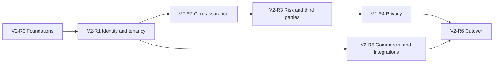

# Workstream K: Delivery plan

| | |
|---|---|
| Status | Draft for the owner's review (Phase 2); rev P5 (2026-11-24): Phase 4 additions scheduled (K-2a), V2-R0 exit corrected, deputy approver R-DEP, effort estimate referenced from K-M07, ISMS workstream K-M08 |
| Inputs | 2A to 2J, spine v2, the unified Phase 3 registers, owner answers Q-23 (no team), Q-27 (everything end to end), OQ-09 (no downgrade), owner decisions OD-01 to OD-11, design-authority rulings DA-01 to DA-15 (rev P3) |
| Rule | No implementation starts before the Phase 5 readiness gate is passed and the owner approves. |

## K-1. Delivery model

| ID | Decision | Rationale |
|---|---|---|
| K-M01 | **Ordered releases, each through its own gate.** The MVP is the full scope (Q-27), but it ships as seven releases, V2-R0 to V2-R6, and production switches to v2 only at V2-R6. | A full-scope big bang with no team is the highest delivery risk (R-05). The order keeps every release testable. |
| K-M02 | **Built behind the existing API.** v2 replaces the store and the server modules module by module, behind `/api/v1`. The v0.2.x front end keeps working against v0.2.x until cutover. | "Nothing breaks" (owner). No live data (Q-01) removes migration risk. |
| K-M03 | **People.** The two named people (R-A Management Approver, R-B CISO) approve every gate. **Deputy approver R-DEP (rev P5, P4-A3-19):** a contracted deputy who may act for R-A **or** R-B in four-eyes actions and in key-store recovery (2F F-K-48, 2H H-KS-12), never for both in the same action; the role is defined by the design authority, and the appointment and the delegation record in `SOD_MATRIX.md` are owner actions, due before the first external tenant (Phase 5 gate item 5). AI-assisted engineering writes the code. An external penetration tester and an outsourced internal auditor are bought in. | Q-23; organisation policy requires human technical, security and management review before deployment. Without a deputy, the `ks` restore, the 24/7 S1 route and FINAL-EXPORT stop when one person is unavailable (P4-A3-19). |
| K-M04 | **Feature parity is a release criterion.** Each release names the Phase 1 screens it brings to v2. None is dropped without the owner's sign-off. Signed off so far: OD-05 drops the demo card form, S-AD-04, S-ST-42 and S-RK-32 (labelled "Dropped by owner (OD-05)" in the parity ledger); OD-05 keeps S-AS-02 and fixes S-RK-23; OD-06 approves the E-DR3 role changes. The parity ledger is a gate with owner sign-off (DU-10). (rev P3) | OQ-09 |
| K-M06 | **Technical reviewer (rev P4, owner decision OD-12).** A contracted fractional senior engineer reviews the code of every release: design conformance, security-sensitive code (router, keys, authorisation), tests and migrations. Their sign-off is the "technical approver" in K-D09. They are independent of the code author (AI-assisted engineering) and of the two approvers. Closes P4-A3-18. |
| K-M07 | **Budget and stop criteria (rev P4, owner decision OD-13).** Before V2-R0 starts, the owner records a budget ceiling (people, vendors, external review, pen test) and a target date per release. A re-plan after V2-R0 is mandatory, using the measured effort. Stop or re-plan triggers: (a) V2-R0 takes more than 2× its target; (b) the isolation suite F-IT or the KS-SNAP restore drill cannot be made green within the release; (c) projected spend exceeds 80% of the ceiling before V2-R3; (d) a Critical finding stays open for more than 30 days. A trigger leads to an owner decision: continue with a revised plan, reduce scope (V2-R4 and R5 can move after launch), or stop. Closes P4-A3-17 once the owner has recorded the figures. **Rev P5:** the bottom-up estimate per release (low, likely and high person-weeks, reviewer and approver hours, external costs) and the minimum sellable subset are in [P5-effort-estimate.md](../phase5/P5-effort-estimate.md); its section 6 holds the owner fields (budget ceiling, per-release dates, scope choice). The figures are recorded **before the Phase 5 gate sign-off** (and in any case before V2-R0 starts). If trigger (c) fires, the first option is the minimum sellable subset of that document. |
| K-M08 | **ISMS workstream (rev P5, P4-A3-12).** The G-14 remediation rows (2G G-14.1 to G-14.3) are scheduled by their target release: each release gate shows the evidence of every G-14 row targeted at it (K-D10). Owners R-A (ISMS owner) and R-B. Calendar dates follow the K-M07 dates. Rows marked "pre-certification" fall after V2-R6. | P4-A3-12; G4 caveat of the Phase 5 evidence. |

## K-2. Release plan

| Release | Scope | Depends on | Exit criteria (in addition to the general Definition of Done in K-4) | Size |
|---|---|---|---|---|
| **V2-R0 Foundations** | Control-plane project `cp` and cell `c1` (2A). Two Vercel projects `app` and `console` (R2-03). Router and roles (ADR-002), with the R-56 controls (2A A-RT-10). Sessions (R2-01). Key store `ks` with its DR-region standby, 8-day key journal and **KS-SNAP** with the keep-newest hold and the deputy-capable restore roles (2F F-7.5, 2H H-9.1a, rev P5), and external KMS with the platform KEK (ADR-003, ADR-004, DA-05, DA-11). ISO-HARD a to d (2F F-4.5) (rev P5). Outbound egress controls (2H H-NW-08). Migration orchestrator and drift report (ADR-009). Tenant provisioning, suspension and deletion with certificate (2D D-12, D-12e), with the **FINAL-EXPORT** job and platform endpoints (D-12b, C-M01-20, C-PL-04) because deletion requires it (D-12b-7) (rev P5). Audit log, hash chain and hourly anchoring (ADR-013), with the **J-AUD** audit-coverage generator (2J J-3.3) (rev P5). Malware scanner (ADR-012). Backups and single-tenant restore (ADR-004). CI gates and new workflows (2H). **SLA-U measurement** from the start: external probes and the availability calculator (2H H-OB-05, 2J J-SLA), so evidence accrues before any SLA is published (rev P5). Synthetic seed. Admin Console: migrations (C-PL-21) and keys (C-PL-22). | Owner decisions OD-02 and OD-03 (decided); DU-07 for edits to existing workflows | Isolation suite F-IT-01 to F-IT-39 and ISO-HARD tests F-IT-100 to F-IT-106 green (J-ISO-01 to J-ISO-65), including the tests proving the R-56 controls (corrected, rev P5; F-SD-01). Single-tenant restore drill and crypto-shredding drill pass. `ks` standby promotion and key-journal replay drill passes, and a destroyed key is shown unrecoverable after replay. **KS-SNAP restore drill (J-KSS) passes**, with the keep-newest hold placed and released (ADR-004 V-004-10, V-004-15; 2H H-KS-09) (rev P5). J-FEX-01 to J-FEX-10 (with the completeness negative case) and J-AUD green. J-SLA calculator tests green and probes reporting. G-14 rows targeted at V2-R0 evidenced (K-M08) (rev P5). Migration rollout with a forced mid-batch failure, pause and rollback passes. Load test measures the knee `K` and sets `T` under capacity rule CR-1 (DU-01, DA-10). `cp` load test (2J H12) meets A-NFR-07a (DA-12). (rev P3) | L |
| **V2-R1 Identity and tenancy** | Account: sign-in, MFA, passkeys, recovery. Memberships and tenant switching. Tenant custom roles. Platform roles: Management Approver, CISO, support, custom roles named only from the fixed list of nine (ADR-014, OD-07). One approval engine. Delegation. Elevation. Support access. SAML/OIDC and SCIM (ADR-006); SCIM assigns only non-privileged roles, privileged assignment needs in-app four-eyes (DA-08). Tenant settings (lockout, trusted networks, session limits, brand). Help desk: tenant questions (M24, C-M24-01) and staff answers (C-PL-10). Admin Console: customers, MFA resets, platform audit log, elevation, platform security, staff and platform roles (C-PL-17/18), break-glass record (C-PL-25), jobs view (C-PL-24). First-admin invitations go by email to the invitee only (DA-09). (rev P3) **`auth` purge job D-80a** (2D, P4-A3-01) and the tenant-facing FINAL-EXPORT endpoints C-M01-23 to C-M01-26 (download, passphrase, confirmation) (rev P5). | V2-R0 | Authorization suite generated from the E-31 matrix covers every endpoint × role. SSO, SCIM and break-glass drills pass. J-AUTHER green for offboarding (rev P5). J-FEX round trip through the tenant endpoints green (rev P5). Paging drill with R-DEP standing in for one principal passes, before the first external tenant (2H H-9.3) (rev P5). G-14 rows targeted at V2-R1 evidenced (rev P5). | L |
| **V2-R2 Core assurance** | Reference releases in `ref` (ADR-011), including the per-tenant reference-content upgrade with preview and tenant approval (ADR-011 D11-6, DA-15). Frameworks, controls, tests, evidence (versions, expiry, links, files), policies (versions, approvals, attestation history, "My remarks" S-AS-02 kept under OD-05), issues, audits (auditor scope with shared items, F1-01: shared kinds control, evidence with its files, policy, risk_snapshot; no risk list; no member list or member ids, DA-07), reports, overview and My Work. (rev P3) | V2-R1 | Parity suite green for the AS screens. Auditor-scope contract tests green. (rev P3) J-AUD and J-FEX re-run with the new tables and endpoints; G-14 rows targeted at V2-R2 evidenced (rev P5). | L |
| **V2-R3 Risk and third parties** | Risk (ISO 27005: event-based and asset-based, OQ-05), vendors, vendor portal, questionnaires (one model), Trust Center (sections, NDA per person, ids, F1-02), commitments and incidents, people and access, AI governance (including the fixed AI "Risk-classify" action S-RK-23, OD-05). (rev P3) | V2-R2 | Parity suite green for the RK screens. Trust Center exposure tests green. J-AUD and J-FEX re-run with the new tables and endpoints (rev P5). | L |
| **V2-R4 Privacy** | Per-tenant RoPA (OQ-08), DPIA, DSAR with deadline clock and erasure by crypto-shredding, retention rules, legal holds, automation rules, notifications per person. Selvara RoPA and Selvara-as-controller DSAR intake (C-PL-23, G-D-07). (rev P3) | V2-R3 | DSAR end-to-end drill, including erasure reaching every `ks` copy within 8 days (DA-11). Retention purge test. Legal review of the retention periods completed (OD-08, DU-21). (rev P3) J-AUTHER green for DSAR erasure; J-AUD and J-FEX re-run; G-14 rows targeted at V2-R4 evidenced (rev P5). | M |
| **V2-R5 Commercial and integrations** | Plans, entitlements (including `db_bytes`, `byok`, `sso`, `scim`, `dedicated_cell`, DA-13) and metering (2I). Standing trial policy (OD-04). Payment adapters: bank transfer at launch and Stripe once a Stripe-eligible entity exists, behind the provider abstraction (ADR-007, OD-01). Integrations registry. API keys and webhooks. Assistant and agents with the AI provider abstraction. Company billing. Admin Console: providers (C-PL-19) and plans (C-PL-20). (rev P3) | V2-R1 (V2-R4 for AI data rules) | Limit enforcement tests green. Webhook signing and retry tests green. Egress tests green: no outbound call reaches a private or internal address (2H H-NW-08). AI provider review recorded for every enabled provider. (rev P3) SLA-U credits computed by the J-SLA calculator into billing (2I I-4.6), with the SLA-U exclusions of 2I I-4.6.4 (rev P5). | M |
| **V2-R6 Cutover** | 100% parity suite. External penetration test with findings closed or accepted. DR drill. Production switch from v0.2.x to v2. Rollback plan tested (config switch back to v0.2.x; no customer data exists yet, Q-01). | V2-R0 to V2-R5 | Phase 5 gate items re-checked. KS-SNAP drill in production passed within the last quarter. SLA-U figure confirmed against VC-13 (H-DR-I) before it is published. G-14 rows targeted at V2-R6 evidenced (management review, SoA draft). Sign-off table signed by technical, security and management approvers (and the compliance and legal reviewer, Phase 5 gate section 3) (rev P5). | M |

Sizes are relative (S, M, L); the bottom-up estimate is in [P5-effort-estimate.md](../phase5/P5-effort-estimate.md) (rev P5). No calendar is committed: the owner gave no team or timeline, and AI-assisted throughput still needs measuring. **K-M05:** after V2-R0, measure the actual time taken and re-plan the dates for R1 to R6.

### K-2a. Phase 4 additions by release (rev P5)

Every Phase 4 addition is placed in a release scope and exit (Phase 5 gate item 7; closes the G4 caveat of the Phase 5 evidence).

| Addition | Design reference | Release (scope) | Exit evidence | Re-run |
|---|---|---|---|---|
| KS-SNAP, keep-newest hold, deputy-capable restore | 2F F-7.5, F-K-47, F-K-48; 2H H-9.1a; ADR-004 | V2-R0 | J-KSS drill, V-004-10, V-004-15, V-004-16 | Quarterly (staging and production); a production drill before V2-R6 |
| ISO-HARD and tests F-IT-100 to F-IT-106 | 2F F-4.5, F-SD-01; 2J J-ISO-50 to J-ISO-65; ADR-002 | V2-R0 | Green with F-IT-01 to F-IT-39 | Every pull request |
| FINAL-EXPORT | 2D D-12b; 2C C-M01-20, C-M01-23 to C-M01-26, C-PL-04; 2J J-FEX | V2-R0 (job, platform side); V2-R1 (tenant endpoints) | J-FEX-01 to J-FEX-10 | Weekly and at each release, as tables are added |
| `auth` purge job D-80a | 2D D-80a; 2B-classification §3.1 | V2-R1 | J-AUTHER (offboarding) | V2-R4 (DSAR erasure) |
| Audit-event coverage J-AUD | 2J J-3.3 | V2-R0 (generator) | J-AUD green | Every pull request; grows with each release's endpoints |
| SLA-U measurement | 2H H-OB-05; 2I I-4.6; 2J J-SLA | V2-R0 (probes, calculator); V2-R5 (credits in billing) | J-SLA calculator tests; probe drill | Quarterly probe drill; figure confirmed at V2-R6 (VC-13) |
| ISMS remediation (G-14) | 2G G-14.1 to G-14.3 | Each row's target release (K-M08) | K-D10 | Each gate; pre-certification rows after V2-R6 |
| Deputy approver R-DEP | K-M03, K-D09; 2F F-K-48; 2H H-KS-12 | Before the first external tenant (owner appointment) | Paging drill and one KS-SNAP drill with R-DEP (V2-R1 exit; V-004-16) | Yearly |

## K-3. Project risk register (delivery)

| ID | Risk | L | I | Owner | Mitigation |
|---|---|---|---|---|---|
| R-03 | No team; approvals block or one person does everything | M | H | R-A | Two named approvers; contracted deputy approver R-DEP for either (K-M03, rev P5); automation for everything except approvals |
| R-05 | Full scope too large to deliver safely | H | H | R-A | Ordered releases with a gate each (K-M01); re-plan after V2-R0 (K-M05); bottom-up estimate and minimum sellable subset (P5-effort-estimate.md); owner to accept or treat at the Phase 5 gate (rev P5) |
| R-04 | No payment route for a Pakistan entity | H | H | R-A | OD-01; bank transfer and adapters (ADR-007) |
| R-10 | Demo-only behaviour lost (no downgrade) (master for R-59 in the Phase 3 register) | M | M | R-A | Parity suite as an exit criterion (K-M04) (rev P3) |
| R-56 | If SQL injection exists inside a routed transaction, an injected `SET ROLE` to another tenant's role **succeeds** and escapes isolation (2J; master for R-40) | L (with controls) | Critical | R-B | Prevention and detection (spine v2 S3.5, 2A A-RT-10, DA-02): only `router` issues role and context statements (lint ban, CodeQL); parameterised extended-protocol statements only, router setup included, no simple-query multi-statements; no dynamic SQL from input; pgaudit alert on role statements (DU-09); F-IT tests prove the controls. Residual inside the owner-accepted C1-01 (R-02) (rev P3) |
| R-K1 | Vendor facts in 2A, 2H, 2I and 2E are unverified (supabase.com and stripe.com were unreachable from the design session) (merged into R-06, Phase 3 register) | H | M | R-B | Verification checklist VC-01 to VC-22 completed before Phase 5 (rev P3) |
| R-K2 | Protected files must change (new workflows, `rbac.ts`, `roles.json`, edits to `ci.yml` and `release.yml`) | H | M | R-A | Approved in principle (OD-03); edits to existing workflows need DU-07; each change reviewed in its release (rev P3) |
| R-K3 | AI-written code with no in-house engineers to maintain it | M | H | R-A | Strict CI gates; human review at each gate; external pen test; documentation kept with the code |

## K-4. Definition of Done (every release)

| ID | Criterion |
|---|---|
| K-D01 | Typecheck, lint (no warnings), unit, integration (real Postgres with several tenant schemas), contract and end-to-end suites all green in CI. |
| K-D02 | The isolation suite (F-IT) and the authorization suite (E-31 matrix × endpoints) are green for every endpoint the release adds. |
| K-D03 | Security gates are green: SAST, SCA, secret scanning, Trivy, ZAP baseline. No open Critical or High findings; Medium findings have an owner and a date. |
| K-D04 | Every new field has a classification, encryption class (E0, E1, E2), retention class and deletion method (2B-classification). Every new processing activity is in Selvara's RoPA (2G). |
| K-D05 | Every new state change writes an audit entry that covers the events listed in 2F. |
| K-D06 | Migrations run through the orchestrator (canary, then batches) in staging, with a rollback rehearsed. |
| K-D07 | The parity screens named for the release pass, or each removal is signed off by the owner. |
| K-D08 | Docs updated: CHANGELOG, CONTROLS.md, SOD_MATRIX.md, and an ADR for any new significant decision. |
| K-D09 | Human sign-off: technical (the contracted reviewer, K-M06), security (R-B CISO) and management (R-A Management Approver) approvers (organisation policy). (rev P4) The deputy approver R-DEP (K-M03) may sign for R-A **or** R-B when that person is unavailable, never for both, and never for the technical approver; the principal reviews the sign-off on return (rev P5). The production gate needs a manual approval. |
| K-D10 | The G-14 ISMS rows targeted at the release have their evidence recorded (K-M08) (rev P5). |

## K-5. Deliverables, decisions required, open risks

- **Deliverables:** release plan (K-2), Phase 4 additions by release (K-2a, rev P5), delivery risks (K-3), Definition of Done (K-4); effort estimate and minimum sellable subset in `phase5/P5-effort-estimate.md` (rev P5).
- **Decisions required:** OD-01, OD-02, OD-03 and OD-05 to OD-07 were decided on 2026-11-23 (Phase 2 summary §8). Still open for delivery: DU-01 (CR-1, adopted by DA-10; confirmed at the V2-R0 exit), DU-07 (existing-workflow edits), DU-08 (load tool and perf cell), DU-10 (parity ledger gate) and DU-37 (ADR status), in `decisions-log.md`. (rev P3)
- **Open risks:** R-K2, R-K3 (new; R-K1 merged into R-06); R-03, R-04, R-05, R-10 and R-56 carried. (rev P3)
- **New assumptions** (rev P3):

| ID | Assumption | Validate by | Status |
|---|---|---|---|
| A-K1 | AI-assisted engineering can deliver V2-R0 within a timeframe the owner accepts | Measure after V2-R0 (K-M05) | Open |
| A-K2 | An external penetration tester is available before V2-R6 | Owner | Open |

- **Spine deviations:** none.
