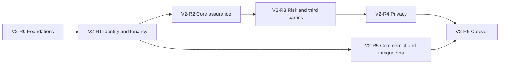

# Workstream K: Delivery plan

| | |
|---|---|
| Status | Draft for the owner's review (Phase 2) |
| Inputs | 2A to 2J, the spine, Phase 1 risks, owner answers Q-23 (no team), Q-27 (everything end to end), OQ-09 (no downgrade) |
| Rule | No implementation starts before the Phase 5 readiness gate is passed and the owner approves. |

## K-1. Delivery model

| ID | Decision | Rationale |
|---|---|---|
| K-M01 | **Ordered releases, each through its own gate.** The MVP is the full scope (Q-27), but it ships as seven releases, V2-R0 to V2-R6, and production switches to v2 only at V2-R6. | A full-scope big bang with no team is the highest delivery risk (R-05). The order keeps every release testable. |
| K-M02 | **Built behind the existing API.** v2 replaces the store and the server modules module by module, behind `/api/v1`. The v0.2.x front end keeps working against v0.2.x until cutover. | "Nothing breaks" (owner). No live data (Q-01) removes migration risk. |
| K-M03 | **People.** The two named people (R-A Management Approver, R-B CISO) approve every gate. AI-assisted engineering writes the code. An external penetration tester and an outsourced internal auditor are bought in. | Q-23; organisation policy requires human technical, security and management review before deployment. |
| K-M04 | **Feature parity is a release criterion.** Each release names the Phase 1 screens it brings to v2. None is dropped without the owner's sign-off (C-DR3, E-DR3). | OQ-09 |

## K-2. Release plan

| Release | Scope | Depends on | Exit criteria (in addition to the general Definition of Done in K-4) | Size |
|---|---|---|---|---|
| **V2-R0 Foundations** | Control-plane project `cp` and cell `c1` (2A). Router and roles (ADR-002). Sessions (R2-01). Key store `ks` and external KMS (ADR-003). Migration orchestrator and drift report (ADR-009). Tenant provisioning, suspension and deletion with certificate (2D). Audit log, hash chain and hourly anchoring (ADR-013). Malware scanner (ADR-012). Backups and single-tenant restore (ADR-004). CI gates and new workflows (2H). Synthetic seed. | Owner decisions OD-02 and OD-03 | Isolation suite F-IT-01 to F-IT-37 green. Single-tenant restore drill and crypto-shredding drill pass. Migration rollout with a forced mid-batch failure, pause and rollback passes. Load test sets the new-cell threshold (2J). | L |
| **V2-R1 Identity and tenancy** | Account: sign-in, MFA, passkeys, recovery. Memberships and tenant switching. Tenant custom roles. Platform roles: Management Approver, CISO, custom roles from predefined names (ADR-014). One approval engine. Delegation. Elevation. Support access. SAML/OIDC and SCIM (ADR-006). Admin Console: customers, MFA resets, platform audit log, elevation, platform security. | V2-R0 | Authorization suite generated from the E-31 matrix covers every endpoint × role. SSO, SCIM and break-glass drills pass. | L |
| **V2-R2 Core assurance** | Reference releases in `ref` (ADR-011). Frameworks, controls, tests, evidence (versions, expiry, links, files), policies (versions, approvals, attestation history), issues, audits (auditor scope with shared items, F1-01), reports, overview and My Work. | V2-R1 | Parity suite green for the AS screens. Auditor-scope contract tests green. | L |
| **V2-R3 Risk and third parties** | Risk (ISO 27005: event-based and asset-based, OQ-05), vendors, vendor portal, questionnaires (one model), Trust Center (sections, NDA per person, ids, F1-02), commitments and incidents, people and access, AI governance. | V2-R2 | Parity suite green for the RK screens. Trust Center exposure tests green. | L |
| **V2-R4 Privacy** | Per-tenant RoPA (OQ-08), DPIA, DSAR with deadline clock and erasure by crypto-shredding, retention rules, legal holds, automation rules, notifications per person. | V2-R3 | DSAR end-to-end drill, including erasure reaching backups once the key-store backups expire. Retention purge test. Legal review of the retention periods completed (OD-08). | M |
| **V2-R5 Commercial and integrations** | Plans, entitlements and metering (2I). Payment adapters: Stripe and bank transfer, behind the provider abstraction (ADR-007, OD-01). Integrations registry. API keys and webhooks. Assistant and agents with the AI provider abstraction. Company billing. | V2-R1 (V2-R4 for AI data rules) | Limit enforcement tests green. Webhook signing and retry tests green. AI provider review recorded for every enabled provider. | M |
| **V2-R6 Cutover** | 100% parity suite. External penetration test with findings closed or accepted. DR drill. Production switch from v0.2.x to v2. Rollback plan tested (config switch back to v0.2.x; no customer data exists yet, Q-01). | V2-R0 to V2-R5 | Phase 5 gate items re-checked. Sign-off table signed by technical, security and management approvers. | M |

Sizes are relative (S, M, L). No calendar is committed: the owner gave no team or timeline, and AI-assisted throughput still needs measuring. **K-M05:** after V2-R0, measure the actual time taken and re-plan the dates for R1 to R6.

## K-3. Project risk register (delivery)

| ID | Risk | L | I | Owner | Mitigation |
|---|---|---|---|---|---|
| R-03 | No team; approvals block or one person does everything | M | H | R-A | Two named approvers; automation for everything except approvals |
| R-05 | Full scope too large to deliver safely | H | H | R-A | Ordered releases with a gate each (K-M01); re-plan after V2-R0 (K-M05) |
| R-04 | No payment route for a Pakistan entity | H | H | R-A | OD-01; bank transfer and adapters (ADR-007) |
| R-10 | Demo-only behaviour lost (no downgrade) | M | M | R-A | Parity suite as an exit criterion (K-M04) |
| R-56 | `SET ROLE` injection inside a routed transaction escapes isolation (2J) | L | Critical | R-B | One `router` module issues `SET ROLE` (spine S3); parameterised queries only; lint ban; test F-IT; pgaudit alert on role statements (2F) |
| R-K1 | Vendor facts in 2A, 2H, 2I and 2E are unverified (supabase.com and stripe.com were unreachable from the design session) | H | M | R-B | Verification checklist VC-01 to VC-12 (Phase 2 summary) completed before Phase 5 |
| R-K2 | Protected files must change (new workflows, `rbac.ts`, `roles.json`) | H | M | R-A | Explicit owner approval per release (OD-03) |
| R-K3 | AI-written code with no in-house engineers to maintain it | M | H | R-A | Strict CI gates; human review at each gate; external pen test; documentation kept with the code |

## K-4. Definition of Done (every release)

| ID | Criterion |
|---|---|
| K-D01 | Typecheck, lint (no warnings), unit, integration (real Postgres with several tenant schemas), contract and end-to-end suites all green in CI. |
| K-D02 | The isolation suite (F-IT) and the authorization suite (E-31 matrix × endpoints) are green for every endpoint the release adds. |
| K-D03 | Security gates are green: SAST, SCA, secret scanning, Trivy, ZAP baseline. No open Critical or High findings; Medium findings have an owner and a date. |
| K-D04 | Every new field has a classification, encryption class (E0, E1, E2), retention class and deletion method (2B-classification). Every new processing activity is in Selvara's RoPA (2G). |
| K-D05 | Every new state change writes an audit entry that covers the events listed in 2F. |
| K-D06 | Migrations run through the orchestrator (canary, then batches) in staging, with a rollback rehearsed. |
| K-D07 | The parity screens named for the release pass, or each removal is signed off by the owner. |
| K-D08 | Docs updated: CHANGELOG, CONTROLS.md, SOD_MATRIX.md, and an ADR for any new significant decision. |
| K-D09 | Human sign-off: technical, security and management approvers (organisation policy). The production gate needs a manual approval. |

## K-5. Deliverables, decisions required, open risks

- **Deliverables:** release plan (K-2), delivery risks (K-3), Definition of Done (K-4).
- **Decisions required:** OD-01, OD-02, OD-03 and OD-05 to OD-07 (Phase 2 summary).
- **Open risks:** R-K1 to R-K3 (new); R-03, R-04, R-05, R-10 and R-56 carried.
- **New assumptions:**
  - A-K1: AI-assisted engineering can deliver V2-R0 within a timeframe the owner accepts. Validate by measuring after V2-R0 (K-M05).
  - A-K2: an external penetration tester is available before V2-R6.
- **Spine deviations:** none.
