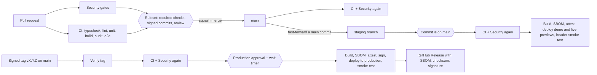

# CI/CD pipeline

How Selvara's front-end is tested, scanned, built, attested and deployed, and what you must configure once for it to work.

> **Status:** the workflows, scripts and policy files are in the repository and their logic is tested locally (see [What has and has not been proven](#what-has-and-has-not-been-proven)). The deployment half has not run against a real Vercel project yet, because it needs secrets that only you can create.

## Design in one paragraph

Every change reaches production only through GitHub Actions. Pull requests run quality and security gates. A merge to `main` re-runs them. Moving the `staging` branch to a `main` commit re-runs them and deploys two **staging** previews (demo and live). A **signed version tag** on `main` re-runs them again and deploys to **production** after an approval in a protected environment. The site is built once in CI, packaged as a deterministic archive, given an SBOM, a build-provenance attestation and a signature, and the deployed bytes are extracted from that exact archive. Vercel's own Git deploys are switched off, so there is no second, unguarded path.



## Workflows

| File | Trigger | What it does |
|---|---|---|
| `.github/workflows/ci.yml` | pull request; reused by staging and release | Typecheck, lint, unit tests, build, `npm audit`, Playwright end-to-end suite. Installs with `--ignore-scripts`. |
| `.github/workflows/security.yml` | pull request, weekly, reused by staging and release | Workflow policy, CodeQL, Gitleaks, dependency review, licence policy, OSV, Trivy, ZAP baseline. |
| `.github/workflows/deploy-staging.yml` | push to `main` or `staging` | CI + Security. On `staging` only, after checking the commit is already on `main`: deploys two Vercel preview deployments to the `staging` environment, **Staging demo** (demonstration build) and **Staging live** (production build on the staging database, when `STAGING_LIVE_ENABLED` is `true`). |
| `.github/workflows/release.yml` | push of a `vX.Y.Z` tag | Verifies the signed tag, CI + Security, deploys to `production` after approval, publishes a GitHub Release. |
| `.github/actions/deploy/action.yml` | used only by the two above (a local composite action) | Build, package, SBOM, attestations, signature, deploy the attested archive, smoke test. |

## What blocks what

Policy: **High and Critical findings block; Medium and below are reported.**

| Gate | Blocks | Source of truth |
|---|---|---|
| Typecheck, lint, unit tests, build | merge and deploy | `ci.yml` |
| End-to-end suite (all routes, access matrix, gates, injection, vendor portal, headers) | merge and deploy | `ci.yml`, `front-end/e2e` |
| `npm audit` production dependencies, High and above | merge and deploy | `ci.yml` |
| Workflow policy (pinned actions, permissions, no `pull_request_target`, no script injection, timeouts, no persisted credentials) | merge and deploy | `.github/scripts/check-workflows.mjs` |
| CodeQL static analysis (High or Critical fail the job; SARIF kept as an artefact) | merge and deploy | `security.yml`, `.github/scripts/check-sarif.mjs` |
| Gitleaks secret scan (full history) | merge and deploy | `security.yml`, `.gitleaks.toml` |
| Dependency review: `npm audit` of runtime dependencies, High and above (copyleft licences are in the licence policy row) | merge and deploy | `security.yml` |
| Licence policy over the whole product lockfile | merge and deploy | `.github/license-policy.json` |
| Trivy filesystem scan (fixable High and Critical, misconfiguration, secrets) | merge and deploy | `security.yml` |
| ZAP baseline against the production build (any High alert) | merge and deploy | `.github/scripts/zap-gate.mjs` |
| OSV scan | reported only (it cannot filter by severity); report kept as an artefact | `security.yml` |
| Smoke test of security headers on the live deployment | the deployment is marked failed | `.github/scripts/smoke-headers.sh` |

## One-time setup

1. **Apply repository settings.** Run the dry run first, read it, then apply (needs admin rights; run by a person, never by CI):

   ```bash
   .github/scripts/apply-settings.sh            # prints every API call
   .github/scripts/apply-settings.sh --apply
   ```

   It sets squash-only merging, secret scanning with push protection, Dependabot alerts, a read-only default workflow token, an allow-list of third-party actions with SHA pinning required, the `staging` and `production` environments, and the two rulesets in `.github/rulesets/`.
2. **Create the Vercel project** with *Root Directory* `front-end`. Git auto-deploy is already disabled by `front-end/vercel.json`.
3. **Add secrets and variables** (Settings > Environments). Never paste a token into chat, an issue or a commit.

   | Where | Name | Type | Notes |
   |---|---|---|---|
   | `staging` and `production` | `VERCEL_TOKEN` | secret | A separate token per environment, team-scoped, with an expiry. |
   | both | `VERCEL_ORG_ID`, `VERCEL_PROJECT_ID` | variable | From `.vercel/project.json` after `vercel link`. |
   | both (optional) | `VERCEL_AUTOMATION_BYPASS_SECRET` | secret | Lets the smoke test reach a deployment protected by Vercel Authentication. |
   | `staging` (optional) | `STAGING_DEMO_ALIAS` | variable | A stable hostname for the demo preview, for example `demo.example.com`. |
   | `staging` (optional) | `STAGING_ALIAS` | variable | A stable hostname for the live preview, for example `staging.example.com`. |
   | `staging` (optional) | `STAGING_LIVE_ENABLED` | variable | `true` once the staging Supabase project and the Vercel **Preview** variables exist ([SUPABASE.md](../guides/SUPABASE.md) section 4i). Until then only the demo preview deploys. |
   | repository (Settings > Variables) | `DEPLOY_ENABLED` | variable | Set to `true` once the rows above exist. Until then pushes run CI and the security gates but skip the staging deployments. |
   | either (optional) | `ATTESTATIONS_ENABLED` | variable | Set to `false` to switch off provenance attestations (needed if your GitHub plan does not support them for private repositories). |
   | `production` (optional) | `API_MODE` | variable | `http` builds the production app on live company data through `/api`; unset or `mock` builds the demonstration. Any other value fails the deploy. Staging does not read it: its demo preview is always the demonstration and its live preview always `http`. Public: it ends up in the browser code as `NEXT_PUBLIC_API_MODE`. Vercel's own variables of that name have no effect, because the build runs here. |
   | either (optional) | `COSIGN_ENABLED` | variable | **Off by default.** Set to `true` to add a keyless Sigstore signature, which publishes the repository name and workflow identity to the public Sigstore log. |

4. **Set up commit signing** (see [Commit signing](#commit-signing)).
5. **Switch deployment on** by setting the repository variable `DEPLOY_ENABLED=true`.
6. **Open a first pull request** so that every job runs once. Required status checks only appear in the ruleset UI after they have run, and the scanners may surface a first backlog.

## Branch and tag protection

> **Plan note.** Rulesets and environment approvals need a paid GitHub plan on private repositories. On the free plan `apply-settings.sh` skips them and says so; the working rules until you upgrade are in [EXCEPTIONS.md](EXCEPTIONS.md) EX-08.

`.github/rulesets/main.json` requires, on `main`: pull requests only, one approving review from a code owner who did not push last, stale approvals dismissed on push, conversations resolved, squash merge only, linear history, **signed commits**, no force push and no deletion, ten required status checks that must be up to date, and the required checks below. There is no code-scanning rule, because that needs GitHub Advanced Security (see EX-07 in [EXCEPTIONS.md](EXCEPTIONS.md)): CodeQL is a required check that gates on its own results instead.

`.github/rulesets/release-tags.json` makes `v*` tags creatable only by repository admins and immutable (no update, delete or move).

### Sole-maintainer exception

There is currently one maintainer, so "approval from someone other than the author" cannot be met by anyone but an admin. Both rulesets therefore list the **repository admin role as a bypass actor, limited to pull requests** for `main`. In practice: you open a pull request, every required check still has to pass, and you may merge it yourself. It is visible in the audit log every time it is used.

Likewise the `production` environment lists you as the only reviewer with *prevent self-review* off and a ten-minute wait timer. This is a **documented exception that would fail a strict segregation-of-duties review**. It is meant to be temporary:

- When a second maintainer exists, add them to `CODEOWNERS`, add them as a production reviewer, set `prevent_self_review` to `true` in `apply-settings.sh`, and remove the bypass actor from both rulesets.
- For regulated customers, require two production approvers.

## Commit signing

`required_signatures` rejects unsigned commits on `main`. Because only squash merging is allowed, GitHub creates the merge commit itself and signs it, so pull-request branches may contain unsigned commits. Each person who pushes release **tags** must sign them: `git tag -s vX.Y.Z -m "vX.Y.Z"` with a key that is registered as a signing key on their GitHub account. Commits created by automation in some environments show as *Unverified*; that does not block a squash merge but would block a direct push to `main` (which the ruleset forbids anyway).

### Setting up your own signing key (SSH signing, about five minutes)

Use a dedicated key just for signing. Do this on the machine where you commit and tag.

```bash
# 1. create the key (use a passphrase; a hardware key is even better: ssh-keygen -t ed25519-sk)
ssh-keygen -t ed25519 -C "<the email verified on your GitHub account>" -f ~/.ssh/id_ed25519_signing

# 2. tell git to sign everything with it
git config --global gpg.format ssh
git config --global user.signingkey ~/.ssh/id_ed25519_signing.pub
git config --global commit.gpgsign true
git config --global tag.gpgsign true

# 3. let git verify signatures locally
echo "<your-email> $(cat ~/.ssh/id_ed25519_signing.pub)" >> ~/.ssh/allowed_signers
git config --global gpg.ssh.allowedSignersFile ~/.ssh/allowed_signers
```

4. On GitHub: **Settings > SSH and GPG keys > New SSH key**, set **Key type: Signing Key**, paste the contents of `~/.ssh/id_ed25519_signing.pub`. (Adding the key only as an *authentication* key does not make commits verified.)
5. Optional but recommended: on the same page enable **Vigilant mode** ("Flag unsigned commits as unverified"), so any unsigned commit under your name is visible.
6. Check it: `git commit --allow-empty -m "test signing" && git log --show-signature -1` should say *Good "git" signature*, and the commit shows **Verified** on GitHub after you push.

Commits made by automation in cloud or sandbox environments cannot use your key and show as *Unverified*. That is why `main` only accepts squash merges: GitHub creates and signs the merge commit itself.

### Vercel setup: where each value goes

Do these once, in this order. Create tokens yourself and paste them only into GitHub's secret form, never into a chat, an issue or a file in the repository.

| # | Where | What to do |
|---|---|---|
| 1 | **Vercel** > Add New > Project | Import this repository. Set **Root Directory** to `front-end`, framework **Next.js**. Do not rely on its automatic deployments: `front-end/vercel.json` already disables them. |
| 2 | **Vercel** > Team Settings > General, and Project Settings > General | Copy the **Team ID** (this is `VERCEL_ORG_ID`) and the **Project ID** (`VERCEL_PROJECT_ID`). For a personal account the Team ID is shown under Account Settings. |
| 3 | **Vercel** > Account Settings > Tokens > Create | Create **two** tokens, one named for staging and one for production. Scope them to your team, give each an expiry (for example 90 days) and note the renewal date. Copy each once. |
| 4 | **GitHub** > repo > Settings > Environments > `staging` | *Add environment secret* `VERCEL_TOKEN` (the staging token). *Add environment variables* `VERCEL_ORG_ID` and `VERCEL_PROJECT_ID`. (`apply-settings.sh` creates the environments if they do not exist yet.) |
| 5 | **GitHub** > Settings > Environments > `production` | Same three entries, with the **production** token. |
| 6 | **GitHub** > Settings > Secrets and variables > Actions > **Variables** tab > New repository variable | `DEPLOY_ENABLED` = `true`. Until this exists, merges to `main` run CI and the security gates but skip the staging deployment. |
| 7 (optional) | **Vercel** > Project > Settings > Deployment Protection > *Protection Bypass for Automation* | Generate the secret, then add it as environment secret `VERCEL_AUTOMATION_BYPASS_SECRET` in both GitHub environments. Needed only if the deployment is behind Vercel Authentication, otherwise the smoke test receives a 401 and fails on purpose. |
| 8 (optional) | **GitHub** > Environments > `staging` > Variables | `STAGING_DEMO_ALIAS` and `STAGING_ALIAS` = stable hostnames such as `demo.example.com` and `staging.example.com` (each must already be assigned to the Vercel project as a domain). |
| 9 | **GitHub** > Environments > `staging` > Deployment branches and tags | Add the branch `staging` (keep `main`). If the environment is limited to `main`, the staging deploy jobs are refused. |
| 10 | **GitHub** > Settings > Rules > Rulesets > New branch ruleset | Name `staging-protection`, target branch `staging`, rules: *Restrict deletions*, *Block force pushes*, *Require signed commits*. Staging then only ever moves forward. |

Where is each value read? `DEPLOY_ENABLED` in `deploy-staging.yml`; the secrets and variables are read by the deploy job in `deploy-staging.yml` / `release.yml` (which declares the environment) and handed to `.github/actions/deploy`. The first step of the action, *Check deploy credentials are present*, prints `true`/`false` for each (never a value) and fails at once if `VERCEL_TOKEN` is missing.

> **Why a composite action and not a reusable workflow?** A job that calls a reusable workflow cannot declare an environment, and secrets of an environment are only available to a job that does. The first design used a reusable workflow and the deploy job saw `VERCEL_TOKEN` as empty although it was correctly set in the environment (found on 2026-11-09). Variables of the environment did arrive; secrets did not.

## Releasing

```bash
# 1. bump front-end/package.json "version" through a normal pull request and merge it
# 2. tag the merge commit on main with a SIGNED, annotated tag and push it
git checkout main && git pull
git tag -s v1.2.3 -m "v1.2.3"
git push origin v1.2.3
```

`release.yml` then verifies that the tag is annotated, that GitHub reports its signature as verified, that its commit is on `main`, and that the tag equals the `package.json` version. After CI and the security gates pass, the production deployment **waits for approval** in the `production` environment. A reviewer should open the run first and check that every gate is green. After deployment the GitHub Release is created with the SBOM, the checksum and the signature.

**Rollback:** promote the previous deployment from the Vercel dashboard, or tag a new patch release. Do not delete or move tags (the ruleset prevents it).

## Verifying an artefact

Anyone can check that a release archive was built by this repository's workflow from the commit it claims:

```bash
# build provenance (GitHub artifact attestation)
gh attestation verify selvara-frontend-v1.2.3.tar.gz --repo ShahidCS/Selvara
# checksum
sha256sum -c selvara-frontend-v1.2.3.tar.gz.sha256
# keyless signature (Sigstore). Only present if COSIGN_ENABLED=true was set for that release
cosign verify-blob selvara-frontend-v1.2.3.tar.gz \
  --bundle selvara-frontend-v1.2.3.tar.gz.cosign.bundle \
  --certificate-identity-regexp '^https://github.com/ShahidCS/Selvara/\.github/workflows/(deploy|release)\.yml@refs/tags/v' \
  --certificate-oidc-issuer https://token.actions.githubusercontent.com
```

## Hardening applied to the pipeline itself

- Every action is pinned to a **full commit SHA** with a version comment; `.github/scripts/verify-pins.sh` checks each SHA against the upstream tag, and Dependabot updates pins and comments together, after a seven-day cooldown.
- Top-level `permissions: {}`; each job grants only what it needs. Only the final release job can write repository contents.
- No `pull_request_target`; no `${{ github.event.* }}`, `head_ref`, `ref_name` or inputs interpolated into shell (values go through `env:`); inputs to the deploy workflow are validated against strict patterns.
- `persist-credentials: false` on every checkout; `npm ci --ignore-scripts` everywhere, so dependency install scripts never run.
- The deploy token is scoped to its environment and handed only to the single deploy step. The build runs with no secrets at all (the project link is written from non-secret variables), so neither the Vercel CLI builders nor third-party actions ever see it.
- The Vercel CLI is installed from its own lockfile in `.github/vercel-cli`, apart from the application's dependencies, with same-major `overrides` for patched transitive packages. The required check "Deploy tooling audit" blocks any new High/Critical advisory in that tree (accepted ones are in `audit-baseline.json` with an expiry date).
- `check-shipped-artifact.mjs` fails the build if the shipped output contains `node_modules`, native addons or sharp/libvips, which is what the licence exceptions rely on. Server functions are allowed only from its reviewed list (today the authentication API); each bundle is checked file by file, may hold no secret files, and may only contain permissively licensed packages. A new function fails the build until it is reviewed and added to the list. `THIRD_PARTY_NOTICES.md` is generated from the lockfile and checked in CI.
- The build is deterministic (sorted, zero-timestamp archive); the deploy step re-verifies the checksum and deploys the extracted archive, so the deployed bytes are the attested bytes.
- Concurrency groups stop superseded pull-request runs but never interrupt a deployment half way.

### Mapping to common frameworks (a mapping, not a certification)

| OWASP Top 10 CI/CD risk | Control here |
|---|---|
| CICD-SEC-1 Insufficient flow control | Rulesets, required checks, protected environments, signed tags, wait timer |
| CICD-SEC-2 Inadequate identity and access | CODEOWNERS, minimal bypass actors, no standing deploy rights in CI jobs |
| CICD-SEC-3 Dependency chain abuse | SHA pins, lockfiles, `--ignore-scripts`, Dependabot cooldown, dependency review, OSV, licence policy |
| CICD-SEC-4 Poisoned pipeline execution | No `pull_request_target`, workflow policy gate, no script injection |
| CICD-SEC-5 Insufficient pipeline access controls | `permissions: {}` with per-job grants, read-only default token |
| CICD-SEC-6 Insufficient credential hygiene | Environment-scoped secrets, step-level scoping, Gitleaks and push protection, OIDC for signing and attestations |
| CICD-SEC-7 Insecure system configuration | Allow-listed actions, SHA pinning required, ephemeral hosted runners |
| CICD-SEC-8 Ungoverned third-party services | Action allow-list, pinned and verified versions |
| CICD-SEC-9 Improper artefact integrity validation | SHA-256 checksum verified before deploy, deterministic archive, SBOM, deploy-from-the-verified-archive; build-provenance attestations and cosign signature are supported but currently off (EX-09, EX-06) |
| CICD-SEC-10 Insufficient logging and visibility | Run logs and job summaries, 90-day evidence artefacts, release assets, repository audit log |

The build runs on GitHub-hosted runners and emits signed provenance, which is the intent of SLSA Build level 2. It does not claim a higher level.

## Accepted risks

The full register, with owners, compensating controls, expiry dates and exit criteria, is [EXCEPTIONS.md](EXCEPTIONS.md). Summary:

| Risk | Why accepted | Controls | Review when |
|---|---|---|---|
| The pinned Vercel CLI's transitive dependencies still carry 11 baselined High advisories (no Critical) after overrides, because Vercel pins them exactly (EX-04). | The CLI only processes our own build output on an ephemeral runner; forcing overrides into a CLI that cannot be tested here could break deployments silently. | Isolated install, `--ignore-scripts`, token only in the deploy step, "Deploy tooling audit" blocks new advisories, expiring baseline. | Each Vercel CLI release; monthly. |
| `script-src 'unsafe-inline'` in the CSP (Pages Router injects inline bootstrap scripts). | No nonce middleware yet. | CSP otherwise strict; documented in `docs/security/SECURITY.md`; the smoke test asserts no `unsafe-eval`. | Before production traffic: move to a nonce-based CSP. |
| LGPL-3.0 optional native binaries (`@img/sharp-*`) in the lockfile. | Unused (no `next/image`), dynamically linked, unmodified. | Time-boxed exception in `.github/license-policy.json`. | Exception expiry (2027-05-09) and before distributing the build. |
| Keyless Sigstore signing would write the repository name and workflow identity to the public Sigstore log. | **Decision (owner): off.** Signing is opt-in (`COSIGN_ENABLED=true`). Integrity and origin evidence still come from GitHub's private artifact attestations and the SHA-256 checksum. | Default off in `.github/actions/deploy/action.yml`. | Decision on repository visibility, or if a customer requires a detached signature. |
| ZAP baseline is a passive scan. | Active scanning needs a safe, isolated target. | Fails on High; weekly schedule. | When a staging data set exists, add an authenticated active scan. |
| Sole-maintainer review exception. | Only one maintainer exists. | Required checks still apply; bypass is pull-request-only and audited. | A second maintainer joins. |

## Operations

- **Rotate `VERCEL_TOKEN`:** create the new token in Vercel, update the environment secret, run the staging workflow manually (*Actions > Deploy staging > Run workflow*), then revoke the old token.
- **A required check is stuck "Expected":** its job name changed. Job names are the check names; keep them in sync with `.github/rulesets/main.json` (the setup checklist and a local script comparison guard this).
- **A pinned action needs updating:** accept the Dependabot pull request, then run `.github/scripts/verify-pins.sh`.
- **Break glass:** repository admins can bypass the main ruleset through a pull request only. Every use appears in the audit log; record the reason in the pull request.
- **Licence exception expired:** `check-licenses.mjs` fails on purpose. Re-assess the package, then extend `review_by` in a reviewed pull request, or remove the dependency.

## What has and has not been proven

**Proven on GitHub and Vercel (2026-11-09, pull requests 11 to 16 and Deploy staging run 10):**
- Every gate runs and passes on a pull request and on `main`: typecheck, lint, unit tests, build, the shipped-output check, the third-party notices check, the runtime dependency audit, Playwright, workflow policy, CodeQL (gated on its own SARIF), Gitleaks (including a full-history scan), licence policy, deploy-tooling audit, Trivy and the ZAP baseline.
- Staging deployment end to end: the Vercel build with no secrets, the shipped-output check, the deterministic archive and SBOM, then deploying exactly that checksum-verified archive to Vercel and a smoke test of the live security headers. The token reaches only the deploy step (it shows as `***`).
- The credential presence check (true/false per credential, never a value) and its fail-fast message.
- `apply-settings.sh` against the live API, including its fallbacks on a plan without environment protection or rulesets.

**Found and fixed by the first real runs** (each is why a documented step exists): the Actions allow-list also needs `aquasecurity/setup-trivy`; a manual full-history Gitleaks scan flagged two lists of known-weak passwords (allow-listed by path); artifact attestations are refused for user-owned private repositories (EX-09); and secrets of an environment do not reach a job that calls a reusable workflow, so the deploy is a local composite action called from a job that declares the environment.

**Proven locally:** the workflow policy checker (workflows and the local action; catches seven classes of violation on a deliberately bad file); every SHA pin against its upstream tag (39 pins); the licence gate; the ZAP gate; the SARIF gate; the release-tag gate (accepts a valid tag and rejects five invalid scenarios, using a stubbed `gh`); the smoke test; required-check names match real job names; all workflows parse as valid YAML and pass `@action-validator/cli` 0.6.0 (whose bundled schema predates the documented `attestations: write` permission, so that one key is reported and is the only thing it reports); typecheck, unit tests and the build with install scripts disabled.

**Not yet proven:**
- **The production release path:** `verify-tag.sh` against a real signed tag, the `release.yml` workflow, the `production` environment, and the `publish` job that creates the GitHub Release. Cut a first release from a signed tag and read the run before relying on it.
- **Build provenance and SBOM attestations, and cosign signing:** both are off (EX-09, EX-06), so `gh attestation verify` does not apply yet.
- **The staging aliases** (`STAGING_DEMO_ALIAS`, `STAGING_ALIAS`) and the **live staging preview**, which are unused so far.
- **Rulesets, branch protection and the production approval step:** GitHub refuses them on this plan (EX-08), so none of their effects are proven.
- **Commit-signing enforcement,** which depends on those rulesets.
- **Merging Dependabot pull requests and the weekly scheduled security run.** Dependabot is running (it has opened pull requests for the application's development dependencies), but none has been reviewed or merged through this pipeline yet; the major-version bumps (TypeScript, Tailwind, ESLint) each need their own review.

## Staging branch and previews

`staging` is a pointer, not a place to commit: it is moved forward to a commit that is already on `main`, and every move deploys that exact commit as two Vercel **preview** deployments (never production).

| Preview | Build | Data | Use |
|---|---|---|---|
| **Staging demo** | demonstration (`API_MODE` mock) | synthetic, in the browser; demo personas | demos to customers and colleagues |
| **Staging live** | production build (`API_MODE` http) | the **staging** Supabase project, synthetic data only | testing a release on the real server before it is tagged |

Move staging to the latest `main` (or to any earlier `main` commit to demo that version):

```bash
git fetch origin main && git push origin origin/main:staging
```

The first push creates the branch. A push of a commit that is not on `main` deploys nothing: the job *Staging commit is on main* fails. The release to production is unchanged: a signed tag on `main`.

**For demos**, Vercel usually protects preview deployments with Vercel Authentication, so a visitor without access to the Vercel team sees a Vercel sign-in page. Check Project > Settings > Deployment Protection. To show the demo preview to outsiders, use a Vercel *shareable link* for that deployment, or a protection exception for the `STAGING_DEMO_ALIAS` domain where your Vercel plan offers it. Keep the live preview protected. The demo build has no real data, but it is still a deployment of the full app.

